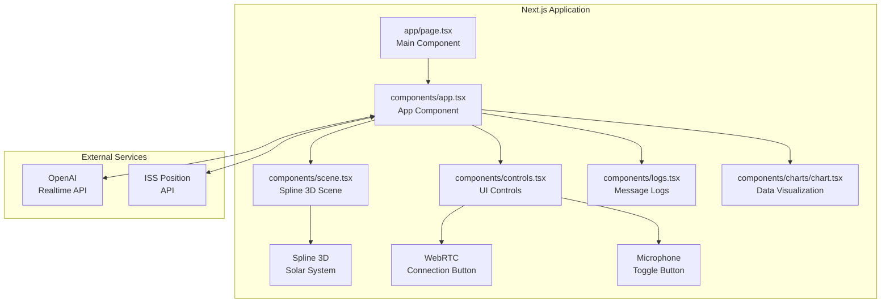
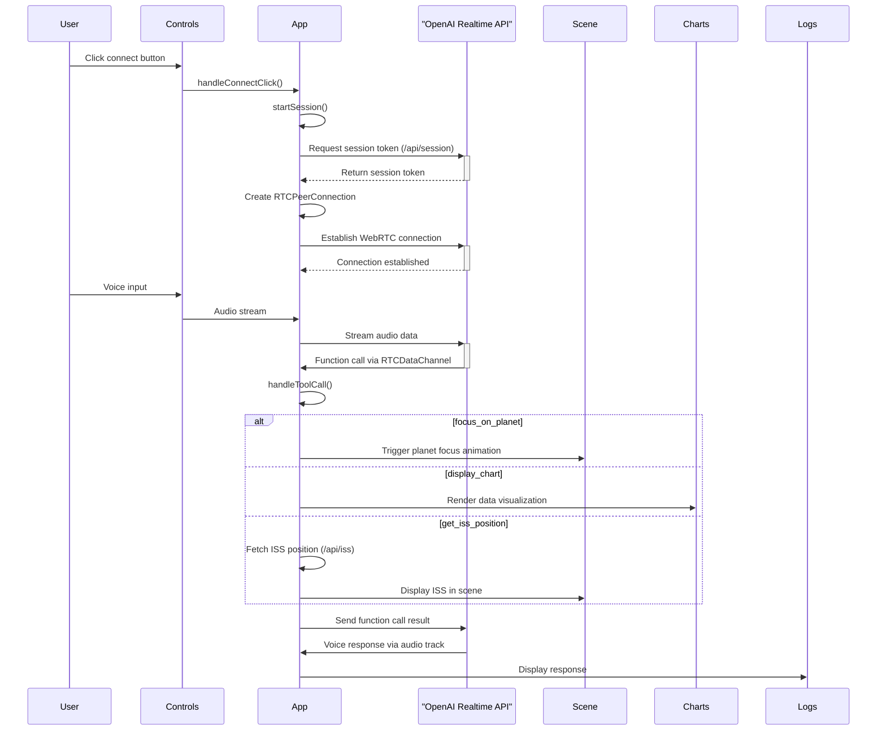
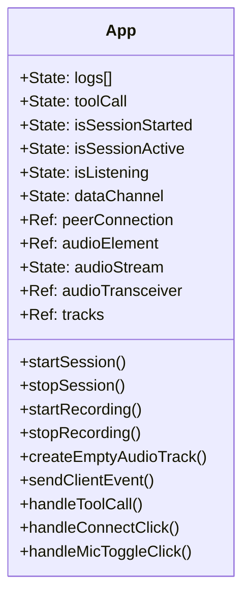
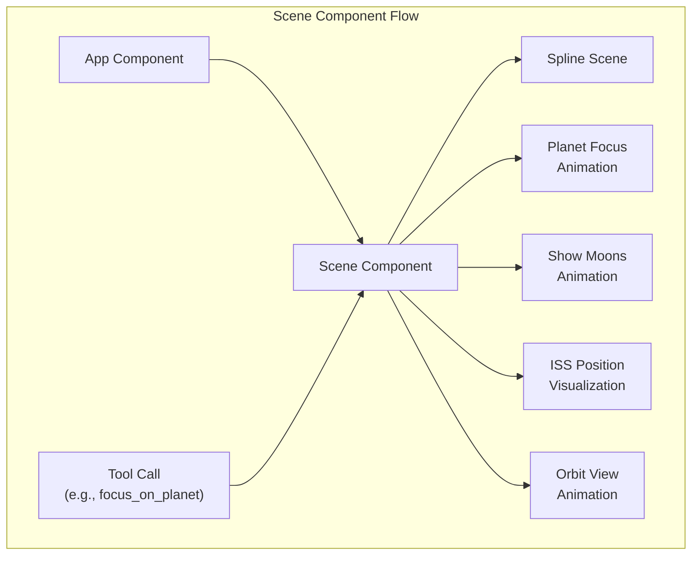
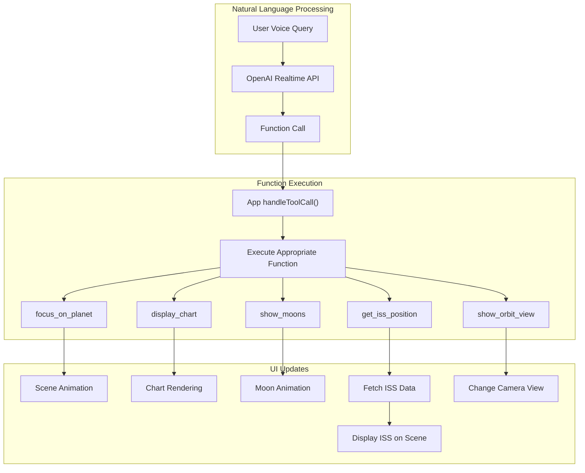

<!-- source: DeepWiki mcp.deepwiki.com · repo openai/openai-realtime-solar-system · page 3 Core Components · fetched 2026-10-26 -->

# Core Components

Relevant source files

The following files were used as context for generating this wiki page:

- [README.md](README.md)
- [app/page.tsx](app/page.tsx)
- [components/app.tsx](components/app.tsx)

This page provides an overview of the main components that form the OpenAI Realtime Solar System Demo application. These components work together to create an interactive voice-controlled experience that demonstrates the capabilities of the OpenAI Realtime API in conjunction with a 3D visualization of our solar system.

For details on the high-level system architecture, see [System Architecture](#2). For specifics about WebRTC integration, see [WebRTC Integration](#2.1).

## Component Architecture Overview

The OpenAI Realtime Solar System Demo is built with a modular component structure centered around a main App component that orchestrates the various parts of the system.

Sources: [app/page.tsx:1-9](), [components/app.tsx:1-301](), [README.md:1-131]()

## Main Component Roles

The application consists of several key components, each with a specific responsibility:

| Component | File | Primary Responsibility |
|-----------|------|------------------------|
| Main | app/page.tsx | Entry point for the Next.js application |
| App | components/app.tsx | Orchestrates WebRTC sessions, manages state, handles tool calls |
| Scene | components/scene.tsx | Renders and controls the 3D Spline solar system scene |
| Controls | components/controls.tsx | Provides UI for starting/stopping sessions and toggling microphone |
| Logs | components/logs.tsx | Displays conversation history and model responses |
| Charts | components/charts/chart.tsx | Renders data visualizations when requested |

Sources: [app/page.tsx:1-9](), [components/app.tsx:4-6](), [components/app.tsx:290-301]()

## Component Data Flow

The following diagram illustrates how data flows between components during a typical user interaction:

Sources: [components/app.tsx:30-301](), [README.md:71-86]()

## App Component

The App component is the central hub of the application, managing:

1. WebRTC connection with the OpenAI Realtime API
2. Audio input/output streams
3. Session state management
4. Function call processing
5. Communication between UI components

### Internal Structure

The App component handles several crucial functions:

1. **Session Management**: Creating and maintaining WebRTC connections for real-time communication with the OpenAI API
   - `startSession()` [components/app.tsx:30-96]()
   - `stopSession()` [components/app.tsx:99-117]()

2. **Audio Handling**: Managing microphone input for user voice queries
   - `startRecording()` [components/app.tsx:120-147]()
   - `stopRecording()` [components/app.tsx:151-167]()
   - `createEmptyAudioTrack()` [components/app.tsx:170-174]()

3. **Data Channel Communication**: Sending and receiving messages via WebRTC data channel
   - `sendClientEvent()` [components/app.tsx:177-190]()

4. **Tool Call Handling**: Processing function calls from the OpenAI API
   - `handleToolCall()` [components/app.tsx:194-235]()

Sources: [components/app.tsx:15-301]()

## Scene Component

The Scene component integrates a 3D solar system visualization built with Spline. It receives tool calls from the App component and triggers appropriate animations or visual changes in the scene.

The Scene component is responsible for:
1. Loading and rendering the Spline 3D scene
2. Processing tool calls to trigger animations
3. Handling various user interactions with the solar system visualization

Sources: [components/app.tsx:291](), [README.md:74-86]()

## UI Components

### Controls Component

The Controls component provides the user interface for starting/stopping sessions and controlling the microphone. It renders buttons that trigger the following actions in the App component:

- `handleConnectClick()`: Toggles the WebRTC connection state [components/app.tsx:269-277]()
- `handleMicToggleClick()`: Toggles the microphone state [components/app.tsx:279-287]()

### Logs Component

The Logs component displays the conversation history and model responses. It receives the `logs` state array from the App component and renders it in the UI.

### Chart Visualization Component

The Chart component renders data visualizations when requested through function calls. It supports:

- Bar charts for comparative data
- Pie charts for distribution data

These charts are triggered when the user asks about data that can be visualized, such as:
- Distribution of land vs. water on Earth
- Comparative heights of mountains across planets

Sources: [components/app.tsx:292-298](), [README.md:81-82]()

## Function Calling System

The application leverages OpenAI's function calling capability to trigger actions based on user voice queries. This system bridges natural language interactions with programmatic functions.

The function calling system allows the model to respond to specific user queries by triggering actions in the application, such as:

1. Focusing on a specific planet in the 3D scene
2. Displaying charts with relevant data
3. Showing moons around planets
4. Retrieving and displaying the current position of the ISS
5. Changing the view to show planetary orbits

Sources: [components/app.tsx:194-235](), [README.md:71-86]()

## Integration Points

The Core Components integrate with several external systems:

1. **OpenAI Realtime API**: For voice-based interaction and function calling
2. **WebRTC**: For real-time audio communication
3. **Spline**: For 3D scene rendering and animation
4. **ISS Position API**: For fetching real-time International Space Station coordinates

This integration allows for a seamless, interactive experience where users can learn about the solar system through natural conversation while seeing visual representations of the discussed concepts.

Sources: [components/app.tsx:30-96](), [components/app.tsx:209-214](), [README.md:7-9]()

---

