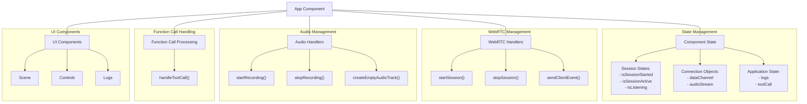
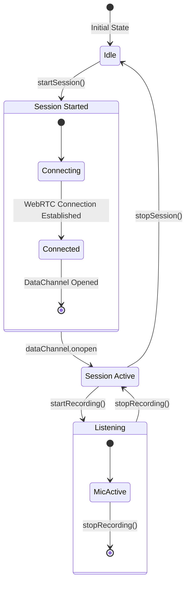
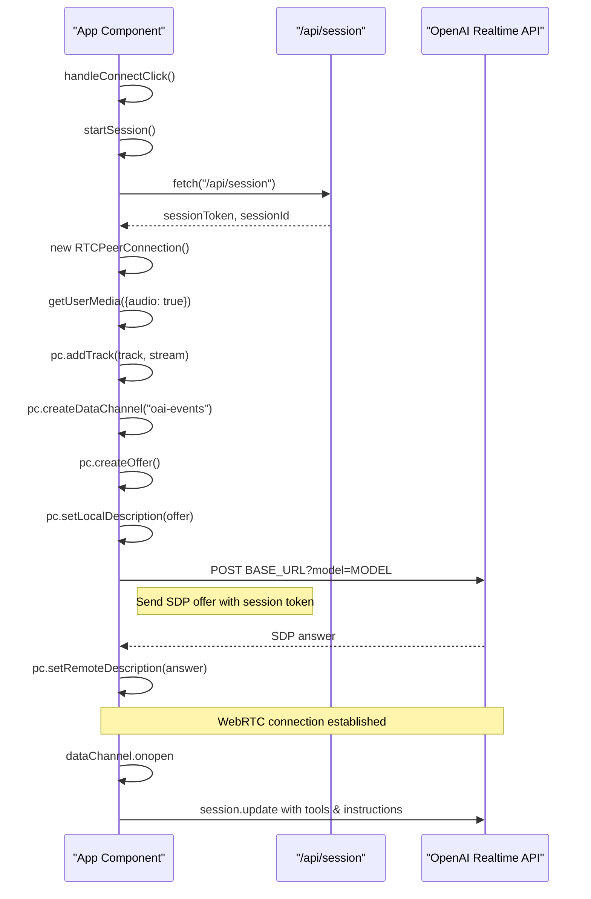
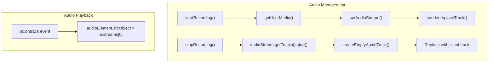
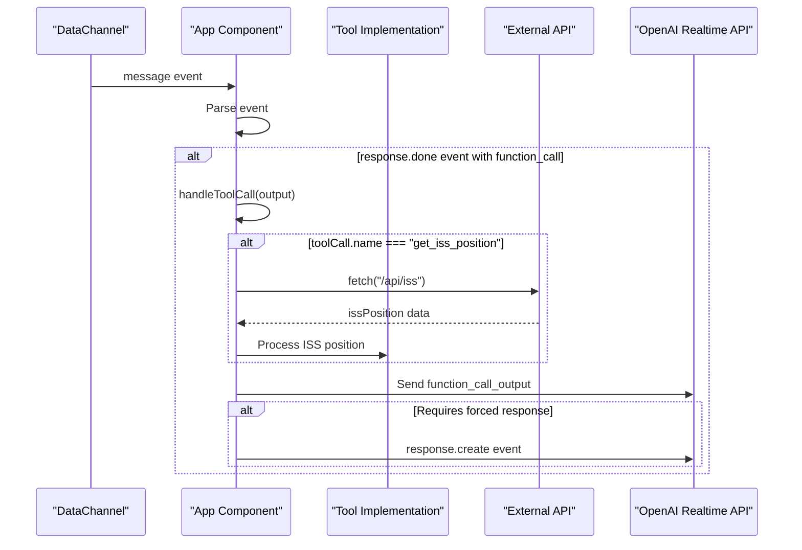
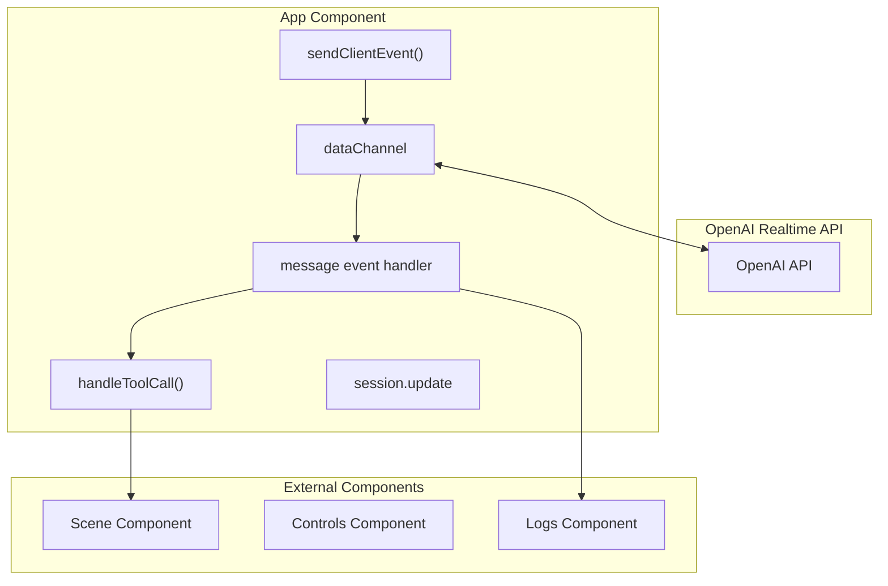
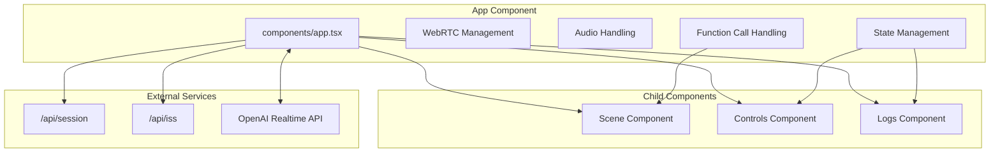
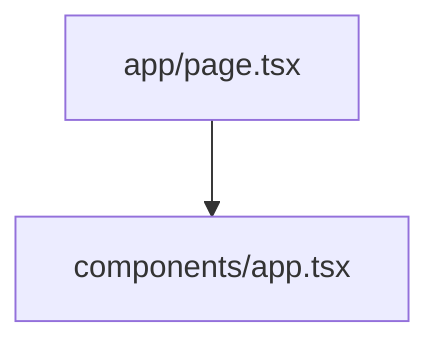

<!-- source: DeepWiki mcp.deepwiki.com · repo openai/openai-realtime-solar-system · page 3.1 App Component · fetched 2026-10-26 -->

# App Component

Relevant source files

The following files were used as context for generating this wiki page:

- [app/page.tsx](app/page.tsx)
- [components/app.tsx](components/app.tsx)

The App component is the central orchestration hub of the OpenAI Realtime Solar System Demo. It manages WebRTC connections with the OpenAI Realtime API, processes user interactions, handles audio streaming, coordinates tool function calls, and renders the core UI elements including the 3D solar system visualization.

This document focuses specifically on the inner workings of the App component. For information about WebRTC integration, see [WebRTC Integration](#2.1). For details about the function calling system, see [Function Calling System](#2.3).

## Component Architecture

The App component serves as the central coordinator for the entire application. It manages the WebRTC connection to the OpenAI Realtime API, handles audio streaming, processes function calls, and renders the core UI components.

Sources: [components/app.tsx:15-301]()

## State Management

The App component manages several key pieces of state that control the application behavior:

| State Variable | Type | Purpose |
|----------------|------|---------|
| `logs` | `any[]` | Stores messages from the AI model |
| `toolCall` | `any` | Current tool call being processed |
| `isSessionStarted` | `boolean` | Indicates if a session has been initiated |
| `isSessionActive` | `boolean` | Indicates if the session is currently active |
| `isListening` | `boolean` | Indicates if the microphone is actively capturing audio |
| `dataChannel` | `RTCDataChannel \| null` | WebRTC data channel for sending/receiving events |
| `audioStream` | `MediaStream \| null` | Current audio stream from the microphone |

The component also uses several React refs to maintain references to WebRTC objects:

| Ref | Type | Purpose |
|-----|------|---------|
| `peerConnection` | `RTCPeerConnection` | WebRTC peer connection to OpenAI's service |
| `audioElement` | `HTMLAudioElement` | Audio element for playing model responses |
| `audioTransceiver` | `RTCRtpTransceiver` | WebRTC audio transceiver |
| `tracks` | `RTCRtpSender[]` | WebRTC RTP senders for audio tracks |

Sources: [components/app.tsx:16-26]()

## Session Management Flow

This diagram illustrates the lifecycle of a WebRTC session within the App component:

Sources: [components/app.tsx:30-117](), [components/app.tsx:120-174](), [components/app.tsx:269-287]()

## WebRTC Session Establishment

The App component handles establishing the WebRTC connection with the OpenAI Realtime API:

The session establishment process follows these key steps:

1. Request a session token from the server's `/api/session` endpoint
2. Create a WebRTC peer connection
3. Set up audio tracks for capturing microphone input
4. Create a data channel for exchanging JSON messages
5. Establish the connection using the Session Description Protocol (SDP)
6. Initialize the session with tool definitions and instructions

Sources: [components/app.tsx:30-96](), [components/app.tsx:237-267]()

## Audio Stream Management

The App component manages the microphone input and audio output:

Key audio handling features:

1. **Microphone Management**:
   - `startRecording()`: Captures microphone input and adds it to the WebRTC connection
   - `stopRecording()`: Stops the microphone and replaces it with a silent track
   - `createEmptyAudioTrack()`: Creates a silent audio track to maintain the connection

2. **Audio Playback**:
   - The component sets up an audio element to play responses from the model
   - Audio output is handled through the `ontrack` event of the peer connection

Sources: [components/app.tsx:47-55](), [components/app.tsx:120-174]()

## Function Call Handling

The App component processes function calls from the OpenAI API and executes the appropriate actions:

The function call handling process:

1. The data channel receives a message from the OpenAI API
2. If the message contains a function call, `handleToolCall()` is invoked
3. Special handling is implemented for specific tools like `get_iss_position`
4. The result of the tool call is sent back to the API
5. For certain tool calls, a `response.create` event is sent to force a model response

Sources: [components/app.tsx:194-235](), [components/app.tsx:237-246]()

## Data Communication

The App component manages bidirectional communication with the OpenAI Realtime API through the WebRTC data channel:

Key aspects of data communication:

1. **Outgoing Messages**:
   - `sendClientEvent()`: Sends JSON events to the OpenAI API
   - Session updates with tools and instructions
   - Function call responses

2. **Incoming Messages**:
   - The data channel's `message` event handler processes incoming events
   - Model responses are added to the logs
   - Function calls are forwarded to the `handleToolCall()` function

Sources: [components/app.tsx:177-190](), [components/app.tsx:237-267]()

## Component Integration

The App component integrates with several other components in the application:

Key component integrations:

1. **Child Components**:
   - `Scene`: Receives tool call data to update the 3D visualization
   - `Controls`: Receives connection state and handlers for UI actions
   - `Logs`: Displays messages from the conversation

2. **External Services**:
   - `/api/session`: Used to obtain session tokens
   - `/api/iss`: Used to get ISS position data
   - OpenAI Realtime API: Connected via WebRTC for real-time communication

Sources: [components/app.tsx:289-301](), [components/app.tsx:30-96](), [components/app.tsx:194-235]()

## Rendering and Props

The App component renders the following child components with specific props:

| Component | Props | Purpose |
|-----------|-------|---------|
| `Scene` | `toolCall` | Passes tool call data to update the 3D scene |
| `Controls` | `handleConnectClick` `handleMicToggleClick` `isConnected` `isListening` | Provides connection status and handlers for UI controls |
| `Logs` | `messages` | Passes conversation messages for display |

Sources: [components/app.tsx:289-301]()

## Usage in Main Page

The App component is used as the main component in the application's root page:

Source: [app/page.tsx:1-9]()

## Summary

The App component serves as the central orchestrator of the OpenAI Realtime Solar System Demo, managing:

1. WebRTC connections with the OpenAI Realtime API
2. Audio streaming for voice input and output
3. Function call processing and execution
4. State management for session and connection status
5. Integration with scene visualization and UI components

This component implements the core functionality that enables real-time voice interaction with the OpenAI model, allowing users to explore the solar system through natural language queries and receive both verbal responses and visual feedback through the 3D scene.

---

