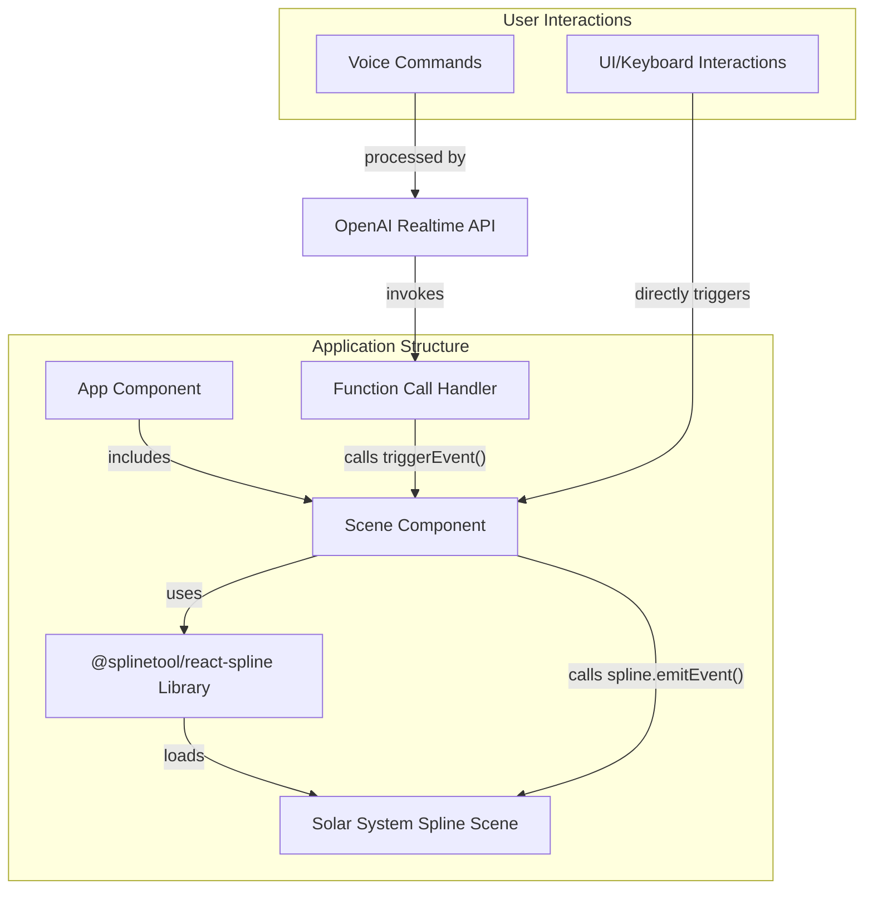
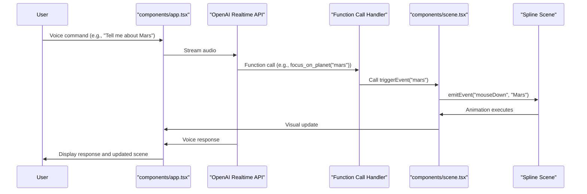

<!-- source: DeepWiki mcp.deepwiki.com · repo openai/openai-realtime-solar-system · page 3.2 3D Solar System Scene · fetched 2026-10-26 -->

# 3D Solar System Scene

<details>
<summary>Relevant source files</summary>

The following files were used as context for generating this wiki page:

- [README.md](README.md)

</details>


This document describes the 3D Solar System Scene component that powers the visual representation of the solar system in the OpenAI Realtime Demo. It covers how the Spline-based scene is structured, integrated into the application, and how it responds to user interactions and function calls.

For information about the broader App component that orchestrates all interactions, see [App Component](#3.1). For details on how function calls are processed to trigger scene actions, see [Function Calling System](#2.3).

## 1. Scene Integration Architecture

The 3D Solar System Scene is built using Spline, a web-based 3D design tool, and integrated into the application through the Scene component.



Sources: README.md

## 2. Scene Interaction Flow

The sequence below illustrates how a user voice command is processed and eventually triggers an animation in the 3D scene:



Sources: README.md, System Architecture diagrams

## 3. Supported Interactions and Animations

The Spline scene is configured with various event-driven animations that can be triggered through voice commands, function calls, or direct user interaction.

### 3.1 Animation Types and Triggers

The following table details the available animations and how they can be triggered:

| Animation | Function Call | Voice Command Example | UI/Keyboard Trigger |
|-----------|---------------|----------------------|---------------------|
| Focus on Planet | `focus_on_planet` | "Tell me about Mars" | Click on planet |
| Show Moons | `show_moons` | "Show me Jupiter's moons" | N/A |
| Show ISS Position | `get_iss_position` | "Where is the ISS?" | N/A |
| Show Orbit View | `show_orbit_view` | "Show me the orbits" | M key |
| Reset Camera | N/A | "Thank you, I'm good" | Space bar |
| Return to Main View | N/A | N/A | Enter key |

Sources: README.md

### 3.2 Animation Event Structure

```mermaid
graph TD
    Scene["Spline Scene Object"]
    
    subgraph "Planet Focus Events"
        PlanetFocus["focus_on_planet() Function"]
        PlanetFocus -- "emitEvent('mouseDown', 'Sun')" --> Sun["Sun Animation"]
        PlanetFocus -- "emitEvent('mouseDown', 'Earth')" --> Earth["Earth Animation"]
        PlanetFocus -- "emitEvent('mouseDown', 'Mercury')" --> Mercury["Mercury Animation"]
        PlanetFocus -- "emitEvent('mouseDown', 'Mars')" --> Mars["Mars Animation"]
        PlanetFocus -- "emitEvent('mouseDown', 'Jupiter')" --> Jupiter["Jupiter Animation"]
        PlanetFocus -- "emitEvent('mouseDown', 'Saturn')" --> Saturn["Saturn Animation"]
        PlanetFocus -- "emitEvent('mouseDown', 'Neptune')" --> Neptune["Neptune Animation"]
        PlanetFocus -- "emitEvent('mouseDown', 'Pluto')" --> Pluto["Pluto Animation"]
    end
    
    subgraph "Special Feature Events"
        SpecialEvents["Special Feature Functions"]
        SpecialEvents -- "moonEvent" --> MoonDisplay["Show Moons Animation"]
        SpecialEvents -- "orbitView" --> OrbitView["Orbit View Animation"]
        SpecialEvents -- "resetCamera" --> ResetView["Reset Camera Animation"]
        SpecialEvents -- "showISS" --> ISSView["Show ISS Animation"]
    end
    
    Scene -- "manages" --> PlanetFocus
    Scene -- "manages" --> SpecialEvents
```



Sources: README.md

## 4. Scene Component Implementation

The Scene component is responsible for loading and managing the Spline scene. It uses a reference to the Spline object to emit events that trigger animations.

Key features:
- Loads the Spline scene from a specified URL
- Maintains a reference to the Spline object using React's `useRef`
- Exposes methods for triggering events in the scene
- Handles keyboard shortcuts for scene manipulation

### 4.1 Event Triggering

The Scene component provides a method to trigger events in the Spline scene. This is typically done using:

```javascript
spline.current.emitEvent("eventName", "objectName")
```

For example, focusing on Mars would use:

```javascript
spline.current.emitEvent("mouseDown", "Mars")
```

Sources: README.md

## 5. Keyboard Controls

The Scene component implements several keyboard shortcuts for controlling the scene:

| Key | Action |
|-----|--------|
| Space bar | Reset camera to initial position |
| M key | Change to orbit view |
| Enter key | Change back to main view |

These keyboard shortcuts provide an alternative way to control the scene besides voice commands and direct clicking.

Sources: README.md

## 6. Customization and Extension

The Spline scene can be customized or replaced entirely with a different scene:

1. Create a new scene using Spline (refer to the [Spline documentation](https://docs.spline.design/doc))
2. Update the scene URL in the Scene component:
   ```javascript
   <Spline
     scene="https://prod.spline.design/<scene_id>/scene.splinecode"
     onLoad={onLoad}
   />
   ```
3. Configure trigger events in your Spline scene
4. Update the Scene component to emit the appropriate events

To add new interactions, configure event triggers in the Spline scene and update the function calling system in `lib/config.ts` to map user requests to these new events.

Sources: README.md

## 7. Loading and Performance Considerations

The Spline scene is large and complex, which can affect initial load time:

- First load: Can take significant time (several seconds)
- Subsequent loads: Faster due to browser caching

The application waits for the scene to be fully loaded before allowing user interactions to ensure proper functionality.

Sources: README.md

---

