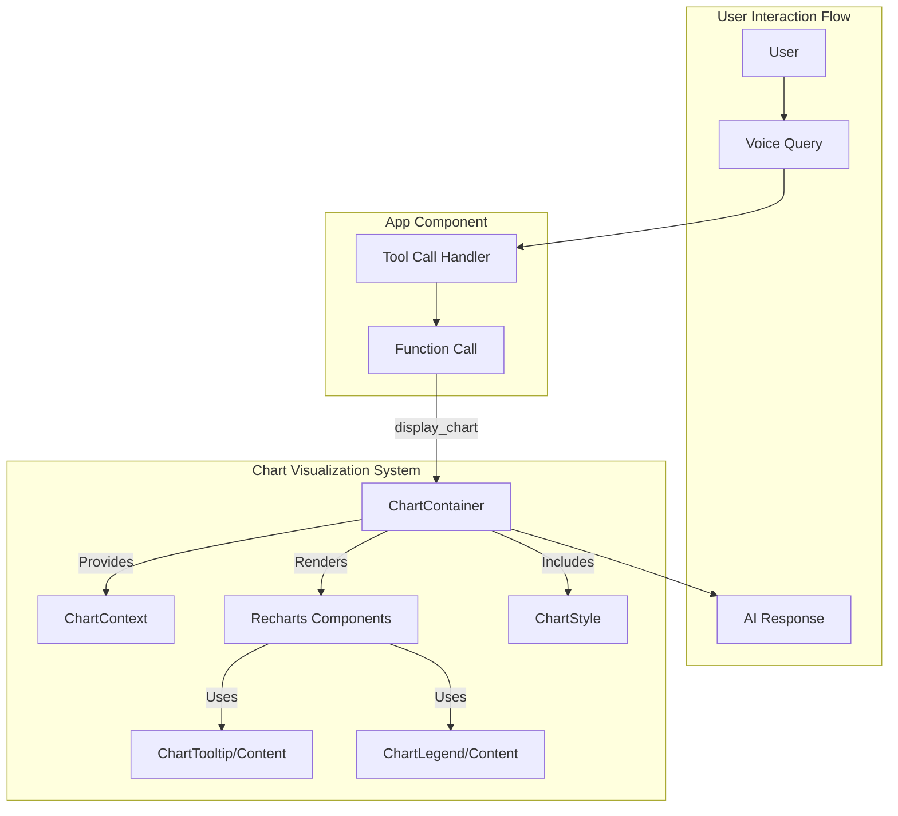
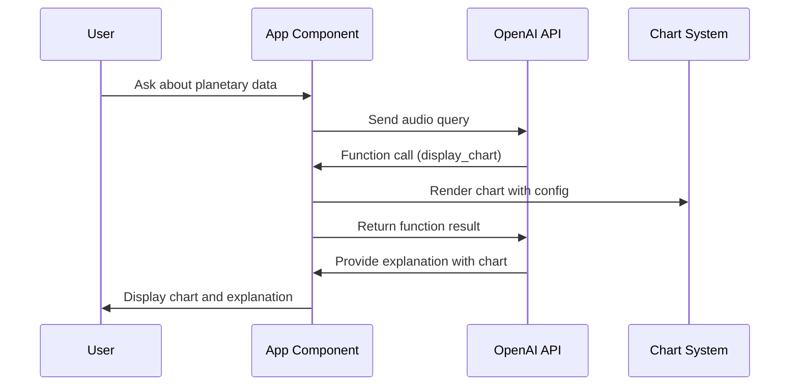

<!-- source: DeepWiki mcp.deepwiki.com · repo openai/openai-realtime-solar-system · page 3.3 Chart Visualization System · fetched 2026-10-26 -->

# Chart Visualization System

<details>
<summary>Relevant source files</summary>

The following files were used as context for generating this wiki page:

- [components/app.tsx](components/app.tsx)
- [components/charts/chart.tsx](components/charts/chart.tsx)

</details>


## Purpose and Scope

The Chart Visualization System provides a framework for creating and displaying interactive data visualizations about celestial bodies in the OpenAI Realtime Solar System Demo. This system encapsulates chart components that can be programmatically displayed and configured through the function calling mechanism when users request information about planets, moons, or other solar system objects.

This document covers the internal architecture of the chart system, its key components, and how it integrates with the rest of the application. For information about the function calling system that triggers chart display, see [Function Calling System](#2.3).

Sources: [components/charts/chart.tsx:1-369]()

## System Architecture Overview

The Chart Visualization System is a wrapper around the Recharts library that provides additional styling, configuration, and context management capabilities. It is integrated into the main application and can be triggered by function calls from the OpenAI API.



The chart system is invoked when a user asks about data related to celestial bodies, which triggers a function call via the OpenAI API that renders the appropriate chart visualization.

Sources: [components/charts/chart.tsx:1-72](), [components/app.tsx:192-235]()

## Component Architecture

The chart system uses a context-based architecture to provide configuration and styling to its child components.

```mermaid
classDiagram
    class ChartConfig {
        +[key: string]: {
            label?: React.ReactNode
            icon?: React.ComponentType
            color?: string 
            theme?: Record<"light"|"dark", string>
        }
    }
    
    class ChartContainer {
        +config: ChartConfig
        +children: React.ReactNode
        +ResponsiveContainer()
    }
    
    class ChartContext {
        +config: ChartConfig
        +useChart()
    }
    
    class ChartStyle {
        +id: string
        +config: ChartConfig
        +generateCSS()
    }
    
    class ChartTooltip {
        +Tooltip properties
    }
    
    class ChartTooltipContent {
        +hideLabel?: boolean
        +hideIndicator?: boolean
        +indicator?: "line"|"dot"|"dashed"
        +nameKey?: string
        +labelKey?: string
        +renderTooltipContent()
    }
    
    class ChartLegend {
        +Legend properties
    }
    
    class ChartLegendContent {
        +hideIcon?: boolean
        +nameKey?: string
        +renderLegendContent()
    }
    
    ChartContainer "1" --> "1" ChartContext : creates
    ChartContainer "1" --> "1" ChartStyle : includes
    ChartTooltipContent "1" --> "1" ChartContext : consumes
    ChartLegendContent "1" --> "1" ChartContext : consumes
```

Sources: [components/charts/chart.tsx:14-28](), [components/charts/chart.tsx:40-104]()

## Key Components

### ChartContainer

The `ChartContainer` component is the main entry point for the chart system. It:

1. Provides a context with a configuration object to all child components
2. Applies consistent styling across different chart types
3. Wraps the chart in a responsive container
4. Manages theme integration

```typescript
// Usage example
<ChartContainer
  config={{
    mars: { label: "Mars", color: "#ff4500" },
    earth: { label: "Earth", color: "#1e90ff" }
  }}
>
  <BarChart data={planetData}>
    {/* Chart components */}
  </BarChart>
</ChartContainer>
```

The container accepts a `config` object that defines labels, colors and other properties for each data series in the chart.

Sources: [components/charts/chart.tsx:40-72]()

### ChartStyle

The `ChartStyle` component dynamically generates CSS variables based on the chart configuration, enabling theme-aware styling for charts. It supports both light and dark themes with different color configurations.

Sources: [components/charts/chart.tsx:73-104]()

### Tooltip Components

The chart system provides two tooltip-related components:

- `ChartTooltip`: A wrapper around the Recharts Tooltip component
- `ChartTooltipContent`: A customizable tooltip content component that displays data points with visual indicators, labels, and formatted values

The tooltip content component supports multiple indicator styles (dot, line, dashed) and can be customized to show or hide different elements.

Sources: [components/charts/chart.tsx:106-260]()

### Legend Components

Similar to tooltips, the chart system includes two legend components:

- `ChartLegend`: A wrapper around the Recharts Legend component
- `ChartLegendContent`: A customizable legend content component that displays data series with visual indicators and labels

Sources: [components/charts/chart.tsx:262-321]()

## Configuration System

Charts are configured using a `ChartConfig` object that specifies how each data series should be displayed. The configuration is passed through React context to all chart components.

### ChartConfig Structure

| Property | Type | Description |
|----------|------|-------------|
| `label` | React.ReactNode | The display label for the data series |
| `icon` | React.ComponentType | An optional icon component to display |
| `color` | string | A single color value (used for all themes) |
| `theme` | Record<"light"\|"dark", string> | Theme-specific colors |

Example configuration:

```typescript
const solarSystemConfig = {
  mercury: { 
    label: "Mercury", 
    color: "#999999" 
  },
  venus: { 
    label: "Venus", 
    theme: { 
      light: "#eedd88", 
      dark: "#ddcc66" 
    } 
  }
};
```

The configuration system supports both direct color values and theme-aware colors that change based on the current theme.

Sources: [components/charts/chart.tsx:14-28]()

## Integration with Main Application

The chart system is integrated with the OpenAI Realtime API through the function calling mechanism. When the AI needs to display data about celestial bodies, it can call functions that render the appropriate charts.

### Function Call Flow



The chart visualization is triggered primarily through the function calling system, which can specify the type of chart to display, the data to show, and configuration options.

The integration happens in the App component's `handleToolCall` function, which processes function calls from the OpenAI API.

Sources: [components/app.tsx:192-235]()

## Helper Functions

The chart system includes a helper function `getPayloadConfigFromPayload` that extracts the appropriate configuration for a particular data point from the chart configuration:

```typescript
// Example of what this function does:
// If payload = { name: "mars", value: 6794 }
// And config = { mars: { label: "Mars", color: "red" } }
// It will return { label: "Mars", color: "red" }
```

This function handles various payload structures that can come from different Recharts components.

Sources: [components/charts/chart.tsx:323-359]()

## Styling and Theming

The chart system uses Tailwind CSS for styling, with additional custom CSS variables for colors. It includes default styles for common chart elements like axes, grids, and tooltips.

The system supports both light and dark themes through the `theme` property in the chart configuration, which allows different colors to be used depending on the active theme.

Sources: [components/charts/chart.tsx:53-69](), [components/charts/chart.tsx:85-101]()

## Exported Components

The chart system exports the following components:

- `ChartContainer`: Main container component
- `ChartTooltip`: Tooltip wrapper
- `ChartTooltipContent`: Custom tooltip content
- `ChartLegend`: Legend wrapper
- `ChartLegendContent`: Custom legend content
- `ChartStyle`: Style injection component
- `ChartConfig`: TypeScript type for chart configuration

These components provide a complete solution for creating and customizing charts in the solar system demo.

Sources: [components/charts/chart.tsx:361-368]()

---

