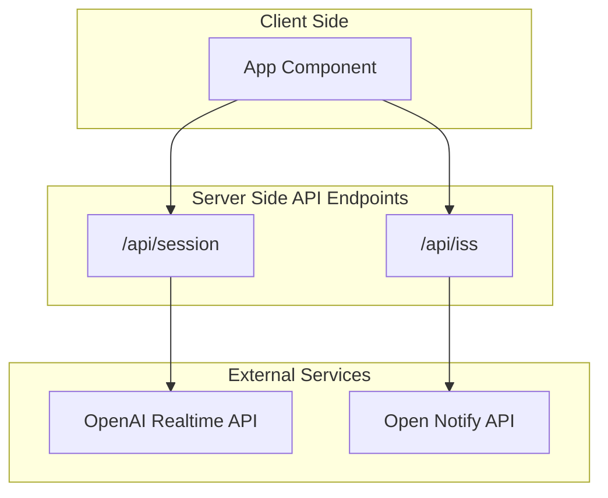
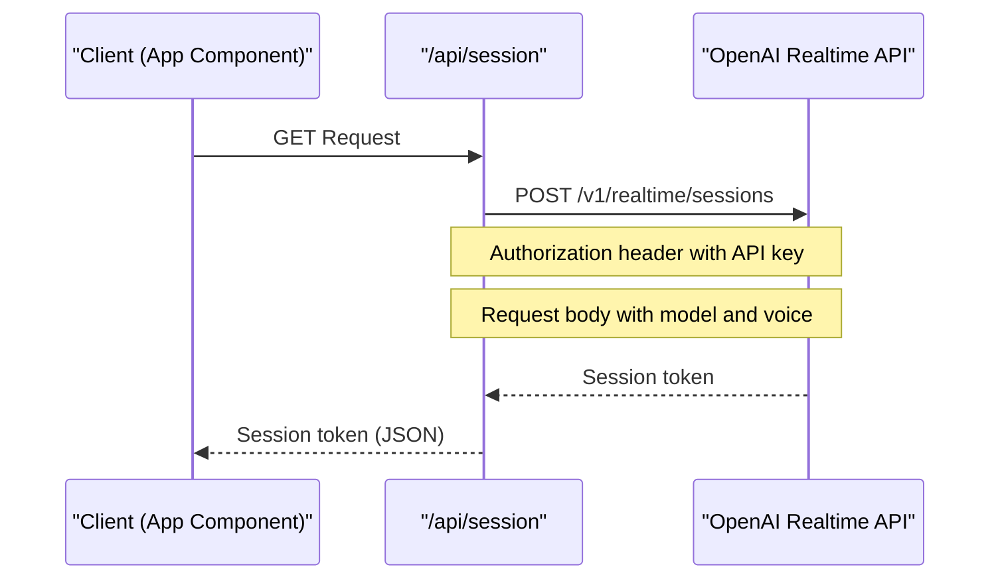
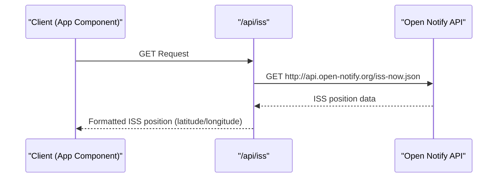
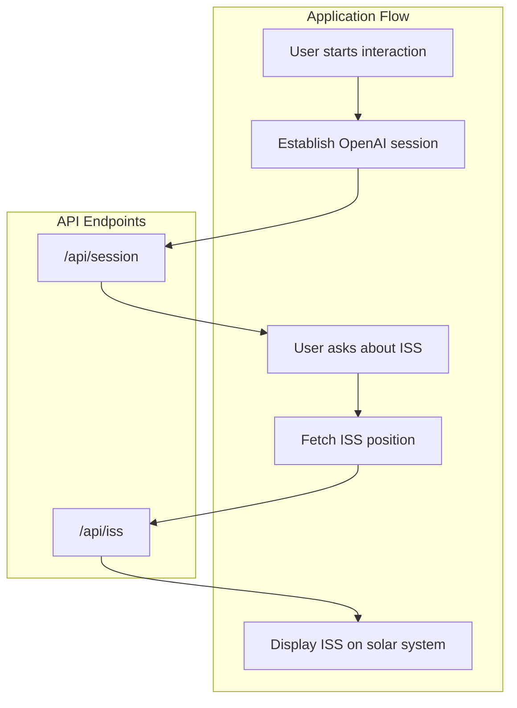

<!-- source: DeepWiki mcp.deepwiki.com · repo openai/openai-realtime-solar-system · page 4 API Endpoints · fetched 2026-10-26 -->

# API Endpoints

<details>
<summary>Relevant source files</summary>

The following files were used as context for generating this wiki page:

- [app/api/iss/route.ts](app/api/iss/route.ts)
- [app/api/session/route.ts](app/api/session/route.ts)

</details>


This page provides an overview of the API endpoints used in the OpenAI Realtime Solar System Demo. These endpoints enable critical functionality such as session management for the OpenAI Realtime API and retrieval of real-time ISS position data. For details on how these endpoints are consumed within the application, see [App Component](#3.1).

## Overview of API Architecture

The application implements two server-side API endpoints using Next.js API routes:



These endpoints serve as the bridge between the client-side application and external services, handling authentication and data transformation as needed.

Sources: [app/api/session/route.ts](), [app/api/iss/route.ts]()

## Session API

The Session API endpoint creates and provides ephemeral session tokens required for establishing WebRTC connections with the OpenAI Realtime API.

### Implementation Details

The endpoint is implemented as a GET request handler in the Next.js API route system:



The endpoint makes an authenticated request to OpenAI's session creation endpoint, using the application's OpenAI API key which is stored as an environment variable. It specifies the AI model and voice configuration to use for the session.

Sources: [app/api/session/route.ts:4-31]()

### Key Implementation Features

- **Authentication**: Uses the OpenAI API key from environment variables
- **Configuration**: Passes the model and voice parameters from the application's configuration
- **Error Handling**: Returns appropriate error responses with status codes
- **Response Forwarding**: Directly forwards the response from OpenAI to the client

### API Usage

```
GET /api/session
```

Response (on success):
```json
{
  "token": "session_token_from_openai",
  "expires": "timestamp"
}
```

Sources: [app/api/session/route.ts:5-24]()

## ISS Position API

The ISS Position API endpoint fetches real-time positional data for the International Space Station, which is used in the solar system visualization.

### Implementation Details



The endpoint proxies requests to the Open Notify API, which provides real-time ISS location data in a JSON format. It processes this data to extract just the position information before returning it to the client.

Sources: [app/api/iss/route.ts:1-28]()

### Key Implementation Features

- **External API Integration**: Fetches data from the Open Notify public API
- **Data Transformation**: Extracts and returns only the position information
- **Error Handling**: Includes comprehensive error handling for network issues or API failures
- **Logging**: Logs position data and errors for debugging purposes

### API Usage

```
GET /api/iss
```

Response (on success):
```json
{
  "latitude": "51.6616",
  "longitude": "-32.3321"
}
```

Sources: [app/api/iss/route.ts:2-28]()

## API Integration with Application Components

The API endpoints are integrated with the rest of the application through the main App component, which manages the application state and user interactions.



### Session Lifecycle

1. When a user initiates a session (by clicking the wi-fi icon), the application requests a session token from the Session API
2. The token is then used to establish a WebRTC connection with the OpenAI Realtime API
3. This connection enables the voice-based interaction with the 3D solar system model

### ISS Position Integration

1. When the OpenAI model responds to a query about the ISS with a function call to `get_iss_position`
2. The application fetches the current position from the ISS API endpoint
3. This data is then used to update the 3D visualization, showing the ISS's current position

Sources: [app/api/session/route.ts](), [app/api/iss/route.ts]()

## Technical Implementation Details

Both API endpoints are implemented using Next.js's API Routes feature, which provides a serverless function approach to API development.

### Session API Implementation

The Session API endpoint creates a new session with the OpenAI Realtime API:

- **HTTP Method**: GET
- **Request Processing**: Makes an authenticated POST request to OpenAI's session creation endpoint
- **Configuration**: Uses model and voice settings from application configuration
- **Response**: Returns the session token for WebRTC connection

Key code snippet (from [app/api/session/route.ts:6-17]()):
- Makes an authenticated request to the OpenAI API
- Includes the model and voice configuration
- Uses the application's API key for authentication

### ISS Position API Implementation

The ISS Position API fetches and transforms data from an external API:

- **HTTP Method**: GET
- **Request Processing**: Makes a request to the Open Notify API for ISS position
- **Data Transformation**: Extracts the position data from the response
- **Response**: Returns latitude and longitude in a simplified JSON format

Key code snippet (from [app/api/iss/route.ts:3-14]()):
- Fetches the ISS position from the external API
- Handles HTTP status errors from the external API
- Logs the position data for debugging

Sources: [app/api/session/route.ts](), [app/api/iss/route.ts]()

## Security Considerations

The API endpoints implement several security best practices:

1. **API Key Protection**: The OpenAI API key is stored as an environment variable and never exposed to the client
2. **Error Handling**: Both endpoints implement proper error handling to prevent information leakage
3. **Response Sanitization**: The ISS API endpoint only returns the specific data needed, minimizing unnecessary data exposure

This design ensures that sensitive credentials and unnecessary data are not exposed to client-side code while still providing the necessary functionality for the application.

Sources: [app/api/session/route.ts:7-11](), [app/api/iss/route.ts:4-12]()

---

