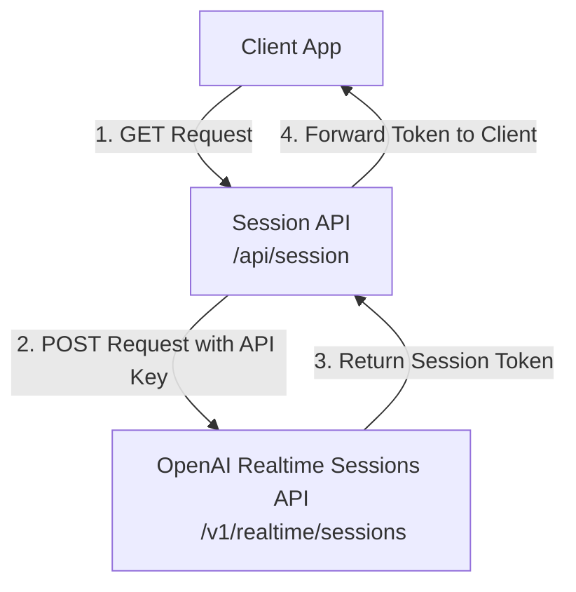
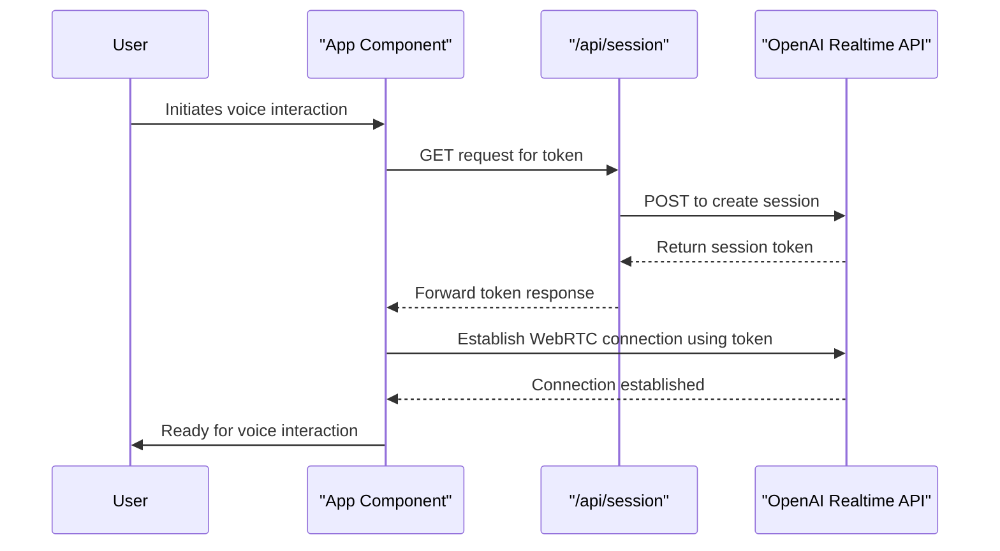

<!-- source: DeepWiki mcp.deepwiki.com · repo openai/openai-realtime-solar-system · page 4.1 Session API · fetched 2026-10-26 -->

# Session API

<details>
<summary>Relevant source files</summary>

The following files were used as context for generating this wiki page:

- [app/api/session/route.ts](app/api/session/route.ts)

</details>


## Purpose and Scope

The Session API is a critical server-side endpoint in the OpenAI Realtime Solar System Demo that manages authentication with OpenAI's Realtime API. It handles token acquisition, which is required before establishing WebRTC connections for real-time voice interactions. This page describes the implementation, usage, and integration of this API endpoint with other system components.

For information about the WebRTC integration that uses these tokens, see [WebRTC Integration](#2.1). For details about the ISS Position API, another server-side endpoint, see [ISS Position API](#4.2).

## Implementation Overview

The Session API is implemented as a Next.js API route that proxies requests to OpenAI's Realtime Sessions API. It abstracts away the authentication complexity and exposes a simplified endpoint for the frontend application.



**Session API Request Flow Diagram**

Sources: [app/api/session/route.ts:5-31]()

## Technical Implementation

The Session API is implemented as a GET endpoint in Next.js, located at `/api/session`. When called, it makes a POST request to OpenAI's `/v1/realtime/sessions` endpoint with the necessary credentials and configuration.

Key implementation details:
- Uses the OpenAI API key stored in environment variables
- Specifies the AI model from `MODEL` constant
- Configures the voice setting from `VOICE` constant
- Returns the response body directly to the client
- Includes error handling for failed requests

Sources: [app/api/session/route.ts:5-31]()

## API Specification

### Request

| Method | Endpoint    | Authorization |
|--------|-------------|---------------|
| GET    | /api/session | Not required  |

No parameters are needed in the request. The model and voice settings are configured server-side.

### Response

A successful response forwards the OpenAI session token response, which includes:

```json
{
  "token": "session-token-value",
  "expires_at": "ISO timestamp"
}
```

Error responses return:

```json
{
  "error": "Error message"
}
```

With a corresponding HTTP status code (500 for server errors).

Sources: [app/api/session/route.ts:19-29]()

## Integration with System Components

The Session API is integrated with the frontend application as part of the WebRTC connection establishment process.



**Session API Integration Sequence Diagram**

Sources: [app/api/session/route.ts:5-31]()

## Code Structure

The Session API implementation is contained within a single file that handles the token acquisition process:

```mermaid
classDiagram
    class "session/route.ts" {
        +GET()
        -fetch() to OpenAI API
        -error handling
    }
    
    class "lib/config.ts" {
        +VOICE: String
    }
    
    class "lib/constants.ts" {
        +MODEL: String
    }
    
    "session/route.ts" --> "lib/config.ts" : imports VOICE
    "session/route.ts" --> "lib/constants.ts" : imports MODEL
```

**Session API Code Structure Diagram**

Sources: [app/api/session/route.ts:1-2]()

## Security Considerations

The Session API plays an important security role by:

1. Keeping the OpenAI API key secure on the server side
2. Preventing direct exposure of the API key to client-side code
3. Obtaining short-lived session tokens that limit potential misuse

The API key is stored in environment variables and only used server-side, following security best practices.

Sources: [app/api/session/route.ts:10]()

## Error Handling

The Session API includes basic error handling that:

1. Catches any exceptions during the fetch operation
2. Logs errors to the console for debugging
3. Returns a structured error response with appropriate HTTP status code

This ensures that clients receive meaningful error information when token acquisition fails.

Sources: [app/api/session/route.ts:25-29]()

## Integration Example

In the application flow, the Session API is typically called before establishing a WebRTC connection:

1. User initiates voice interaction (clicks the wifi icon)
2. Frontend calls Session API to get a token
3. Once token is received, WebRTC connection is established
4. Audio streaming begins between client and OpenAI Realtime API

This sequence ensures proper authentication before attempting real-time communication.

Sources: [app/api/session/route.ts:5-31]()

---

