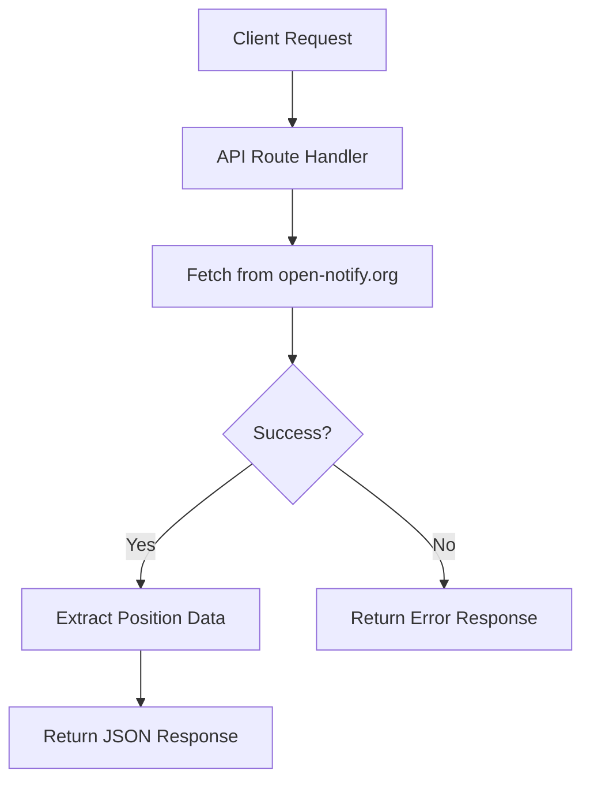
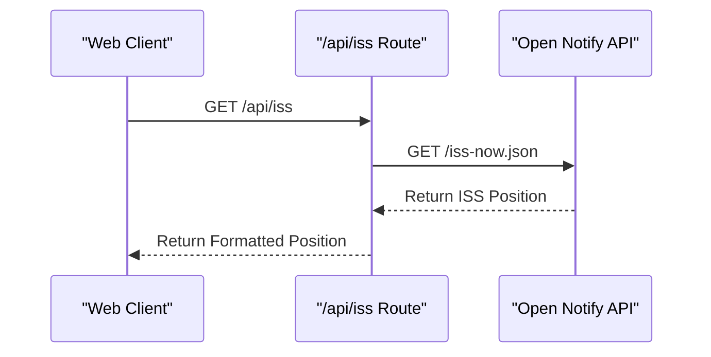
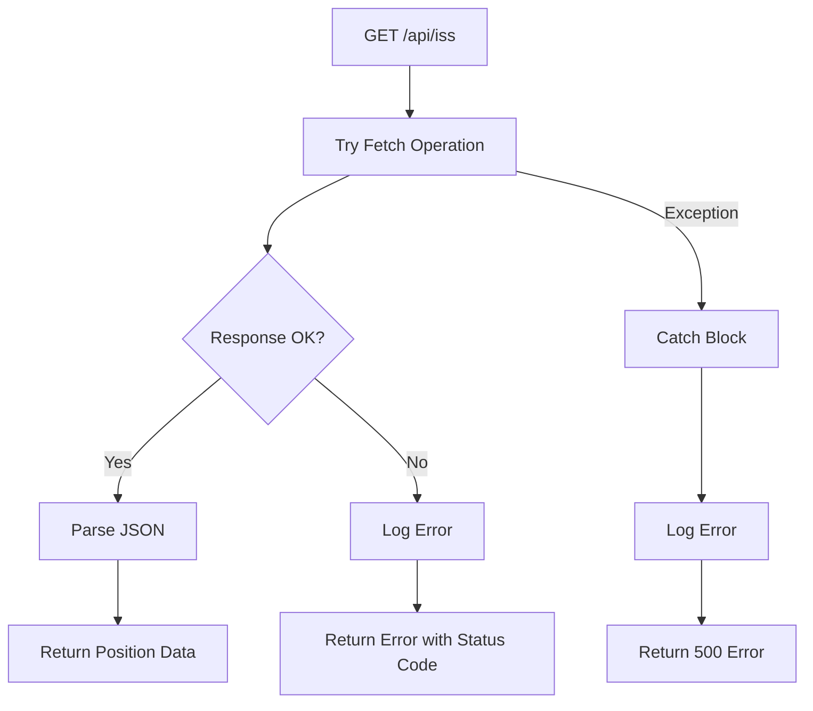
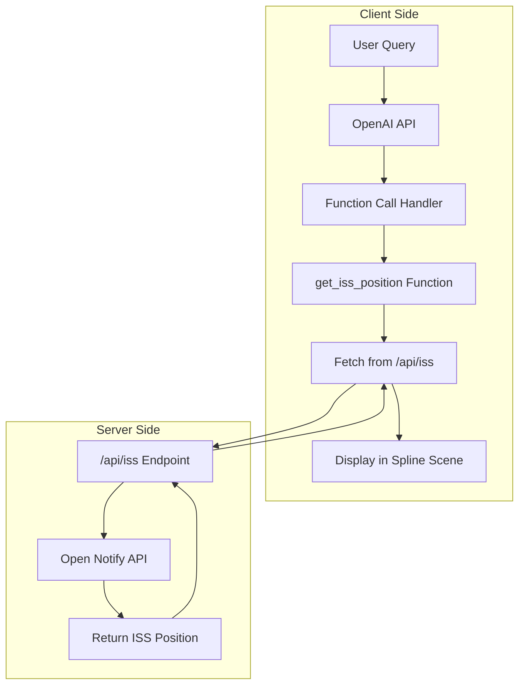

<!-- source: DeepWiki mcp.deepwiki.com · repo openai/openai-realtime-solar-system · page 4.2 ISS Position API · fetched 2026-10-26 -->

# ISS Position API

<details>
<summary>Relevant source files</summary>

The following files were used as context for generating this wiki page:

- [app/api/iss/route.ts](app/api/iss/route.ts)

</details>


## Overview

The ISS Position API is a server-side endpoint that provides real-time International Space Station (ISS) coordinates to the OpenAI Realtime Solar System Demo. This API acts as a bridge between the application and the external ISS tracking service, enabling the display of the ISS's current position within the solar system visualization.

For information about other API endpoints used in the application, see the [API Endpoints](#4) overview. For details on how this data is used in function calls, see the [Function Calling System](#2.3).

Sources: [app/api/iss/route.ts:1-28]()

## Implementation Details

The ISS Position API is implemented as a Next.js API route that fetches ISS position data from the Open Notify API, a public service that provides ISS location information. The endpoint handles HTTP GET requests, processes the external API response, and returns the position data in a standardized format.



**Diagram: ISS API Request Flow**

The API route is defined in the `route.ts` file within the `/app/api/iss` directory, following Next.js App Router conventions for API routes.

Sources: [app/api/iss/route.ts:1-28]()

## External Data Source

The API relies on the Open Notify API's `/iss-now.json` endpoint, which provides the current latitude and longitude of the International Space Station. This third-party service updates the ISS position in real-time based on data from NASA.



**Diagram: ISS Position Data Flow**

Sources: [app/api/iss/route.ts:4]()

## Response Format

The API returns a JSON object containing the latitude and longitude of the ISS. The response is formatted as follows:

```json
{
  "latitude": "51.6616",
  "longitude": "-32.3940"
}
```

This simplified response format makes it easy for the client-side components to consume and visualize the ISS position data.

Sources: [app/api/iss/route.ts:15-21]()

## Error Handling

The API implements comprehensive error handling to manage various failure scenarios:

1. **External API Failure**: If the Open Notify API returns an error status code, the error details are logged and an appropriate error response is returned.
2. **Network Errors**: Any network-related exceptions during the fetch operation are caught and returned as a 500 error response.



**Diagram: ISS API Error Handling Flow**

Sources: [app/api/iss/route.ts:5-13](), [app/api/iss/route.ts:22-27]()

## Integration with System Architecture

The ISS Position API integrates with the broader application through the function calling mechanism. When the OpenAI model determines that ISS position information is needed, it can trigger the `get_iss_position` function, which in turn calls this API endpoint.



**Diagram: ISS Position in System Architecture**

Sources: [app/api/iss/route.ts:1-28]()

## Implementation Code

The core implementation of the ISS Position API is contained in a single GET handler function that:

1. Fetches data from the external API
2. Processes the response
3. Returns the formatted position data or an error response

The handler uses standard fetch API and error handling patterns to ensure reliable operation.

Sources: [app/api/iss/route.ts:2-28]()

## Usage Considerations

When integrating with the ISS Position API, consider the following:

- **Refresh Rate**: The ISS position updates frequently as it orbits Earth. Consider implementing polling or refreshing the data at appropriate intervals.
- **Error States**: Always handle potential API failures in the client implementation.
- **Rate Limiting**: The external Open Notify API may have rate limits. Use caching strategies if making frequent requests.

Sources: [app/api/iss/route.ts:1-28]()

## Summary

The ISS Position API provides a simple yet effective way to integrate real-time ISS tracking data into the solar system visualization. By abstracting the external API details behind a consistent endpoint, it enables seamless integration with the function calling system and facilitates displaying the ISS position within the 3D scene.

Sources: [app/api/iss/route.ts:1-28]()

---

