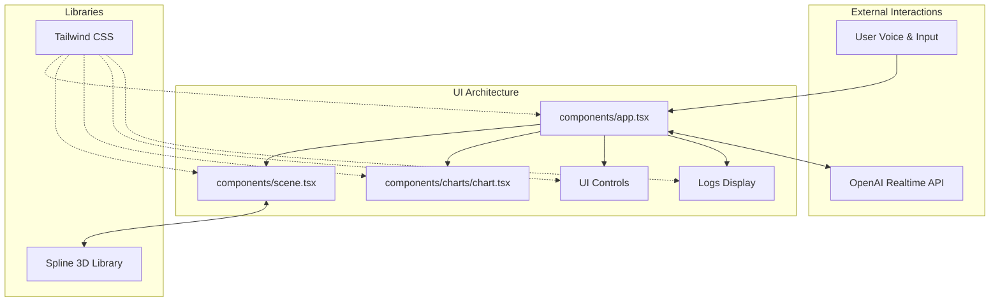
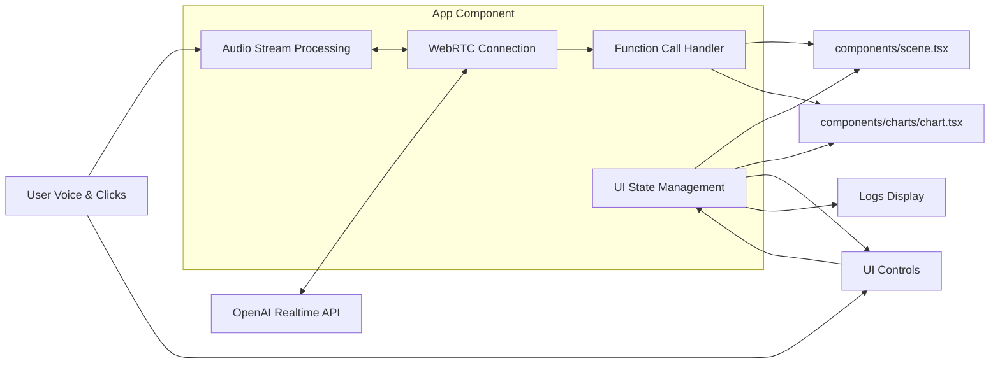
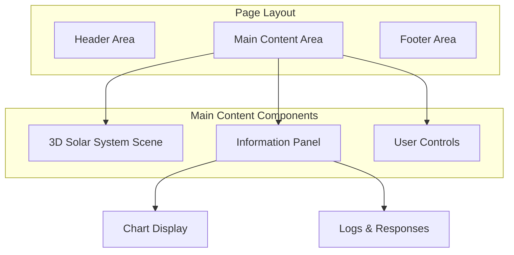
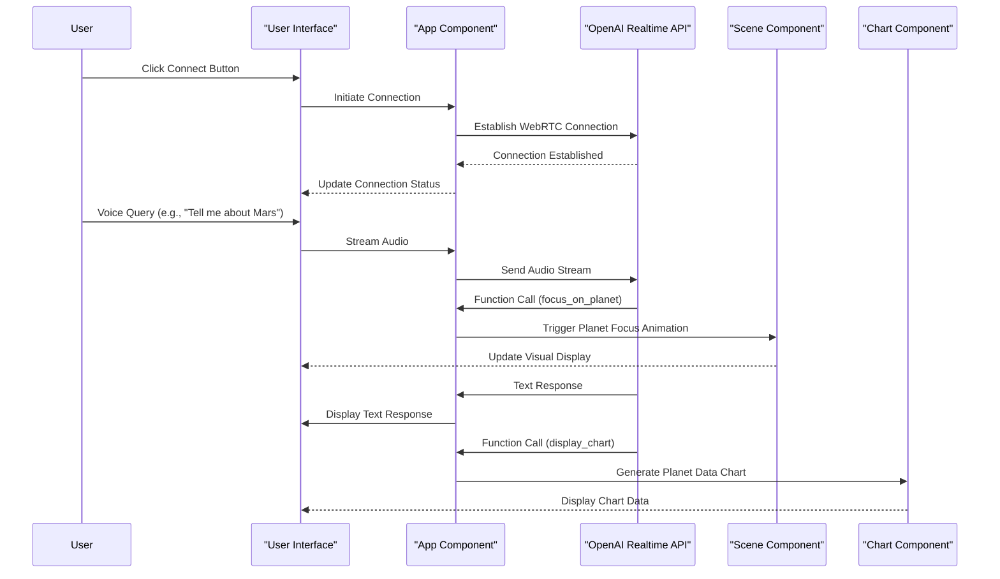
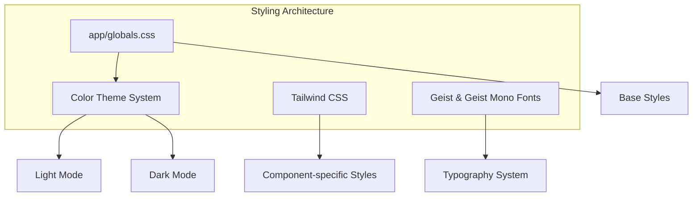

<!-- source: DeepWiki mcp.deepwiki.com · repo openai/openai-realtime-solar-system · page 5 User Interface · fetched 2026-10-26 -->

# User Interface

Relevant source files

The following files were used as context for generating this wiki page:

- [app/favicon.ico](app/favicon.ico)
- [app/globals.css](app/globals.css)
- [app/layout.tsx](app/layout.tsx)

This document provides an overview of the OpenAI Realtime Solar System Demo's user interface components, their organization, and how they collectively deliver an interactive, voice-controlled solar system experience. This page focuses on the high-level UI architecture and main components, while more detailed information about layout structure and styling can be found in [Layout and Styling](#5.1), and details about the main page structure and user experience in [Main Page and User Experience](#5.2).

## UI Architecture Overview

The user interface of the application is built using Next.js and is composed of several key components that work together to create an immersive, interactive solar system demonstration.

The UI is organized hierarchically with the App component at the center, managing the other components and coordinating communication with the OpenAI API via WebRTC.

Sources: [app/layout.tsx:23-37](), [app/globals.css:1-22]()

## Main UI Components

### App Component

The App component serves as the central orchestrator for the entire application. It:
- Manages the WebRTC connection to the OpenAI Realtime API
- Handles user audio input and output
- Coordinates the display of different UI components
- Processes function calls received from the API and triggers appropriate actions in the UI

Sources: [app/page.tsx]()

### 3D Solar System Scene

The Scene component is responsible for displaying the interactive 3D solar system visualization. This component:
- Integrates with the Spline 3D library
- Responds to events triggered by function calls (like focusing on a planet)
- Provides the core visual experience of the application

### Chart Visualization

The Chart component displays data visualizations about celestial bodies. It:
- Renders different types of charts based on function calls
- Shows comparative data about planets, moons, and other celestial objects
- Updates dynamically based on user queries and API responses

### UI Controls

The application includes various UI controls for user interaction:
- Audio controls (mute/unmute)
- Connection status indicators
- Navigation buttons for the solar system

### Logs and Information Display

The application displays informational content including:
- Transcriptions of user queries
- Responses from the AI
- Status messages and errors
- Educational content about celestial bodies

## User Interface Layout

The application uses a responsive layout that organizes these components effectively across different screen sizes.

The layout is designed to focus on the 3D scene while providing easy access to controls and information displays.

Sources: [app/layout.tsx:23-37]()

## User Interaction Flow

The following diagram illustrates how users interact with the interface and how those interactions flow through the system:

This flow shows how user voice queries are processed through the OpenAI API, which may respond with both textual information and function calls that trigger visual actions in the UI.

## Styling and Visual Design

The application uses Tailwind CSS for styling and follows a clean, modern design aesthetic. The main styling features include:

- Responsive design that adapts to different screen sizes
- Dark mode support using CSS variables
- Custom font integration with Geist and Geist Mono fonts
- Consistent spacing and typography

The application uses CSS variables for theming, with appropriate color schemes for both light and dark modes.

Sources: [app/globals.css:1-22](), [app/layout.tsx:1-37]()

## UI Components Table

| Component | File Path | Primary Responsibility |
|-----------|-----------|------------------------|
| Root Layout | app/layout.tsx | Sets up document structure, fonts, and metadata |
| App Component | components/app.tsx | Orchestrates all UI components and manages API communication |
| Scene Component | components/scene.tsx | Renders the interactive 3D solar system visualization |
| Chart Component | components/charts/chart.tsx | Displays data visualizations about celestial bodies |
| UI Controls | (Various components) | Provides user interface controls for interaction |
| Logs Display | (Component in app.tsx) | Shows transcripts, responses, and status information |

This table summarizes the main UI components and their primary responsibilities in the application.

Sources: [app/layout.tsx:23-37]()

## Integration with Function Calling System

The UI components integrate closely with the function calling system to enable interactive features triggered by voice commands. The main function-UI interactions include:

- `focus_on_planet` - Triggers the Scene component to focus on a specific planet
- `display_chart` - Instructs the Chart component to generate and display data
- `show_moons` - Causes the Scene component to highlight moon objects
- `show_orbit_view` - Changes the Scene component to show orbital paths
- `get_iss_position` - Retrieves ISS data and displays it in the UI

For more details on the function calling system, see [Function Calling System](#2.3).

---

