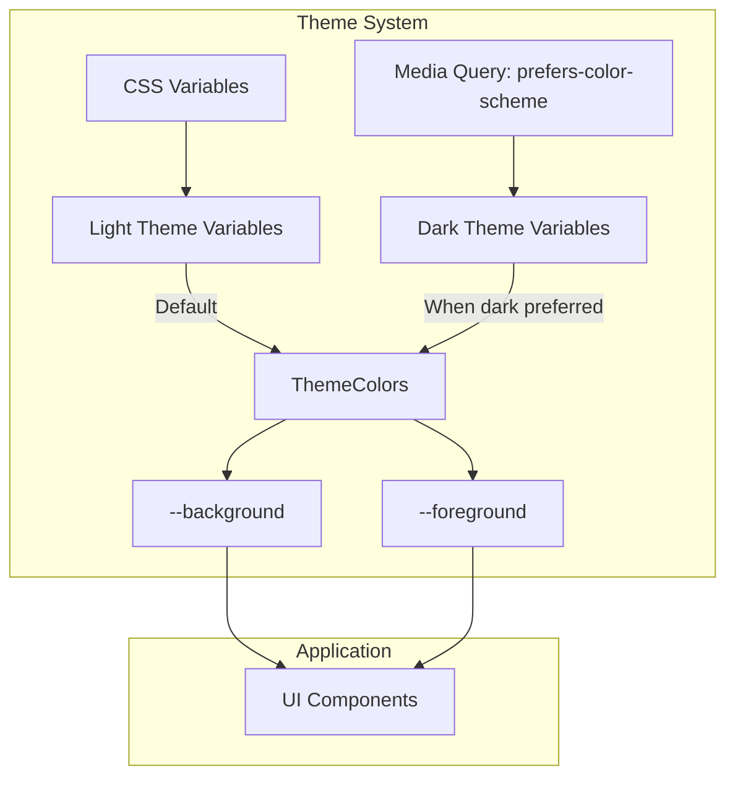
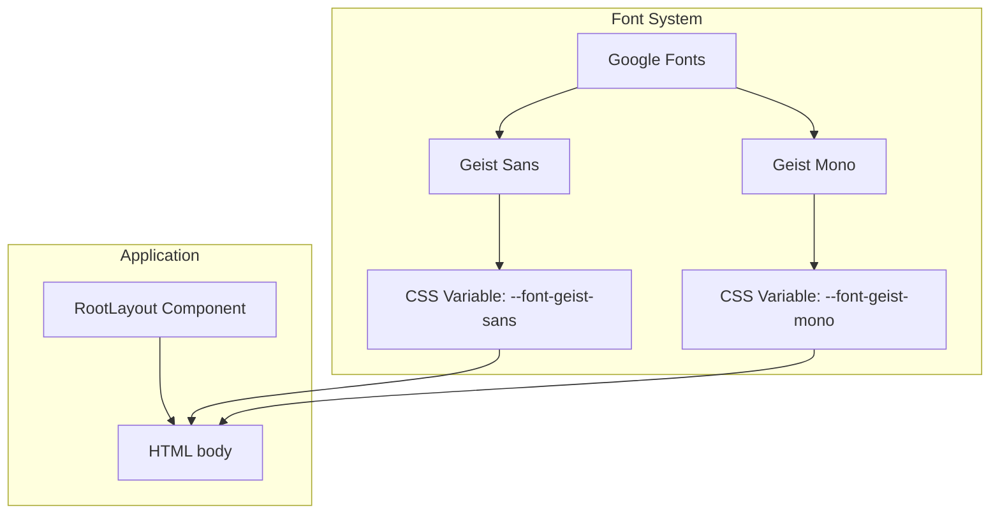
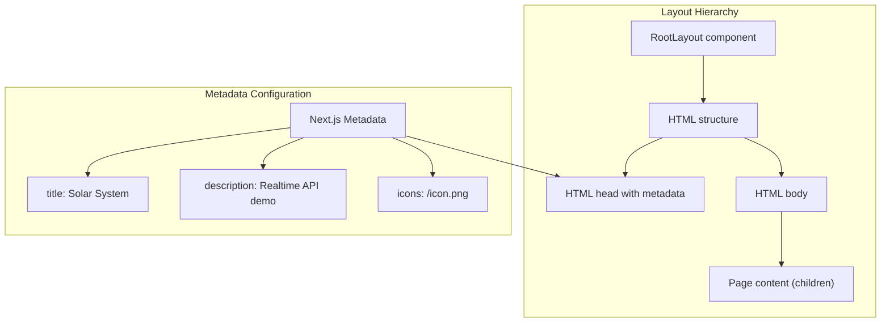

<!-- source: DeepWiki mcp.deepwiki.com · repo openai/openai-realtime-solar-system · page 5.1 Layout and Styling · fetched 2026-10-26 -->

# Layout and Styling

<details>
<summary>Relevant source files</summary>

The following files were used as context for generating this wiki page:

- [app/globals.css](app/globals.css)
- [app/layout.tsx](app/layout.tsx)

</details>


This document explains the layout structure and styling approach used in the OpenAI Realtime Solar System Demo. It covers the foundational styling system, including Tailwind CSS integration, theming, typography, and the application's base layout structure. For information about the main page structure and user interaction experience, see [Main Page and User Experience](#5.2).

## Styling Architecture

The application uses a clean, modern styling approach based on Tailwind CSS with custom theming support for both light and dark modes.

### Tailwind CSS Integration

Tailwind CSS provides the foundation for all styling in the application through utility classes. This approach offers:

- Consistent design tokens through Tailwind's design system
- Utility-first styling for rapid development
- Component-level style isolation

The base Tailwind configuration is imported at the top of the global CSS file:

```css
@tailwind base;
@tailwind components;
@tailwind utilities;
```

Sources: [app/globals.css:1-3]()

### Theme System

The application implements a simple theming system using CSS custom properties (variables) with light and dark mode support. These variables are used throughout the application to maintain consistent colors across all components.



Title: Theme System Architecture

The theme variables are defined in the global CSS file:

```css
:root {
  --background: #ffffff;
  --foreground: #171717;
}

@media (prefers-color-scheme: dark) {
  :root {
    --background: #0a0a0a;
    --foreground: #ededed;
  }
}

body {
  color: var(--foreground);
  background: var(--background);
  font-family: Arial, Helvetica, sans-serif;
}
```

Sources: [app/globals.css:5-21]()

### Typography and Fonts

The application uses the Geist font family from Google Fonts for a clean, modern typography style:

1. **Geist Sans** - Primary sans-serif font for general text
2. **Geist Mono** - Monospace font for code or technical information



Title: Typography System Architecture

Font configuration in the root layout:

```tsx
const geistSans = Geist({
  variable: "--font-geist-sans",
  subsets: ["latin"],
});

const geistMono = Geist_Mono({
  variable: "--font-geist-mono",
  subsets: ["latin"],
});
```

Sources: [app/layout.tsx:2-13]()

The fonts are applied to the body element through CSS variables:

```tsx
<body
  className={`${geistSans.variable} ${geistMono.variable} antialiased`}
>
  {children}
</body>
```

Sources: [app/layout.tsx:30-34]()

## Layout Structure

The application uses a hierarchical layout structure with Next.js, where the root layout provides the base HTML structure that wraps all pages.

### Root Layout

The `RootLayout` component serves as the foundation for all pages in the application, providing:

- HTML document structure
- Font application
- Metadata configuration (title, description, favicon)



Title: Root Layout Architecture

The root layout component:

```tsx
export default function RootLayout({
  children,
}: Readonly<{
  children: React.ReactNode;
}>) {
  return (
    <html lang="en">
      <body
        className={`${geistSans.variable} ${geistMono.variable} antialiased`}
      >
        {children}
      </body>
    </html>
  );
}
```

Sources: [app/layout.tsx:23-37]()

Metadata configuration:

```tsx
export const metadata: Metadata = {
  title: "Solar System",
  description: "Realtime API demo",
  icons: {
    icon: "/icon.png",
  },
};
```

Sources: [app/layout.tsx:15-21]()

## Styling Best Practices

Based on the application's approach, these are the recommended styling practices for the OpenAI Realtime Solar System Demo:

1. **Use Tailwind utilities** for component styling whenever possible
2. **Reference theme variables** (`var(--background)`, `var(--foreground)`) for colors to ensure theme consistency
3. **Apply font variables** through className properties to ensure consistent typography
4. **Use the antialiased** class for improved text rendering
5. **Leverage Next.js metadata** for SEO and browser display properties

## Responsive Design

The application implements responsive design through:

1. **Media queries** for dark/light theme switching based on system preferences
2. **Tailwind's responsive utility classes** for adapting layouts at different breakpoints
3. **Fluid typography** through the font system

This responsive approach ensures the solar system demo works well across different devices and screen sizes.

Sources: [app/globals.css:10-15](), [app/layout.tsx:30-34]()

---

