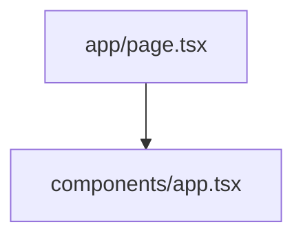
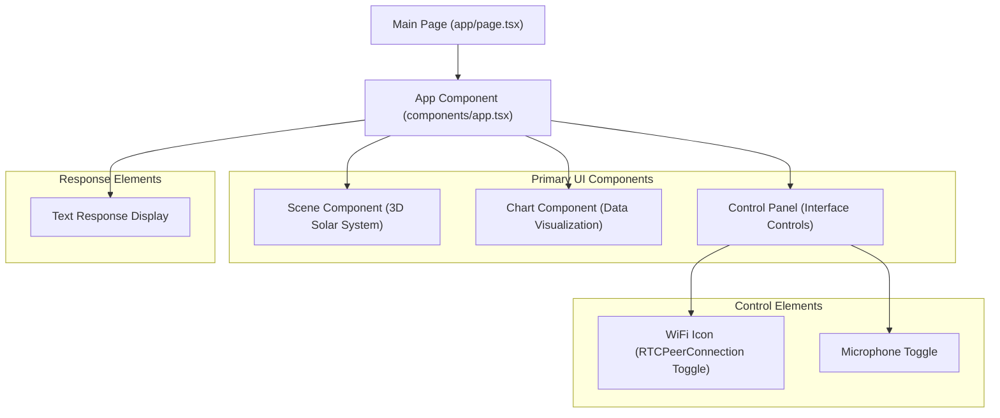
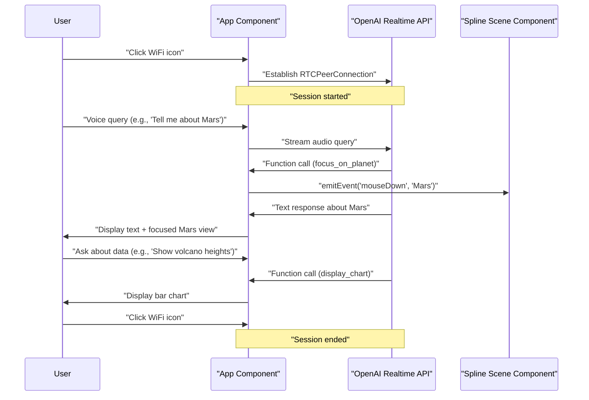
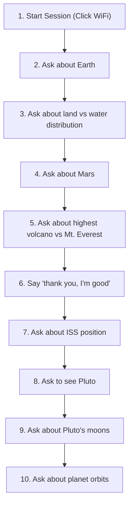
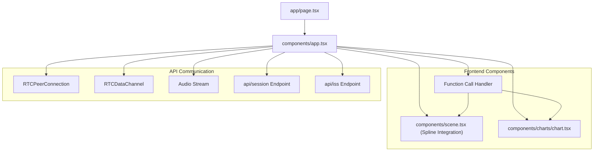

<!-- source: DeepWiki mcp.deepwiki.com · repo openai/openai-realtime-solar-system · page 5.2 Main Page and User Experience · fetched 2026-10-26 -->

# Main Page and User Experience

Relevant source files

The following files were used as context for generating this wiki page:

- [README.md](README.md)
- [app/page.tsx](app/page.tsx)

## Purpose and Scope

This document describes the main page structure and user interaction experience of the OpenAI Realtime Solar System Demo. It covers the page's components, layout, interaction mechanisms, and the overall user journey through the application. For information about the styling and layout system, see [Layout and Styling](#5.1). For details about function calling mechanics, see [Function Calling System](#2.3).

## Main Page Structure

The main page serves as the entry point for the application, presenting a minimal structure that renders the App component, which manages all core functionality.

The main page wraps the App component in a div that fills the entire screen space:

Sources: [app/page.tsx:1-9]()

## User Interface Components

The user interface consists of several key components arranged in a specific layout:

Sources: [README.md:7-9](), [README.md:57-64]()

## Session Management and Controls

The primary user controls are located in the top-right corner of the interface:

| Control | Function | States |
|---------|----------|--------|
| WiFi Icon | Toggles connection to OpenAI Realtime API | Grey: Disconnected, Green: Connected |
| Microphone Icon | Controls microphone input | On: Active, Off: Muted |

To start a session:
1. Wait for the page to fully load (initial load may take time)
2. Click the WiFi icon in the top right corner
3. When the icon turns green, the session is active and you can begin speaking

To end a session:
1. Click the WiFi icon again to disconnect
2. The conversation state will be reset

Sources: [README.md:57-64]()

## User Interaction Flow

The typical user interaction flow follows this sequence:

Sources: [README.md:72-86](), [README.md:90-104]()

## Voice Interaction Capabilities

The application supports various voice interactions through function calling:

| Voice Query Type | System Response | UI Effect | Function Call |
|------------------|-----------------|-----------|---------------|
| Planet information | Information about the requested planet | Focus animation on planet | `focus_on_planet` |
| Moon information | Details about moons | Display moons if configured | `show_moons` |
| Data comparisons | Comparative data analysis | Chart visualization appears | `display_chart` |
| ISS position | Current ISS location | ISS visualization in scene | `get_iss_position` |
| Orbit view request | Explanation of planetary orbits | Camera shifts to top-down view | `show_orbit_view` |
| Session closing | Acknowledgment | Camera resets to initial position | N/A (direct animation) |

Sources: [README.md:72-86]()

## Keyboard Shortcuts

The application supports keyboard shortcuts for common interactions:

| Key | Action | Equivalent Voice Command |
|-----|--------|-------------------------|
| Space bar | Reset camera to initial position | "Thank you, I'm good" |
| M key | Change to orbit view | "Show me the planets' orbits" |
| Enter key | Return to main view | N/A |

Sources: [README.md:84-86]()

## Recommended User Flow

The application is designed with a suggested demonstration flow that showcases its capabilities:

This flow ensures users experience all the key interaction types supported by the application, from planet focus to chart displays and specialized views.

Sources: [README.md:90-104]()

## System Integration

The main page integrates with several key system components:

The Main Page connects the user interface with the WebRTC communication layer, allowing real-time voice interaction with the OpenAI API and coordinating between visual components like the 3D scene and data charts.

Sources: [app/page.tsx:1-9](), [README.md:7-9]()

## Performance and Loading Considerations

The application includes important performance considerations:

1. **Initial Scene Loading**: The 3D scene is resource-intensive and may take time to load initially
   - Users should wait for the page to fully load before initiating a session
   - A loading indicator would appear during this time

2. **Caching Behavior**: Subsequent visits benefit from browser caching
   - The README notes: "The subsequent loads should be faster as it will be cached"

Sources: [README.md:55]()

## Voice Interaction Best Practices

For optimal interaction with the voice interface:

1. **Environment**: Minimize background noise and echo to prevent interruptions
2. **Speaking Pattern**: 
   - Speak clearly and directly
   - Wait for the model to finish responding before asking a new question
   - Use direct phrases that clearly indicate the subject (e.g., "Tell me about Mars")
3. **Function Prompting**:
   - To trigger specific functionality, use clear language (e.g., "Show me a chart of planet sizes")
   - If a chart or animation doesn't appear, explicitly ask the model to show it

Sources: [README.md:68](), [README.md:82-83]()

## Related Pages

For more detailed information about specific aspects of the system:
- [Overview](#1) - For a high-level introduction to the entire system
- [Function Calling System](#2.3) - For details on how the AI model triggers actions
- [3D Solar System Scene](#3.2) - For information on the Spline scene integration
- [Chart Visualization System](#3.3) - For details on the data visualization components