# Page: Overview

# Overview

<details>
<summary>Relevant source files</summary>

The following files were used as context for generating this wiki page:

- [README.md](README.md)

</details>


This document provides a technical overview of the OpenAI Realtime Solar System Demo, which demonstrates the integration of the OpenAI Realtime API with a 3D solar system visualization. The demo showcases voice-based interaction with a dynamic 3D scene built with Spline, utilizing WebRTC for real-time communication and Function Calling for triggering actions within the application.

For installation and configuration instructions, see [Getting Started](#1.1). For licensing information, see [License and Legal](#1.2).

## System Architecture

The OpenAI Realtime Solar System Demo follows a client-server architecture with most of the processing happening on the client side, interfacing with external APIs as needed.

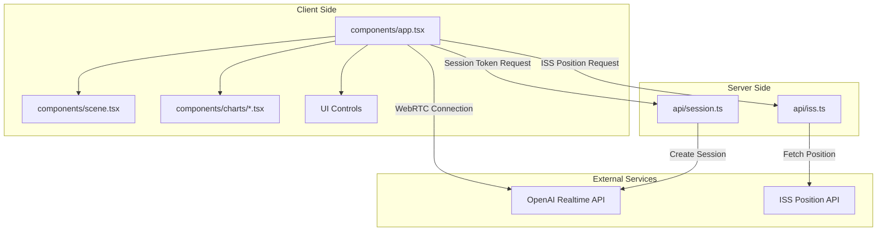

The application consists of a Next.js web application that serves as the central hub, establishing a WebRTC connection with the OpenAI Realtime API for voice interaction. The application utilizes a Spline 3D scene for visualizing the solar system and includes chart components for data visualization.

Sources: [README.md:6-9]()

## Key Components

### Next.js Web Application

The application is built using Next.js, with the following core components:

| Component | Purpose | File Location |
|-----------|---------|---------------|
| App | Main orchestration component managing WebRTC, audio, and UI states | components/app.tsx |
| Scene | Integration with Spline 3D scene | components/scene.tsx |
| Charts | Data visualization components | components/charts/*.tsx |
| API Endpoints | Server-side endpoints for session management and ISS data | app/api/* |

### OpenAI Realtime API Integration

The application integrates with the OpenAI Realtime API using WebRTC, enabling real-time voice-based interactions and function calling capabilities.

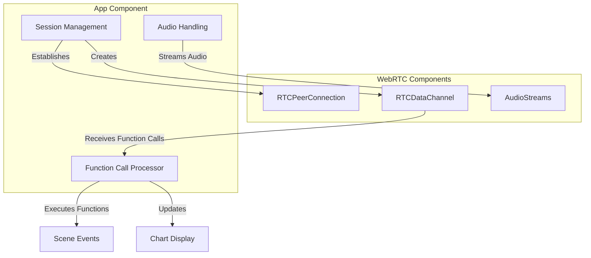

The WebRTC integration handles bidirectional audio communication with the OpenAI API while the function call processor interprets and executes commands received from the API.

Sources: [README.md:8-9]()

### Spline 3D Scene

The application uses a pre-built Spline 3D scene that visualizes the solar system. The scene is loaded in the browser and controlled via events triggered by function calls.

### Function Calling System

The OpenAI model can trigger actions in the application through a function calling system defined in the configuration.

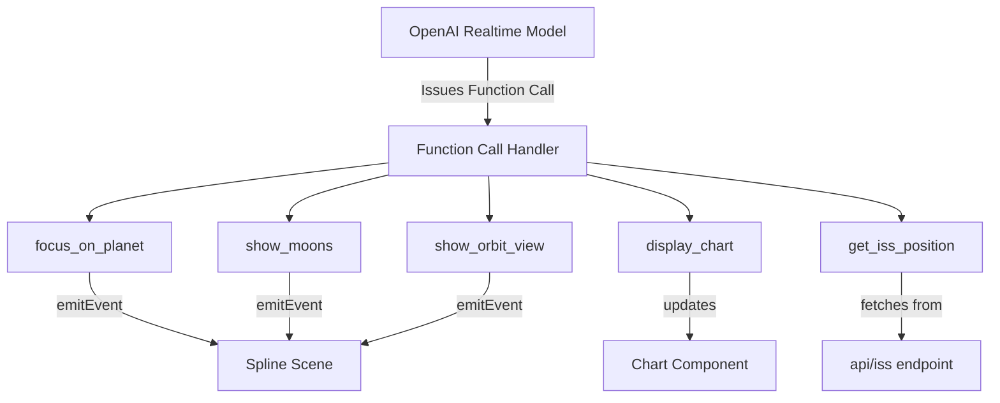

Each function maps to specific actions in the application, such as focusing on a planet, displaying a chart, or showing the International Space Station position.

Sources: [README.md:72-86](), [lib/config.ts]()

## Data Flow

The following sequence diagram illustrates the typical data flow during a user interaction:

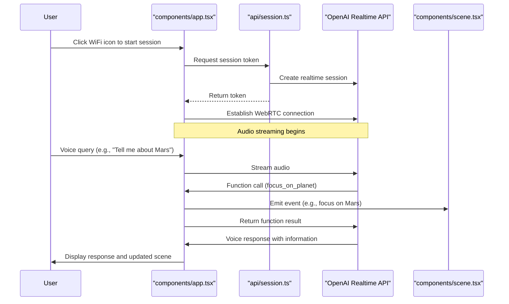

This flow demonstrates how user voice queries are processed through the OpenAI API, which may respond with function calls that trigger animations in the Spline scene along with voice responses.

Sources: [README.md:56-64]()

## Configured Interactions

The demo supports several predefined interactions that showcase the integration between voice commands, the AI model, and the 3D scene:

1. **Planet Focus**: Asking about specific planets triggers visual focus animations
2. **Moons Display**: Requesting information about moons causes them to appear in the scene
3. **Data Visualization**: Questions about planetary data can trigger chart displays
4. **ISS Tracking**: Inquiries about the ISS position fetch real-time data and display the station
5. **Orbit View**: Questions about planetary orbits trigger a top-down view of the solar system
6. **Conversation Reset**: Ending the conversation resets the camera position

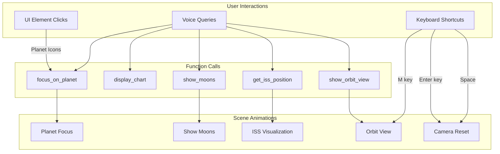

These interactions demonstrate the power of combining voice interaction with function calling to create an interactive educational experience.

Sources: [README.md:74-86]()

## Technical Components

### App Component

The central orchestration component managing:
- WebRTC connection to OpenAI API
- Audio processing and streaming
- Function call handling
- UI state management

### Scene Component

Integrates the Spline 3D scene and provides methods to trigger animations and events within the scene.

### Chart System

Generates visual representations of data about celestial bodies based on user queries.

### API Endpoints

Two main endpoints facilitate the application's functionality:
1. `/api/session`: Creates and manages OpenAI Realtime API sessions
2. `/api/iss`: Fetches real-time position data for the International Space Station

### Function Call Configuration

The function definitions and system instructions are configured in `lib/config.ts`, which determines:
- Available functions for the AI model
- Function parameters and constraints
- System instructions for the AI model's behavior

Sources: [lib/config.ts]()

## Related Pages

For more detailed information about specific system components, refer to these wiki pages:

- [System Architecture](#2) - Comprehensive overview of the system architecture
- [WebRTC Integration](#2.1) - Details on the WebRTC communication implementation
- [OpenAI Realtime API](#2.2) - Specifics of the OpenAI API integration
- [Function Calling System](#2.3) - In-depth explanation of the function calling mechanism
- [Core Components](#3) - Detailed descriptions of the main application components

Sources: [README.md]()

---

# Page: Getting Started

# Getting Started

<details>
<summary>Relevant source files</summary>

The following files were used as context for generating this wiki page:

- [.gitignore](.gitignore)
- [README.md](README.md)

</details>


This document guides you through the process of setting up and running the OpenAI Realtime Solar System Demo locally. It covers prerequisites, installation, configuration, and initializing your first interactive session. For information about the overall architecture of the system, see [System Architecture](#2).

## Prerequisites

Before you begin, ensure you have:

- Node.js (v14 or later)
- npm package manager
- An OpenAI API key with access to the Realtime API
- Git installed on your system

## Installation Process

The installation process involves cloning the repository, setting up your API key, and installing dependencies.

### Installation Flow

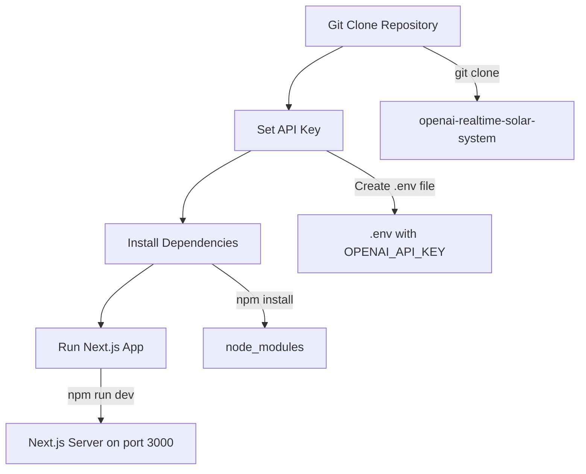

Sources: [README.md:24-53]()

### 1. Clone the Repository

Clone the repository from GitHub using the following command:

```bash
git clone https://github.com/openai/openai-realtime-solar-system.git
cd openai-realtime-solar-system
```

Sources: [README.md:24-26]()

### 2. Set Your OpenAI API Key

You have two options for setting your API key:

#### Option 1: Global Environment Variable

Set the `OPENAI_API_KEY` environment variable globally in your system.

#### Option 2: Project-specific .env File

Create a `.env` file in the root directory of the project and add your API key:

```
OPENAI_API_KEY=your_api_key_here
```

Sources: [README.md:28-37](), [.gitignore:34]()

### 3. Install Dependencies

Install the required dependencies using npm:

```bash
npm install
```

Sources: [README.md:39-45]()

## Running the Application

After installation, start the application with:

```bash
npm run dev
```

The application will be available at http://localhost:3000.

**Note:** The first time you load the app, the 3D scene may take a while to load as it's quite large. Subsequent loads should be faster as the scene will be cached in your browser.

Sources: [README.md:47-55]()

### Application Initialization Flow

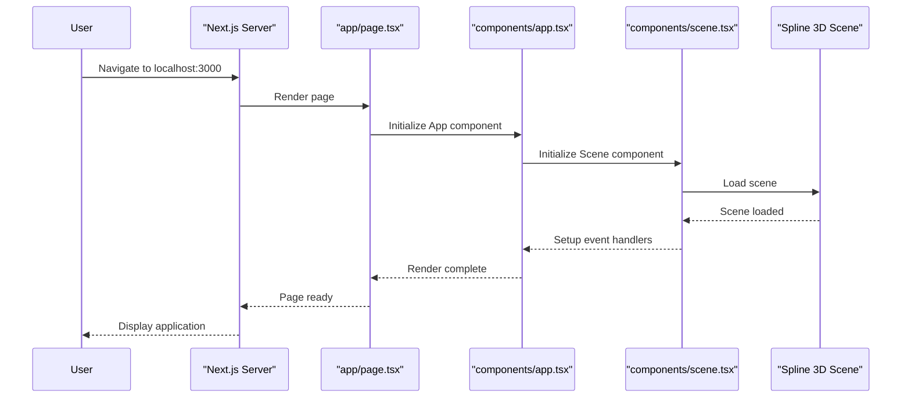

Sources: Based on the Component Architecture diagram provided

## Starting a Session

To begin interacting with the solar system demo:

1. Wait for the page to load completely
2. Click on the wifi icon in the top right corner of the app
3. When the icon turns green, your session is active and ready
4. Speak into your microphone to interact with the model
5. Use the microphone icon to toggle your microphone on/off
6. Click the wifi icon again to end the session and reset the conversation

Sources: [README.md:57-64]()

### Session Establishment Flow

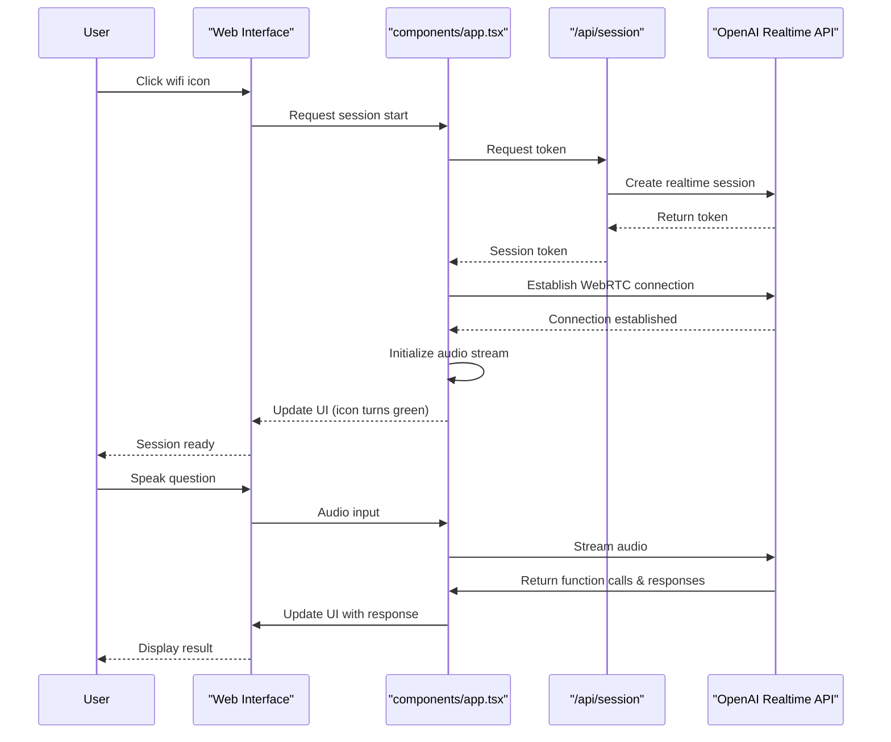

Sources: Based on the Data Flow and Communication diagram provided

## Voice Command to Code Execution Flow

This diagram illustrates how user voice commands are processed and mapped to specific code functions:

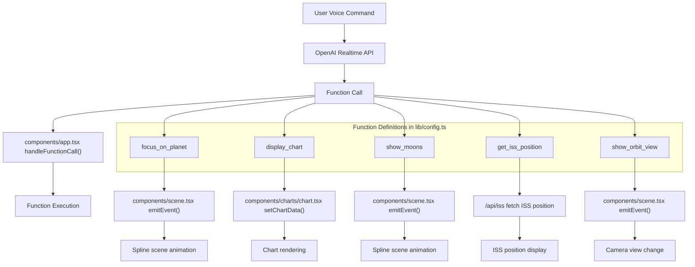

Sources: Based on the Function Calling System diagram provided

## Example Interactions

Here are some example interactions you can try with the demo:

| Voice Command | Function Called | Result |
|---------------|----------------|--------|
| "Tell me about Mars" | `focus_on_planet('mars')` | Camera focuses on Mars with information |
| "Show me a chart of planet sizes" | `display_chart({type: 'bar', ...})` | Bar chart of planet sizes appears |
| "Does Jupiter have moons?" | `show_moons('jupiter')` | Jupiter's Galilean moons are displayed |
| "Where is the ISS right now?" | `get_iss_position()` | Current ISS position is displayed |
| "Show me the orbits of planets" | `show_orbit_view()` | Camera changes to orbital perspective |
| "Thank you, I'm good" | N/A | Camera resets to initial position |

Sources: [README.md:73-86](), [README.md:92-104]()

## Configuration Options

The demo can be customized by modifying several configuration files:

| File | Purpose | What You Can Change |
|------|---------|---------------------|
| `lib/config.ts` | Defines AI instructions and available function tools | System instructions, function definitions, parameters |
| `lib/constants.ts` | Contains API parameters | Voice settings, model settings |
| `components/scene.tsx` | Controls the Spline scene | Scene URL, event handlers |

To use your own Spline scene, update the scene URL in `components/scene.tsx` and configure the appropriate event handlers to trigger animations. Make sure to update the function definitions in `lib/config.ts` to match your custom scene's capabilities.

Sources: [README.md:105-127]()

## Troubleshooting

### Common Issues

| Issue | Solution |
|-------|----------|
| API key not recognized | Verify your `.env` file is in the correct location and properly formatted |
| Scene not loading | Check your internet connection and browser console for errors |
| Voice not recognized | Ensure microphone permissions are granted and there's minimal background noise |
| WebRTC connection fails | Check if your network allows WebRTC connections |
| Function calls not working | Review the examples in the README for properly formatted requests |

### Browser Compatibility

For optimal performance, use recent versions of Chrome, Firefox, or Edge browsers. Safari may have limited WebRTC support in some versions.

Sources: [README.md:68]()

---

# Page: License and Legal

# License and Legal

<details>
<summary>Relevant source files</summary>

The following files were used as context for generating this wiki page:

- [LICENSE](LICENSE)
- [README.md](README.md)

</details>


This document outlines the licensing terms and legal considerations for the OpenAI Realtime Solar System Demo. It covers the project's license, usage permissions, attribution requirements, and legal considerations when using the OpenAI API with this demo.

## License Overview

The OpenAI Realtime Solar System Demo is licensed under the MIT License, a permissive open-source license that allows for extensive freedom in using, modifying, and distributing the software.

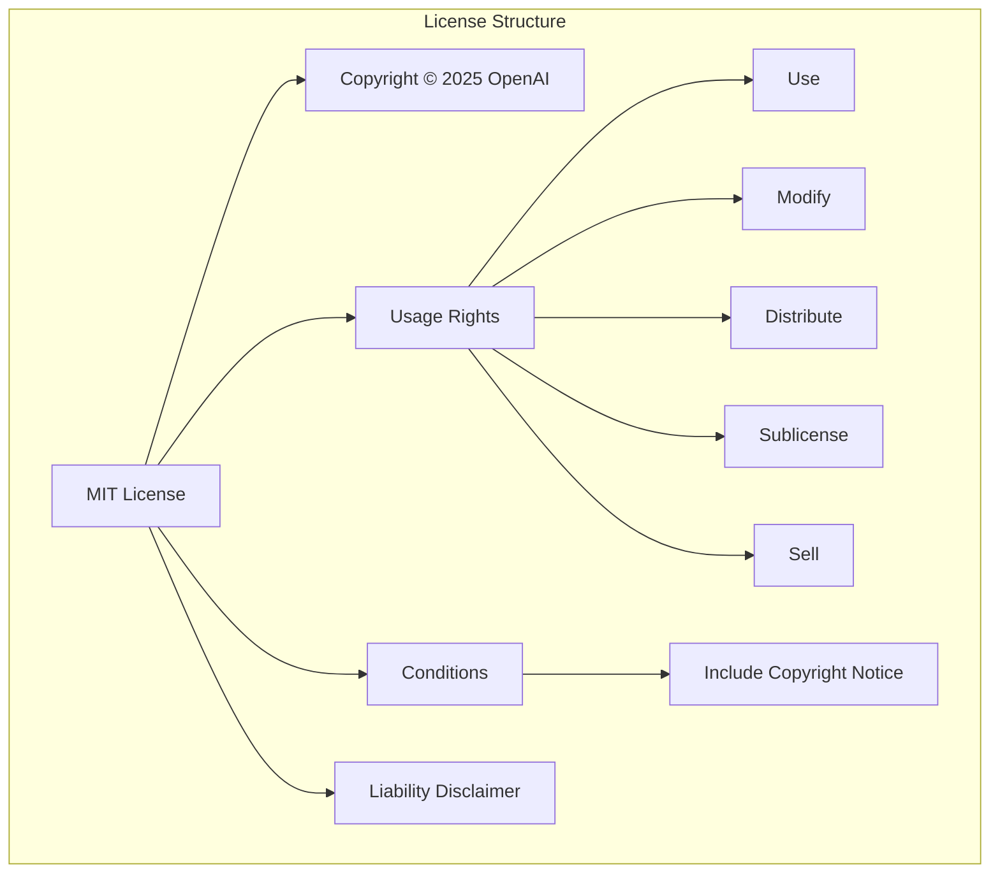

Sources: [LICENSE:1-21](), [README.md:3-3](), [README.md:128-130]()

## MIT License Details

The MIT License grants the following permissions without restriction:

| Permission | Description |
|------------|-------------|
| Use | You can use the software for any purpose, private or commercial |
| Modify | You can modify the source code to suit your needs |
| Distribute | You can distribute original or modified versions |
| Sublicense | You can incorporate the software into products that have different licenses |
| Sell | You can sell copies of the software |

The license only requires that all copies of the software include the original copyright notice and the MIT License text. The full text of the license can be found in the LICENSE file at the project root.

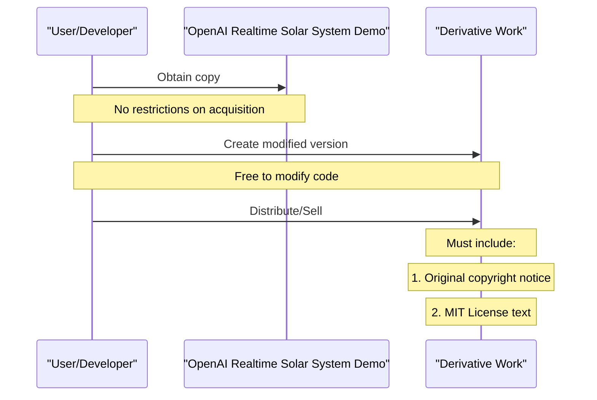

Sources: [LICENSE:1-21]()

## License Compliance

To comply with the MIT License when using, modifying, or distributing this software:

1. **Retain the copyright notice**: Include the original copyright notice (`Copyright (c) 2025 OpenAI`) in all copies or substantial portions of the software.

2. **Include the full license text**: The complete MIT License text must be included in all copies or substantial portions of the software.

3. **No warranty**: Acknowledge that the software is provided "as is", without warranty of any kind.

Sources: [LICENSE:5-21]()

## Legal Considerations for API Usage

The demo uses the OpenAI Realtime API, which has its own terms of service and usage requirements:

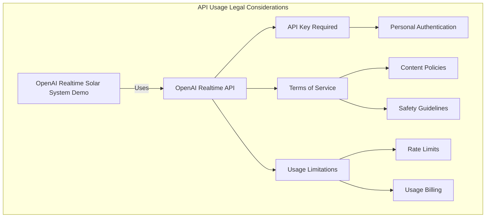

When using this demo with the OpenAI API:

1. **API Key**: You must use your own OpenAI API key, which requires agreeing to OpenAI's terms of service.

2. **Usage Costs**: Using the OpenAI Realtime API with this demo will incur charges to your OpenAI account according to OpenAI's pricing structure.

3. **Compliance**: Your use of the API through this demo must comply with OpenAI's usage policies.

4. **Rate Limits**: Be aware of rate limits and other restrictions imposed by the OpenAI API.

Sources: [README.md:17-37]()

## Third-Party Components

The demo integrates several third-party technologies, each with their own licenses:

| Component | Usage in Demo | License Type |
|-----------|---------------|--------------|
| Next.js | Web application framework | MIT License |
| Spline | 3D scene rendering | Free for use as integrated |
| OpenAI Realtime API | Voice interaction and AI responses | Commercial API with Terms of Service |

When deploying or distributing this demo, ensure compliance with all individual licenses of these components.

Sources: [README.md:4-9](), [README.md:107-116]()

## Using the Demo for Commercial Purposes

The MIT License allows for commercial use of the OpenAI Realtime Solar System Demo. However, commercial deployments should consider:

1. **API Costs**: OpenAI API usage will incur charges that scale with usage.

2. **Attribution**: While the MIT License only requires including the license text and copyright notice, it's good practice to acknowledge the original work.

3. **Liability**: The MIT License explicitly states that the authors or copyright holders are not liable for any claims, damages, or other liability arising from the software.

4. **Third-Party Services**: Commercial usage must comply with the terms of all third-party services incorporated (especially the OpenAI API).

Sources: [LICENSE:15-21](), [README.md:106-127]()

## License Applicability

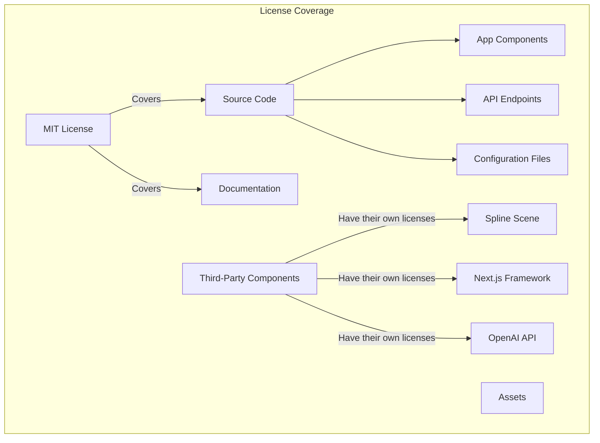

The MIT License applies to the OpenAI Realtime Solar System Demo codebase specifically, including:

- Custom React components (`components/` directory)
- API implementation (`pages/api/` directory)
- Configuration and utility files

The license does not override or replace the licenses of third-party dependencies or services integrated into the demo.

Sources: [LICENSE:1-21](), [README.md:128-130]()

## Questions and Legal Support

The MIT License does not provide legal support or warranty. If you have specific legal questions about using this demo or need clarification on licensing terms, consider:

1. Consulting with a legal professional who specializes in software licensing
2. Reviewing the [MIT License FAQ](https://opensource.org/licenses/MIT) on the Open Source Initiative website
3. Consulting OpenAI's terms of service for API usage questions

Note that this wiki page provides general information and not legal advice.

Sources: [LICENSE:15-21]()

---

# Page: System Architecture

# System Architecture

<details>
<summary>Relevant source files</summary>

The following files were used as context for generating this wiki page:

- [README.md](README.md)
- [components/app.tsx](components/app.tsx)

</details>


This document provides a high-level overview of the OpenAI Realtime Solar System Demo's architecture, explaining how the different components interact to create an interactive, voice-controlled solar system visualization. For specific details about WebRTC integration, see [WebRTC Integration](#2.1), for OpenAI Realtime API integration, see [OpenAI Realtime API](#2.2), and for the function calling system, see [Function Calling System](#2.3).

## System Overview

The OpenAI Realtime Solar System Demo is a web application that combines WebRTC-based voice communication with the OpenAI Realtime API, interactive 3D visualization using Spline, and data visualization via charts. It allows users to interact with a 3D solar system model through voice commands, with the AI interpreting requests and triggering appropriate actions in the interface.

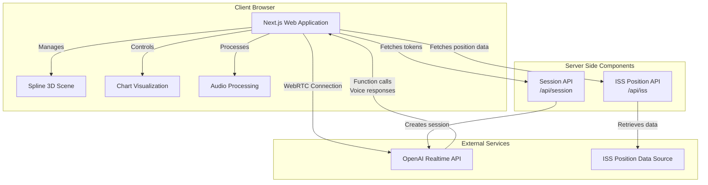

Sources:
- [README.md:7-9]()
- [components/app.tsx:3-8]()

## Core Components

The system consists of the following core components:

1. **Next.js Web Application**: The central hub that manages user interactions, WebRTC connections, and orchestrates all other components.
2. **Spline 3D Scene**: Interactive 3D visualization of the solar system.
3. **OpenAI Realtime API Integration**: Handles voice processing and provides AI responses.
4. **WebRTC Communication**: Establishes real-time audio connections.
5. **Function Calling System**: Allows the AI to trigger actions in the application.
6. **API Endpoints**: Provides session management and external data integration.

### Component Relationships

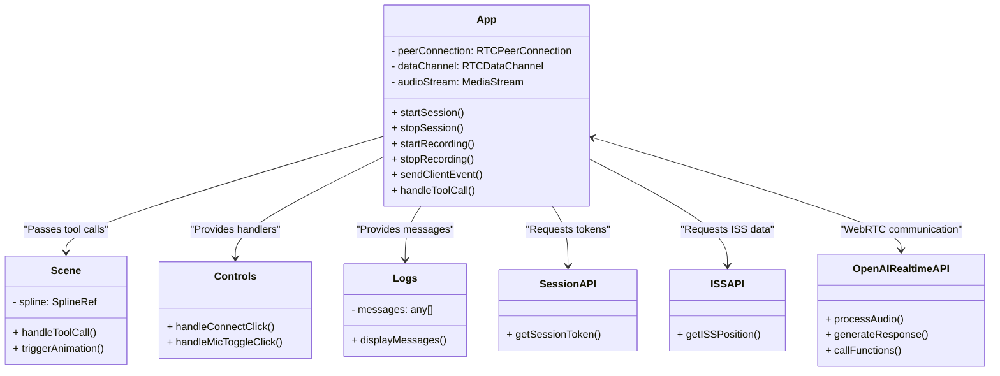

Sources:
- [components/app.tsx:15-301]()
- [README.md:72-86]()

## Communication Flow

The following sequence diagram illustrates the typical communication flow during a user interaction with the system:

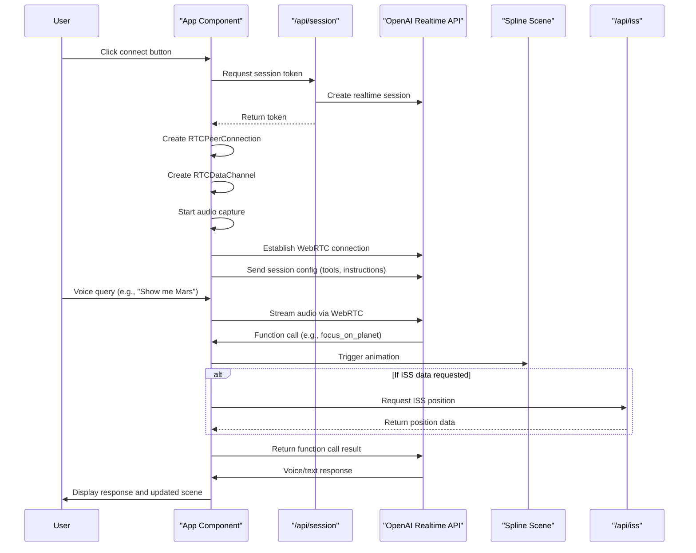

Sources:
- [components/app.tsx:30-177]()
- [components/app.tsx:194-235]()

## WebRTC Integration

The application establishes real-time communication with the OpenAI API using WebRTC, enabling bidirectional audio streaming and data exchange. The WebRTC connection consists of two main channels:

1. **Audio Channel**: Sends user's voice input to the API and receives audio responses.
2. **Data Channel**: Exchanges JSON messages for function calls, responses, and session management.

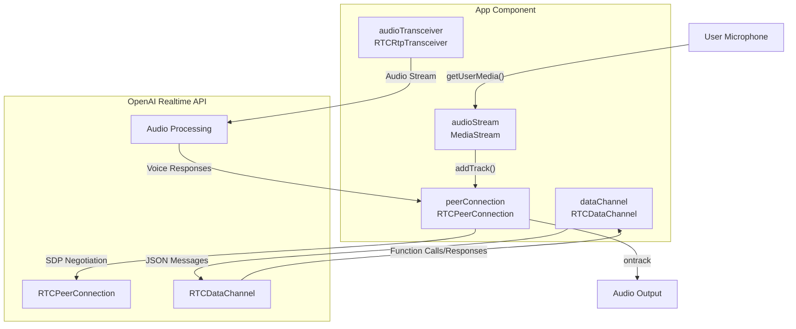

Sources:
- [components/app.tsx:22-27]()
- [components/app.tsx:30-90]()
- [components/app.tsx:119-167]()

## Function Calling System

The application implements a function calling mechanism that allows the OpenAI model to trigger specific actions in the interface. This is handled through the WebRTC data channel:

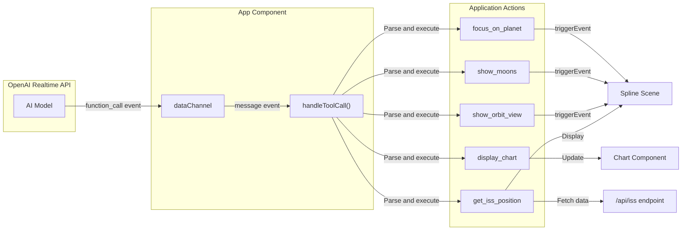

Sources:
- [components/app.tsx:194-235]()
- [README.md:72-86]()

## System Initialization and Session Management

The system initialization process involves establishing a WebRTC connection with the OpenAI Realtime API and configuring the session parameters:

### Session Establishment Process

1. **Token Acquisition**: The application requests a session token from the `/api/session` endpoint.
2. **WebRTC Setup**: A new `RTCPeerConnection` is created and configured.
3. **Media Capture**: User's microphone is accessed using `getUserMedia()`.
4. **Data Channel Creation**: An `RTCDataChannel` is established for exchanging JSON messages.
5. **SDP Negotiation**: The application creates an offer, sends it to the API, and processes the answer.
6. **Session Configuration**: Once the connection is established, the application sends configuration data, including tools and instructions.

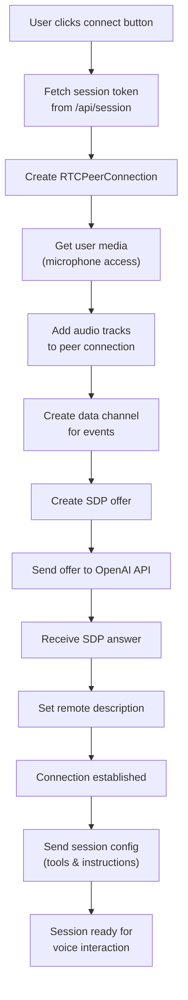

Sources:
- [components/app.tsx:30-90]()
- [components/app.tsx:237-267]()

## Data Flow Architecture

The application's data flow architecture illustrates how information travels through the system during user interactions:

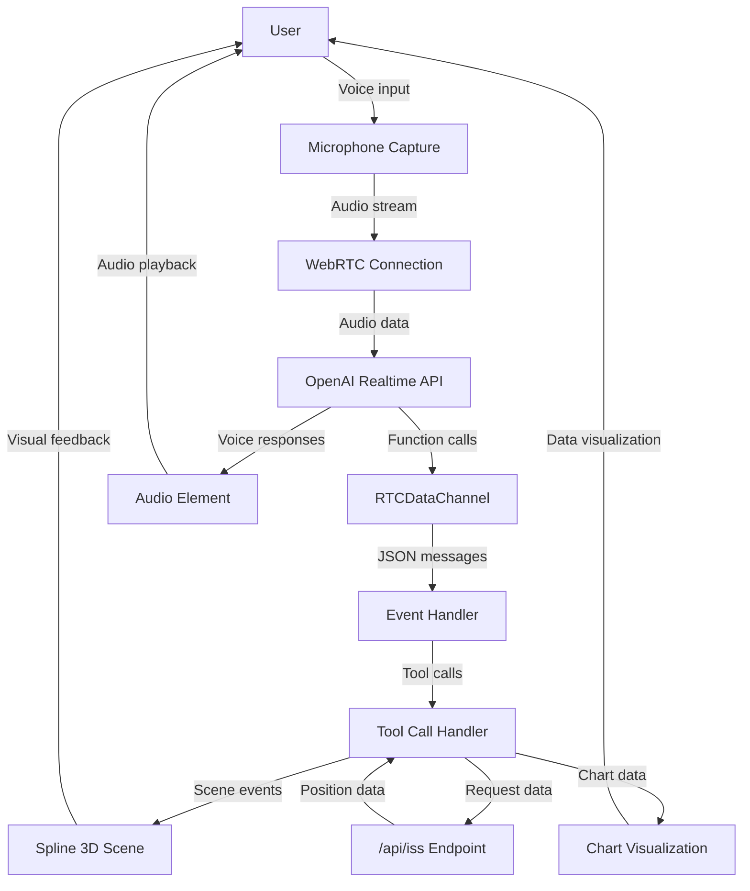

Sources:
- [components/app.tsx:15-301]()
- [README.md:72-86]()

## Key Technical Implementation Details

### WebRTC Connection Management

The application implements careful WebRTC connection and media stream management:

1. **Connection Initialization**: The `startSession()` function sets up the WebRTC connection with proper event handlers.
2. **Media Stream Control**: The application provides functions to start and stop recording from the user's microphone.
3. **Connection Cleanup**: The `stopSession()` function ensures proper cleanup of all resources when a session ends.

### Tool Call Handling

The system processes tool calls from the OpenAI API through the `handleToolCall()` function, which:

1. Parses the incoming function call data
2. Executes the appropriate action based on the function name
3. Handles special cases like fetching ISS position data
4. Returns the result back to the API
5. Forces a model response when necessary

Sources:
- [components/app.tsx:194-235]()

## Summary

The OpenAI Realtime Solar System Demo showcases a sophisticated architecture that combines modern web technologies to create an interactive, voice-controlled solar system exploration experience. The application leverages WebRTC for real-time communication, integrates with the OpenAI Realtime API for voice processing and AI responses, and uses function calling to trigger actions in a 3D visualization built with Spline.

Key strengths of the architecture include:
- Clean separation of concerns between components
- Bidirectional real-time communication
- Flexible function calling system
- Integration of multiple visualization techniques (3D scene and charts)
- Real-time external data integration (ISS position)

For more details about specific aspects of the architecture, refer to the related pages:
- [WebRTC Integration](#2.1)
- [OpenAI Realtime API](#2.2)
- [Function Calling System](#2.3)

Sources:
- [README.md:7-9]()
- [components/app.tsx:15-301]()

---

# Page: WebRTC Integration

# WebRTC Integration

<details>
<summary>Relevant source files</summary>

The following files were used as context for generating this wiki page:

- [app/api/session/route.ts](app/api/session/route.ts)
- [components/app.tsx](components/app.tsx)

</details>


This document explains how WebRTC (Web Real-Time Communication) is implemented in the OpenAI Realtime Solar System Demo to establish bidirectional, real-time communication between the web browser and the OpenAI Realtime API. For information about the OpenAI Realtime API itself and its capabilities, see [OpenAI Realtime API](#2.2). For details on how function calling works over this connection, see [Function Calling System](#2.3).

## 1. Overview of WebRTC Integration

The demo uses WebRTC to establish two critical communication channels:

1. **Audio Stream**: Bidirectional audio transmission that sends user voice input to the OpenAI API and receives AI-generated voice responses
2. **Data Channel**: Bidirectional messaging channel for sending function calls, text responses, and other structured data

```mermaid
flowchart LR
    subgraph "Client Browser"
        UA["User Audio Input"]
        DC["Data Channel"]
        MA["Model Audio Output"]
    end
    
    subgraph "OpenAI Realtime API"
        API["OpenAI Model"]
    end
    
    UA -->|"RTCPeerConnection"| API
    API -->|"RTCPeerConnection"| MA
    DC <-->|"RTCDataChannel"| API
    
    style UA stroke-width:1px
    style MA stroke-width:1px
    style DC stroke-width:1px
    style API stroke-width:1px
```

Sources: [components/app.tsx:21-27](components/app.tsx:21-27)

## 2. WebRTC Connection Lifecycle

### 2.1 Session Initialization

Before establishing a WebRTC connection, the application obtains a session token from the OpenAI API.

```mermaid
sequenceDiagram
    participant Browser as "Web Browser"
    participant SessionAPI as "/api/session Endpoint"
    participant OpenAI as "OpenAI API"
    
    Browser->>SessionAPI: GET request
    SessionAPI->>OpenAI: POST /v1/realtime/sessions
    Note over SessionAPI,OpenAI: Sends model and voice preferences
    OpenAI-->>SessionAPI: Return session token
    SessionAPI-->>Browser: Forward session token
    Note over Browser: Store sessionToken and sessionId
```

Sources: [app/api/session/route.ts:4-31](app/api/session/route.ts:4-31), [components/app.tsx:30-38](components/app.tsx:30-38)

### 2.2 Peer Connection Establishment

Once a session token is obtained, the application sets up the WebRTC peer connection using the Session Description Protocol (SDP).

```mermaid
sequenceDiagram
    participant Browser as "Web Browser"
    participant OpenAI as "OpenAI API"
    
    Browser->>Browser: Create RTCPeerConnection
    Browser->>Browser: Request user media (microphone)
    Browser->>Browser: Add audio tracks to connection
    Browser->>Browser: Create data channel "oai-events"
    Browser->>Browser: Create SDP offer
    Browser->>OpenAI: POST SDP offer with session token
    OpenAI-->>Browser: Return SDP answer
    Browser->>Browser: Set remote description
    Note over Browser,OpenAI: WebRTC connection established
```

Sources: [components/app.tsx:43-91](components/app.tsx:43-91)

## 3. WebRTC Component Architecture

The application manages the WebRTC connection through several key components within the App component:

```mermaid
classDiagram
    class App {
        -peerConnection: RTCPeerConnection
        -dataChannel: RTCDataChannel
        -audioElement: HTMLAudioElement
        -audioStream: MediaStream
        -audioTransceiver: RTCRtpTransceiver
        -tracks: RTCRtpSender[]
        +startSession()
        +stopSession()
        +startRecording()
        +stopRecording()
        +sendClientEvent()
    }
    
    class RTCPeerConnection {
        +createDataChannel()
        +addTrack()
        +createOffer()
        +setLocalDescription()
        +setRemoteDescription()
    }
    
    class RTCDataChannel {
        +send()
        +addEventListener()
    }
    
    App --> RTCPeerConnection : creates and manages
    App --> RTCDataChannel : creates and manages
    RTCPeerConnection --> RTCDataChannel : creates
```

Sources: [components/app.tsx:15-27](components/app.tsx:15-27), [components/app.tsx:30-96](components/app.tsx:30-96)

## 4. Media Stream Handling

The application implements sophisticated management of audio streams to control when the microphone is active.

### 4.1 Audio Input Handling

```mermaid
flowchart TD
    Start["startRecording()"] --> GetMedia["Get user media (microphone)"]
    GetMedia --> StreamExists{"tracks.current exists?"}
    StreamExists -->|Yes| ReplaceTrack["Replace track in existing sender"]
    StreamExists -->|No| AddTrack["Add new track to peer connection"]
    ReplaceTrack --> SetListening["Set isListening = true"]
    AddTrack --> SetListening
    
    Stop["stopRecording()"] --> StopTracks["Stop existing audio tracks"]
    StopTracks --> CreateEmpty["Create empty audio track"]
    CreateEmpty --> ReplaceEmpty["Replace with silent track"]
```

The application uses track replacement to toggle the microphone on and off without disrupting the WebRTC connection:

1. **Start Recording**: Acquires microphone access and adds the track to the peer connection
2. **Stop Recording**: Replaces the active microphone track with a silent placeholder track
3. **Empty Audio Track**: Creates a silent audio track using the Web Audio API

Sources: [components/app.tsx:120-174](components/app.tsx:120-174)

### 4.2 Audio Output Handling

```mermaid
flowchart LR
    PC["peerConnection"] -->|"ontrack event"| AE["audioElement"]
    AE -->|"srcObject = event.streams[0]"| Audio["Browser Audio Output"]
```

Sources: [components/app.tsx:46-55](components/app.tsx:46-55)

## 5. Data Channel Communication

The data channel (`oai-events`) handles bidirectional structured data exchange between the client and the OpenAI API.

### 5.1 Data Channel Setup

```mermaid
flowchart LR
    PC["peerConnection"] -->|"createDataChannel('oai-events')"| DC["dataChannel"]
    DC -->|"addEventListener('open')"| Open["Handle channel open"]
    DC -->|"addEventListener('message')"| Message["Handle incoming messages"]
```

Sources: [components/app.tsx:68-70](components/app.tsx:68-70), [components/app.tsx:193-267](components/app.tsx:193-267)

### 5.2 Message Flow

```mermaid
sequenceDiagram
    participant App as "App Component"
    participant DC as "Data Channel"
    participant API as "OpenAI API"
    
    Note over App,DC: Channel opens
    App->>DC: session.update event
    Note over App,DC: Configure tools and instructions
    DC->>API: Forward event
    
    API->>DC: response.done event
    DC->>App: Parse event
    App->>App: Update UI with response
    
    Note over App,DC: For function calls
    App->>App: Execute function
    App->>DC: function_call_output event
    DC->>API: Forward result
```

Messages sent through the data channel follow a specific event-based structure, with the most common events being:

- `session.update`: Configures the session with tools and instructions
- `response.done`: Contains responses from the model, including function calls
- `conversation.item.create`: Used to send function call outputs back to the model

Sources: [components/app.tsx:177-235](components/app.tsx:177-235), [components/app.tsx:237-267](components/app.tsx:237-267)

## 6. Session Management

The application provides methods to start and stop WebRTC sessions:

### 6.1 Starting a Session

The `startSession` function performs these key steps:
1. Fetches a session token from the server
2. Creates the RTCPeerConnection
3. Sets up audio playback
4. Captures microphone input and adds tracks
5. Establishes the data channel
6. Creates and exchanges SDP offers/answers to establish the connection

Sources: [components/app.tsx:30-96](components/app.tsx:30-96)

### 6.2 Stopping a Session

The `stopSession` function:
1. Closes the data channel
2. Closes the peer connection
3. Stops all audio tracks
4. Resets state variables

This ensures clean termination of the WebRTC connection and releases all media resources.

Sources: [components/app.tsx:98-117](components/app.tsx:98-117)

## 7. Integration with UI Controls

The WebRTC functionality is exposed to users through simple UI controls:

```mermaid
flowchart TD
    Connect["Connect button"] -->|"handleConnectClick()"| IsActive{"isSessionActive?"}
    IsActive -->|Yes| Stop["stopSession()"]
    IsActive -->|No| Start["startSession()"]
    
    Mic["Microphone button"] -->|"handleMicToggleClick()"| IsListening{"isListening?"}
    IsListening -->|Yes| StopRec["stopRecording()"]
    IsListening -->|No| StartRec["startRecording()"]
```

These controls allow users to:
1. Start/stop the WebRTC connection to the OpenAI API
2. Toggle the microphone on/off during an active session

Sources: [components/app.tsx:269-287](components/app.tsx:269-287), [components/app.tsx:289-301](components/app.tsx:289-301)

## 8. Technical Considerations

### 8.1 Browser Compatibility

WebRTC is supported in all modern browsers, but the implementation specifically uses:
- `navigator.mediaDevices.getUserMedia()` for microphone access
- `RTCPeerConnection` API for connection management
- `RTCDataChannel` for data messaging
- Web Audio API for creating silent audio tracks

### 8.2 Error Handling

The implementation includes basic error handling for:
- Failed session token requests
- Microphone access errors
- WebRTC connection setup failures

Sources: [components/app.tsx:93-96](components/app.tsx:93-96), [components/app.tsx:145-147](components/app.tsx:145-147)

---

# Page: OpenAI Realtime API

# OpenAI Realtime API

<details>
<summary>Relevant source files</summary>

The following files were used as context for generating this wiki page:

- [README.md](README.md)
- [app/api/session/route.ts](app/api/session/route.ts)
- [components/app.tsx](components/app.tsx)

</details>


This document explains how the Solar System Demo integrates with the OpenAI Realtime API for voice-based interactions. It covers the session creation process, WebRTC communication setup, data flow between the client and API, and function call handling.

For information about the WebRTC implementation details, see [WebRTC Integration](#2.1). For details on the function calling system, see [Function Calling System](#2.3).

## 1. Overview

The OpenAI Realtime API enables real-time voice conversations with AI models using WebRTC for low-latency audio streaming. In this demo, it powers the interactive voice interface that allows users to ask questions about the solar system and trigger various visualizations through voice commands.

```mermaid
flowchart LR
    subgraph "Client"
        User["User"]
        Browser["Web Browser"]
        WebApp["Next.js App"]
        MicInput["Microphone Input"]
        AudioOutput["Audio Output"]
    end
    
    subgraph "Server"
        SessionAPI["/api/session Endpoint"]
    end
    
    subgraph "OpenAI"
        RealtimeAPI["OpenAI Realtime API"]
        GPT4Model["GPT-4 Model"]
        AudioProcessing["Audio Processing"]
        TextToSpeech["Text-to-Speech"]
    end
    
    User-->MicInput
    MicInput-->Browser
    Browser-->WebApp
    WebApp-->SessionAPI
    SessionAPI-->RealtimeAPI
    WebApp--"WebRTC Audio Stream"-->RealtimeAPI
    RealtimeAPI-->GPT4Model
    GPT4Model-->AudioProcessing
    GPT4Model-->TextToSpeech
    RealtimeAPI--"WebRTC Audio & Data"-->WebApp
    AudioOutput-->User
    WebApp-->AudioOutput
```

Sources: [README.md:7-9](). [components/app.tsx:76-89]()

## 2. Session Management

Before establishing a WebRTC connection, the application must first obtain a session token from the OpenAI Realtime API.

### 2.1 Session Creation Flow

```mermaid
sequenceDiagram
    participant Client as "Client (Browser)"
    participant SessionAPI as "/api/session Endpoint"
    participant OpenAI as "OpenAI Realtime API"
    
    Client->>SessionAPI: GET /api/session
    SessionAPI->>OpenAI: POST /v1/realtime/sessions
    note right of SessionAPI: Includes model & voice parameters
    OpenAI-->>SessionAPI: Return session token & ID
    SessionAPI-->>Client: Return session data
    Client->>Client: Store session token for WebRTC setup
```

Sources: [app/api/session/route.ts:5-31](). [components/app.tsx:30-45]()

### 2.2 Session Endpoint Implementation

The application includes a server-side endpoint that proxies requests to the OpenAI API to obtain session tokens:

```
GET /api/session
```

This endpoint makes a POST request to `https://api.openai.com/v1/realtime/sessions` with the configured model and voice parameters and returns the response to the client.

Sources: [app/api/session/route.ts:5-31]()

## 3. WebRTC Communication

After obtaining a session token, the application establishes a WebRTC connection with the OpenAI Realtime API.

### 3.1 WebRTC Connection Setup

```mermaid
flowchart TD
    subgraph "Client Side Implementation"
        StartSession["startSession()"]
        CreatePeerConnection["Create RTCPeerConnection"]
        GetUserMedia["Get user media stream"]
        AddTracks["Add audio tracks"]
        CreateDataChannel["Create data channel"]
        CreateOffer["Create offer"]
        SetLocalDescription["Set local description"]
        SendOffer["Send offer to API"]
        ReceiveAnswer["Receive answer"]
        SetRemoteDescription["Set remote description"]
    end
    
    subgraph "OpenAI API"
        ProcessOffer["Process offer"]
        GenerateAnswer["Generate SDP answer"]
    end
    
    StartSession --> CreatePeerConnection
    CreatePeerConnection --> GetUserMedia
    GetUserMedia --> AddTracks
    CreatePeerConnection --> CreateDataChannel
    AddTracks --> CreateOffer
    CreateOffer --> SetLocalDescription
    SetLocalDescription --> SendOffer
    SendOffer --> ProcessOffer
    ProcessOffer --> GenerateAnswer
    GenerateAnswer --> ReceiveAnswer
    ReceiveAnswer --> SetRemoteDescription
```

Sources: [components/app.tsx:30-96]()

### 3.2 Audio Stream Management

The application manages two audio streams:

1. **Input Stream**: Audio from the user's microphone sent to the API
2. **Output Stream**: Audio responses from the API played back to the user

The application provides controls to start/stop the microphone input while keeping the session active.

Sources: [components/app.tsx:120-169]()

## 4. Data Communication Channel

In addition to audio streams, the WebRTC connection includes a data channel for exchanging JSON messages between the client and the API.

### 4.1 Data Channel Architecture

```mermaid
flowchart LR
    subgraph "Client Application"
        AppComponent["App Component"]
        DataChannel["RTCDataChannel: 'oai-events'"]
        SendEvent["sendClientEvent()"]
        ProcessEvent["process server events"]
    end
    
    subgraph "OpenAI Realtime API"
        ModelProcessing["Model Processing"]
        ResponseGeneration["Response Generation"]
        FunctionCallGeneration["Function Call Generation"]
    end
    
    AppComponent--"creates"-->DataChannel
    AppComponent--"calls"-->SendEvent
    SendEvent--"sends JSON events"-->DataChannel
    DataChannel--"sends to"-->ModelProcessing
    ModelProcessing-->ResponseGeneration
    ModelProcessing-->FunctionCallGeneration
    ResponseGeneration--"sends response events"-->DataChannel
    FunctionCallGeneration--"sends function call events"-->DataChannel
    DataChannel--"receives"-->ProcessEvent
```

Sources: [components/app.tsx:169-190](). [components/app.tsx:193-267]()

### 4.2 Message Types

The data channel exchanges several types of JSON messages:

| Message Type | Direction | Purpose |
|--------------|-----------|---------|
| `session.update` | Client to API | Set instructions and available tools |
| `conversation.item.create` | Client to API | Send function call outputs |
| `response.create` | Client to API | Request model to respond |
| `response.done` | API to Client | Deliver model responses and function calls |

Sources: [components/app.tsx:217-234](). [components/app.tsx:239-265]()

## 5. Function Call Processing

The OpenAI model can trigger predefined functions in the application through function calling.

### 5.1 Function Call Flow

```mermaid
sequenceDiagram
    participant Client as "Client (App Component)"
    participant DataChannel as "WebRTC Data Channel"
    participant OpenAI as "OpenAI Realtime API"
    
    OpenAI->>DataChannel: Send function_call (response.done event)
    DataChannel->>Client: Process message event
    Client->>Client: handleToolCall()
    
    alt get_iss_position function
        Client->>Client: Fetch ISS position from /api/iss
    end
    
    Client->>DataChannel: Send function call output
    DataChannel->>OpenAI: Process function output
    Client->>DataChannel: Send response.create event
    DataChannel->>OpenAI: Request follow-up response
    OpenAI->>DataChannel: Send text response
    DataChannel->>Client: Display response
```

Sources: [components/app.tsx:194-235]()

### 5.2 Tool Configuration

During session initialization, the application sends a configuration message that defines the available tools (functions) that the model can call:

```json
{
  "type": "session.update",
  "session": {
    "tools": [/* tool definitions */],
    "instructions": "/* system instructions */"
  }
}
```

Sources: [components/app.tsx:256-264]()

## 6. Session Lifecycle Management

The application manages the complete lifecycle of the Realtime API session:

### 6.1 Session Lifecycle States

```mermaid
stateDiagram-v2
    [*] --> Idle
    Idle --> Starting: User clicks connect button
    Starting --> Active: Data channel opens
    Active --> Idle: User clicks disconnect button
    
    state Active {
        [*] --> Listening
        Listening --> Muted: User toggles mic
        Muted --> Listening: User toggles mic
    }
```

Sources: [components/app.tsx:30-96](). [components/app.tsx:99-117](). [components/app.tsx:269-287]()

### 6.2 Cleanup on Session End

When a session ends, the application performs the following cleanup:
- Closes the data channel
- Closes the peer connection
- Stops all audio tracks
- Resets state variables

Sources: [components/app.tsx:99-117]()

## 7. Error Handling

The application implements error handling for various scenarios:

- Session creation errors
- WebRTC connection failures
- Microphone access errors
- Data channel communication errors

Sources: [components/app.tsx:94-96](). [app/api/session/route.ts:25-30]()

## 8. Integration with UI Components

The App component coordinates the Realtime API integration with other UI components:

```mermaid
flowchart TD
    subgraph "App Component"
        SessionState["Session State Management"]
        WebRTCConnection["WebRTC Connection"]
        DataChannelHandler["Data Channel Handler"]
        ToolCallProcessor["Tool Call Processor"]
    end
    
    subgraph "UI Components"
        Controls["Controls Component"]
        Scene["Scene Component"]
        Logs["Logs Component"]
    end
    
    SessionState--"isSessionActive\nisListening"-->Controls
    ToolCallProcessor--"toolCall"-->Scene
    DataChannelHandler--"logs"-->Logs
    Controls--"handleConnectClick\nhandleMicToggleClick"-->SessionState
```

Sources: [components/app.tsx:289-301]()

This integration allows the OpenAI Realtime API to control the 3D solar system scene, trigger chart visualizations, and provide informative responses based on user voice commands.

---

# Page: Function Calling System

# Function Calling System

<details>
<summary>Relevant source files</summary>

The following files were used as context for generating this wiki page:

- [README.md](README.md)
- [components/app.tsx](components/app.tsx)

</details>


The Function Calling System is a core component of the OpenAI Realtime Solar System Demo that enables the AI model to trigger specific actions in the application. This document describes how function calls (also known as tool calls) are defined, processed, and handled within the application architecture. For details about the overall architecture, see [System Architecture](#2).

## Overview

The Function Calling System provides a bridge between natural language user queries and specific application actions. When a user asks about planets, moons, or data that can be visualized, the OpenAI model can call functions that trigger animations, display charts, or fetch real-time data like the ISS position.

```mermaid
flowchart TD
    User["User Voice Input"] --> OpenAI["OpenAI Realtime API"]
    OpenAI -->|"Text Response"| App["App Component"]
    OpenAI --> |"Function Call"| FunctionHandler["handleToolCall()"]
    
    subgraph "Function Call System"
        FunctionHandler --> PlanetFocus["focus_on_planet()"]
        FunctionHandler --> ChartDisplay["display_chart()"]
        FunctionHandler --> MoonDisplay["show_moons()"]
        FunctionHandler --> ISSPosition["get_iss_position()"]
        FunctionHandler --> OrbitView["show_orbit_view()"]
    end
    
    PlanetFocus --> Scene["Spline Scene"]
    ChartDisplay --> Charts["Chart Component"]
    MoonDisplay --> Scene
    OrbitView --> Scene
    ISSPosition --> |"API Request"| ISSEndpoint["/api/iss Endpoint"]
    ISSPosition --> Scene
    
    FunctionHandler --> |"Function Result"| OpenAI
```

Sources: [README.md:7-9](), [components/app.tsx:194-235]()

## Tool Configuration and Registration

The application defines a set of tools in the configuration that the AI model can use to perform actions. These tools are registered with the OpenAI API during session initialization.

### Tool Definition Structure

Tools are defined in the configuration file and follow a specific structure that the OpenAI API requires:

```mermaid
classDiagram
    class "Tool Configuration" {
        name: string
        description: string
        parameters: object
        return_type: object
    }
    
    class "Parameter Schema" {
        type: string
        properties: object
        required: string[]
    }
    
    class "Return Schema" {
        type: string
        properties: object
    }
    
    "Tool Configuration" --> "Parameter Schema" : defines
    "Tool Configuration" --> "Return Schema" : defines
```

Sources: [components/app.tsx:256-265](), [README.md:84-88]()

### Tool Registration Process

When a new session starts, the application sends the configured tools to the OpenAI API as part of the session update:

```mermaid
sequenceDiagram
    participant App as "App Component"
    participant DC as "Data Channel"
    participant OpenAI as "OpenAI API"
    
    App->>DC: dataChannel.addEventListener("open")
    activate DC
    Note over DC: Data channel open event
    DC->>App: Event triggered
    deactivate DC
    
    App->>App: Create session update object
    Note over App: Include TOOLS and INSTRUCTIONS
    
    App->>DC: sendClientEvent(sessionUpdate)
    DC->>OpenAI: Send JSON message
    Note over OpenAI: API now aware of available tools
```

Sources: [components/app.tsx:256-265]()

## Function Call Workflow

When a user interacts with the application, the following sequence occurs for function calls:

```mermaid
sequenceDiagram
    participant User
    participant App as "App Component"
    participant OpenAI as "OpenAI API"
    participant DataChannel as "RTCDataChannel"
    participant Scene as "Spline Scene"
    participant API as "External APIs"
    
    User->>App: Voice Input
    App->>OpenAI: Stream audio via WebRTC
    OpenAI->>OpenAI: Process audio and determine function call
    OpenAI->>DataChannel: Send function_call event
    DataChannel->>App: message event with function_call data
    
    App->>App: handleToolCall function
    
    alt is get_iss_position
        App->>API: Fetch ISS position data
        API->>App: Return position data
        App->>Scene: Update scene with ISS position
    else is display_chart
        App->>App: Process chart data
        App->>Scene: Display chart
    else Other function calls
        App->>Scene: Trigger appropriate animation
    end
    
    App->>DataChannel: Send function_call_output
    DataChannel->>OpenAI: Function call result
    OpenAI->>DataChannel: Continue conversation
    DataChannel->>App: Updated response
    App->>User: Display response or update UI
```

Sources: [components/app.tsx:194-235](), [components/app.tsx:239-246]()

## Function Call Handling

The application handles function calls through the `handleToolCall` function in the App component. This function processes the tool call data received from the OpenAI API and takes appropriate actions.

### Function Call Processing

```mermaid
flowchart TD
    EventHandler["Data Channel Message Event"] -->|"Parse JSON"| EventProcessor["Process Event"]
    
    EventProcessor -->|"event.type === 'response.done'"| ResponseHandler["Handle Response"]
    ResponseHandler -->|"output.type === 'function_call'"| ToolCallHandler["handleToolCall()"]
    
    ToolCallHandler --> LogToolCall["Log tool call details"]
    LogToolCall --> SetToolCall["setToolCall(toolCall)"]
    SetToolCall --> InitializeOutput["Initialize toolCallOutput"]
    
    InitializeOutput --> SpecialCaseCheck{"Special tool case?"}
    
    SpecialCaseCheck -->|"get_iss_position"| FetchISS["Fetch ISS position data"]
    FetchISS --> AddToOutput["Add data to toolCallOutput"]
    
    SpecialCaseCheck -->|"Other tools"| GenericOutput["Use default output"]
    
    AddToOutput --> SendOutput["Send function_call_output"]
    GenericOutput --> SendOutput
    
    SendOutput --> ForceResponseCheck{"Needs forced response?"}
    ForceResponseCheck -->|"Yes"| SendResponseCreate["Send response.create event"]
    ForceResponseCheck -->|"No"| Done["Complete"]
```

Sources: [components/app.tsx:194-235](), [components/app.tsx:237-247]()

### Function Call Output Handling

After handling a tool call, the application sends the result back to the OpenAI API:

```typescript
sendClientEvent({
  type: "conversation.item.create",
  item: {
    type: "function_call_output",
    call_id: output.call_id,
    output: JSON.stringify(toolCallOutput),
  },
});
```

For certain function calls like `get_iss_position` and `display_data`, the application explicitly requests a response from the API to ensure continuity in the conversation:

```typescript
if (toolCall.name === "get_iss_position" || toolCall.name === "display_chart") {
  sendClientEvent({
    type: "response.create",
  });
}
```

Sources: [components/app.tsx:217-234]()

## Supported Function Calls

The application supports several types of function calls that trigger different actions:

| Function Name | Description | Action | Trigger |
|---------------|-------------|--------|---------|
| `focus_on_planet` | Focus the view on a specific planet | Triggers animation in Spline scene | User asking about a specific planet |
| `show_moons` | Display moons for a planet | Shows moon objects in Spline scene | User asking about moons |
| `display_chart` | Show data visualization | Displays bar or pie chart | User asking about data that can be visualized |
| `get_iss_position` | Fetch and display ISS position | Fetches data and shows ISS in scene | User asking about ISS position |
| `show_orbit_view` | Show orbital view of solar system | Changes camera to top-down view | User asking about orbits |
| `reset_view` | Reset camera to default position | Resets camera animation | User ending conversation |

Sources: [README.md:72-86]()

### ISS Position Function Example

The `get_iss_position` function call demonstrates how the application interacts with external APIs:

```mermaid
flowchart TD
    UserQuery["User asks: 'Where is the ISS now?'"]
    ModelIdentifies["Model identifies ISS position request"]
    FunctionCall["OpenAI calls get_iss_position function"]
    AppHandles["App handles function in handleToolCall"]
    FetchData["App fetches ISS position from /api/iss"]
    ReturnResult["App returns position data"]
    UpdateScene["Scene updated with ISS position"]
    ModelResponds["Model responds with position explanation"]
    
    UserQuery --> ModelIdentifies
    ModelIdentifies --> FunctionCall
    FunctionCall --> AppHandles
    AppHandles --> FetchData
    FetchData --> ReturnResult
    ReturnResult --> UpdateScene
    ReturnResult --> ModelResponds
    ModelResponds --> UserQuery
```

Sources: [components/app.tsx:209-215](), [README.md:81-82]()

## Integration with Application Components

The function calling system integrates with other components of the application:

```mermaid
flowchart TD
    subgraph "App Component"
        DataChannelHandler["Data Channel Handler"]
        ToolCallHandler["Tool Call Handler"]
    end
    
    subgraph "External Components"
        SplineScene["Spline 3D Scene"]
        ChartSystem["Chart Visualization"]
        APIEndpoints["API Endpoints"]
    end
    
    subgraph "Configuration"
        ToolDefinitions["Tool Definitions (lib/config.ts)"]
    end
    
    DataChannelHandler -->|"Receive function call"| ToolCallHandler
    ToolCallHandler -->|"Process function call"| ActionDispatcher["Action Dispatcher"]
    
    ToolDefinitions -->|"Define available tools"| ToolCallHandler
    
    ActionDispatcher -->|"Trigger animation"| SplineScene
    ActionDispatcher -->|"Display chart"| ChartSystem
    ActionDispatcher -->|"Fetch data"| APIEndpoints
    
    APIEndpoints -->|"Return data"| ToolCallHandler
    ToolCallHandler -->|"Send function result"| DataChannelHandler
```

Sources: [components/app.tsx:194-235](), [components/app.tsx:290-300]()

## Implementation Details

The function call implementation involves several key parts of the codebase:

1. **Tool Definitions**: Defined in `lib/config.ts` and imported into the App component
2. **Tool Registration**: Tools are sent to the OpenAI API when the data channel opens
3. **Message Handling**: The data channel's message event is used to detect function calls
4. **Function Call Processing**: The `handleToolCall` function processes function calls
5. **Result Handling**: Function call results are sent back to the OpenAI API
6. **Scene Integration**: Function calls trigger actions in the Spline scene

Sources: [components/app.tsx:7-8](), [components/app.tsx:194-235](), [components/app.tsx:237-266]()

## Customization

The function calling system can be customized by modifying the tool definitions in `lib/config.ts`. This allows developers to add new tools or modify existing ones to create different interactive experiences.

For example, to add a new tool that performs a specific action in the Spline scene, you would:

1. Add the tool definition to `lib/config.ts`
2. Update the `handleToolCall` function to handle the new tool
3. Add the corresponding animation or event in the Spline scene
4. Connect the function call to the Spline event

Sources: [README.md:124-126]()

---

# Page: Core Components

# Core Components

<details>
<summary>Relevant source files</summary>

The following files were used as context for generating this wiki page:

- [README.md](README.md)
- [app/page.tsx](app/page.tsx)
- [components/app.tsx](components/app.tsx)

</details>


This page provides an overview of the main components that form the OpenAI Realtime Solar System Demo application. These components work together to create an interactive voice-controlled experience that demonstrates the capabilities of the OpenAI Realtime API in conjunction with a 3D visualization of our solar system.

For details on the high-level system architecture, see [System Architecture](#2). For specifics about WebRTC integration, see [WebRTC Integration](#2.1).

## Component Architecture Overview

The OpenAI Realtime Solar System Demo is built with a modular component structure centered around a main App component that orchestrates the various parts of the system.

```mermaid
graph TD
    subgraph "Next.js Application"
        Main["app/page.tsx\nMain Component"] --> App["components/app.tsx\nApp Component"]
        
        App --> Scene["components/scene.tsx\nSpline 3D Scene"]
        App --> Controls["components/controls.tsx\nUI Controls"]
        App --> Logs["components/logs.tsx\nMessage Logs"]
        App --> Charts["components/charts/chart.tsx\nData Visualization"]
        
        Scene --> SplineScene["Spline 3D\nSolar System"]
        Controls --> ConnectButton["WebRTC\nConnection Button"]
        Controls --> MicButton["Microphone\nToggle Button"]
    end
    
    subgraph "External Services"
        App <--> OpenAIAPI["OpenAI\nRealtime API"]
        App <--> ISSApi["ISS Position\nAPI"]
    end
```

Sources: [app/page.tsx:1-9](), [components/app.tsx:1-301](), [README.md:1-131]()

## Main Component Roles

The application consists of several key components, each with a specific responsibility:

| Component | File | Primary Responsibility |
|-----------|------|------------------------|
| Main | app/page.tsx | Entry point for the Next.js application |
| App | components/app.tsx | Orchestrates WebRTC sessions, manages state, handles tool calls |
| Scene | components/scene.tsx | Renders and controls the 3D Spline solar system scene |
| Controls | components/controls.tsx | Provides UI for starting/stopping sessions and toggling microphone |
| Logs | components/logs.tsx | Displays conversation history and model responses |
| Charts | components/charts/chart.tsx | Renders data visualizations when requested |

Sources: [app/page.tsx:1-9](), [components/app.tsx:4-6](), [components/app.tsx:290-301]()

## Component Data Flow

The following diagram illustrates how data flows between components during a typical user interaction:

```mermaid
sequenceDiagram
    participant User
    participant Controls
    participant App
    participant OpenAI as "OpenAI Realtime API"
    participant Scene
    participant Charts
    
    User->>Controls: Click connect button
    Controls->>App: handleConnectClick()
    App->>App: startSession()
    App->>+OpenAI: Request session token (/api/session)
    OpenAI-->>-App: Return session token
    App->>App: Create RTCPeerConnection
    App->>+OpenAI: Establish WebRTC connection
    OpenAI-->>-App: Connection established
    
    User->>Controls: Voice input
    Controls->>App: Audio stream
    App->>+OpenAI: Stream audio data
    OpenAI->>-App: Function call via RTCDataChannel
    
    App->>App: handleToolCall()
    
    alt focus_on_planet
        App->>Scene: Trigger planet focus animation
    else display_chart
        App->>Charts: Render data visualization
    else get_iss_position
        App->>App: Fetch ISS position (/api/iss)
        App->>Scene: Display ISS in scene
    end
    
    App->>OpenAI: Send function call result
    OpenAI->>App: Voice response via audio track
    App->>Logs: Display response
```

Sources: [components/app.tsx:30-301](), [README.md:71-86]()

## App Component

The App component is the central hub of the application, managing:

1. WebRTC connection with the OpenAI Realtime API
2. Audio input/output streams
3. Session state management
4. Function call processing
5. Communication between UI components

### Internal Structure

```mermaid
classDiagram
    class App {
        +State: logs[]
        +State: toolCall
        +State: isSessionStarted
        +State: isSessionActive
        +State: isListening
        +State: dataChannel
        +Ref: peerConnection
        +Ref: audioElement
        +State: audioStream
        +Ref: audioTransceiver
        +Ref: tracks
        +startSession()
        +stopSession()
        +startRecording()
        +stopRecording()
        +createEmptyAudioTrack()
        +sendClientEvent()
        +handleToolCall()
        +handleConnectClick()
        +handleMicToggleClick()
    }
```

The App component handles several crucial functions:

1. **Session Management**: Creating and maintaining WebRTC connections for real-time communication with the OpenAI API
   - `startSession()` [components/app.tsx:30-96]()
   - `stopSession()` [components/app.tsx:99-117]()

2. **Audio Handling**: Managing microphone input for user voice queries
   - `startRecording()` [components/app.tsx:120-147]()
   - `stopRecording()` [components/app.tsx:151-167]()
   - `createEmptyAudioTrack()` [components/app.tsx:170-174]()

3. **Data Channel Communication**: Sending and receiving messages via WebRTC data channel
   - `sendClientEvent()` [components/app.tsx:177-190]()

4. **Tool Call Handling**: Processing function calls from the OpenAI API
   - `handleToolCall()` [components/app.tsx:194-235]()

Sources: [components/app.tsx:15-301]()

## Scene Component

The Scene component integrates a 3D solar system visualization built with Spline. It receives tool calls from the App component and triggers appropriate animations or visual changes in the scene.

```mermaid
graph TD
    subgraph "Scene Component Flow"
        App["App Component"] --> SceneComponent["Scene Component"]
        SceneComponent --> SplineScene["Spline Scene"]
        
        ToolCall["Tool Call\n(e.g., focus_on_planet)"] --> SceneComponent
        
        SceneComponent --> PlanetFocus["Planet Focus\nAnimation"]
        SceneComponent --> MoonDisplay["Show Moons\nAnimation"]
        SceneComponent --> ISSDisplay["ISS Position\nVisualization"]
        SceneComponent --> OrbitView["Orbit View\nAnimation"]
    end
```

The Scene component is responsible for:
1. Loading and rendering the Spline 3D scene
2. Processing tool calls to trigger animations
3. Handling various user interactions with the solar system visualization

Sources: [components/app.tsx:291](), [README.md:74-86]()

## UI Components

### Controls Component

The Controls component provides the user interface for starting/stopping sessions and controlling the microphone. It renders buttons that trigger the following actions in the App component:

- `handleConnectClick()`: Toggles the WebRTC connection state [components/app.tsx:269-277]()
- `handleMicToggleClick()`: Toggles the microphone state [components/app.tsx:279-287]()

### Logs Component

The Logs component displays the conversation history and model responses. It receives the `logs` state array from the App component and renders it in the UI.

### Chart Visualization Component

The Chart component renders data visualizations when requested through function calls. It supports:

- Bar charts for comparative data
- Pie charts for distribution data

These charts are triggered when the user asks about data that can be visualized, such as:
- Distribution of land vs. water on Earth
- Comparative heights of mountains across planets

Sources: [components/app.tsx:292-298](), [README.md:81-82]()

## Function Calling System

The application leverages OpenAI's function calling capability to trigger actions based on user voice queries. This system bridges natural language interactions with programmatic functions.

```mermaid
flowchart TD
    subgraph "Natural Language Processing"
        VoiceQuery["User Voice Query"] --> OpenAIAPI["OpenAI Realtime API"]
        OpenAIAPI --> FunctionCall["Function Call"]
    end
    
    subgraph "Function Execution"
        FunctionCall --> AppHandler["App handleToolCall()"]
        AppHandler --> Execution["Execute Appropriate Function"]
        
        Execution --> FocusPlanet["focus_on_planet"]
        Execution --> DisplayChart["display_chart"]
        Execution --> ShowMoons["show_moons"]
        Execution --> GetISSPosition["get_iss_position"]
        Execution --> ShowOrbitView["show_orbit_view"]
    end
    
    subgraph "UI Updates"
        FocusPlanet --> SceneUpdate["Scene Animation"]
        DisplayChart --> ChartRender["Chart Rendering"]
        ShowMoons --> MoonAnimation["Moon Animation"]
        GetISSPosition --> ISSFetch["Fetch ISS Data"]
        ISSFetch --> ISSDisplay["Display ISS on Scene"]
        ShowOrbitView --> OrbitAnimation["Change Camera View"]
    end
```

The function calling system allows the model to respond to specific user queries by triggering actions in the application, such as:

1. Focusing on a specific planet in the 3D scene
2. Displaying charts with relevant data
3. Showing moons around planets
4. Retrieving and displaying the current position of the ISS
5. Changing the view to show planetary orbits

Sources: [components/app.tsx:194-235](), [README.md:71-86]()

## Integration Points

The Core Components integrate with several external systems:

1. **OpenAI Realtime API**: For voice-based interaction and function calling
2. **WebRTC**: For real-time audio communication
3. **Spline**: For 3D scene rendering and animation
4. **ISS Position API**: For fetching real-time International Space Station coordinates

This integration allows for a seamless, interactive experience where users can learn about the solar system through natural conversation while seeing visual representations of the discussed concepts.

Sources: [components/app.tsx:30-96](), [components/app.tsx:209-214](), [README.md:7-9]()

---

# Page: App Component

# App Component

<details>
<summary>Relevant source files</summary>

The following files were used as context for generating this wiki page:

- [app/page.tsx](app/page.tsx)
- [components/app.tsx](components/app.tsx)

</details>


The App component is the central orchestration hub of the OpenAI Realtime Solar System Demo. It manages WebRTC connections with the OpenAI Realtime API, processes user interactions, handles audio streaming, coordinates tool function calls, and renders the core UI elements including the 3D solar system visualization.

This document focuses specifically on the inner workings of the App component. For information about WebRTC integration, see [WebRTC Integration](#2.1). For details about the function calling system, see [Function Calling System](#2.3).

## Component Architecture

The App component serves as the central coordinator for the entire application. It manages the WebRTC connection to the OpenAI Realtime API, handles audio streaming, processes function calls, and renders the core UI components.

```mermaid
graph TD
    App["App Component"]
    
    subgraph "State Management"
        State["Component State"]
        State --> SessionState["Session States:<br>- isSessionStarted<br>- isSessionActive<br>- isListening"]
        State --> ConnectionState["Connection Objects:<br>- dataChannel<br>- audioStream"]
        State --> AppState["Application State:<br>- logs<br>- toolCall"]
    end
    
    subgraph "WebRTC Management"
        WebRTC["WebRTC Handlers"]
        WebRTC --> StartSession["startSession()"]
        WebRTC --> StopSession["stopSession()"]
        WebRTC --> SendEvent["sendClientEvent()"]
    end
    
    subgraph "Audio Management"
        Audio["Audio Handlers"]
        Audio --> StartRec["startRecording()"]
        Audio --> StopRec["stopRecording()"]
        Audio --> EmptyTrack["createEmptyAudioTrack()"]
    end
    
    subgraph "Function Call Handling"
        FunctionCall["Function Call Processing"]
        FunctionCall --> ToolCall["handleToolCall()"]
    end
    
    subgraph "UI Components"
        UI["UI Components"]
        UI --> SceneComp["Scene"]
        UI --> ControlsComp["Controls"]
        UI --> LogsComp["Logs"]
    end
    
    App --- State
    App --- WebRTC
    App --- Audio
    App --- FunctionCall
    App --- UI
```

Sources: [components/app.tsx:15-301]()

## State Management

The App component manages several key pieces of state that control the application behavior:

| State Variable | Type | Purpose |
|----------------|------|---------|
| `logs` | `any[]` | Stores messages from the AI model |
| `toolCall` | `any` | Current tool call being processed |
| `isSessionStarted` | `boolean` | Indicates if a session has been initiated |
| `isSessionActive` | `boolean` | Indicates if the session is currently active |
| `isListening` | `boolean` | Indicates if the microphone is actively capturing audio |
| `dataChannel` | `RTCDataChannel \| null` | WebRTC data channel for sending/receiving events |
| `audioStream` | `MediaStream \| null` | Current audio stream from the microphone |

The component also uses several React refs to maintain references to WebRTC objects:

| Ref | Type | Purpose |
|-----|------|---------|
| `peerConnection` | `RTCPeerConnection` | WebRTC peer connection to OpenAI's service |
| `audioElement` | `HTMLAudioElement` | Audio element for playing model responses |
| `audioTransceiver` | `RTCRtpTransceiver` | WebRTC audio transceiver |
| `tracks` | `RTCRtpSender[]` | WebRTC RTP senders for audio tracks |

Sources: [components/app.tsx:16-26]()

## Session Management Flow

This diagram illustrates the lifecycle of a WebRTC session within the App component:

```mermaid
stateDiagram-v2
    [*] --> Idle: Initial State
    
    state "Idle" as Idle
    state "Session Started" as Started
    state "Session Active" as Active
    state "Listening" as Listening
    
    Idle --> Started: startSession()
    Started --> Active: dataChannel.onopen
    Active --> Listening: startRecording()
    Listening --> Active: stopRecording()
    Active --> Idle: stopSession()
    
    state Started {
        [*] --> Connecting
        Connecting --> Connected: WebRTC Connection Established
        Connected --> [*]: DataChannel Opened
    }
    
    state Listening {
        [*] --> MicActive
        MicActive --> [*]: stopRecording()
    }
```

Sources: [components/app.tsx:30-117](), [components/app.tsx:120-174](), [components/app.tsx:269-287]()

## WebRTC Session Establishment

The App component handles establishing the WebRTC connection with the OpenAI Realtime API:

```mermaid
sequenceDiagram
    participant App as "App Component"
    participant SessionAPI as "/api/session"
    participant OpenAI as "OpenAI Realtime API"
    
    App->>App: handleConnectClick()
    App->>App: startSession()
    App->>SessionAPI: fetch("/api/session")
    SessionAPI-->>App: sessionToken, sessionId
    
    App->>App: new RTCPeerConnection()
    App->>App: getUserMedia({audio: true})
    
    App->>App: pc.addTrack(track, stream)
    App->>App: pc.createDataChannel("oai-events")
    
    App->>App: pc.createOffer()
    App->>App: pc.setLocalDescription(offer)
    
    App->>OpenAI: POST BASE_URL?model=MODEL
    Note right of App: Send SDP offer with session token
    OpenAI-->>App: SDP answer
    
    App->>App: pc.setRemoteDescription(answer)
    
    Note over App,OpenAI: WebRTC connection established
    
    App->>App: dataChannel.onopen
    App->>OpenAI: session.update with tools & instructions
```

The session establishment process follows these key steps:

1. Request a session token from the server's `/api/session` endpoint
2. Create a WebRTC peer connection
3. Set up audio tracks for capturing microphone input
4. Create a data channel for exchanging JSON messages
5. Establish the connection using the Session Description Protocol (SDP)
6. Initialize the session with tool definitions and instructions

Sources: [components/app.tsx:30-96](), [components/app.tsx:237-267]()

## Audio Stream Management

The App component manages the microphone input and audio output:

```mermaid
graph TD
    subgraph "Audio Management"
        StartRec["startRecording()"]
        StopRec["stopRecording()"]
        
        StartRec --> GetMedia["getUserMedia()"]
        GetMedia --> SetStream["setAudioStream()"]
        SetStream --> ReplaceTrack["sender.replaceTrack()"]
        
        StopRec --> StopTracks["audioStream.getTracks().stop()"]
        StopTracks --> CreateEmpty["createEmptyAudioTrack()"]
        CreateEmpty --> ReplaceSilent["Replace with silent track"]
    end
    
    subgraph "Audio Playback"
        OnTrack["pc.ontrack event"]
        OnTrack --> SetSrc["audioElement.srcObject = e.streams[0]"]
    end
```

Key audio handling features:

1. **Microphone Management**:
   - `startRecording()`: Captures microphone input and adds it to the WebRTC connection
   - `stopRecording()`: Stops the microphone and replaces it with a silent track
   - `createEmptyAudioTrack()`: Creates a silent audio track to maintain the connection

2. **Audio Playback**:
   - The component sets up an audio element to play responses from the model
   - Audio output is handled through the `ontrack` event of the peer connection

Sources: [components/app.tsx:47-55](), [components/app.tsx:120-174]()

## Function Call Handling

The App component processes function calls from the OpenAI API and executes the appropriate actions:

```mermaid
sequenceDiagram
    participant DC as "DataChannel"
    participant App as "App Component"
    participant Tool as "Tool Implementation"
    participant API as "External API"
    participant OpenAI as "OpenAI Realtime API"
    
    DC->>App: message event
    App->>App: Parse event
    
    Alt response.done event with function_call
        App->>App: handleToolCall(output)
        
        Alt toolCall.name === "get_iss_position"
            App->>API: fetch("/api/iss")
            API-->>App: issPosition data
            App->>Tool: Process ISS position
        end
        
        App->>OpenAI: Send function_call_output
        
        Alt Requires forced response
            App->>OpenAI: response.create event
        end
    end
```

The function call handling process:

1. The data channel receives a message from the OpenAI API
2. If the message contains a function call, `handleToolCall()` is invoked
3. Special handling is implemented for specific tools like `get_iss_position`
4. The result of the tool call is sent back to the API
5. For certain tool calls, a `response.create` event is sent to force a model response

Sources: [components/app.tsx:194-235](), [components/app.tsx:237-246]()

## Data Communication

The App component manages bidirectional communication with the OpenAI Realtime API through the WebRTC data channel:

```mermaid
graph TD
    subgraph "OpenAI Realtime API"
        OpenAIAPI["OpenAI API"]
    end
    
    subgraph "App Component"
        DataChannel["dataChannel"]
        SendEvent["sendClientEvent()"]
        OnMessage["message event handler"]
        FunctionCall["handleToolCall()"]
        SessionUpdate["session.update"]
        
        SendEvent --> DataChannel
        DataChannel --> OnMessage
        OnMessage --> FunctionCall
    end
    
    subgraph "External Components"
        Scene["Scene Component"]
        Controls["Controls Component"]
        Logs["Logs Component"]
    end
    
    DataChannel <--> OpenAIAPI
    FunctionCall --> Scene
    OnMessage --> Logs
```

Key aspects of data communication:

1. **Outgoing Messages**:
   - `sendClientEvent()`: Sends JSON events to the OpenAI API
   - Session updates with tools and instructions
   - Function call responses

2. **Incoming Messages**:
   - The data channel's `message` event handler processes incoming events
   - Model responses are added to the logs
   - Function calls are forwarded to the `handleToolCall()` function

Sources: [components/app.tsx:177-190](), [components/app.tsx:237-267]()

## Component Integration

The App component integrates with several other components in the application:

```mermaid
graph TD
    subgraph "App Component"
        App["components/app.tsx"]
        WebRTC["WebRTC Management"]
        AudioHandling["Audio Handling"]
        FunctionHandling["Function Call Handling"]
        State["State Management"]
    end
    
    subgraph "Child Components"
        Scene["Scene Component"]
        Controls["Controls Component"]
        Logs["Logs Component"]
    end
    
    subgraph "External Services"
        SessionAPI["/api/session"]
        ISSAPI["/api/iss"]
        OpenAI["OpenAI Realtime API"]
    end
    
    App --> Scene
    App --> Controls
    App --> Logs
    
    App --> SessionAPI
    App --> ISSAPI
    App <--> OpenAI
    
    FunctionHandling --> Scene
    State --> Controls
    State --> Logs
```

Key component integrations:

1. **Child Components**:
   - `Scene`: Receives tool call data to update the 3D visualization
   - `Controls`: Receives connection state and handlers for UI actions
   - `Logs`: Displays messages from the conversation

2. **External Services**:
   - `/api/session`: Used to obtain session tokens
   - `/api/iss`: Used to get ISS position data
   - OpenAI Realtime API: Connected via WebRTC for real-time communication

Sources: [components/app.tsx:289-301](), [components/app.tsx:30-96](), [components/app.tsx:194-235]()

## Rendering and Props

The App component renders the following child components with specific props:

| Component | Props | Purpose |
|-----------|-------|---------|
| `Scene` | `toolCall` | Passes tool call data to update the 3D scene |
| `Controls` | `handleConnectClick`<br>`handleMicToggleClick`<br>`isConnected`<br>`isListening` | Provides connection status and handlers for UI controls |
| `Logs` | `messages` | Passes conversation messages for display |

Sources: [components/app.tsx:289-301]()

## Usage in Main Page

The App component is used as the main component in the application's root page:

```mermaid
graph TD
    Page["app/page.tsx"]
    App["components/app.tsx"]
    
    Page --> App
```

Source: [app/page.tsx:1-9]()

## Summary

The App component serves as the central orchestrator of the OpenAI Realtime Solar System Demo, managing:

1. WebRTC connections with the OpenAI Realtime API
2. Audio streaming for voice input and output
3. Function call processing and execution
4. State management for session and connection status
5. Integration with scene visualization and UI components

This component implements the core functionality that enables real-time voice interaction with the OpenAI model, allowing users to explore the solar system through natural language queries and receive both verbal responses and visual feedback through the 3D scene.

---

# Page: 3D Solar System Scene

# 3D Solar System Scene

<details>
<summary>Relevant source files</summary>

The following files were used as context for generating this wiki page:

- [README.md](README.md)

</details>


This document describes the 3D Solar System Scene component that powers the visual representation of the solar system in the OpenAI Realtime Demo. It covers how the Spline-based scene is structured, integrated into the application, and how it responds to user interactions and function calls.

For information about the broader App component that orchestrates all interactions, see [App Component](#3.1). For details on how function calls are processed to trigger scene actions, see [Function Calling System](#2.3).

## 1. Scene Integration Architecture

The 3D Solar System Scene is built using Spline, a web-based 3D design tool, and integrated into the application through the Scene component.

```mermaid
graph TD
    subgraph "Application Structure"
        AppComponent["App Component"]
        SceneComponent["Scene Component"]
        SplineLib["@splinetool/react-spline Library"]
        SplineScene["Solar System Spline Scene"]
        FunctionHandler["Function Call Handler"]
    
        AppComponent -- "includes" --> SceneComponent
        SceneComponent -- "uses" --> SplineLib
        SplineLib -- "loads" --> SplineScene
    
        FunctionHandler -- "calls triggerEvent()" --> SceneComponent
        SceneComponent -- "calls spline.emitEvent()" --> SplineScene
    end
    
    subgraph "User Interactions"
        UserVoice["Voice Commands"]
        UIInteractions["UI/Keyboard Interactions"]
    end
    
    UserVoice -- "processed by" --> OpenAI["OpenAI Realtime API"]
    OpenAI -- "invokes" --> FunctionHandler
    UIInteractions -- "directly triggers" --> SceneComponent
```

Sources: README.md

## 2. Scene Interaction Flow

The sequence below illustrates how a user voice command is processed and eventually triggers an animation in the 3D scene:

```mermaid
sequenceDiagram
    participant User
    participant App as "components/app.tsx"
    participant API as "OpenAI Realtime API"
    participant Handler as "Function Call Handler"
    participant Scene as "components/scene.tsx"
    participant Spline as "Spline Scene"
    
    User->>App: Voice command (e.g., "Tell me about Mars")
    App->>API: Stream audio
    API->>Handler: Function call (e.g., focus_on_planet("mars"))
    Handler->>Scene: Call triggerEvent("mars")
    Scene->>Spline: emitEvent("mouseDown", "Mars")
    Spline->>Scene: Animation executes
    Scene->>App: Visual update
    API->>App: Voice response
    App->>User: Display response and updated scene
```

Sources: README.md, System Architecture diagrams

## 3. Supported Interactions and Animations

The Spline scene is configured with various event-driven animations that can be triggered through voice commands, function calls, or direct user interaction.

### 3.1 Animation Types and Triggers

The following table details the available animations and how they can be triggered:

| Animation | Function Call | Voice Command Example | UI/Keyboard Trigger |
|-----------|---------------|----------------------|---------------------|
| Focus on Planet | `focus_on_planet` | "Tell me about Mars" | Click on planet |
| Show Moons | `show_moons` | "Show me Jupiter's moons" | N/A |
| Show ISS Position | `get_iss_position` | "Where is the ISS?" | N/A |
| Show Orbit View | `show_orbit_view` | "Show me the orbits" | M key |
| Reset Camera | N/A | "Thank you, I'm good" | Space bar |
| Return to Main View | N/A | N/A | Enter key |

Sources: README.md

### 3.2 Animation Event Structure

```mermaid
graph TD
    Scene["Spline Scene Object"]
    
    subgraph "Planet Focus Events"
        PlanetFocus["focus_on_planet() Function"]
        PlanetFocus -- "emitEvent('mouseDown', 'Sun')" --> Sun["Sun Animation"]
        PlanetFocus -- "emitEvent('mouseDown', 'Earth')" --> Earth["Earth Animation"]
        PlanetFocus -- "emitEvent('mouseDown', 'Mercury')" --> Mercury["Mercury Animation"]
        PlanetFocus -- "emitEvent('mouseDown', 'Mars')" --> Mars["Mars Animation"]
        PlanetFocus -- "emitEvent('mouseDown', 'Jupiter')" --> Jupiter["Jupiter Animation"]
        PlanetFocus -- "emitEvent('mouseDown', 'Saturn')" --> Saturn["Saturn Animation"]
        PlanetFocus -- "emitEvent('mouseDown', 'Neptune')" --> Neptune["Neptune Animation"]
        PlanetFocus -- "emitEvent('mouseDown', 'Pluto')" --> Pluto["Pluto Animation"]
    end
    
    subgraph "Special Feature Events"
        SpecialEvents["Special Feature Functions"]
        SpecialEvents -- "moonEvent" --> MoonDisplay["Show Moons Animation"]
        SpecialEvents -- "orbitView" --> OrbitView["Orbit View Animation"]
        SpecialEvents -- "resetCamera" --> ResetView["Reset Camera Animation"]
        SpecialEvents -- "showISS" --> ISSView["Show ISS Animation"]
    end
    
    Scene -- "manages" --> PlanetFocus
    Scene -- "manages" --> SpecialEvents
```

Sources: README.md

## 4. Scene Component Implementation

The Scene component is responsible for loading and managing the Spline scene. It uses a reference to the Spline object to emit events that trigger animations.

Key features:
- Loads the Spline scene from a specified URL
- Maintains a reference to the Spline object using React's `useRef`
- Exposes methods for triggering events in the scene
- Handles keyboard shortcuts for scene manipulation

### 4.1 Event Triggering

The Scene component provides a method to trigger events in the Spline scene. This is typically done using:

```javascript
spline.current.emitEvent("eventName", "objectName")
```

For example, focusing on Mars would use:

```javascript
spline.current.emitEvent("mouseDown", "Mars")
```

Sources: README.md

## 5. Keyboard Controls

The Scene component implements several keyboard shortcuts for controlling the scene:

| Key | Action |
|-----|--------|
| Space bar | Reset camera to initial position |
| M key | Change to orbit view |
| Enter key | Change back to main view |

These keyboard shortcuts provide an alternative way to control the scene besides voice commands and direct clicking.

Sources: README.md

## 6. Customization and Extension

The Spline scene can be customized or replaced entirely with a different scene:

1. Create a new scene using Spline (refer to the [Spline documentation](https://docs.spline.design/doc))
2. Update the scene URL in the Scene component:
   ```javascript
   <Spline
     scene="https://prod.spline.design/<scene_id>/scene.splinecode"
     onLoad={onLoad}
   />
   ```
3. Configure trigger events in your Spline scene
4. Update the Scene component to emit the appropriate events

To add new interactions, configure event triggers in the Spline scene and update the function calling system in `lib/config.ts` to map user requests to these new events.

Sources: README.md

## 7. Loading and Performance Considerations

The Spline scene is large and complex, which can affect initial load time:

- First load: Can take significant time (several seconds)
- Subsequent loads: Faster due to browser caching

The application waits for the scene to be fully loaded before allowing user interactions to ensure proper functionality.

Sources: README.md

---

# Page: Chart Visualization System

# Chart Visualization System

<details>
<summary>Relevant source files</summary>

The following files were used as context for generating this wiki page:

- [components/app.tsx](components/app.tsx)
- [components/charts/chart.tsx](components/charts/chart.tsx)

</details>


## Purpose and Scope

The Chart Visualization System provides a framework for creating and displaying interactive data visualizations about celestial bodies in the OpenAI Realtime Solar System Demo. This system encapsulates chart components that can be programmatically displayed and configured through the function calling mechanism when users request information about planets, moons, or other solar system objects.

This document covers the internal architecture of the chart system, its key components, and how it integrates with the rest of the application. For information about the function calling system that triggers chart display, see [Function Calling System](#2.3).

Sources: [components/charts/chart.tsx:1-369]()

## System Architecture Overview

The Chart Visualization System is a wrapper around the Recharts library that provides additional styling, configuration, and context management capabilities. It is integrated into the main application and can be triggered by function calls from the OpenAI API.

```mermaid
flowchart TD
    subgraph "User Interaction Flow"
        User["User"]
        Voice["Voice Query"]
        Response["AI Response"]
    end
    
    subgraph "App Component"
        ToolCall["Tool Call Handler"]
        FunctionCall["Function Call"]
    end
    
    subgraph "Chart Visualization System"
        ChartContainer["ChartContainer"]
        ChartContext["ChartContext"]
        ChartComponents["Recharts Components"]
        ChartTooltip["ChartTooltip/Content"]
        ChartLegend["ChartLegend/Content"]
        ChartStyle["ChartStyle"]
    end
    
    User --> Voice
    Voice --> ToolCall
    ToolCall --> FunctionCall
    FunctionCall -- "display_chart" --> ChartContainer
    ChartContainer --> Response
    
    ChartContainer -- "Provides" --> ChartContext
    ChartContainer -- "Renders" --> ChartComponents
    ChartContainer -- "Includes" --> ChartStyle
    ChartComponents -- "Uses" --> ChartTooltip
    ChartComponents -- "Uses" --> ChartLegend
```

The chart system is invoked when a user asks about data related to celestial bodies, which triggers a function call via the OpenAI API that renders the appropriate chart visualization.

Sources: [components/charts/chart.tsx:1-72](), [components/app.tsx:192-235]()

## Component Architecture

The chart system uses a context-based architecture to provide configuration and styling to its child components.

```mermaid
classDiagram
    class ChartConfig {
        +[key: string]: {
            label?: React.ReactNode
            icon?: React.ComponentType
            color?: string 
            theme?: Record<"light"|"dark", string>
        }
    }
    
    class ChartContainer {
        +config: ChartConfig
        +children: React.ReactNode
        +ResponsiveContainer()
    }
    
    class ChartContext {
        +config: ChartConfig
        +useChart()
    }
    
    class ChartStyle {
        +id: string
        +config: ChartConfig
        +generateCSS()
    }
    
    class ChartTooltip {
        +Tooltip properties
    }
    
    class ChartTooltipContent {
        +hideLabel?: boolean
        +hideIndicator?: boolean
        +indicator?: "line"|"dot"|"dashed"
        +nameKey?: string
        +labelKey?: string
        +renderTooltipContent()
    }
    
    class ChartLegend {
        +Legend properties
    }
    
    class ChartLegendContent {
        +hideIcon?: boolean
        +nameKey?: string
        +renderLegendContent()
    }
    
    ChartContainer "1" --> "1" ChartContext : creates
    ChartContainer "1" --> "1" ChartStyle : includes
    ChartTooltipContent "1" --> "1" ChartContext : consumes
    ChartLegendContent "1" --> "1" ChartContext : consumes
```

Sources: [components/charts/chart.tsx:14-28](), [components/charts/chart.tsx:40-104]()

## Key Components

### ChartContainer

The `ChartContainer` component is the main entry point for the chart system. It:

1. Provides a context with a configuration object to all child components
2. Applies consistent styling across different chart types
3. Wraps the chart in a responsive container
4. Manages theme integration

```typescript
// Usage example
<ChartContainer
  config={{
    mars: { label: "Mars", color: "#ff4500" },
    earth: { label: "Earth", color: "#1e90ff" }
  }}
>
  <BarChart data={planetData}>
    {/* Chart components */}
  </BarChart>
</ChartContainer>
```

The container accepts a `config` object that defines labels, colors and other properties for each data series in the chart.

Sources: [components/charts/chart.tsx:40-72]()

### ChartStyle

The `ChartStyle` component dynamically generates CSS variables based on the chart configuration, enabling theme-aware styling for charts. It supports both light and dark themes with different color configurations.

Sources: [components/charts/chart.tsx:73-104]()

### Tooltip Components

The chart system provides two tooltip-related components:

- `ChartTooltip`: A wrapper around the Recharts Tooltip component
- `ChartTooltipContent`: A customizable tooltip content component that displays data points with visual indicators, labels, and formatted values

The tooltip content component supports multiple indicator styles (dot, line, dashed) and can be customized to show or hide different elements.

Sources: [components/charts/chart.tsx:106-260]()

### Legend Components

Similar to tooltips, the chart system includes two legend components:

- `ChartLegend`: A wrapper around the Recharts Legend component
- `ChartLegendContent`: A customizable legend content component that displays data series with visual indicators and labels

Sources: [components/charts/chart.tsx:262-321]()

## Configuration System

Charts are configured using a `ChartConfig` object that specifies how each data series should be displayed. The configuration is passed through React context to all chart components.

### ChartConfig Structure

| Property | Type | Description |
|----------|------|-------------|
| `label` | React.ReactNode | The display label for the data series |
| `icon` | React.ComponentType | An optional icon component to display |
| `color` | string | A single color value (used for all themes) |
| `theme` | Record<"light"\|"dark", string> | Theme-specific colors |

Example configuration:

```typescript
const solarSystemConfig = {
  mercury: { 
    label: "Mercury", 
    color: "#999999" 
  },
  venus: { 
    label: "Venus", 
    theme: { 
      light: "#eedd88", 
      dark: "#ddcc66" 
    } 
  }
};
```

The configuration system supports both direct color values and theme-aware colors that change based on the current theme.

Sources: [components/charts/chart.tsx:14-28]()

## Integration with Main Application

The chart system is integrated with the OpenAI Realtime API through the function calling mechanism. When the AI needs to display data about celestial bodies, it can call functions that render the appropriate charts.

### Function Call Flow

```mermaid
sequenceDiagram
    participant User
    participant App as App Component
    participant OpenAI as OpenAI API
    participant Chart as Chart System
    
    User->>App: Ask about planetary data
    App->>OpenAI: Send audio query
    OpenAI->>App: Function call (display_chart)
    App->>Chart: Render chart with config
    App->>OpenAI: Return function result
    OpenAI->>App: Provide explanation with chart
    App->>User: Display chart and explanation
```

The chart visualization is triggered primarily through the function calling system, which can specify the type of chart to display, the data to show, and configuration options.

The integration happens in the App component's `handleToolCall` function, which processes function calls from the OpenAI API.

Sources: [components/app.tsx:192-235]()

## Helper Functions

The chart system includes a helper function `getPayloadConfigFromPayload` that extracts the appropriate configuration for a particular data point from the chart configuration:

```typescript
// Example of what this function does:
// If payload = { name: "mars", value: 6794 }
// And config = { mars: { label: "Mars", color: "red" } }
// It will return { label: "Mars", color: "red" }
```

This function handles various payload structures that can come from different Recharts components.

Sources: [components/charts/chart.tsx:323-359]()

## Styling and Theming

The chart system uses Tailwind CSS for styling, with additional custom CSS variables for colors. It includes default styles for common chart elements like axes, grids, and tooltips.

The system supports both light and dark themes through the `theme` property in the chart configuration, which allows different colors to be used depending on the active theme.

Sources: [components/charts/chart.tsx:53-69](), [components/charts/chart.tsx:85-101]()

## Exported Components

The chart system exports the following components:

- `ChartContainer`: Main container component
- `ChartTooltip`: Tooltip wrapper
- `ChartTooltipContent`: Custom tooltip content
- `ChartLegend`: Legend wrapper
- `ChartLegendContent`: Custom legend content
- `ChartStyle`: Style injection component
- `ChartConfig`: TypeScript type for chart configuration

These components provide a complete solution for creating and customizing charts in the solar system demo.

Sources: [components/charts/chart.tsx:361-368]()

---

# Page: API Endpoints

# API Endpoints

<details>
<summary>Relevant source files</summary>

The following files were used as context for generating this wiki page:

- [app/api/iss/route.ts](app/api/iss/route.ts)
- [app/api/session/route.ts](app/api/session/route.ts)

</details>


This page provides an overview of the API endpoints used in the OpenAI Realtime Solar System Demo. These endpoints enable critical functionality such as session management for the OpenAI Realtime API and retrieval of real-time ISS position data. For details on how these endpoints are consumed within the application, see [App Component](#3.1).

## Overview of API Architecture

The application implements two server-side API endpoints using Next.js API routes:

```mermaid
flowchart TD
    subgraph "Client Side"
        AppComponent["App Component"]
    end
    
    subgraph "Server Side API Endpoints"
        SessionAPI["/api/session"]
        ISSAPI["/api/iss"]
    end
    
    subgraph "External Services"
        OpenAI["OpenAI Realtime API"]
        ISSDataProvider["Open Notify API"]
    end
    
    AppComponent --> SessionAPI
    AppComponent --> ISSAPI
    SessionAPI --> OpenAI
    ISSAPI --> ISSDataProvider
```

These endpoints serve as the bridge between the client-side application and external services, handling authentication and data transformation as needed.

Sources: [app/api/session/route.ts](), [app/api/iss/route.ts]()

## Session API

The Session API endpoint creates and provides ephemeral session tokens required for establishing WebRTC connections with the OpenAI Realtime API.

### Implementation Details

The endpoint is implemented as a GET request handler in the Next.js API route system:

```mermaid
sequenceDiagram
    participant Client as "Client (App Component)"
    participant SessionAPI as "/api/session"
    participant OpenAI as "OpenAI Realtime API"
    
    Client->>SessionAPI: GET Request
    SessionAPI->>OpenAI: POST /v1/realtime/sessions
    Note over SessionAPI,OpenAI: Authorization header with API key
    Note over SessionAPI,OpenAI: Request body with model and voice
    OpenAI-->>SessionAPI: Session token
    SessionAPI-->>Client: Session token (JSON)
```

The endpoint makes an authenticated request to OpenAI's session creation endpoint, using the application's OpenAI API key which is stored as an environment variable. It specifies the AI model and voice configuration to use for the session.

Sources: [app/api/session/route.ts:4-31]()

### Key Implementation Features

- **Authentication**: Uses the OpenAI API key from environment variables
- **Configuration**: Passes the model and voice parameters from the application's configuration
- **Error Handling**: Returns appropriate error responses with status codes
- **Response Forwarding**: Directly forwards the response from OpenAI to the client

### API Usage

```
GET /api/session
```

Response (on success):
```json
{
  "token": "session_token_from_openai",
  "expires": "timestamp"
}
```

Sources: [app/api/session/route.ts:5-24]()

## ISS Position API

The ISS Position API endpoint fetches real-time positional data for the International Space Station, which is used in the solar system visualization.

### Implementation Details

```mermaid
sequenceDiagram
    participant Client as "Client (App Component)"
    participant ISSAPI as "/api/iss"
    participant ExternalAPI as "Open Notify API"
    
    Client->>ISSAPI: GET Request
    ISSAPI->>ExternalAPI: GET http://api.open-notify.org/iss-now.json
    ExternalAPI-->>ISSAPI: ISS position data
    ISSAPI-->>Client: Formatted ISS position (latitude/longitude)
```

The endpoint proxies requests to the Open Notify API, which provides real-time ISS location data in a JSON format. It processes this data to extract just the position information before returning it to the client.

Sources: [app/api/iss/route.ts:1-28]()

### Key Implementation Features

- **External API Integration**: Fetches data from the Open Notify public API
- **Data Transformation**: Extracts and returns only the position information
- **Error Handling**: Includes comprehensive error handling for network issues or API failures
- **Logging**: Logs position data and errors for debugging purposes

### API Usage

```
GET /api/iss
```

Response (on success):
```json
{
  "latitude": "51.6616",
  "longitude": "-32.3321"
}
```

Sources: [app/api/iss/route.ts:2-28]()

## API Integration with Application Components

The API endpoints are integrated with the rest of the application through the main App component, which manages the application state and user interactions.

```mermaid
flowchart TD
    subgraph "Application Flow"
        Start["User starts interaction"]
        GetSession["Establish OpenAI session"]
        UserInteraction["User asks about ISS"]
        FetchISS["Fetch ISS position"]
        DisplayISS["Display ISS on solar system"]
    end
    
    subgraph "API Endpoints"
        SessionEndpoint["/api/session"]
        ISSEndpoint["/api/iss"]
    end
    
    Start --> GetSession
    GetSession --> SessionEndpoint
    SessionEndpoint --> UserInteraction
    UserInteraction --> FetchISS
    FetchISS --> ISSEndpoint
    ISSEndpoint --> DisplayISS
```

### Session Lifecycle

1. When a user initiates a session (by clicking the wi-fi icon), the application requests a session token from the Session API
2. The token is then used to establish a WebRTC connection with the OpenAI Realtime API
3. This connection enables the voice-based interaction with the 3D solar system model

### ISS Position Integration

1. When the OpenAI model responds to a query about the ISS with a function call to `get_iss_position`
2. The application fetches the current position from the ISS API endpoint
3. This data is then used to update the 3D visualization, showing the ISS's current position

Sources: [app/api/session/route.ts](), [app/api/iss/route.ts]()

## Technical Implementation Details

Both API endpoints are implemented using Next.js's API Routes feature, which provides a serverless function approach to API development.

### Session API Implementation

The Session API endpoint creates a new session with the OpenAI Realtime API:

- **HTTP Method**: GET
- **Request Processing**: Makes an authenticated POST request to OpenAI's session creation endpoint
- **Configuration**: Uses model and voice settings from application configuration
- **Response**: Returns the session token for WebRTC connection

Key code snippet (from [app/api/session/route.ts:6-17]()):
- Makes an authenticated request to the OpenAI API
- Includes the model and voice configuration
- Uses the application's API key for authentication

### ISS Position API Implementation

The ISS Position API fetches and transforms data from an external API:

- **HTTP Method**: GET
- **Request Processing**: Makes a request to the Open Notify API for ISS position
- **Data Transformation**: Extracts the position data from the response
- **Response**: Returns latitude and longitude in a simplified JSON format

Key code snippet (from [app/api/iss/route.ts:3-14]()):
- Fetches the ISS position from the external API
- Handles HTTP status errors from the external API
- Logs the position data for debugging

Sources: [app/api/session/route.ts](), [app/api/iss/route.ts]()

## Security Considerations

The API endpoints implement several security best practices:

1. **API Key Protection**: The OpenAI API key is stored as an environment variable and never exposed to the client
2. **Error Handling**: Both endpoints implement proper error handling to prevent information leakage
3. **Response Sanitization**: The ISS API endpoint only returns the specific data needed, minimizing unnecessary data exposure

This design ensures that sensitive credentials and unnecessary data are not exposed to client-side code while still providing the necessary functionality for the application.

Sources: [app/api/session/route.ts:7-11](), [app/api/iss/route.ts:4-12]()

---

# Page: Session API

# Session API

<details>
<summary>Relevant source files</summary>

The following files were used as context for generating this wiki page:

- [app/api/session/route.ts](app/api/session/route.ts)

</details>


## Purpose and Scope

The Session API is a critical server-side endpoint in the OpenAI Realtime Solar System Demo that manages authentication with OpenAI's Realtime API. It handles token acquisition, which is required before establishing WebRTC connections for real-time voice interactions. This page describes the implementation, usage, and integration of this API endpoint with other system components.

For information about the WebRTC integration that uses these tokens, see [WebRTC Integration](#2.1). For details about the ISS Position API, another server-side endpoint, see [ISS Position API](#4.2).

## Implementation Overview

The Session API is implemented as a Next.js API route that proxies requests to OpenAI's Realtime Sessions API. It abstracts away the authentication complexity and exposes a simplified endpoint for the frontend application.

```mermaid
flowchart TD
    ClientApp["Client App"]
    SessionAPI["Session API
    /api/session"]
    OpenAISessionsAPI["OpenAI Realtime Sessions API
    /v1/realtime/sessions"]
    
    ClientApp -- "1. GET Request" --> SessionAPI
    SessionAPI -- "2. POST Request with API Key" --> OpenAISessionsAPI
    OpenAISessionsAPI -- "3. Return Session Token" --> SessionAPI
    SessionAPI -- "4. Forward Token to Client" --> ClientApp
```

**Session API Request Flow Diagram**

Sources: [app/api/session/route.ts:5-31]()

## Technical Implementation

The Session API is implemented as a GET endpoint in Next.js, located at `/api/session`. When called, it makes a POST request to OpenAI's `/v1/realtime/sessions` endpoint with the necessary credentials and configuration.

Key implementation details:
- Uses the OpenAI API key stored in environment variables
- Specifies the AI model from `MODEL` constant
- Configures the voice setting from `VOICE` constant
- Returns the response body directly to the client
- Includes error handling for failed requests

Sources: [app/api/session/route.ts:5-31]()

## API Specification

### Request

| Method | Endpoint    | Authorization |
|--------|-------------|---------------|
| GET    | /api/session | Not required  |

No parameters are needed in the request. The model and voice settings are configured server-side.

### Response

A successful response forwards the OpenAI session token response, which includes:

```json
{
  "token": "session-token-value",
  "expires_at": "ISO timestamp"
}
```

Error responses return:

```json
{
  "error": "Error message"
}
```

With a corresponding HTTP status code (500 for server errors).

Sources: [app/api/session/route.ts:19-29]()

## Integration with System Components

The Session API is integrated with the frontend application as part of the WebRTC connection establishment process.

```mermaid
sequenceDiagram
    participant User
    participant AppComponent as "App Component"
    participant SessionAPI as "/api/session"
    participant OpenAIRealtime as "OpenAI Realtime API"
    
    User->>AppComponent: Initiates voice interaction
    AppComponent->>SessionAPI: GET request for token
    SessionAPI->>OpenAIRealtime: POST to create session
    OpenAIRealtime-->>SessionAPI: Return session token
    SessionAPI-->>AppComponent: Forward token response
    AppComponent->>OpenAIRealtime: Establish WebRTC connection using token
    OpenAIRealtime-->>AppComponent: Connection established
    AppComponent->>User: Ready for voice interaction
```

**Session API Integration Sequence Diagram**

Sources: [app/api/session/route.ts:5-31]()

## Code Structure

The Session API implementation is contained within a single file that handles the token acquisition process:

```mermaid
classDiagram
    class "session/route.ts" {
        +GET()
        -fetch() to OpenAI API
        -error handling
    }
    
    class "lib/config.ts" {
        +VOICE: String
    }
    
    class "lib/constants.ts" {
        +MODEL: String
    }
    
    "session/route.ts" --> "lib/config.ts" : imports VOICE
    "session/route.ts" --> "lib/constants.ts" : imports MODEL
```

**Session API Code Structure Diagram**

Sources: [app/api/session/route.ts:1-2]()

## Security Considerations

The Session API plays an important security role by:

1. Keeping the OpenAI API key secure on the server side
2. Preventing direct exposure of the API key to client-side code
3. Obtaining short-lived session tokens that limit potential misuse

The API key is stored in environment variables and only used server-side, following security best practices.

Sources: [app/api/session/route.ts:10]()

## Error Handling

The Session API includes basic error handling that:

1. Catches any exceptions during the fetch operation
2. Logs errors to the console for debugging
3. Returns a structured error response with appropriate HTTP status code

This ensures that clients receive meaningful error information when token acquisition fails.

Sources: [app/api/session/route.ts:25-29]()

## Integration Example

In the application flow, the Session API is typically called before establishing a WebRTC connection:

1. User initiates voice interaction (clicks the wifi icon)
2. Frontend calls Session API to get a token
3. Once token is received, WebRTC connection is established
4. Audio streaming begins between client and OpenAI Realtime API

This sequence ensures proper authentication before attempting real-time communication.

Sources: [app/api/session/route.ts:5-31]()

---

# Page: ISS Position API

# ISS Position API

<details>
<summary>Relevant source files</summary>

The following files were used as context for generating this wiki page:

- [app/api/iss/route.ts](app/api/iss/route.ts)

</details>


## Overview

The ISS Position API is a server-side endpoint that provides real-time International Space Station (ISS) coordinates to the OpenAI Realtime Solar System Demo. This API acts as a bridge between the application and the external ISS tracking service, enabling the display of the ISS's current position within the solar system visualization.

For information about other API endpoints used in the application, see the [API Endpoints](#4) overview. For details on how this data is used in function calls, see the [Function Calling System](#2.3).

Sources: [app/api/iss/route.ts:1-28]()

## Implementation Details

The ISS Position API is implemented as a Next.js API route that fetches ISS position data from the Open Notify API, a public service that provides ISS location information. The endpoint handles HTTP GET requests, processes the external API response, and returns the position data in a standardized format.

```mermaid
flowchart TD
    A["Client Request"] --> B["API Route Handler"]
    B --> C["Fetch from open-notify.org"]
    C --> D{"Success?"}
    D -- Yes --> E["Extract Position Data"]
    E --> F["Return JSON Response"]
    D -- No --> G["Return Error Response"]
```

**Diagram: ISS API Request Flow**

The API route is defined in the `route.ts` file within the `/app/api/iss` directory, following Next.js App Router conventions for API routes.

Sources: [app/api/iss/route.ts:1-28]()

## External Data Source

The API relies on the Open Notify API's `/iss-now.json` endpoint, which provides the current latitude and longitude of the International Space Station. This third-party service updates the ISS position in real-time based on data from NASA.

```mermaid
sequenceDiagram
    participant Client as "Web Client"
    participant APIRoute as "/api/iss Route"
    participant ExternalAPI as "Open Notify API"
    
    Client->>APIRoute: GET /api/iss
    APIRoute->>ExternalAPI: GET /iss-now.json
    ExternalAPI-->>APIRoute: Return ISS Position
    APIRoute-->>Client: Return Formatted Position
```

**Diagram: ISS Position Data Flow**

Sources: [app/api/iss/route.ts:4]()

## Response Format

The API returns a JSON object containing the latitude and longitude of the ISS. The response is formatted as follows:

```json
{
  "latitude": "51.6616",
  "longitude": "-32.3940"
}
```

This simplified response format makes it easy for the client-side components to consume and visualize the ISS position data.

Sources: [app/api/iss/route.ts:15-21]()

## Error Handling

The API implements comprehensive error handling to manage various failure scenarios:

1. **External API Failure**: If the Open Notify API returns an error status code, the error details are logged and an appropriate error response is returned.
2. **Network Errors**: Any network-related exceptions during the fetch operation are caught and returned as a 500 error response.

```mermaid
flowchart TD
    A["GET /api/iss"] --> B["Try Fetch Operation"]
    B --> C{"Response OK?"}
    C -- Yes --> D["Parse JSON"]
    D --> E["Return Position Data"]
    C -- No --> F["Log Error"]
    F --> G["Return Error with Status Code"]
    B -- Exception --> H["Catch Block"]
    H --> I["Log Error"]
    I --> J["Return 500 Error"]
```

**Diagram: ISS API Error Handling Flow**

Sources: [app/api/iss/route.ts:5-13](), [app/api/iss/route.ts:22-27]()

## Integration with System Architecture

The ISS Position API integrates with the broader application through the function calling mechanism. When the OpenAI model determines that ISS position information is needed, it can trigger the `get_iss_position` function, which in turn calls this API endpoint.

```mermaid
flowchart TD
    subgraph "Client Side"
        A["User Query"] --> B["OpenAI API"]
        B --> C["Function Call Handler"]
        C --> D["get_iss_position Function"]
        D --> E["Fetch from /api/iss"]
        E --> F["Display in Spline Scene"]
    end
    
    subgraph "Server Side"
        E --> G["/api/iss Endpoint"]
        G --> H["Open Notify API"]
        H --> I["Return ISS Position"]
        I --> G
        G --> E
    end
```

**Diagram: ISS Position in System Architecture**

Sources: [app/api/iss/route.ts:1-28]()

## Implementation Code

The core implementation of the ISS Position API is contained in a single GET handler function that:

1. Fetches data from the external API
2. Processes the response
3. Returns the formatted position data or an error response

The handler uses standard fetch API and error handling patterns to ensure reliable operation.

Sources: [app/api/iss/route.ts:2-28]()

## Usage Considerations

When integrating with the ISS Position API, consider the following:

- **Refresh Rate**: The ISS position updates frequently as it orbits Earth. Consider implementing polling or refreshing the data at appropriate intervals.
- **Error States**: Always handle potential API failures in the client implementation.
- **Rate Limiting**: The external Open Notify API may have rate limits. Use caching strategies if making frequent requests.

Sources: [app/api/iss/route.ts:1-28]()

## Summary

The ISS Position API provides a simple yet effective way to integrate real-time ISS tracking data into the solar system visualization. By abstracting the external API details behind a consistent endpoint, it enables seamless integration with the function calling system and facilitates displaying the ISS position within the 3D scene.

Sources: [app/api/iss/route.ts:1-28]()

---

# Page: User Interface

# User Interface

<details>
<summary>Relevant source files</summary>

The following files were used as context for generating this wiki page:

- [app/favicon.ico](app/favicon.ico)
- [app/globals.css](app/globals.css)
- [app/layout.tsx](app/layout.tsx)

</details>


This document provides an overview of the OpenAI Realtime Solar System Demo's user interface components, their organization, and how they collectively deliver an interactive, voice-controlled solar system experience. This page focuses on the high-level UI architecture and main components, while more detailed information about layout structure and styling can be found in [Layout and Styling](#5.1), and details about the main page structure and user experience in [Main Page and User Experience](#5.2).

## UI Architecture Overview

The user interface of the application is built using Next.js and is composed of several key components that work together to create an immersive, interactive solar system demonstration.

```mermaid
graph TD
    subgraph "UI Architecture"
        AppComponent["components/app.tsx"] 
        SceneComponent["components/scene.tsx"]
        ChartComponent["components/charts/chart.tsx"]
        ControlsComponent["UI Controls"]
        LogsComponent["Logs Display"]
        
        AppComponent --> SceneComponent
        AppComponent --> ChartComponent
        AppComponent --> ControlsComponent
        AppComponent --> LogsComponent
    end
    
    subgraph "External Interactions"
        UserInteraction["User Voice & Input"]
        OpenAIAPI["OpenAI Realtime API"]
        
        UserInteraction --> AppComponent
        AppComponent <--> OpenAIAPI
    end
    
    subgraph "Libraries"
        SplineLib["Spline 3D Library"]
        TailwindCSS["Tailwind CSS"]
        
        SceneComponent <--> SplineLib
        TailwindCSS -.-> AppComponent
        TailwindCSS -.-> SceneComponent
        TailwindCSS -.-> ChartComponent
        TailwindCSS -.-> ControlsComponent
        TailwindCSS -.-> LogsComponent
    end
```

The UI is organized hierarchically with the App component at the center, managing the other components and coordinating communication with the OpenAI API via WebRTC.

Sources: [app/layout.tsx:23-37](), [app/globals.css:1-22]()

## Main UI Components

### App Component

The App component serves as the central orchestrator for the entire application. It:
- Manages the WebRTC connection to the OpenAI Realtime API
- Handles user audio input and output
- Coordinates the display of different UI components
- Processes function calls received from the API and triggers appropriate actions in the UI

```mermaid
flowchart LR
    subgraph "App Component"
        WebRTCConnection["WebRTC Connection"]
        FunctionHandler["Function Call Handler"]
        AudioHandling["Audio Stream Processing"]
        UIStateManagement["UI State Management"]
    end
    
    OpenAIAPI["OpenAI Realtime API"] <--> WebRTCConnection
    WebRTCConnection --> FunctionHandler
    FunctionHandler --> SceneComponent["components/scene.tsx"]
    FunctionHandler --> ChartComponent["components/charts/chart.tsx"]
    AudioHandling <--> WebRTCConnection
    UIStateManagement --> SceneComponent
    UIStateManagement --> ChartComponent
    UIStateManagement --> ControlsComponent["UI Controls"]
    UIStateManagement --> LogsComponent["Logs Display"]
    
    UserInteraction["User Voice & Clicks"] --> AudioHandling
    UserInteraction --> ControlsComponent --> UIStateManagement
```

Sources: [app/page.tsx]()

### 3D Solar System Scene

The Scene component is responsible for displaying the interactive 3D solar system visualization. This component:
- Integrates with the Spline 3D library
- Responds to events triggered by function calls (like focusing on a planet)
- Provides the core visual experience of the application

### Chart Visualization

The Chart component displays data visualizations about celestial bodies. It:
- Renders different types of charts based on function calls
- Shows comparative data about planets, moons, and other celestial objects
- Updates dynamically based on user queries and API responses

### UI Controls

The application includes various UI controls for user interaction:
- Audio controls (mute/unmute)
- Connection status indicators
- Navigation buttons for the solar system

### Logs and Information Display

The application displays informational content including:
- Transcriptions of user queries
- Responses from the AI
- Status messages and errors
- Educational content about celestial bodies

## User Interface Layout

The application uses a responsive layout that organizes these components effectively across different screen sizes.

```mermaid
flowchart TD
    subgraph "Page Layout"
        Header["Header Area"]
        MainContent["Main Content Area"]
        Footer["Footer Area"]
    end
    
    subgraph "Main Content Components"
        Scene["3D Solar System Scene"]
        InfoPanel["Information Panel"]
        Controls["User Controls"]
    end
    
    MainContent --> Scene
    MainContent --> InfoPanel
    InfoPanel --> ChartDisplay["Chart Display"]
    InfoPanel --> LogsDisplay["Logs & Responses"]
    MainContent --> Controls
```

The layout is designed to focus on the 3D scene while providing easy access to controls and information displays.

Sources: [app/layout.tsx:23-37]()

## User Interaction Flow

The following diagram illustrates how users interact with the interface and how those interactions flow through the system:

```mermaid
sequenceDiagram
    participant User
    participant UI as "User Interface"
    participant App as "App Component"
    participant OpenAI as "OpenAI Realtime API"
    participant Scene as "Scene Component"
    participant Chart as "Chart Component"
    
    User->>UI: Click Connect Button
    UI->>App: Initiate Connection
    App->>OpenAI: Establish WebRTC Connection
    OpenAI-->>App: Connection Established
    App-->>UI: Update Connection Status
    
    User->>UI: Voice Query (e.g., "Tell me about Mars")
    UI->>App: Stream Audio
    App->>OpenAI: Send Audio Stream
    OpenAI->>App: Function Call (focus_on_planet)
    App->>Scene: Trigger Planet Focus Animation
    Scene-->>UI: Update Visual Display
    OpenAI->>App: Text Response
    App->>UI: Display Text Response
    
    OpenAI->>App: Function Call (display_chart)
    App->>Chart: Generate Planet Data Chart
    Chart-->>UI: Display Chart Data
```

This flow shows how user voice queries are processed through the OpenAI API, which may respond with both textual information and function calls that trigger visual actions in the UI.

## Styling and Visual Design

The application uses Tailwind CSS for styling and follows a clean, modern design aesthetic. The main styling features include:

- Responsive design that adapts to different screen sizes
- Dark mode support using CSS variables
- Custom font integration with Geist and Geist Mono fonts
- Consistent spacing and typography

```mermaid
graph TD
    subgraph "Styling Architecture"
        TailwindCSS["Tailwind CSS"]
        GlobalCSS["app/globals.css"]
        FontsSystem["Geist & Geist Mono Fonts"]
        ThemeSystem["Color Theme System"]
    end
    
    TailwindCSS --> ComponentStyles["Component-specific Styles"]
    GlobalCSS --> BaseStyles["Base Styles"]
    GlobalCSS --> ThemeSystem
    FontsSystem --> Typography["Typography System"]
    
    ThemeSystem --> LightMode["Light Mode"]
    ThemeSystem --> DarkMode["Dark Mode"]
```

The application uses CSS variables for theming, with appropriate color schemes for both light and dark modes.

Sources: [app/globals.css:1-22](), [app/layout.tsx:1-37]()

## UI Components Table

| Component | File Path | Primary Responsibility |
|-----------|-----------|------------------------|
| Root Layout | app/layout.tsx | Sets up document structure, fonts, and metadata |
| App Component | components/app.tsx | Orchestrates all UI components and manages API communication |
| Scene Component | components/scene.tsx | Renders the interactive 3D solar system visualization |
| Chart Component | components/charts/chart.tsx | Displays data visualizations about celestial bodies |
| UI Controls | (Various components) | Provides user interface controls for interaction |
| Logs Display | (Component in app.tsx) | Shows transcripts, responses, and status information |

This table summarizes the main UI components and their primary responsibilities in the application.

Sources: [app/layout.tsx:23-37]()

## Integration with Function Calling System

The UI components integrate closely with the function calling system to enable interactive features triggered by voice commands. The main function-UI interactions include:

- `focus_on_planet` - Triggers the Scene component to focus on a specific planet
- `display_chart` - Instructs the Chart component to generate and display data
- `show_moons` - Causes the Scene component to highlight moon objects
- `show_orbit_view` - Changes the Scene component to show orbital paths
- `get_iss_position` - Retrieves ISS data and displays it in the UI

For more details on the function calling system, see [Function Calling System](#2.3).

---

# Page: Layout and Styling

# Layout and Styling

<details>
<summary>Relevant source files</summary>

The following files were used as context for generating this wiki page:

- [app/globals.css](app/globals.css)
- [app/layout.tsx](app/layout.tsx)

</details>


This document explains the layout structure and styling approach used in the OpenAI Realtime Solar System Demo. It covers the foundational styling system, including Tailwind CSS integration, theming, typography, and the application's base layout structure. For information about the main page structure and user interaction experience, see [Main Page and User Experience](#5.2).

## Styling Architecture

The application uses a clean, modern styling approach based on Tailwind CSS with custom theming support for both light and dark modes.

### Tailwind CSS Integration

Tailwind CSS provides the foundation for all styling in the application through utility classes. This approach offers:

- Consistent design tokens through Tailwind's design system
- Utility-first styling for rapid development
- Component-level style isolation

The base Tailwind configuration is imported at the top of the global CSS file:

```css
@tailwind base;
@tailwind components;
@tailwind utilities;
```

Sources: [app/globals.css:1-3]()

### Theme System

The application implements a simple theming system using CSS custom properties (variables) with light and dark mode support. These variables are used throughout the application to maintain consistent colors across all components.

```mermaid
flowchart TD
    subgraph "Theme System"
        CSS["CSS Variables"]
        LightTheme["Light Theme Variables"]
        DarkTheme["Dark Theme Variables"]
        MediaQuery["Media Query: prefers-color-scheme"]
        
        CSS --> LightTheme
        MediaQuery --> DarkTheme
        LightTheme -- "Default" --> ThemeColors
        DarkTheme -- "When dark preferred" --> ThemeColors
        
        ThemeColors --> Background["--background"]
        ThemeColors --> Foreground["--foreground"]
    end
    
    subgraph "Application"
        Components["UI Components"]
    end
    
    Background --> Components
    Foreground --> Components
```

Title: Theme System Architecture

The theme variables are defined in the global CSS file:

```css
:root {
  --background: #ffffff;
  --foreground: #171717;
}

@media (prefers-color-scheme: dark) {
  :root {
    --background: #0a0a0a;
    --foreground: #ededed;
  }
}

body {
  color: var(--foreground);
  background: var(--background);
  font-family: Arial, Helvetica, sans-serif;
}
```

Sources: [app/globals.css:5-21]()

### Typography and Fonts

The application uses the Geist font family from Google Fonts for a clean, modern typography style:

1. **Geist Sans** - Primary sans-serif font for general text
2. **Geist Mono** - Monospace font for code or technical information

```mermaid
flowchart TD
    subgraph "Font System"
        GoogleFonts["Google Fonts"]
        GoogleFonts --> GeistSans["Geist Sans"]
        GoogleFonts --> GeistMono["Geist Mono"]
        
        GeistSans --> SansVariable["CSS Variable: --font-geist-sans"]
        GeistMono --> MonoVariable["CSS Variable: --font-geist-mono"]
    end
    
    subgraph "Application"
        RootLayout["RootLayout Component"]
        HTML["HTML body"]
        
        RootLayout --> HTML
        SansVariable --> HTML
        MonoVariable --> HTML
    end
```

Title: Typography System Architecture

Font configuration in the root layout:

```tsx
const geistSans = Geist({
  variable: "--font-geist-sans",
  subsets: ["latin"],
});

const geistMono = Geist_Mono({
  variable: "--font-geist-mono",
  subsets: ["latin"],
});
```

Sources: [app/layout.tsx:2-13]()

The fonts are applied to the body element through CSS variables:

```tsx
<body
  className={`${geistSans.variable} ${geistMono.variable} antialiased`}
>
  {children}
</body>
```

Sources: [app/layout.tsx:30-34]()

## Layout Structure

The application uses a hierarchical layout structure with Next.js, where the root layout provides the base HTML structure that wraps all pages.

### Root Layout

The `RootLayout` component serves as the foundation for all pages in the application, providing:

- HTML document structure
- Font application
- Metadata configuration (title, description, favicon)

```mermaid
flowchart TD
    subgraph "Layout Hierarchy"
        RootLayout["RootLayout component"]
        HTML["HTML structure"]
        Head["HTML head with metadata"]
        Body["HTML body"]
        
        RootLayout --> HTML
        HTML --> Head
        HTML --> Body
        Body --> Children["Page content (children)"]
    end
    
    subgraph "Metadata Configuration"
        Meta["Next.js Metadata"]
        Meta --> Title["title: Solar System"]
        Meta --> Description["description: Realtime API demo"]
        Meta --> Icon["icons: /icon.png"]
    end
    
    Meta --> Head
```

Title: Root Layout Architecture

The root layout component:

```tsx
export default function RootLayout({
  children,
}: Readonly<{
  children: React.ReactNode;
}>) {
  return (
    <html lang="en">
      <body
        className={`${geistSans.variable} ${geistMono.variable} antialiased`}
      >
        {children}
      </body>
    </html>
  );
}
```

Sources: [app/layout.tsx:23-37]()

Metadata configuration:

```tsx
export const metadata: Metadata = {
  title: "Solar System",
  description: "Realtime API demo",
  icons: {
    icon: "/icon.png",
  },
};
```

Sources: [app/layout.tsx:15-21]()

## Styling Best Practices

Based on the application's approach, these are the recommended styling practices for the OpenAI Realtime Solar System Demo:

1. **Use Tailwind utilities** for component styling whenever possible
2. **Reference theme variables** (`var(--background)`, `var(--foreground)`) for colors to ensure theme consistency
3. **Apply font variables** through className properties to ensure consistent typography
4. **Use the antialiased** class for improved text rendering
5. **Leverage Next.js metadata** for SEO and browser display properties

## Responsive Design

The application implements responsive design through:

1. **Media queries** for dark/light theme switching based on system preferences
2. **Tailwind's responsive utility classes** for adapting layouts at different breakpoints
3. **Fluid typography** through the font system

This responsive approach ensures the solar system demo works well across different devices and screen sizes.

Sources: [app/globals.css:10-15](), [app/layout.tsx:30-34]()

---

# Page: Main Page and User Experience

# Main Page and User Experience

<details>
<summary>Relevant source files</summary>

The following files were used as context for generating this wiki page:

- [README.md](README.md)
- [app/page.tsx](app/page.tsx)

</details>


## Purpose and Scope

This document describes the main page structure and user interaction experience of the OpenAI Realtime Solar System Demo. It covers the page's components, layout, interaction mechanisms, and the overall user journey through the application. For information about the styling and layout system, see [Layout and Styling](#5.1). For details about function calling mechanics, see [Function Calling System](#2.3).

## Main Page Structure

The main page serves as the entry point for the application, presenting a minimal structure that renders the App component, which manages all core functionality.

```mermaid
graph TD
    page["app/page.tsx"]
    appComponent["components/app.tsx"]
    
    page --> appComponent
```

The main page wraps the App component in a div that fills the entire screen space:

Sources: [app/page.tsx:1-9]()

## User Interface Components

The user interface consists of several key components arranged in a specific layout:

```mermaid
graph TD
    mainPage["Main Page (app/page.tsx)"]
    appComponent["App Component (components/app.tsx)"]
    
    subgraph "Primary UI Components"
        sceneComponent["Scene Component (3D Solar System)"]
        chartComponent["Chart Component (Data Visualization)"]
        controlPanel["Control Panel (Interface Controls)"]
    end
    
    subgraph "Control Elements"
        wifiIcon["WiFi Icon (RTCPeerConnection Toggle)"]
        micIcon["Microphone Toggle"]
    end
    
    subgraph "Response Elements"
        textResponse["Text Response Display"]
    end
    
    mainPage --> appComponent
    appComponent --> sceneComponent
    appComponent --> chartComponent
    appComponent --> controlPanel
    appComponent --> textResponse
    
    controlPanel --> wifiIcon
    controlPanel --> micIcon
```

Sources: [README.md:7-9](), [README.md:57-64]()

## Session Management and Controls

The primary user controls are located in the top-right corner of the interface:

| Control | Function | States |
|---------|----------|--------|
| WiFi Icon | Toggles connection to OpenAI Realtime API | Grey: Disconnected, Green: Connected |
| Microphone Icon | Controls microphone input | On: Active, Off: Muted |

To start a session:
1. Wait for the page to fully load (initial load may take time)
2. Click the WiFi icon in the top right corner
3. When the icon turns green, the session is active and you can begin speaking

To end a session:
1. Click the WiFi icon again to disconnect
2. The conversation state will be reset

Sources: [README.md:57-64]()

## User Interaction Flow

The typical user interaction flow follows this sequence:

```mermaid
sequenceDiagram
    participant User
    participant App as "App Component"
    participant API as "OpenAI Realtime API"
    participant Scene as "Spline Scene Component"
    
    User->>App: "Click WiFi icon"
    App->>API: "Establish RTCPeerConnection"
    Note over App,API: "Session started"
    
    User->>App: "Voice query (e.g., 'Tell me about Mars')"
    App->>API: "Stream audio query"
    API->>App: "Function call (focus_on_planet)"
    App->>Scene: "emitEvent('mouseDown', 'Mars')"
    API->>App: "Text response about Mars"
    App->>User: "Display text + focused Mars view"
    
    User->>App: "Ask about data (e.g., 'Show volcano heights')"
    API->>App: "Function call (display_chart)"
    App->>User: "Display bar chart"
    
    User->>App: "Click WiFi icon"
    Note over App,API: "Session ended"
```

Sources: [README.md:72-86](), [README.md:90-104]()

## Voice Interaction Capabilities

The application supports various voice interactions through function calling:

| Voice Query Type | System Response | UI Effect | Function Call |
|------------------|-----------------|-----------|---------------|
| Planet information | Information about the requested planet | Focus animation on planet | `focus_on_planet` |
| Moon information | Details about moons | Display moons if configured | `show_moons` |
| Data comparisons | Comparative data analysis | Chart visualization appears | `display_chart` |
| ISS position | Current ISS location | ISS visualization in scene | `get_iss_position` |
| Orbit view request | Explanation of planetary orbits | Camera shifts to top-down view | `show_orbit_view` |
| Session closing | Acknowledgment | Camera resets to initial position | N/A (direct animation) |

Sources: [README.md:72-86]()

## Keyboard Shortcuts

The application supports keyboard shortcuts for common interactions:

| Key | Action | Equivalent Voice Command |
|-----|--------|-------------------------|
| Space bar | Reset camera to initial position | "Thank you, I'm good" |
| M key | Change to orbit view | "Show me the planets' orbits" |
| Enter key | Return to main view | N/A |

Sources: [README.md:84-86]()

## Recommended User Flow

The application is designed with a suggested demonstration flow that showcases its capabilities:

```mermaid
graph TD
    start["1. Start Session (Click WiFi)"]
    askEarth["2. Ask about Earth"]
    askLandWater["3. Ask about land vs water distribution"]
    askMars["4. Ask about Mars"]
    askVolcano["5. Ask about highest volcano vs Mt. Everest"]
    thankYou["6. Say 'thank you, I'm good'"]
    askISS["7. Ask about ISS position"]
    askPluto["8. Ask to see Pluto"]
    askMoons["9. Ask about Pluto's moons"]
    askOrbits["10. Ask about planet orbits"]
    
    start --> askEarth
    askEarth --> askLandWater
    askLandWater --> askMars
    askMars --> askVolcano
    askVolcano --> thankYou
    thankYou --> askISS
    askISS --> askPluto
    askPluto --> askMoons
    askMoons --> askOrbits
```

This flow ensures users experience all the key interaction types supported by the application, from planet focus to chart displays and specialized views.

Sources: [README.md:90-104]()

## System Integration

The main page integrates with several key system components:

```mermaid
graph TD
    appPage["app/page.tsx"]
    appComponent["components/app.tsx"]
    
    subgraph "Frontend Components"
        sceneComponent["components/scene.tsx (Spline Integration)"]
        chartComponent["components/charts/chart.tsx"]
        functionHandler["Function Call Handler"]
    end
    
    subgraph "API Communication"
        rtcConnection["RTCPeerConnection"]
        dataChannel["RTCDataChannel"]
        audioStream["Audio Stream"]
        sessionEndpoint["api/session Endpoint"]
        issEndpoint["api/iss Endpoint"]
    end
    
    appPage --> appComponent
    appComponent --> sceneComponent
    appComponent --> chartComponent
    appComponent --> functionHandler
    appComponent --> rtcConnection
    appComponent --> dataChannel
    appComponent --> audioStream
    appComponent --> sessionEndpoint
    appComponent --> issEndpoint
    
    functionHandler --> sceneComponent
    functionHandler --> chartComponent
```

The Main Page connects the user interface with the WebRTC communication layer, allowing real-time voice interaction with the OpenAI API and coordinating between visual components like the 3D scene and data charts.

Sources: [app/page.tsx:1-9](), [README.md:7-9]()

## Performance and Loading Considerations

The application includes important performance considerations:

1. **Initial Scene Loading**: The 3D scene is resource-intensive and may take time to load initially
   - Users should wait for the page to fully load before initiating a session
   - A loading indicator would appear during this time

2. **Caching Behavior**: Subsequent visits benefit from browser caching
   - The README notes: "The subsequent loads should be faster as it will be cached"

Sources: [README.md:55]()

## Voice Interaction Best Practices

For optimal interaction with the voice interface:

1. **Environment**: Minimize background noise and echo to prevent interruptions
2. **Speaking Pattern**: 
   - Speak clearly and directly
   - Wait for the model to finish responding before asking a new question
   - Use direct phrases that clearly indicate the subject (e.g., "Tell me about Mars")
3. **Function Prompting**:
   - To trigger specific functionality, use clear language (e.g., "Show me a chart of planet sizes")
   - If a chart or animation doesn't appear, explicitly ask the model to show it

Sources: [README.md:68](), [README.md:82-83]()

## Related Pages

For more detailed information about specific aspects of the system:
- [Overview](#1) - For a high-level introduction to the entire system
- [Function Calling System](#2.3) - For details on how the AI model triggers actions
- [3D Solar System Scene](#3.2) - For information on the Spline scene integration
- [Chart Visualization System](#3.3) - For details on the data visualization components