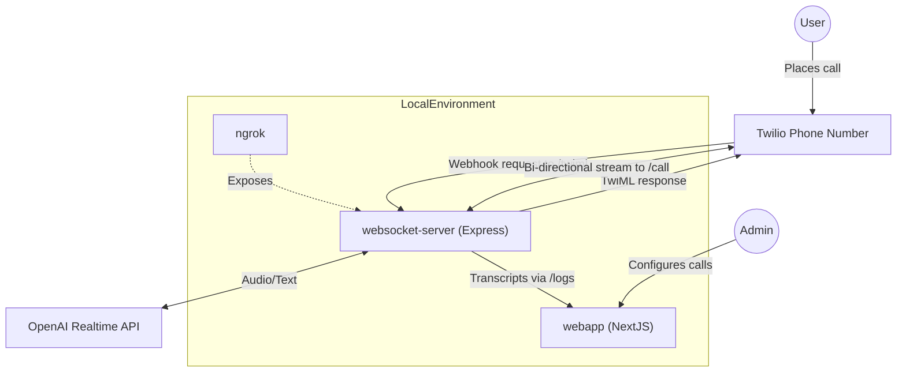
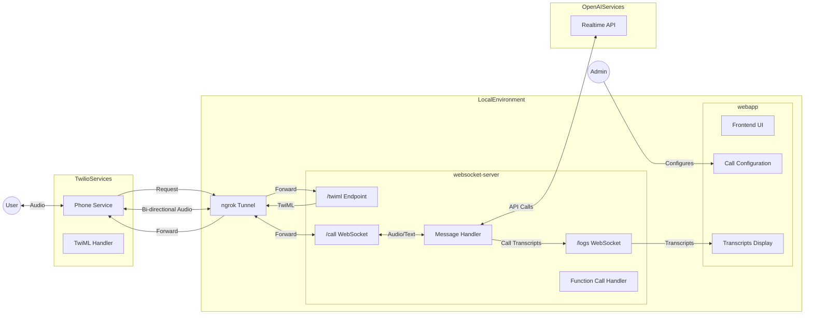
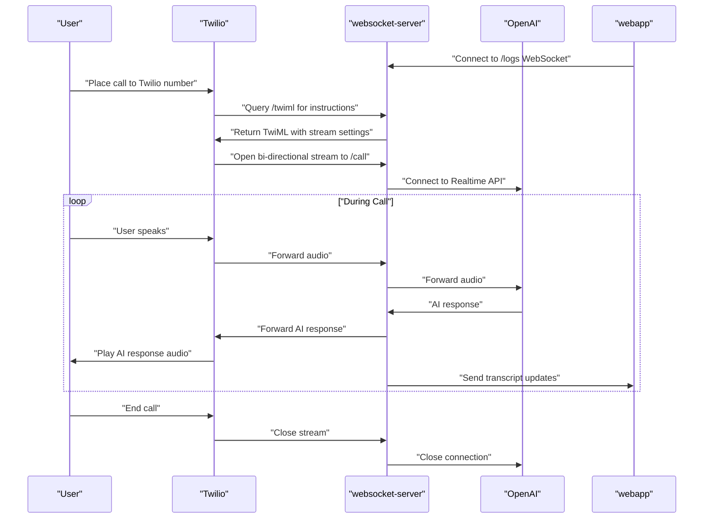

<!-- source: DeepWiki mcp.deepwiki.com · repo openai/openai-realtime-twilio-demo · page 1 Overview · fetched 2026-10-26 -->

# Overview

<details>
<summary>Relevant source files</summary>

The following files were used as context for generating this wiki page:

- [README.md](README.md)

</details>


This document provides an introduction to the OpenAI Realtime Twilio Demo, a system that integrates OpenAI's Realtime API with Twilio's phone calling capability to create an AI-powered phone calling assistant. For detailed architecture information, see [Architecture](#1.1), and for specific component details, see [System Components](#1.2).

## Purpose and Scope

The OpenAI Realtime Twilio Demo demonstrates how to build an AI calling assistant that can:

- Receive incoming phone calls through Twilio
- Process speech in real-time using OpenAI's Realtime API
- Generate AI responses that are spoken back to the caller
- Display call transcripts in a web interface
- Execute function calls in response to user requests

This overview covers the high-level architecture, component interactions, and call flow, without diving into implementation details that are covered in other sections.

Sources: [README.md:1-4](), [README.md:19-25]()

## System Components

The system consists of two primary applications:

| Component | Description | Purpose |
|-----------|-------------|---------|
| `webapp` | Next.js web application | Frontend for call configuration and transcript display |
| `websocket-server` | Express-based backend | Bridges communication between Twilio, OpenAI, and the frontend |

Additionally, the system relies on:

- **Twilio**: For phone call handling and audio streaming
- **OpenAI Realtime API**: For real-time speech processing and AI responses
- **ngrok**: For exposing the locally running server to the internet

Sources: [README.md:19-25](), [README.md:44-60]()

## System Architecture

### High-Level Architecture Diagram



Sources: [README.md:19-44]()

### Code Entity Relationship Diagram



Sources: [README.md:19-44]()

## Call Lifecycle

The following sequence diagram illustrates the typical flow of an AI-powered phone call:



Sources: [README.md:44-60]()

## Key Components

### WebSocket Server

The WebSocket server is the core of the system, handling bidirectional communication between all components:

| Endpoint | Purpose |
|----------|---------|
| `/twiml` | Returns TwiML instructions to Twilio for handling calls |
| `/call` | WebSocket endpoint for bi-directional audio streaming with Twilio |
| `/logs` | WebSocket endpoint for sending real-time transcripts to the frontend |

For more details on the WebSocket server implementation, see [WebSocket Server](#2).

Sources: [README.md:26-28]()

### Next.js Web Application

The frontend webapp provides a user interface for configuration and monitoring:

| Feature | Purpose |
|---------|---------|
| Call Configuration | Configure Twilio phone numbers and settings |
| Transcript Display | View real-time transcripts of ongoing calls |
| Connection Status | Monitor connection status with the WebSocket server |

For more details on the frontend application, see [Frontend Application](#3).

Sources: [README.md:23-24]()

## TwiML Integration

Twilio uses TwiML (a form of XML) to specify how to handle a phone call. When a call comes in, the system provides TwiML instructions that tell Twilio to start a bi-directional stream with the WebSocket server:

```xml
<?xml version="1.0" encoding="UTF-8"?>
<Response>
  <Say>Connected</Say>
  <Connect>
    <Stream url="{{WS_URL}}" />
  </Connect>
  <Say>Disconnected</Say>
</Response>
```

The `{{WS_URL}}` placeholder is replaced with the WebSocket server's endpoint URL.

Sources: [README.md:27-40]()

## Function Calling Support

The system includes support for function calling, allowing the AI assistant to trigger actions during a call. The current implementation includes a mocking mechanism for testing and development purposes.

For more details on function calling, see [Function Calling](#2.4).

Sources: [README.md:61-64]()

## Getting Started

To run the system, you need:

1. OpenAI API key with access to the Realtime API
2. Twilio account with a phone number
3. ngrok account for exposing the local server

The typical setup involves running three separate processes:

| Terminal | Purpose | Command |
|----------|---------|---------|
| 1 | Run the webapp | `npm run dev` |
| 2 | Run the websocket-server | `npm run dev` |
| 3 | Run ngrok | `ngrok http 8081` |

For detailed setup instructions, see [Setup and Deployment](#4).

Sources: [README.md:9-16](), [README.md:66-105]()

## Security Considerations

The repository is provided as a reference implementation and demonstration. As noted in the README, the security practices may not be suitable for production use without additional review and hardening:

> This repo isn't polished, and the security practices leave some to be desired. Please only use this as reference, and make sure to audit your app with security and engineering before deploying!

Sources: [README.md:107-109]()

---

