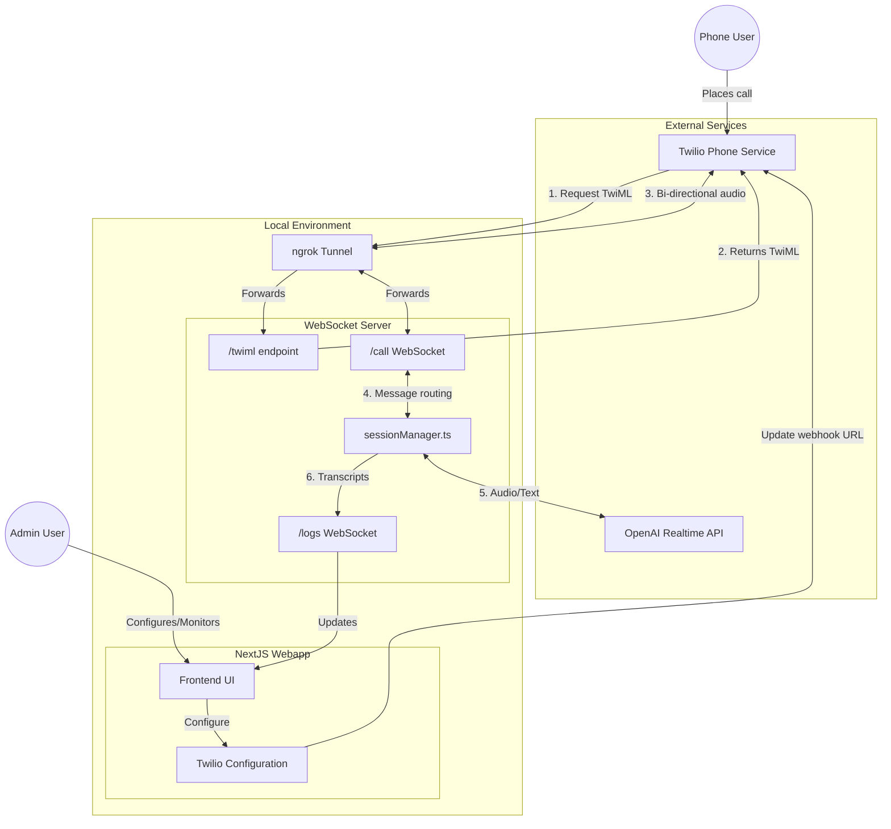
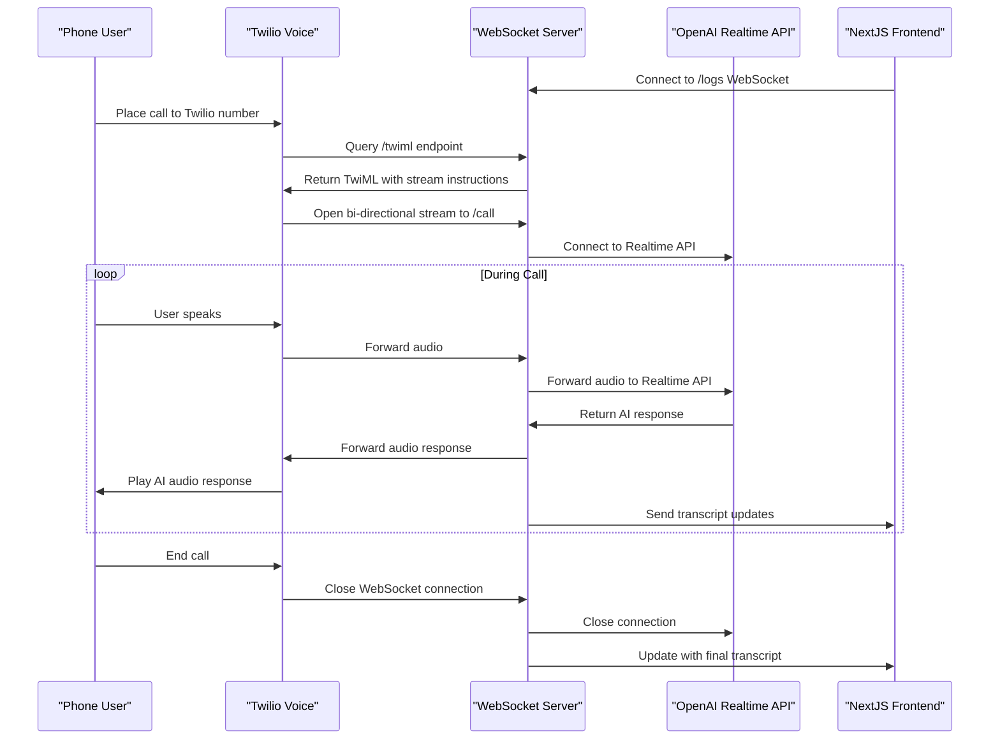
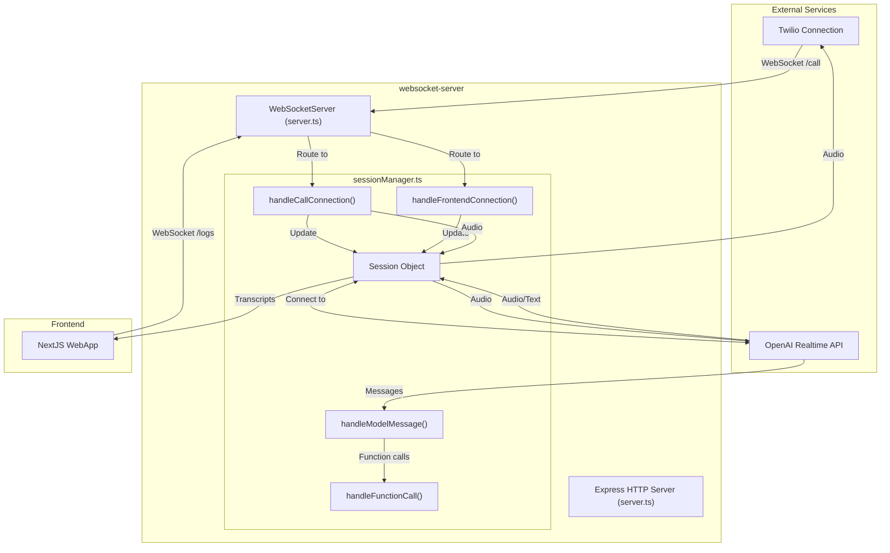
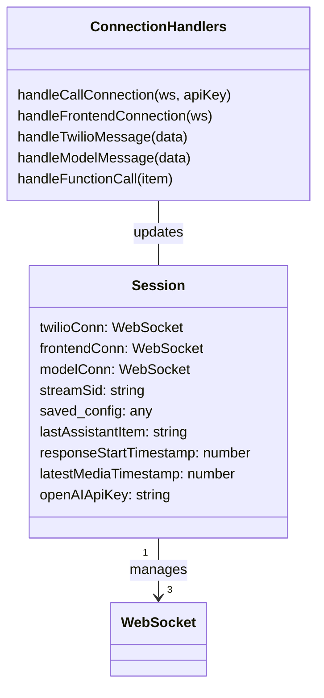
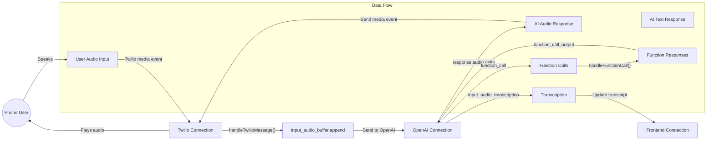
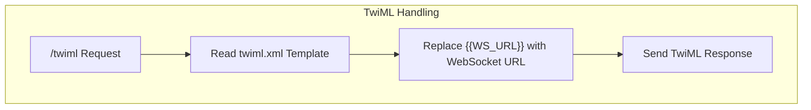
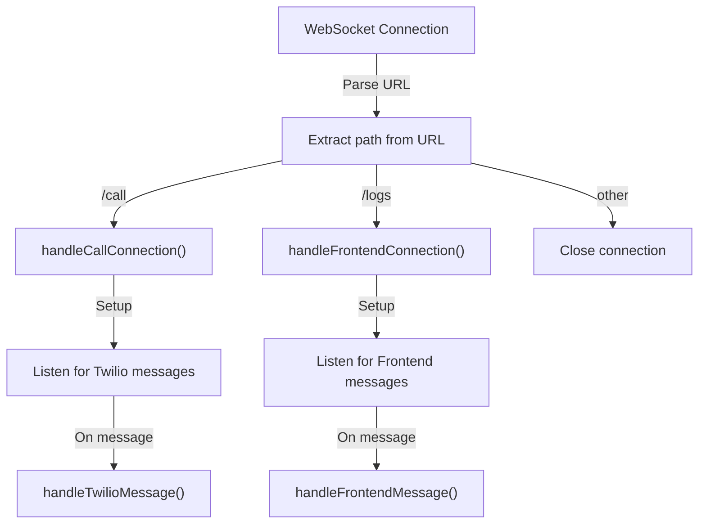
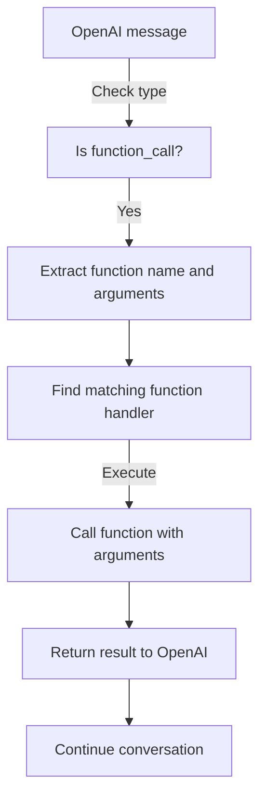
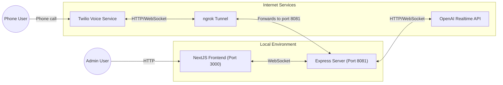

<!-- source: DeepWiki mcp.deepwiki.com · repo openai/openai-realtime-twilio-demo · page 1.1 Architecture · fetched 2026-10-26 -->

# Architecture

Relevant source files

The following files were used as context for generating this wiki page:

- [README.md](README.md)
- [websocket-server/src/server.ts](websocket-server/src/server.ts)
- [websocket-server/src/sessionManager.ts](websocket-server/src/sessionManager.ts)

This page describes the overall system architecture of the OpenAI Realtime Twilio Demo, detailing how the different components interact with each other to enable AI-powered phone calls. For information about specific component implementations, see [System Components](#1.2).

## High-Level System Architecture

The OpenAI Realtime Twilio Demo consists of two main components:

1. **NextJS Webapp**: A frontend application for call configuration and transcript monitoring
2. **WebSocket Server**: A backend server that bridges communication between Twilio and OpenAI

These components work together with external services to create an AI-powered phone calling assistant:

Sources: [README.md:19-42](), [websocket-server/src/server.ts:1-83]()

## Call Flow Sequence

The sequence of events during a call illustrates how the components interact over time:

Sources: [README.md:44-60]()

## WebSocket Server Architecture

The WebSocket Server is the core of the system, managing three types of connections and routing messages between them:

Sources: [websocket-server/src/server.ts:30-79](), [websocket-server/src/sessionManager.ts:1-153]()

## Session Management

The Session object is a central state manager that coordinates all connections and message routing:

Sources: [websocket-server/src/sessionManager.ts:4-16]()

## Data Flow Architecture

The data flow in the system shows how audio and text messages are routed between components:

Sources: [websocket-server/src/sessionManager.ts:78-240]()

## Technical Implementation Details

### TwiML Generation

When a call comes in, Twilio requests instructions from the `/twiml` endpoint. The server responds with TwiML that directs Twilio to establish a WebSocket connection:

The TwiML template instructs Twilio to:
1. Say "Connected"
2. Establish a bi-directional stream to the WebSocket server
3. Say "Disconnected" when the call ends

Sources: [websocket-server/src/server.ts:33-47]()

### WebSocket Connection Management

The WebSocket server maintains three types of connections:

1. **Twilio Connection** (`/call`): Handles audio streaming with Twilio
2. **Frontend Connection** (`/logs`): Sends call transcripts to the frontend
3. **OpenAI Connection**: Connects to OpenAI's Realtime API

Sources: [websocket-server/src/server.ts:57-79](), [websocket-server/src/sessionManager.ts:18-48]()

### Function Calling

The system supports function calling, allowing the OpenAI model to trigger actions through predefined functions:

When the OpenAI model sends a function call, the system:
1. Identifies the appropriate function handler
2. Parses the arguments
3. Executes the function
4. Returns the result to continue the conversation

Sources: [websocket-server/src/sessionManager.ts:50-76](), [websocket-server/src/sessionManager.ts:185-207]()

## Integration with External Services

### Twilio Integration

The connection with Twilio involves:
1. A public URL (via ngrok) for Twilio to reach the WebSocket server
2. TwiML generation to instruct Twilio how to handle calls
3. Bi-directional audio streaming using Twilio's Media Streams API

### OpenAI Realtime API Integration

The connection with OpenAI's Realtime API involves:
1. Establishing a WebSocket connection with authentication
2. Configuring session parameters (voice, audio format, etc.)
3. Streaming audio input and receiving text/audio responses
4. Handling function calls for extended functionality

Sources: [websocket-server/src/sessionManager.ts:118-152]()

## Deployment Architecture

Sources: [README.md:9-17]()

---

