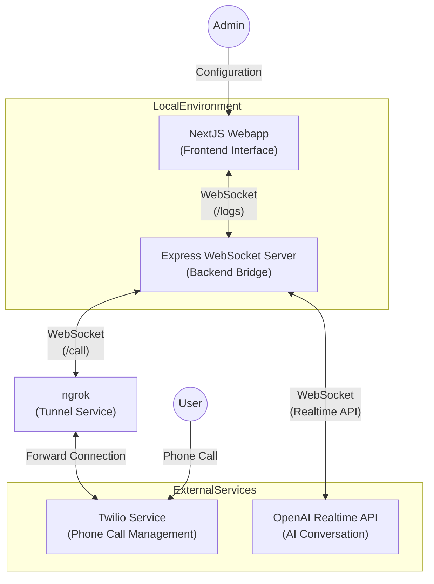
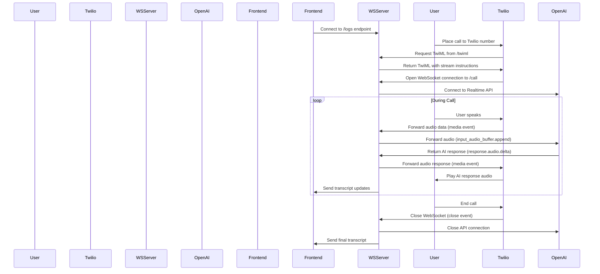
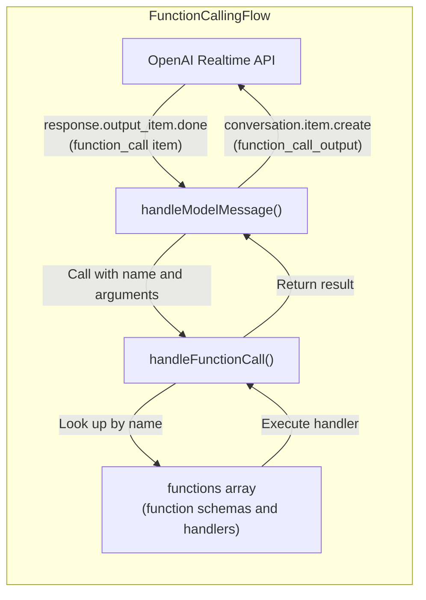

<!-- source: DeepWiki mcp.deepwiki.com · repo openai/openai-realtime-twilio-demo · page 1.2 System Components · fetched 2026-10-26 -->

# System Components

<details>
<summary>Relevant source files</summary>

The following files were used as context for generating this wiki page:

- [README.md](README.md)
- [websocket-server/src/server.ts](websocket-server/src/server.ts)
- [websocket-server/src/sessionManager.ts](websocket-server/src/sessionManager.ts)

</details>


This page details the core components that comprise the OpenAI Realtime Twilio Demo system. It describes each component's purpose, implementation, and interactions with other system elements. For a higher-level overview of the architecture, see [Architecture](#1.1).

## Core Components Overview

The OpenAI Realtime Twilio Demo consists of four primary components that work together to provide an AI-powered phone calling experience:



Sources: [README.md:19-25](), [websocket-server/src/server.ts:1-20]()

## NextJS Webapp

The webapp is built with Next.js and serves as the frontend interface for administrators to:
- Configure call settings
- View real-time call transcripts
- Set up Twilio phone numbers

The webapp connects to the websocket server via a persistent WebSocket connection to `/logs` to receive real-time updates about ongoing calls.

Sources: [README.md:23]()

## WebSocket Server

The websocket server is the central component that bridges all communications between Twilio, OpenAI's Realtime API, and the frontend webapp.

### Key Endpoints

| Endpoint | Type | Purpose |
|----------|------|---------|
| `/twiml` | HTTP | Provides TwiML instructions for Twilio to handle calls |
| `/call` | WebSocket | Receives bidirectional audio stream from Twilio |
| `/logs` | WebSocket | Sends real-time updates to the frontend |
| `/tools` | HTTP | Lists available function schemas for the AI |
| `/public-url` | HTTP | Returns the server's public URL (via ngrok) |

Sources: [websocket-server/src/server.ts:36-52]()

### Session Management

The websocket server maintains a central `Session` object that coordinates all connections and message routing:

```mermaid
classDiagram
    class "Session" {
        twilioConn: WebSocket
        frontendConn: WebSocket
        modelConn: WebSocket
        streamSid: string
        saved_config: any
        lastAssistantItem: string
        responseStartTimestamp: number
        latestMediaTimestamp: number
        openAIApiKey: string
    }
    
    class "handleCallConnection()" {
        +process Twilio messages
        +manage model connection
    }
    
    class "handleFrontendConnection()" {
        +process frontend messages
        +update session config
    }
    
    class "handleModelMessage()" {
        +process OpenAI messages
        +route responses
        +handle function calls
    }
    
    "Session" <-- "handleCallConnection()"
    "Session" <-- "handleFrontendConnection()"
    "Session" <-- "handleModelMessage()"
```

Sources: [websocket-server/src/sessionManager.ts:4-16](), [websocket-server/src/sessionManager.ts:18-36](), [websocket-server/src/sessionManager.ts:38-48]()

## Communication Flow

This diagram shows how messages flow through the system during a typical call:



Sources: [README.md:46-60](), [websocket-server/src/sessionManager.ts:78-103](), [websocket-server/src/sessionManager.ts:154-209]()

## Twilio Integration

Twilio provides the phone calling infrastructure and connects to the system in two ways:

1. **HTTP Request Flow**: When a call is received, Twilio requests TwiML instructions from the `/twiml` endpoint
2. **WebSocket Connection**: After receiving TwiML, Twilio establishes a WebSocket connection to `/call` for bidirectional audio streaming

### TwiML Configuration

The server provides Twilio with TwiML that contains instructions to:
1. Say "Connected" to the caller
2. Establish a bidirectional stream to the WebSocket server
3. Say "Disconnected" when the call ends

Sources: [README.md:27-40](), [websocket-server/src/server.ts:40-47]()

## OpenAI Realtime API Integration

The WebSocket server connects to OpenAI's Realtime API to provide AI capabilities:

### Integration Features
- Forwards audio from Twilio to OpenAI for processing
- Receives AI-generated responses and forwards them to Twilio
- Handles function calling capabilities for performing actions
- Manages turn-taking in the conversation

### Session Configuration
When connecting to the OpenAI Realtime API, the server configures the session with:
- Modalities (text and audio)
- Voice selection (e.g., "ash")
- Audio formats (g711_ulaw for compatibility with Twilio)
- Turn detection settings (server_vad)

Sources: [websocket-server/src/sessionManager.ts:118-147]()

## Function Calling System

The system implements a function calling mechanism that allows the AI to perform actions:



Sources: [websocket-server/src/sessionManager.ts:50-76](), [websocket-server/src/sessionManager.ts:185-207]()

## ngrok Integration

ngrok creates a secure tunnel to expose the locally running WebSocket server to the internet, enabling Twilio to connect to it.

### Role in the System
- Creates a public URL for the WebSocket server
- Forwards requests from Twilio to the local server
- Enables real-time communication between Twilio and the local environment

When the server starts, it expects the `PUBLIC_URL` environment variable to contain the ngrok URL that will be used to construct the WebSocket URL in the TwiML response.

Sources: [README.md:42](), [README.md:91-102](), [websocket-server/src/server.ts:18](), [websocket-server/src/server.ts:41-46]()

## Component Interactions Table

| From | To | Communication Method | Purpose |
|------|----|--------------------|---------|
| Frontend | WebSocket Server | WebSocket `/logs` | Receive call transcripts and updates |
| WebSocket Server | Frontend | WebSocket `/logs` | Send transcripts and call status |
| Twilio | WebSocket Server | HTTP GET `/twiml` | Get TwiML instructions |
| Twilio | WebSocket Server | WebSocket `/call` | Bidirectional audio streaming |
| WebSocket Server | Twilio | WebSocket `/call` | Send AI responses as audio |
| WebSocket Server | OpenAI | WebSocket | Send user audio and receive AI responses |
| OpenAI | WebSocket Server | WebSocket | Send function calls and audio responses |

Sources: [README.md:46-60](), [websocket-server/src/server.ts:57-79]()

The system components work together through these well-defined interfaces to create a seamless experience where a user can speak with an AI assistant over a phone call, with the conversation processed in real-time.

---

