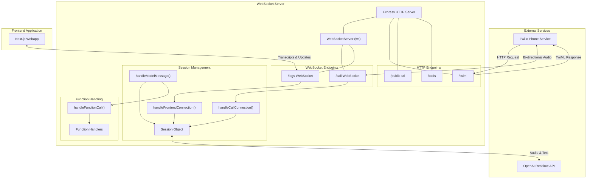
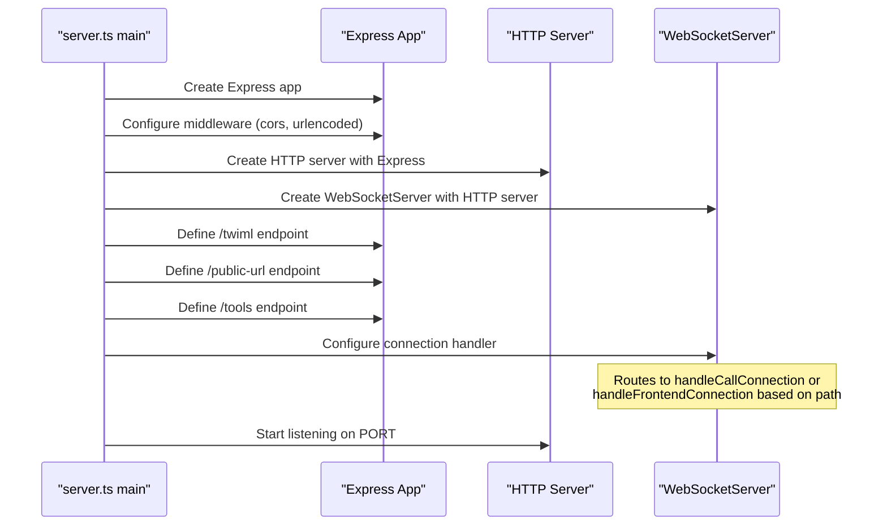
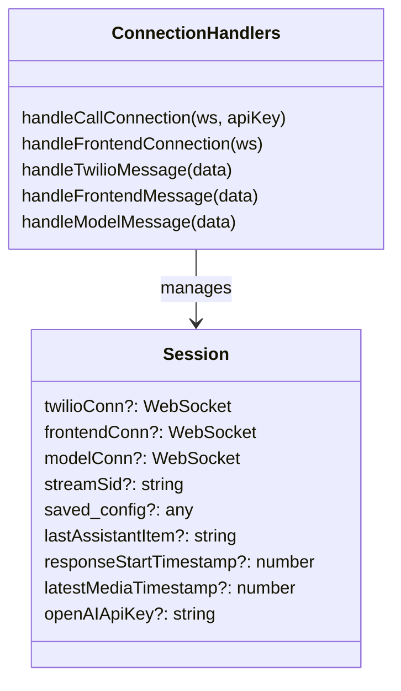
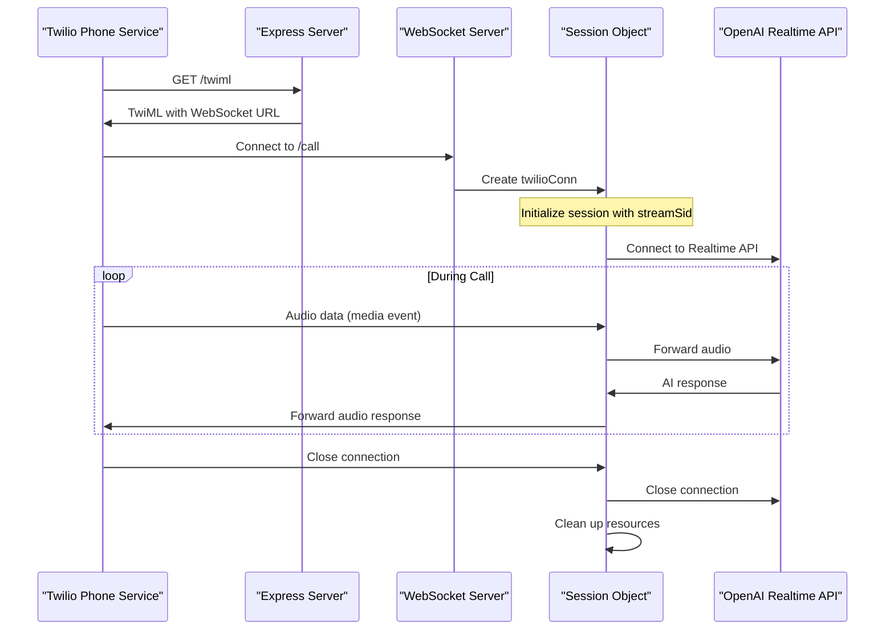
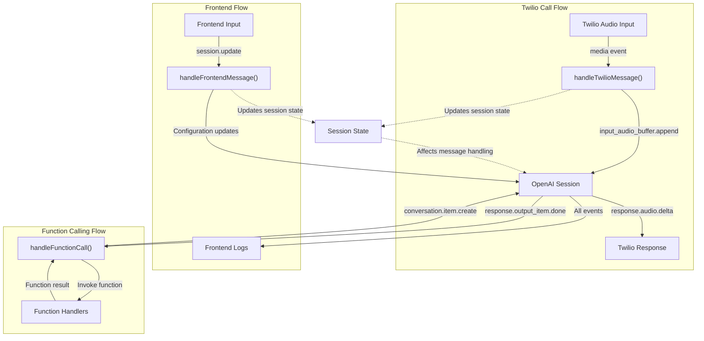
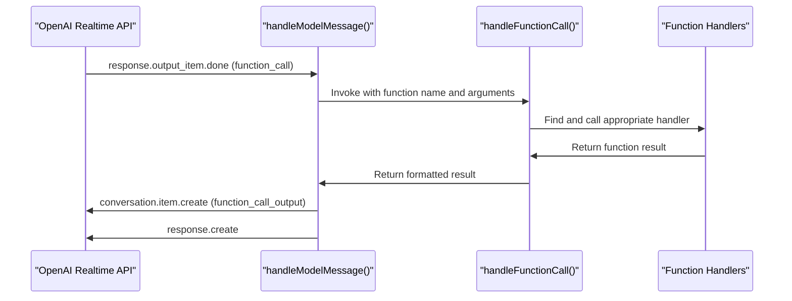

<!-- source: DeepWiki mcp.deepwiki.com · repo openai/openai-realtime-twilio-demo · page 2 WebSocket Server · fetched 2026-10-26 -->

# WebSocket Server

Relevant source files

The following files were used as context for generating this wiki page:

- [README.md](README.md)
- [websocket-server/src/server.ts](websocket-server/src/server.ts)
- [websocket-server/src/sessionManager.ts](websocket-server/src/sessionManager.ts)

The WebSocket Server is the critical bridge component in the OpenAI Realtime Twilio Demo system, facilitating real-time communication between Twilio's voice service, OpenAI's Realtime API, and the Next.js frontend application. This page explains the server's architecture, how it handles connections and sessions, and its role in routing messages between system components.

For implementation details about individual server components, see [Server Implementation](#2.1). For session management specifics, see [Session Management](#2.2).

## Purpose and Core Responsibilities

The WebSocket Server acts as the central hub for all communication in the system with three primary responsibilities:

1. **Twilio Integration**: Processes incoming calls via Twilio webhooks and maintains bidirectional audio streams
2. **OpenAI Connectivity**: Establishes and manages connections to the OpenAI Realtime API
3. **Frontend Communication**: Provides real-time call transcripts and updates to the web interface

Sources: [README.md:21-24](), [websocket-server/src/server.ts:57-79]()

## System Architecture

Sources: [websocket-server/src/server.ts:1-33](), [websocket-server/src/sessionManager.ts:1-17]()

## Server Initialization

The WebSocket Server is built on Express and the `ws` WebSocket library. It initializes the HTTP server and WebSocket server, sets up routes and endpoints, and begins listening for connections.

Key initialization components:

The server configures several key HTTP endpoints and WebSocket paths:

| Type | Endpoint | Purpose |
|------|----------|---------|
| HTTP | `/twiml` | Returns TwiML instructions for Twilio to establish a WebSocket connection |
| HTTP | `/public-url` | Returns the server's public URL (used for configuration) |
| HTTP | `/tools` | Lists available function schemas for the OpenAI model |
| WebSocket | `/call` | Endpoint for Twilio's bidirectional stream connection |
| WebSocket | `/logs` | Endpoint for the frontend to receive real-time updates |

Sources: [websocket-server/src/server.ts:16-83]()

## Session Management

The server uses a central session object to maintain state across multiple connections. This approach allows for coordinated message routing between Twilio, OpenAI, and the frontend.

The session object tracks:
- Active WebSocket connections (Twilio, frontend, OpenAI)
- Call metadata (stream SID, timestamps)
- Configuration settings
- State for managing assistant responses

Connection lifecycles are managed with dedicated handlers that update the session state and set up appropriate event listeners for each connection type.

Sources: [websocket-server/src/sessionManager.ts:4-17](), [websocket-server/src/sessionManager.ts:18-48]()

## Connection Handling

The WebSocket Server handles three distinct connection types, each with its own lifecycle and message processing needs:

### Twilio Connection

When a call comes in to a Twilio phone number:

1. Twilio requests TwiML instructions from the `/twiml` endpoint
2. The server responds with TwiML that includes a WebSocket stream URL
3. Twilio establishes a WebSocket connection to the `/call` endpoint
4. The server handles the connection with `handleCallConnection`
5. As the call progresses, bidirectional audio is exchanged

Sources: [websocket-server/src/server.ts:33-47](), [websocket-server/src/sessionManager.ts:18-36](), [websocket-server/src/sessionManager.ts:78-103]()

### Frontend Connection

The frontend application connects to receive real-time updates about ongoing calls:

1. Frontend connects to the `/logs` WebSocket endpoint
2. The server handles the connection with `handleFrontendConnection`
3. Updates about the call (transcripts, state changes) are sent to the frontend
4. The frontend can also send configuration updates to the server

Sources: [websocket-server/src/server.ts:72-76](), [websocket-server/src/sessionManager.ts:38-48](), [websocket-server/src/sessionManager.ts:105-116]()

### OpenAI Connection

The OpenAI Realtime API connection is established when a call begins:

1. When a Twilio call starts, the server connects to the OpenAI Realtime API
2. The server configures the session with modalities, voice settings, and audio formats
3. Audio from Twilio is forwarded to OpenAI for processing
4. OpenAI responses are forwarded back to Twilio
5. Transcripts and function calls are processed and routed as needed

Sources: [websocket-server/src/sessionManager.ts:118-152](), [websocket-server/src/sessionManager.ts:154-209]()

## Message Flow

The WebSocket Server orchestrates message flow between all components:

The server handles several message types:

| Source | Key Message Types | Handler | Purpose |
|--------|-------------------|---------|---------|
| Twilio | `start` | `handleTwilioMessage` | Initialize call session |
| Twilio | `media` | `handleTwilioMessage` | Forward audio to OpenAI |
| Twilio | `close` | `handleTwilioMessage` | End the call session |
| Frontend | `session.update` | `handleFrontendMessage` | Update session configuration |
| OpenAI | `response.audio.delta` | `handleModelMessage` | Forward AI audio to Twilio |
| OpenAI | `input_audio_buffer.speech_started` | `handleModelMessage` | Handle user speech detection |
| OpenAI | `response.output_item.done` | `handleModelMessage` | Process function calls |

Sources: [websocket-server/src/sessionManager.ts:78-240]()

## Function Calling Mechanism

The WebSocket Server includes a function calling system that allows the AI to perform actions during the call:

The function calling flow:
1. OpenAI model sends a function call event
2. Server finds the matching function handler by name
3. Function arguments are parsed from JSON
4. The function is executed with provided arguments
5. Result is returned to the OpenAI model as function output
6. Model uses the output to continue the conversation

**Note**: As described in the README, this demo implementation mocks function calling responses for demonstration purposes. In a production environment, these functions would perform real actions.

Sources: [websocket-server/src/sessionManager.ts:50-76](), [websocket-server/src/sessionManager.ts:184-207](), [README.md:61-64]()

---

