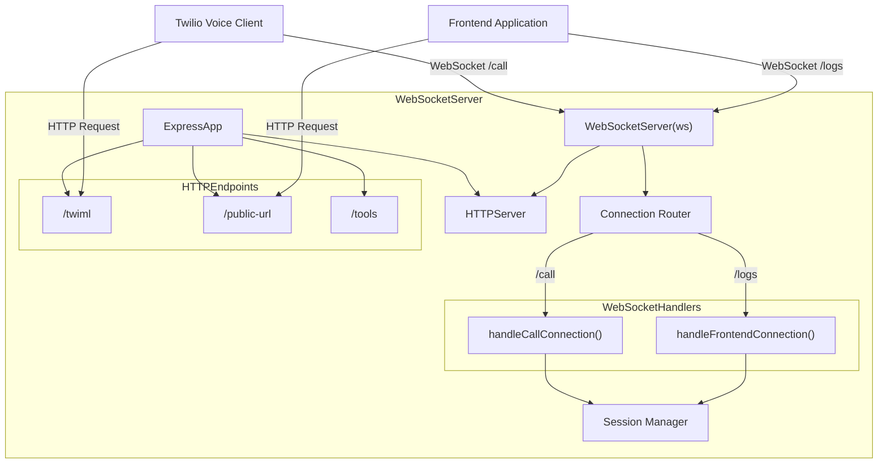
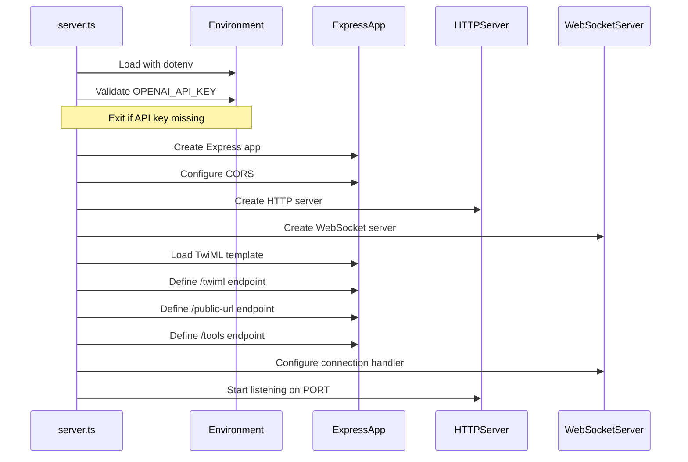
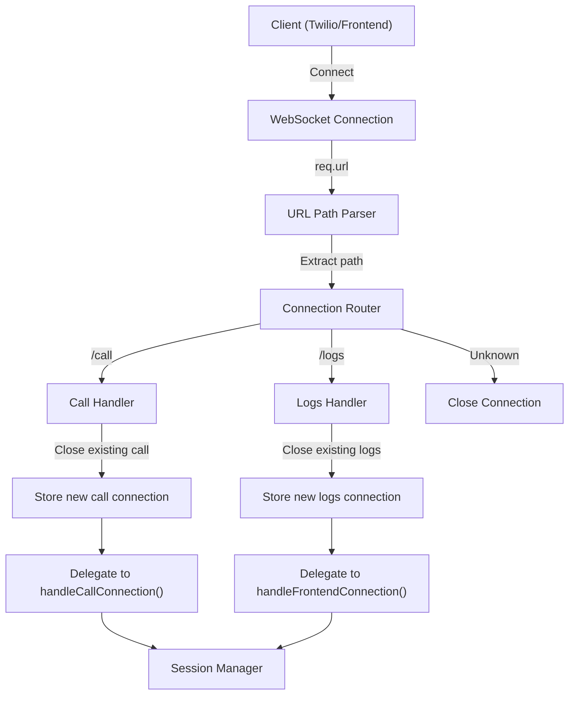
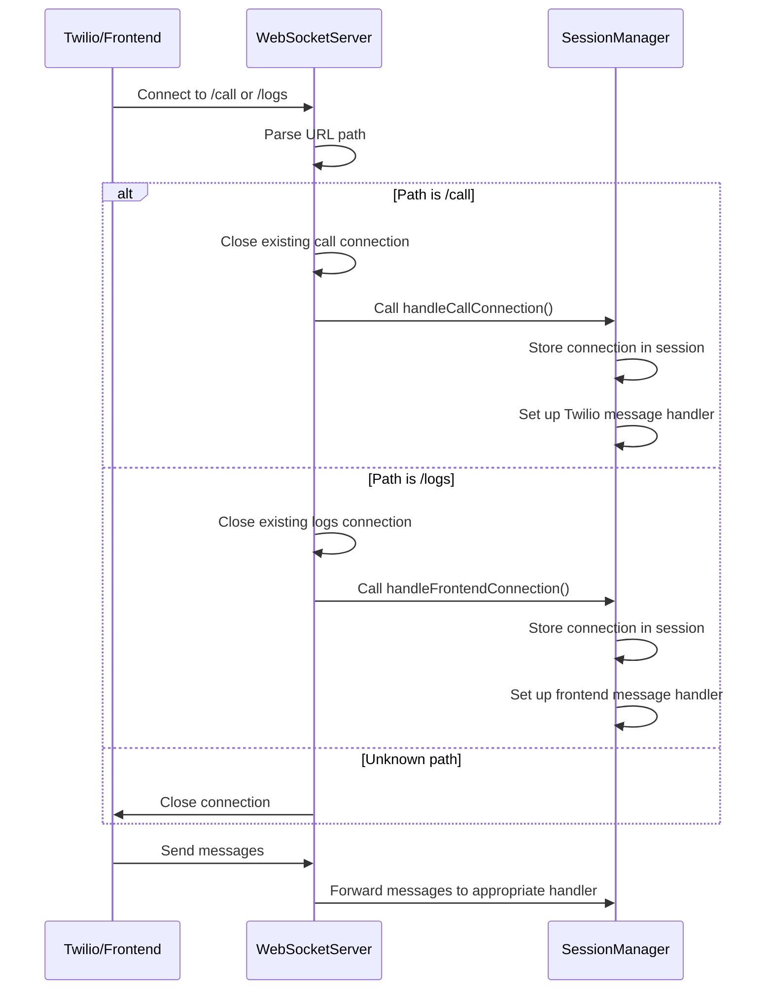

<!-- source: DeepWiki mcp.deepwiki.com · repo openai/openai-realtime-twilio-demo · page 2.1 Server Implementation · fetched 2026-10-26 -->

# Server Implementation

<details>
<summary>Relevant source files</summary>

The following files were used as context for generating this wiki page:

- [websocket-server/src/server.ts](websocket-server/src/server.ts)
- [websocket-server/src/sessionManager.ts](websocket-server/src/sessionManager.ts)

</details>


The Server Implementation is the core component of the OpenAI Realtime Twilio Demo, establishing the connection bridge between Twilio voice calls, OpenAI's Realtime API, and the frontend application. This page details the server's initialization process, HTTP endpoints, WebSocket connection handling, and integration with the session management system.

For information about how the session manager handles connections and message routing, see [Session Management](#2.2).

## Server Architecture



Sources: [websocket-server/src/server.ts:1-83]()

## Server Initialization

The server is initialized in `server.ts` through the following process:

1. Environment variables are loaded and validated
2. An Express application and HTTP server are created
3. A WebSocket server is attached to the HTTP server
4. HTTP endpoints are defined
5. WebSocket connection handling is configured
6. The server starts listening on the configured port



Sources: [websocket-server/src/server.ts:1-83]()

### Environment Configuration

The server requires several environment variables:

| Variable | Purpose | Default |
|----------|---------|---------|
| `PORT` | The port the server listens on | 8081 |
| `PUBLIC_URL` | Public URL for Twilio to connect to | "" |
| `OPENAI_API_KEY` | OpenAI API key for authentication | Required |

The server validates the presence of the OpenAI API key and exits if it's missing:

```typescript
if (!OPENAI_API_KEY) {
  console.error("OPENAI_API_KEY environment variable is required");
  process.exit(1);
}
```

Sources: [websocket-server/src/server.ts:15-24]()

## HTTP Endpoints

The server exposes three HTTP endpoints to support the Twilio integration and frontend application:

### 1. TwiML Endpoint (`/twiml`)

This endpoint generates TwiML (Twilio Markup Language) instructions when Twilio receives a call. It reads a template file and replaces placeholders with the WebSocket URL:

```typescript
app.all("/twiml", (req, res) => {
  const wsUrl = new URL(PUBLIC_URL);
  wsUrl.protocol = "wss:";
  wsUrl.pathname = `/call`;

  const twimlContent = twimlTemplate.replace("{{WS_URL}}", wsUrl.toString());
  res.type("text/xml").send(twimlContent);
});
```

The TwiML instructs Twilio to connect to the WebSocket server for real-time audio streaming.

Sources: [websocket-server/src/server.ts:33-47]()

### 2. Public URL Endpoint (`/public-url`)

This endpoint returns the server's public URL:

```typescript
app.get("/public-url", (req, res) => {
  res.json({ publicUrl: PUBLIC_URL });
});
```

The frontend uses this endpoint to determine the server's public address.

Sources: [websocket-server/src/server.ts:36-38]()

### 3. Tools Endpoint (`/tools`)

This endpoint lists the function schemas available to the OpenAI assistant:

```typescript
app.get("/tools", (req, res) => {
  res.json(functions.map((f) => f.schema));
});
```

This allows the frontend to display available function calling capabilities.

Sources: [websocket-server/src/server.ts:50-52]()

## WebSocket Connection Handling

The server handles WebSocket connections based on their request path. The main connection handler is implemented as follows:



Sources: [websocket-server/src/server.ts:57-79]()

The server supports two main connection types:

1. **Call connections** (`/call`): Established by Twilio for real-time audio streaming
2. **Logs connections** (`/logs`): Established by the frontend for receiving logs and transcripts

The implementation ensures only one active connection of each type by closing any existing connection before storing a new one:

```typescript
wss.on("connection", (ws: WebSocket, req: IncomingMessage) => {
  const url = new URL(req.url || "", `http://${req.headers.host}`);
  const parts = url.pathname.split("/").filter(Boolean);

  if (parts.length < 1) {
    ws.close();
    return;
  }

  const type = parts[0];

  if (type === "call") {
    if (currentCall) currentCall.close();
    currentCall = ws;
    handleCallConnection(currentCall, OPENAI_API_KEY);
  } else if (type === "logs") {
    if (currentLogs) currentLogs.close();
    currentLogs = ws;
    handleFrontendConnection(currentLogs);
  } else {
    ws.close();
  }
});
```

Sources: [websocket-server/src/server.ts:57-79]()

## Integration with Session Management

After accepting WebSocket connections, the server delegates their handling to the session manager through two functions:

1. `handleCallConnection`: Processes connections from Twilio, managing audio streaming and call events
2. `handleFrontendConnection`: Processes connections from the frontend, providing transcript updates

These functions are imported from the session manager module:

```typescript
import {
  handleCallConnection,
  handleFrontendConnection,
} from "./sessionManager";
```

The session manager maintains a shared session object that tracks all connections and mediates communication between them. When a connection is delegated to the session manager, it sets up appropriate event handlers and updates the session state.

The server maintains references to the current call and logs connections:

```typescript
let currentCall: WebSocket | null = null;
let currentLogs: WebSocket | null = null;
```

These references allow the server to track and manage active connections, ensuring only one connection of each type is active at a time.

Sources: [websocket-server/src/server.ts:9-12](), [websocket-server/src/server.ts:54-55](), [websocket-server/src/server.ts:57-79]()

## Connection Flow

When a client connects to the WebSocket server, the following sequence occurs:



Sources: [websocket-server/src/server.ts:57-79](), [websocket-server/src/sessionManager.ts:18-48]()

## Server Startup

The server starts listening on the configured port with:

```typescript
server.listen(PORT, () => {
  console.log(`Server running on http://localhost:${PORT}`);
});
```

This initiates the HTTP and WebSocket servers, making them available to handle requests and connections.

Sources: [websocket-server/src/server.ts:81-83]()

---

