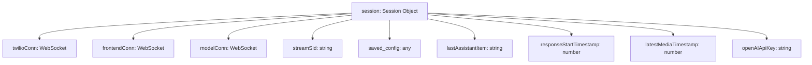
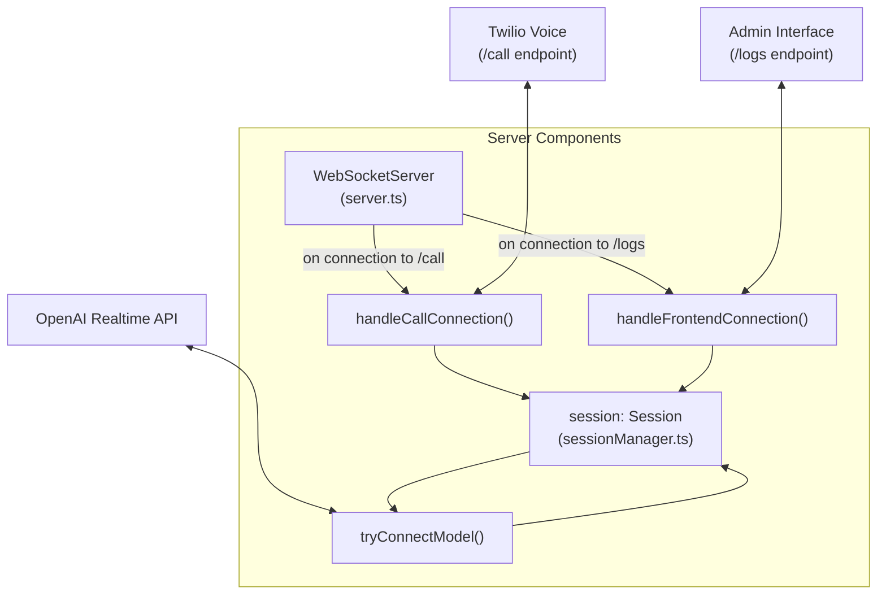
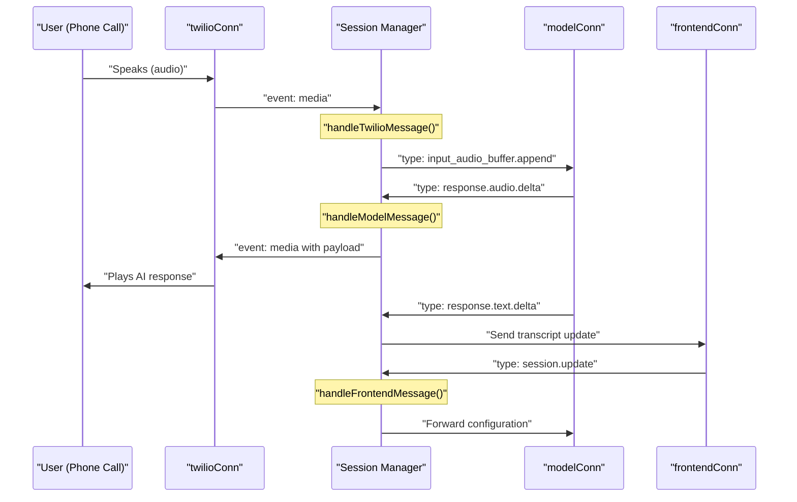
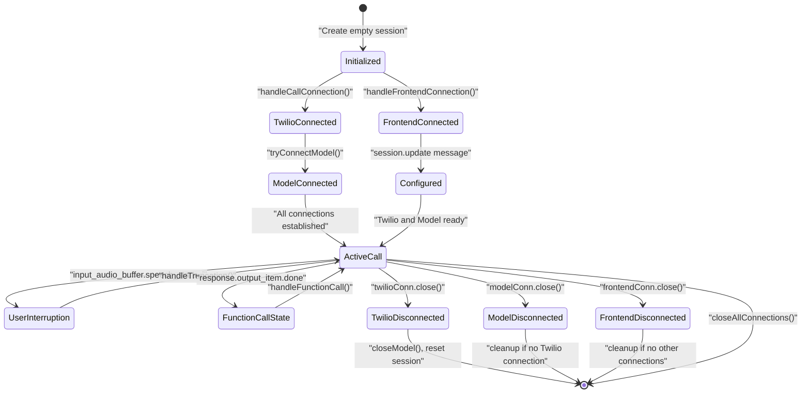
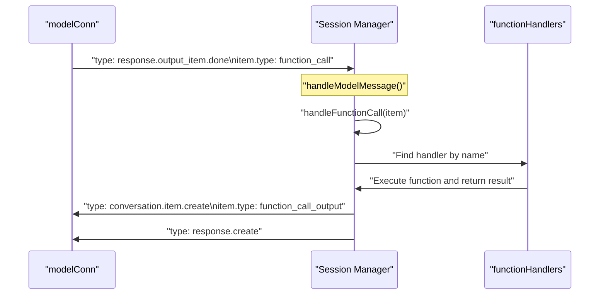

<!-- source: DeepWiki mcp.deepwiki.com · repo openai/openai-realtime-twilio-demo · page 2.2 Session Management · fetched 2026-10-26 -->

# Session Management

Relevant source files

The following files were used as context for generating this wiki page:

- [websocket-server/src/server.ts](websocket-server/src/server.ts)
- [websocket-server/src/sessionManager.ts](websocket-server/src/sessionManager.ts)

This document describes the Session Management subsystem in the OpenAI Realtime Twilio Demo, which is responsible for handling WebSocket connections and routing messages between Twilio, the OpenAI model, and the frontend application. The Session Manager maintains state for active calls, facilitates message passing between components, and manages connection lifecycles.

For information about message processing details, see [Message Handling](#2.3). For function call implementation, see [Function Calling](#2.4).

## Session Structure

The Session Manager uses a centralized `Session` object to maintain state and coordinate communication between components. This object stores references to all active connections and call-specific state information.

### Session Interface Diagram

Sources: [websocket-server/src/sessionManager.ts:4-14]()

### Session Properties

The Session object contains the following key properties:

| Property | Type | Description |
|----------|------|-------------|
| `twilioConn` | WebSocket | Connection to Twilio for audio streaming |
| `frontendConn` | WebSocket | Connection to admin interface for logs and configuration |
| `modelConn` | WebSocket | Connection to OpenAI's Realtime API |
| `streamSid` | string | Unique identifier for the Twilio audio stream |
| `saved_config` | any | Configuration settings from the frontend |
| `lastAssistantItem` | string | ID of the last assistant response item (for truncation) |
| `responseStartTimestamp` | number | Timestamp when the assistant started responding |
| `latestMediaTimestamp` | number | Latest timestamp of received audio from the user |
| `openAIApiKey` | string | API key for OpenAI |

Sources: [websocket-server/src/sessionManager.ts:4-14]()

## Connection Management

The Session Manager is responsible for managing three distinct WebSocket connections:

### Connection Architecture

Sources: 
- [websocket-server/src/server.ts:57-78]()
- [websocket-server/src/sessionManager.ts:18-47]()
- [websocket-server/src/sessionManager.ts:118-152]()

### Connection Handlers

Three primary handlers manage the different types of connections:

1. **Twilio Connection Handler** (`handleCallConnection`):
   - Stores the WebSocket connection from Twilio
   - Sets up event listeners for audio data and control messages
   - Initializes the OpenAI model connection when a call starts
   - Cleans up resources when the call ends

2. **Frontend Connection Handler** (`handleFrontendConnection`):
   - Manages the WebSocket connection to the admin interface
   - Handles configuration updates and log subscriptions
   - Forwards call transcripts to the frontend

3. **Model Connection Handler** (`tryConnectModel`):
   - Establishes the connection to OpenAI's Realtime API
   - Configures the model session with voice settings and audio formats
   - Processes AI responses and function call requests

Sources: 
- [websocket-server/src/sessionManager.ts:18-47]()
- [websocket-server/src/sessionManager.ts:118-152]()

## Message Routing

The Session Manager functions as a central message router between all connected systems. Each connection has dedicated message handlers that process and forward messages appropriately.

### Message Flow Diagram

Sources: 
- [websocket-server/src/sessionManager.ts:78-103]()
- [websocket-server/src/sessionManager.ts:105-116]()
- [websocket-server/src/sessionManager.ts:154-208]()

### Message Handlers

The Session Manager implements three specialized message handlers:

1. **`handleTwilioMessage`**:
   - Processes audio data received from the user's call
   - Handles call start and end events
   - Forwards audio data to the OpenAI model
   - Tracks media timestamps for response timing

2. **`handleFrontendMessage`**:
   - Processes configuration updates from the admin interface
   - Forwards session configuration to the OpenAI model
   - Maintains saved configuration in the session state

3. **`handleModelMessage`**:
   - Processes text and audio responses from the OpenAI model
   - Forwards audio responses to Twilio
   - Sends transcript updates to the frontend
   - Triggers function call processing when requested by the model
   - Handles speech interruptions via truncation

Sources: 
- [websocket-server/src/sessionManager.ts:78-103]()
- [websocket-server/src/sessionManager.ts:105-116]()
- [websocket-server/src/sessionManager.ts:154-208]()

## Session Lifecycle

The Session Manager maintains clear lifecycle stages for each call session, from initialization to termination.

### Lifecycle State Diagram

Sources: 
- [websocket-server/src/sessionManager.ts:18-36]()
- [websocket-server/src/sessionManager.ts:38-47]()
- [websocket-server/src/sessionManager.ts:211-240]()
- [websocket-server/src/sessionManager.ts:242-266]()

### Speech Interruption and Truncation

The Session Manager handles speech interruptions through a truncation mechanism:

1. When the user starts speaking while the AI is responding, the system detects this via the `input_audio_buffer.speech_started` event
2. The `handleTruncation` function is triggered to:
   - Calculate the elapsed time since the AI started responding
   - Send a truncation request to OpenAI to cut off the current response
   - Send a clear event to Twilio to stop playing the current audio
   - Reset response tracking state

This creates a more natural conversation flow by allowing the user to interrupt the AI.

Sources: [websocket-server/src/sessionManager.ts:211-240]()

## Utility Functions

The Session Manager includes several utility functions to facilitate its operations:

| Function | Purpose |
|----------|---------|
| `cleanupConnection` | Safely closes a WebSocket connection |
| `parseMessage` | Converts raw WebSocket data to JSON objects |
| `jsonSend` | Safely sends JSON data over a WebSocket |
| `isOpen` | Checks if a WebSocket connection is open and ready |
| `closeModel` | Cleans up the OpenAI model connection |
| `closeAllConnections` | Terminates all active connections and resets session state |

Sources: 
- [websocket-server/src/sessionManager.ts:242-287]()
- [websocket-server/src/sessionManager.ts:268-287]()

## Function Call Integration

When the OpenAI model requests a function call, the Session Manager coordinates the process:

Sources: 
- [websocket-server/src/sessionManager.ts:50-76]()
- [websocket-server/src/sessionManager.ts:154-208]()

The `handleFunctionCall` function:
1. Locates the appropriate function handler from the imported functions
2. Parses the function arguments from JSON
3. Executes the function and captures the result
4. Returns the result to the OpenAI model to continue the conversation

For more detailed information about function calling implementation, see [Function Calling](#2.4).

---

