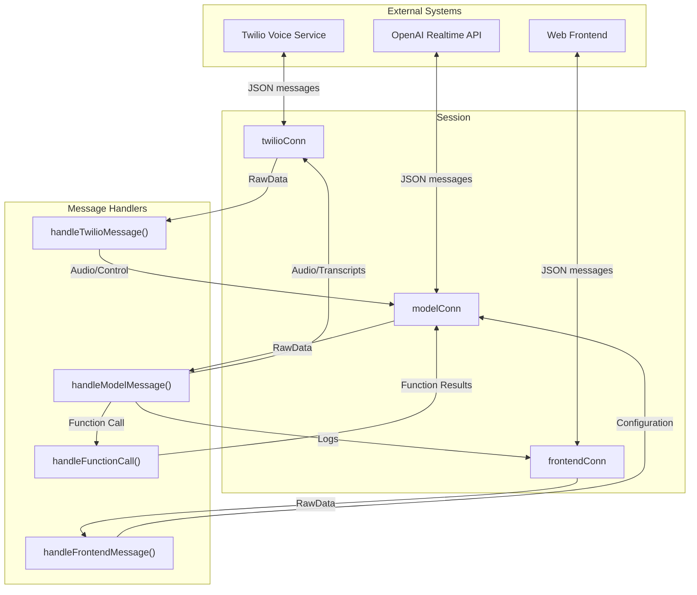
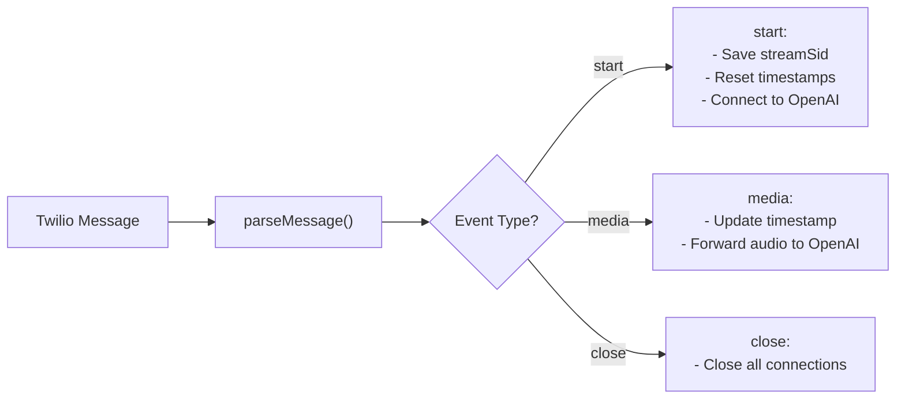
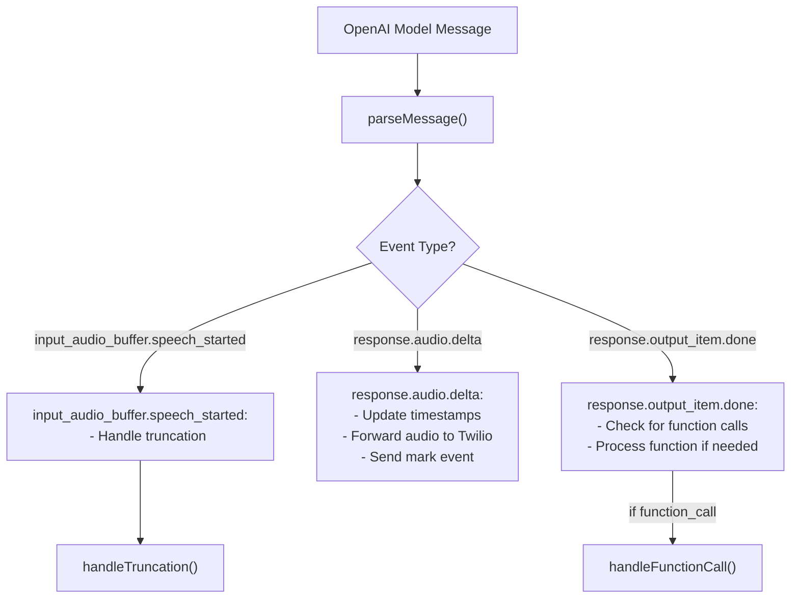
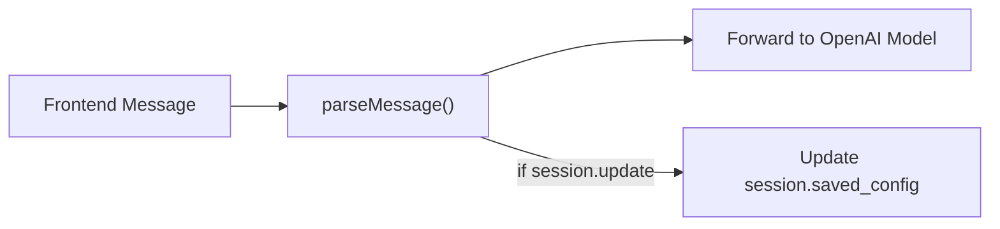
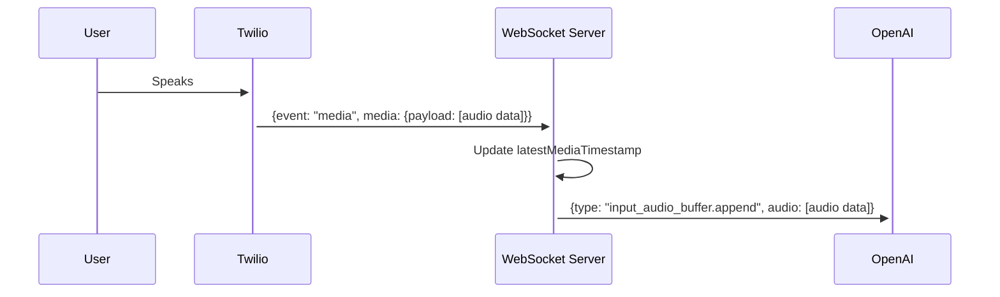
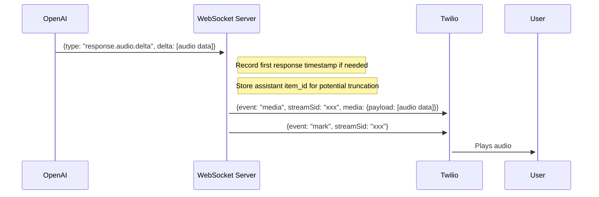
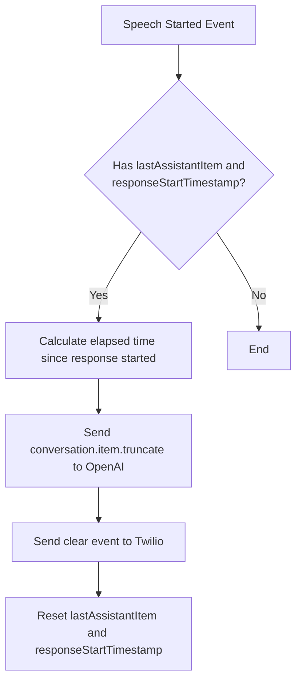
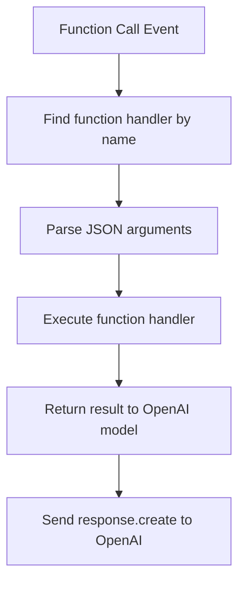
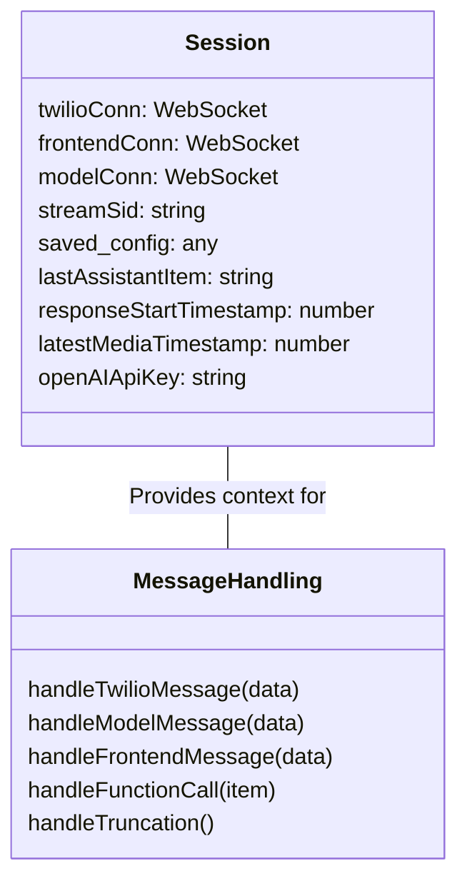

<!-- source: DeepWiki mcp.deepwiki.com · repo openai/openai-realtime-twilio-demo · page 2.3 Message Handling · fetched 2026-10-26 -->

# Message Handling

Relevant source files

The following files were used as context for generating this wiki page:

- [websocket-server/src/server.ts](websocket-server/src/server.ts)
- [websocket-server/src/sessionManager.ts](websocket-server/src/sessionManager.ts)

This page details the message processing and routing mechanisms that enable communication between Twilio, OpenAI, and the frontend within the WebSocket server. It focuses on how different types of messages are parsed, processed, and forwarded to appropriate destinations, forming the core communication layer of the system. For information about WebSocket connection management, see [Session Management](#2.2), and for details on function calling functionality, see [Function Calling](#2.4).

## Message Flow Overview

The WebSocket server acts as a central hub that processes and routes messages between three main components: Twilio (providing user audio input and playing AI responses), OpenAI (generating AI responses and transcriptions), and the frontend web application (displaying call logs and providing configuration).

Sources: [websocket-server/src/sessionManager.ts:78-103](), [websocket-server/src/sessionManager.ts:105-116](), [websocket-server/src/sessionManager.ts:154-209](), [websocket-server/src/sessionManager.ts:50-76]()

## Message Types and Handlers

The system processes various message types through dedicated handler functions that interpret and route messages to their appropriate destinations.

### Twilio Message Handling

Twilio messages are handled by the `handleTwilioMessage` function, which processes three main event types:

| Event Type | Description | Handler Actions |
|------------|-------------|----------------|
| `start` | Initiates a call | Stores streamSid, resets timestamps, connects to OpenAI |
| `media` | Contains audio data | Updates timestamp, forwards audio to OpenAI |
| `close` | Ends the call | Closes all connections |

Sources: [websocket-server/src/sessionManager.ts:78-103]()

### OpenAI Model Message Handling

Messages from the OpenAI model are handled by `handleModelMessage` and can include several event types:

| Event Type | Description | Handler Actions |
|------------|-------------|----------------|
| `input_audio_buffer.speech_started` | User started speaking | Trigger truncation of AI response |
| `response.audio.delta` | AI audio chunk | Forward audio to Twilio |
| `response.output_item.done` | Function call completed | Process function call if needed |

Sources: [websocket-server/src/sessionManager.ts:154-209]()

### Frontend Message Handling

Messages from the frontend are processed by `handleFrontendMessage` and primarily consist of configuration updates:

Sources: [websocket-server/src/sessionManager.ts:105-116]()

## Audio Data Flow

Audio data flows bidirectionally between Twilio and OpenAI through the WebSocket server, with specific processing for each direction:

### User Audio (Twilio to OpenAI)

When a user speaks, Twilio sends audio data as media events to the WebSocket server, which forwards it to OpenAI's Realtime API:

Sources: [websocket-server/src/sessionManager.ts:90-97]()

### AI Response Audio (OpenAI to Twilio)

When the AI responds, OpenAI sends audio chunks that the server forwards to Twilio:

Sources: [websocket-server/src/sessionManager.ts:165-182]()

## Speech Interruption and Truncation

The system implements a mechanism to handle user interruptions during AI response playback. When a user starts speaking while the AI is responding, the system truncates the current AI response:

Sources: [websocket-server/src/sessionManager.ts:211-240]()

## Function Call Processing

When the OpenAI model generates a function call, the system processes it through a dedicated mechanism that finds the appropriate handler and returns the result:

Sources: [websocket-server/src/sessionManager.ts:50-76](), [websocket-server/src/sessionManager.ts:187-205]()

## Message Parsing and Sending

The system includes utility functions for parsing incoming raw WebSocket data and sending outgoing JSON messages:

| Function | Purpose | Implementation |
|----------|---------|----------------|
| `parseMessage` | Parses raw WebSocket data into JSON | Converts data to string and parses as JSON |
| `jsonSend` | Sends an object as a JSON string | Checks if WebSocket is open, then sends JSON-stringified object |
| `isOpen` | Checks if a WebSocket connection is open | Verifies WebSocket exists and has OPEN state |

Sources: [websocket-server/src/sessionManager.ts:272-287]()

## Integration with Session Management

Message handling is tightly integrated with the session management system. The session object maintains references to all three connection types and provides context for message processing:

Sources: [websocket-server/src/sessionManager.ts:4-14]()

---

