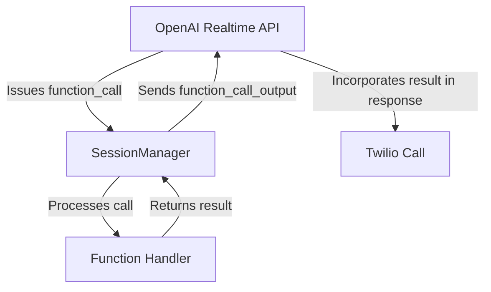
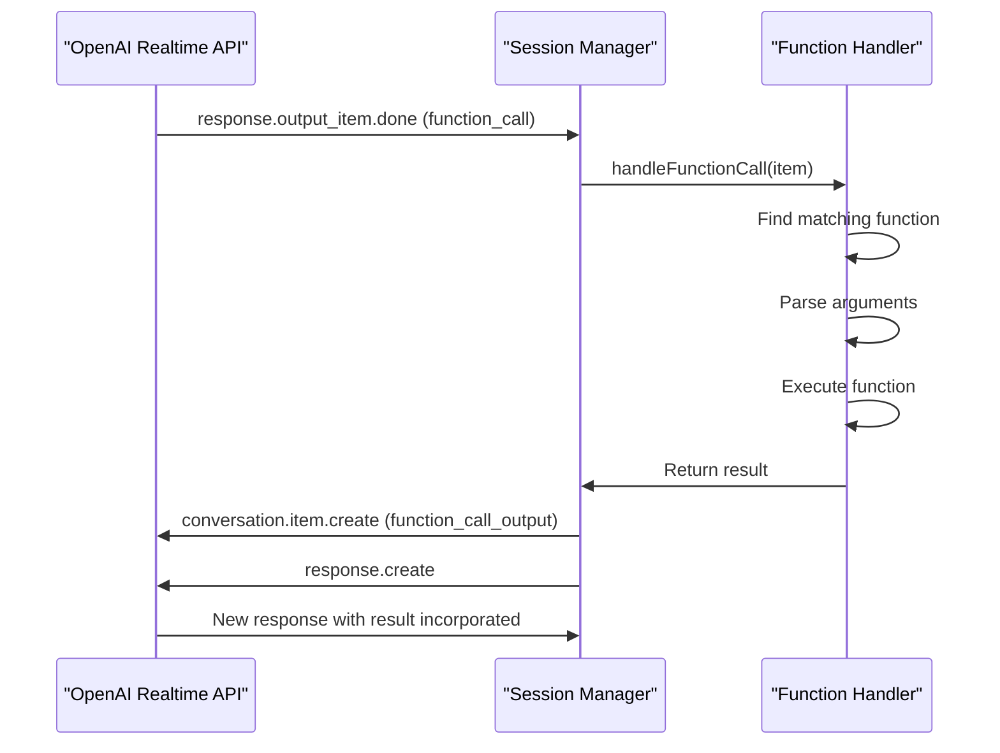
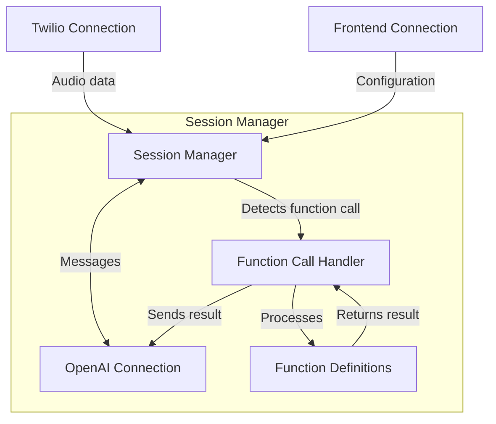

<!-- source: DeepWiki mcp.deepwiki.com · repo openai/openai-realtime-twilio-demo · page 2.4 Function Calling · fetched 2026-10-26 -->

# Function Calling

<details>
<summary>Relevant source files</summary>

The following files were used as context for generating this wiki page:

- [README.md](README.md)
- [websocket-server/src/server.ts](websocket-server/src/server.ts)
- [websocket-server/src/sessionManager.ts](websocket-server/src/sessionManager.ts)

</details>


This document explains the function calling mechanism in the OpenAI Realtime Twilio Demo, which allows the AI assistant to perform actions or retrieve information by invoking predefined functions. Function calling enables the AI to go beyond conversation by triggering code execution when needed during a call.

For information about general message handling, see [Message Handling](#2.3).

## Overview of Function Calling

The function calling system in this demo enables the AI to request specific operations by calling functions with arguments. The system implements a mock function calling mechanism that simulates external API calls or operations without actually executing them.



Sources: [websocket-server/src/sessionManager.ts:50-76](), [websocket-server/src/sessionManager.ts:185-207]()

## Function Definition Structure

Functions are defined in a separate module (`functionHandlers.ts`) and imported into the session manager. Each function consists of:

1. A schema defining the function's name, description, and parameters
2. A handler implementation that processes the arguments and returns a result

```mermaid
classDiagram
    class "Function Definition" {
        schema: FunctionSchema
        handler(args: any): Promise<any>
    }
    
    class "FunctionSchema" {
        name: string
        description: string
        parameters: JSONSchema
    }
    
    "Function Definition" --> "FunctionSchema"
```

Sources: [websocket-server/src/sessionManager.ts:50-52](), [websocket-server/src/server.ts:50-52]()

## Function Call Flow

The function calling process follows a specific sequence of events:

1. The AI assistant decides it needs to call a function
2. The model sends a message with a function call request
3. The session manager receives this request and invokes the function handler
4. The function handler processes the request and returns a result
5. The result is sent back to the model
6. The model incorporates the result into its next response



Sources: [websocket-server/src/sessionManager.ts:185-207](), [websocket-server/src/sessionManager.ts:50-76]()

## Implementation Details

### Function Handler

The function handler is responsible for processing function calls:

1. Finding the appropriate function definition based on the function name
2. Parsing the arguments from JSON format
3. Executing the function with the parsed arguments
4. Handling any errors that occur during execution
5. Returning the result or error message

```
handleFunctionCall(item: { name: string; arguments: string })
```

This function takes an item containing the function name and arguments as a JSON string, and returns a promise that resolves to the function result.

Sources: [websocket-server/src/sessionManager.ts:50-76]()

### Function Call Detection

The system detects function calls in the model's response through the message handling logic:

```typescript
case "response.output_item.done": {
  const { item } = event;
  if (item.type === "function_call") {
    handleFunctionCall(item)
      .then((output) => {
        // Send result back to model
      })
      .catch((err) => {
        console.error("Error handling function call:", err);
      });
  }
  break;
}
```

When a message with type `response.output_item.done` is received and the item type is `function_call`, the system invokes the function handler.

Sources: [websocket-server/src/sessionManager.ts:185-207]()

### Function Call Response

After processing a function call, the system sends two messages back to the model:

1. A `conversation.item.create` message with the function call output
2. A `response.create` message to prompt the model to generate a new response

```typescript
jsonSend(session.modelConn, {
  type: "conversation.item.create",
  item: {
    type: "function_call_output",
    call_id: item.call_id,
    output: JSON.stringify(output),
  },
});
jsonSend(session.modelConn, { type: "response.create" });
```

Sources: [websocket-server/src/sessionManager.ts:191-200]()

## API Endpoint for Tool Schemas

The server exposes an endpoint at `/tools` that returns a list of available function schemas:

```typescript
app.get("/tools", (req, res) => {
  res.json(functions.map((f) => f.schema));
});
```

This allows clients to discover what functions are available and their parameter requirements.

Sources: [websocket-server/src/server.ts:50-52]()

## Integration with Session Management

The function calling mechanism is integrated with the session management system:



The session manager handles all communication between Twilio, the frontend, and the OpenAI API. When a function call is detected in the OpenAI response, it's processed by the function call handler and the result is sent back to the OpenAI API.

Sources: [websocket-server/src/sessionManager.ts:1-17](), [websocket-server/src/sessionManager.ts:154-209]()

## Example Function Call Lifecycle

1. The AI assistant determines it needs to call a function (e.g., looking up weather information)
2. The OpenAI API sends a message with `type: "response.output_item.done"` and an item with `type: "function_call"`
3. The session manager receives this message and extracts the function call details
4. The function handler finds the appropriate function and executes it
5. The result is sent back to the OpenAI API
6. The OpenAI API incorporates the result in its next response
7. The response is sent to Twilio and converted to speech for the user

This mock implementation allows for quick prototyping without external API dependencies, while providing a framework that could be extended with real function implementations in a production environment.

Sources: [README.md:61-64](), [websocket-server/src/sessionManager.ts:154-209]()

---

