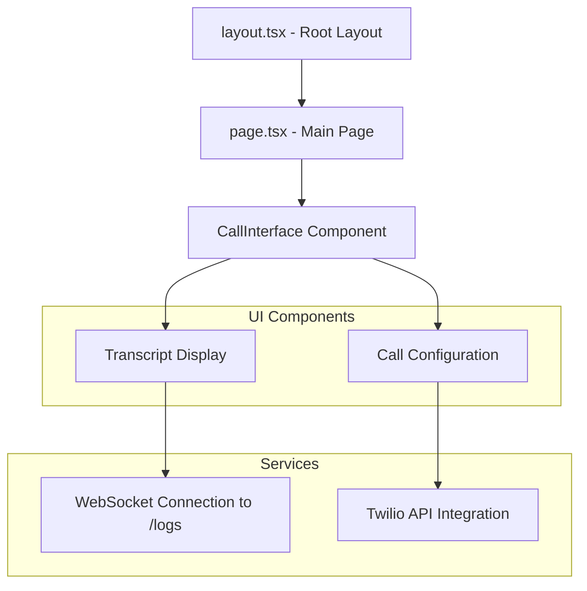
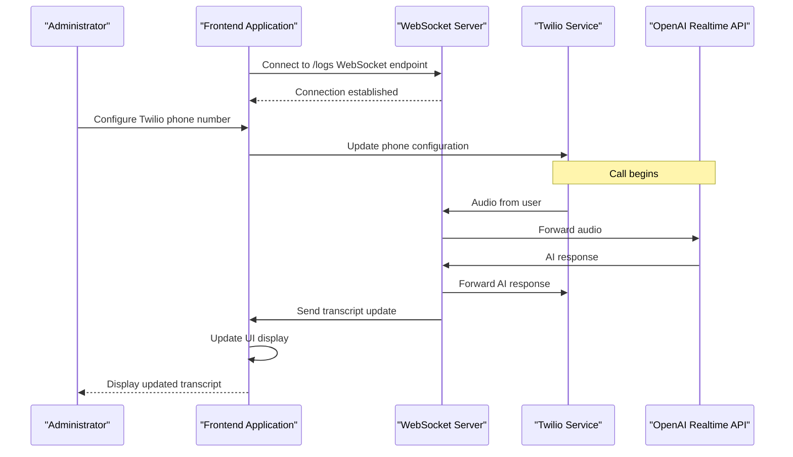
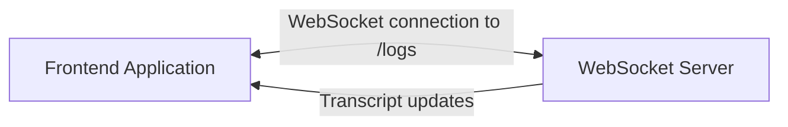
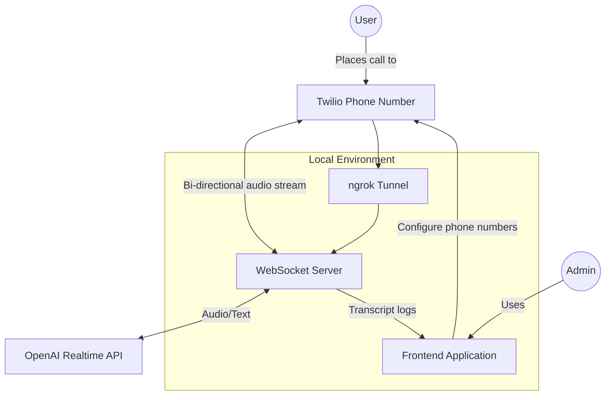

<!-- source: DeepWiki mcp.deepwiki.com · repo openai/openai-realtime-twilio-demo · page 3 Frontend Application · fetched 2026-10-26 -->

# Frontend Application

<details>
<summary>Relevant source files</summary>

The following files were used as context for generating this wiki page:

- [README.md](README.md)
- [webapp/app/layout.tsx](webapp/app/layout.tsx)
- [webapp/app/page.tsx](webapp/app/page.tsx)

</details>


The Frontend Application is a Next.js web application that serves as the user interface for the OpenAI Realtime Twilio Demo. It provides administrators with a dashboard for configuring Twilio phone calls and viewing real-time call transcripts. For information about the backend server that handles the communication between Twilio and OpenAI, see [WebSocket Server](#2).

## Purpose and Overview

The Frontend Application is designed to serve as a control center and monitoring interface for the AI calling system. It fulfills several key functions:

1. Displaying real-time transcripts of ongoing calls between users and the AI assistant
2. Providing configuration options for Twilio phone numbers 
3. Offering a user-friendly interface for monitoring call activity
4. Connecting to the WebSocket server to receive log updates

Sources: [README.md:21-24]()

## Architecture

The Frontend Application is built using Next.js, a React framework for building web applications. The application follows a component-based architecture with a clear separation of concerns.

### Component Structure



Sources: [webapp/app/page.tsx](), [webapp/app/layout.tsx](), [README.md:23-24]()

### Data Flow

The following diagram illustrates how data flows through the Frontend Application and how it interacts with other components of the system:



Sources: [README.md:45-60]()

## Key Components

### Main Page

The main page of the application imports and renders the `CallInterface` component, which serves as the entry point for the application interface:

```tsx
import CallInterface from "@/components/call-interface";

export default function Page() {
  return <CallInterface />;
}
```

Sources: [webapp/app/page.tsx]()

### Call Interface

The `CallInterface` component is the central component of the Frontend Application. It's responsible for:

1. Rendering the user interface for call configuration
2. Displaying real-time call transcripts
3. Establishing and maintaining the WebSocket connection to the backend
4. Providing call management functionality

Sources: [webapp/app/page.tsx](), [README.md:23-24]()

### WebSocket Connection

The Frontend Application establishes a WebSocket connection to the backend server's `/logs` endpoint. This connection allows the frontend to receive real-time updates about call transcripts and system status:



The connection flow is:
1. When the frontend application loads, it establishes a WebSocket connection to the server
2. It connects to the `/logs` endpoint, ready to receive call data
3. During a call, the WebSocket server sends transcript updates to the frontend
4. The frontend displays these updates in real-time

Sources: [README.md:49-50](), [README.md:56-60]()

### Twilio Integration

Based on the system diagrams, the Frontend Application includes functionality for configuring Twilio phone numbers, likely setting webhook URLs to point to the WebSocket server for call handling.

## Layout and Styling

The application uses the Inter font from Google Fonts and defines metadata for the application:

```typescript
export const metadata: Metadata = {
  title: "OpenAI Realtime + Twilio",
  description:
    "Sample phone call assistant app for OpenAI Realtime API and Twilio",
};
```

The application layout wraps all content in a basic HTML structure with the Inter font applied:

```typescript
export default function RootLayout({
  children,
}: Readonly<{
  children: React.ReactNode;
}>) {
  return (
    <html lang="en">
      <body className={inter.className}>{children}</body>
    </html>
  );
}
```

Sources: [webapp/app/layout.tsx]()

## System Context

The Frontend Application fits into the overall system architecture as follows:



In this system:
- End users place calls to a Twilio-managed phone number
- The WebSocket server handles the communication between Twilio and OpenAI's Realtime API
- The Frontend Application receives transcript logs from the WebSocket server
- Administrators use the Frontend Application to configure calls and monitor activity

Sources: [README.md:19-25](), [README.md:45-60]()

## Environment Configuration and Setup

The Frontend Application requires environment variables to be set in `webapp/.env`. These typically include:

- OpenAI API credentials
- Twilio API credentials
- WebSocket server URL

For local development, the application can be started with:

```shell
cd webapp
npm install
npm run dev
```

This will start the Next.js development server, typically on port 3000.

Sources: [README.md:11-16](), [README.md:69-75]()

## Conclusion

The Frontend Application provides a user-friendly interface for configuring, monitoring, and managing the OpenAI Realtime Twilio Demo. It works in conjunction with the WebSocket server to create a complete system for AI-powered phone calls, allowing administrators to configure Twilio phone numbers and view real-time call transcripts.

For more information about the WebSocket server, see [WebSocket Server](#2). For details on setting up and deploying the entire system, see [Setup and Deployment](#4).

---

