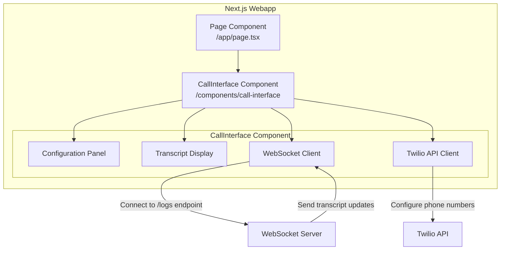
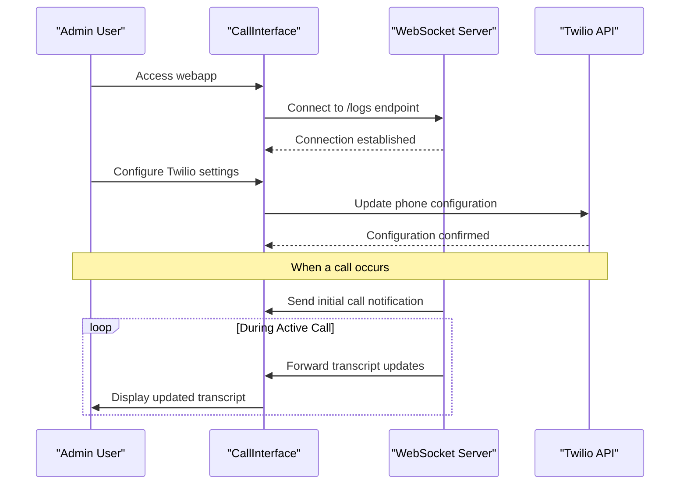
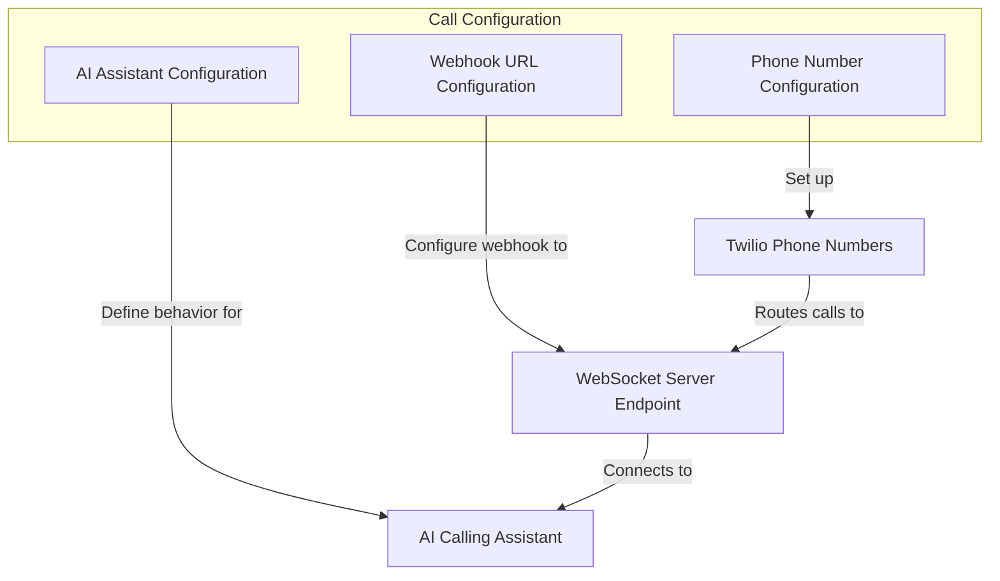
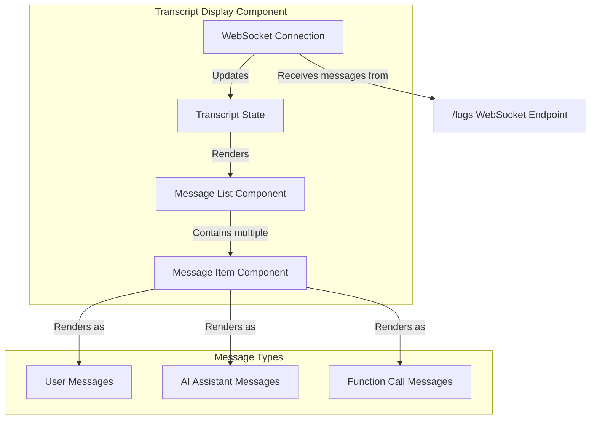
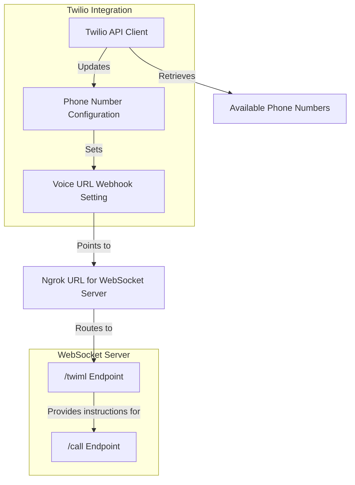
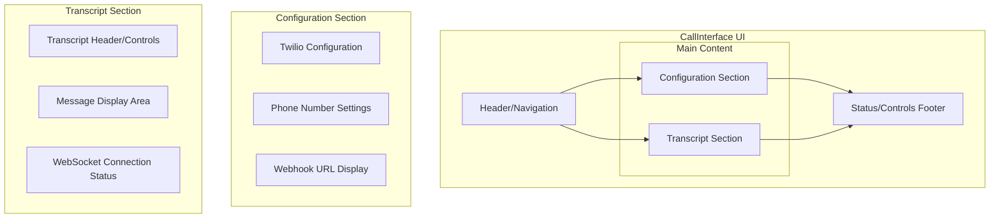

<!-- source: DeepWiki mcp.deepwiki.com · repo openai/openai-realtime-twilio-demo · page 3.1 Call Interface · fetched 2026-10-26 -->

# Call Interface

<details>
<summary>Relevant source files</summary>

The following files were used as context for generating this wiki page:

- [README.md](README.md)
- [webapp/app/page.tsx](webapp/app/page.tsx)

</details>


## Purpose and Overview

The Call Interface is the primary user-facing component of the OpenAI Realtime Twilio Demo. It serves as the control center for configuring AI-powered phone calls and monitoring real-time conversations. This component handles both the setup of Twilio phone numbers and the display of call transcripts, providing administrators with a comprehensive view of the AI phone calling system.

The Call Interface component is imported and used as the main content of the application's homepage, as seen in the application's page component:

Sources:
- `webapp/app/page.tsx:1-5`
- `README.md:21-25`

## Component Architecture

The Call Interface component resides within the Next.js frontend application and interfaces with both the WebSocket server and Twilio's API. Here's how it fits into the overall system architecture:



Sources:
- `README.md:23-25`
- `webapp/app/page.tsx:1-5`

## Data Flow

The Call Interface manages bidirectional data flow between the user interface, the WebSocket server, and Twilio's API. This sequence diagram illustrates the typical flow of data during configuration and a call:



Sources:
- `README.md:44-60`

## Call Configuration Features

The Call Interface provides functionality for administrators to configure Twilio phone numbers that will be used for AI-powered calls:



The configuration features likely include:
- Setting up and managing Twilio phone numbers
- Configuring the webhook URL to point to the WebSocket server
- Setting parameters for the AI assistant's behavior
- Viewing the status of current configurations

Sources:
- `README.md:23-24`
- `README.md:85-102`

## Transcript Display

A key feature of the Call Interface is the real-time display of call transcripts, which gives administrators visibility into the conversations between callers and the AI assistant:



The transcript display:
- Establishes a WebSocket connection to the server's `/logs` endpoint
- Receives and processes real-time message updates
- Renders messages with appropriate formatting based on the speaker (user vs. AI)
- May highlight function calls made by the AI assistant
- Updates in real-time as new messages arrive

Sources:
- `README.md:25`
- `README.md:49-60`

## WebSocket Connection Management

The Call Interface relies on a WebSocket connection to receive real-time updates from the server:

```mermaid
stateDiagram-v2
    [*] --> "Disconnected"
    "Disconnected" --> "Connecting": "Component mounts"
    "Connecting" --> "Connected": "Connection established"
    "Connecting" --> "Connection Error": "Connection fails"
    "Connected" --> "Receiving Updates": "Call active"
    "Receiving Updates" --> "Connected": "Call ends"
    "Connected" --> "Disconnected": "Component unmounts"
    "Connection Error" --> "Reconnecting": "Auto retry"
    "Reconnecting" --> "Connecting": "Attempt reconnection"
```

The WebSocket connection logic typically includes:
- Automatic connection when the component mounts
- Connection status tracking and display
- Error handling for failed connections
- Reconnection attempts when the connection is lost
- Processing of received message data

Sources:
- `README.md:49-51`
- `README.md:56-60`

## Integration with Twilio

The Call Interface component integrates with Twilio's API to configure phone numbers:



The integration involves:
- Setting up Twilio API credentials
- Retrieving and displaying available phone numbers
- Configuring the webhook URL to point to the WebSocket server
- Ensuring the proper TwiML is returned when a call is received

Sources:
- `README.md:85-106`
- `README.md:27-40`

## User Interface Layout

Based on the screenshot in the README and the functionality described, the Call Interface likely has a layout similar to:



The interface features:
- A clean, modern UI design
- A transcript display area showing the conversation in real-time
- Configuration controls for Twilio settings
- Status indicators for connection and call state

Sources:
- `README.md:5` (screenshot reference)
- `README.md:25` (description of transcript display)

## Technical Implementation

The Call Interface is implemented as a React component in the Next.js application. It's imported into the main page component:

```jsx
// From webapp/app/page.tsx
import CallInterface from "@/components/call-interface";

export default function Page() {
  return <CallInterface />;
}
```

The implementation likely involves:
- React hooks for state management (useState, useEffect)
- WebSocket connection establishment and management
- API calls to Twilio for configuration
- UI components for displaying transcripts and configuration options

Sources:
- `webapp/app/page.tsx:1-5`

## Summary

The Call Interface component serves as the central administrative tool for the OpenAI Realtime Twilio Demo. It provides a comprehensive interface for configuring Twilio phone numbers and monitoring real-time AI-powered phone conversations. Through its integration with the WebSocket server and Twilio's API, it enables administrators to set up, monitor, and manage the entire system from a single web interface.

The component plays a critical role in the overall system architecture by providing the human-facing control center for the AI phone calling system, bridging the gap between the technical backend services and the administrative users.

Sources:
- `README.md:19-25`
- `README.md:42-60`
- `webapp/app/page.tsx:1-5`

---

