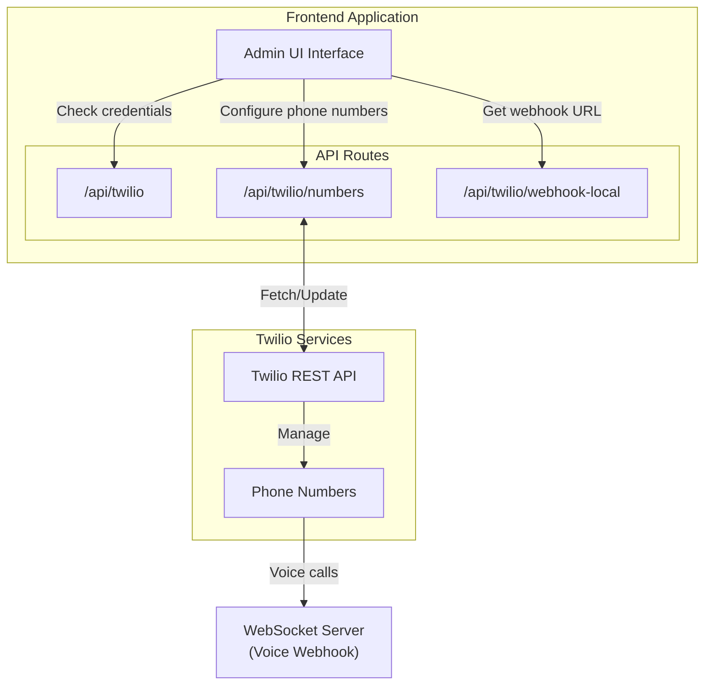
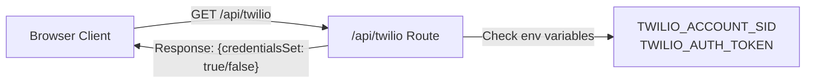
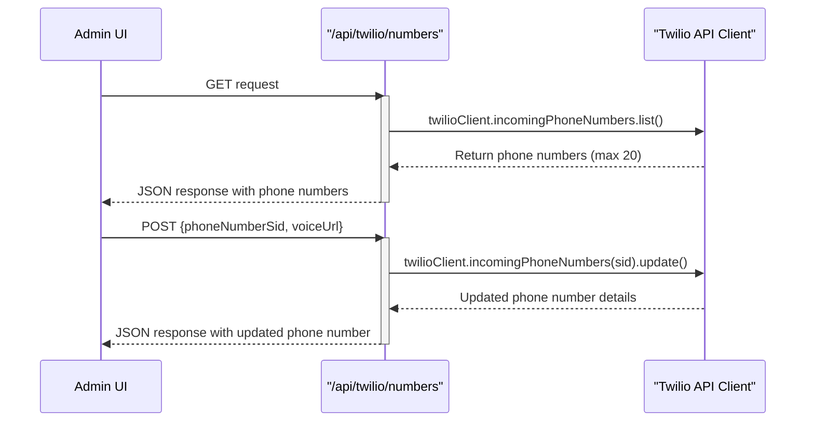
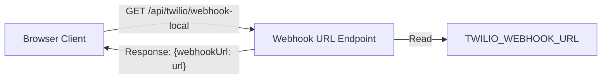
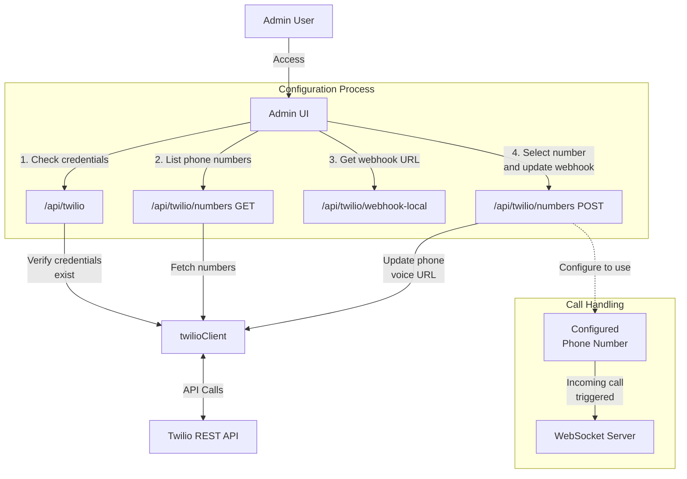
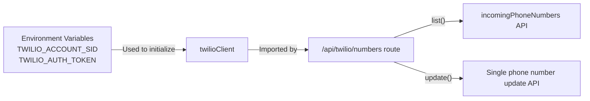
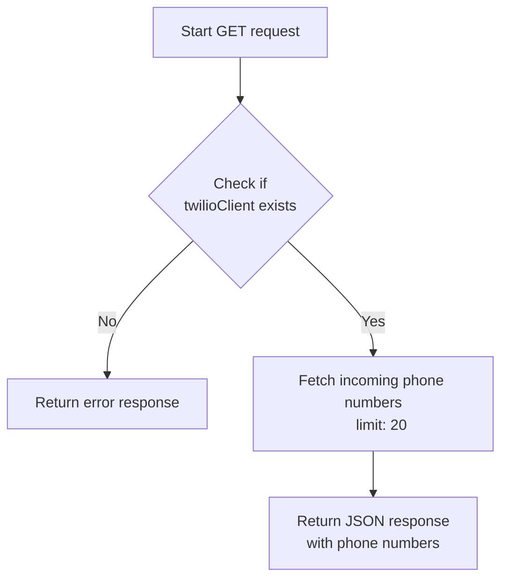
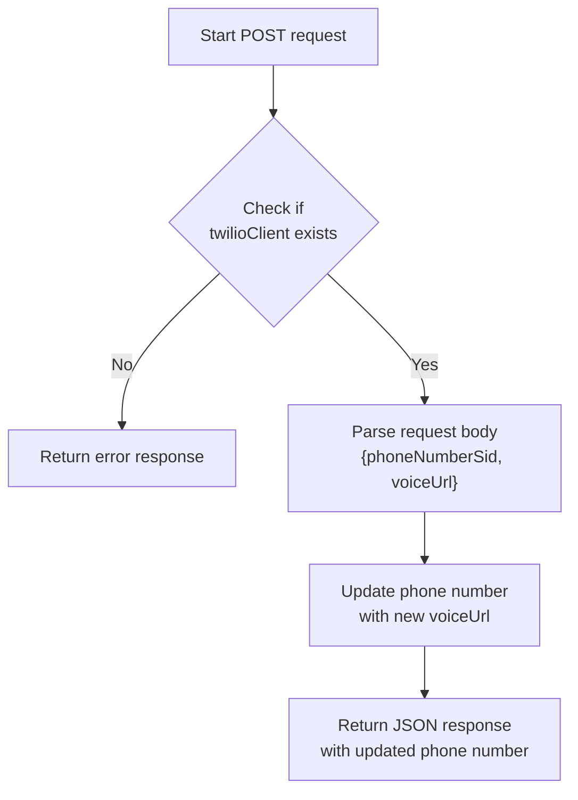

<!-- source: DeepWiki mcp.deepwiki.com · repo openai/openai-realtime-twilio-demo · page 3.2 Twilio API Integration · fetched 2026-10-26 -->

# Twilio API Integration

Relevant source files

The following files were used as context for generating this wiki page:

- [webapp/app/api/twilio/numbers/route.ts](webapp/app/api/twilio/numbers/route.ts)
- [webapp/app/api/twilio/route.ts](webapp/app/api/twilio/route.ts)
- [webapp/app/api/twilio/webhook-local/route.ts](webapp/app/api/twilio/webhook-local/route.ts)

This page documents the Twilio API integration within the frontend application of the OpenAI Realtime Twilio Demo. It covers how the Next.js webapp interacts with Twilio's API to manage phone numbers and configure webhooks. For information on how the WebSocket server handles Twilio calls, see [WebSocket Server](#2).

## Overview

The frontend application includes several API endpoints that serve as a bridge between the webapp UI and Twilio's services. These endpoints allow for:

1. Verifying Twilio credentials
2. Retrieving phone numbers from the Twilio account
3. Updating phone number configurations to use the application's webhook
4. Retrieving the local webhook URL for configuration

Sources: [webapp/app/api/twilio/numbers/route.ts](), [webapp/app/api/twilio/route.ts](), [webapp/app/api/twilio/webhook-local/route.ts]()

## API Endpoints

The frontend includes three API routes that handle Twilio-related functionality:

| Endpoint | Method | Purpose | Source |
|----------|--------|---------|--------|
| `/api/twilio` | GET | Verify Twilio credentials are configured | [webapp/app/api/twilio/route.ts]() |
| `/api/twilio/numbers` | GET | Retrieve Twilio phone numbers | [webapp/app/api/twilio/numbers/route.ts:3-15]() |
| `/api/twilio/numbers` | POST | Update a phone number's voice URL | [webapp/app/api/twilio/numbers/route.ts:17-31]() |
| `/api/twilio/webhook-local` | GET | Get the local webhook URL | [webapp/app/api/twilio/webhook-local/route.ts]() |

Sources: [webapp/app/api/twilio/numbers/route.ts](), [webapp/app/api/twilio/route.ts](), [webapp/app/api/twilio/webhook-local/route.ts]()

### Credential Verification

The credential verification endpoint checks if the required Twilio credentials are set in the environment variables:

Sources: [webapp/app/api/twilio/route.ts:1-6]()

### Phone Number Management

The phone number endpoints allow listing and updating Twilio phone numbers:

Sources: [webapp/app/api/twilio/numbers/route.ts]()

### Webhook URL Retrieval

The webhook URL endpoint provides the configured webhook URL from environment variables:

Sources: [webapp/app/api/twilio/webhook-local/route.ts]()

## Integration Flow

The following diagram illustrates the complete flow of Twilio API integration in the application:

Sources: [webapp/app/api/twilio/numbers/route.ts](), [webapp/app/api/twilio/route.ts](), [webapp/app/api/twilio/webhook-local/route.ts]()

## Twilio Client Initialization

The Twilio client is initialized in a separate module and imported by the API routes. It uses the Twilio SDK to create a client using the account SID and auth token from environment variables.

Sources: [webapp/app/api/twilio/numbers/route.ts:1]()

## Key Implementation Details

### Phone Number Listing

The GET endpoint for `/api/twilio/numbers` fetches up to 20 phone numbers from the Twilio account:

Sources: [webapp/app/api/twilio/numbers/route.ts:3-15]()

### Phone Number Update

The POST endpoint for `/api/twilio/numbers` updates a specific phone number's voice URL:

Sources: [webapp/app/api/twilio/numbers/route.ts:17-31]()

## Summary

The Twilio API integration in the frontend application provides a simple yet effective way to manage Twilio phone numbers and configure them to use the application's WebSocket server for handling calls. The integration consists of several API endpoints that interact with Twilio's REST API to check credentials, list phone numbers, and update their configuration.

By updating a phone number's voice URL to point to the application's webhook endpoint, incoming calls to that number will be routed to the WebSocket server, enabling the AI-powered phone calling assistant functionality.

---

