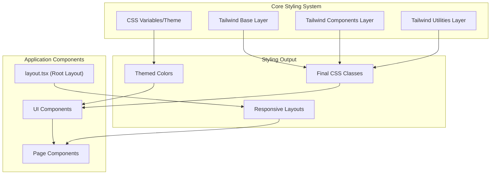
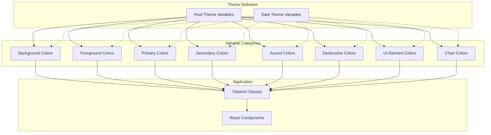
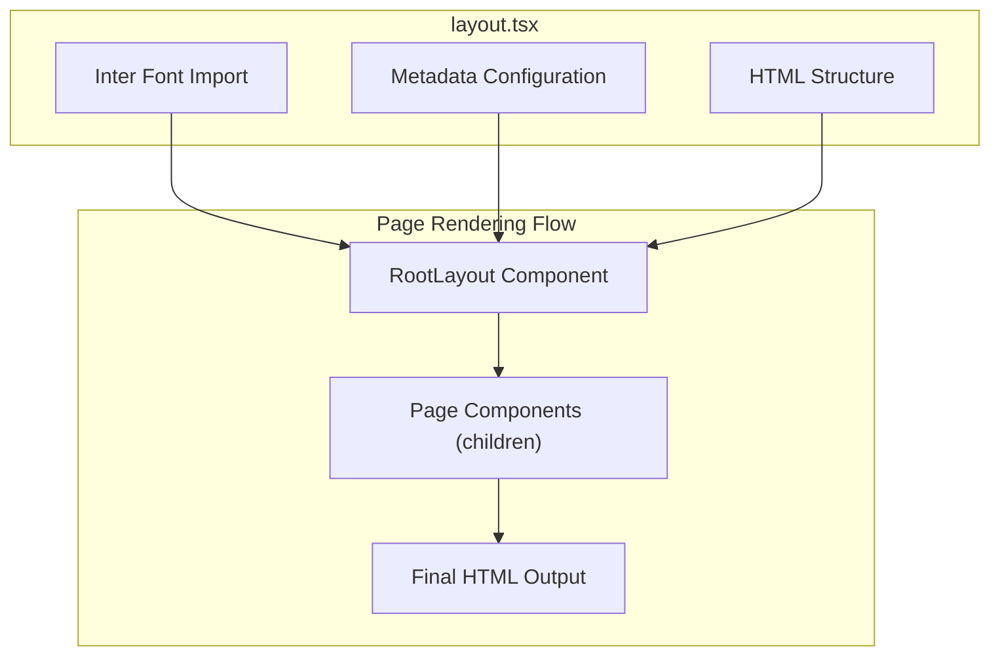
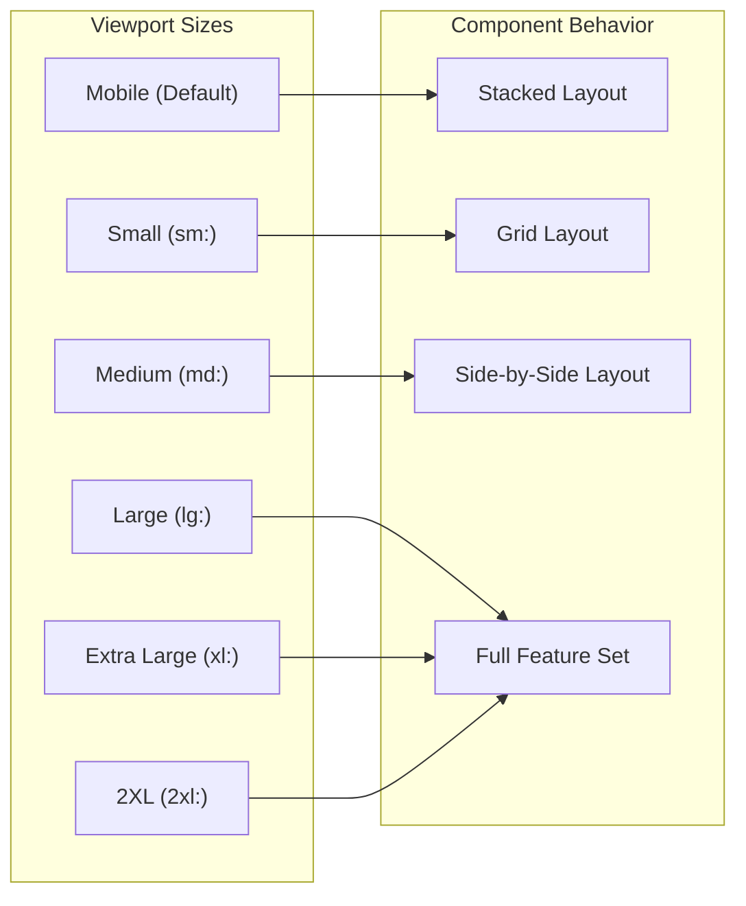
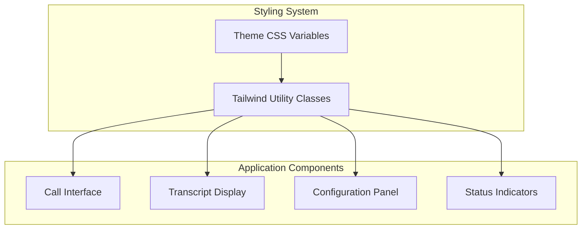

<!-- source: DeepWiki mcp.deepwiki.com · repo openai/openai-realtime-twilio-demo · page 3.3 Styling and Layout · fetched 2026-10-26 -->

# Styling and Layout

<details>
<summary>Relevant source files</summary>

The following files were used as context for generating this wiki page:

- [webapp/app/favicon.ico](webapp/app/favicon.ico)
- [webapp/app/globals.css](webapp/app/globals.css)
- [webapp/app/layout.tsx](webapp/app/layout.tsx)

</details>


This page documents the styling and layout architecture used in the OpenAI Realtime Twilio Demo webapp. The frontend application utilizes modern CSS approaches and component architecture to maintain a consistent and responsive user interface.

## Overview

The OpenAI Realtime Twilio Demo employs a combination of Tailwind CSS for utility-based styling and CSS variables for theming. The interface is built using React components within a Next.js framework, providing a responsive layout that adapts to different viewport sizes.

Sources: [webapp/app/globals.css](), [webapp/app/layout.tsx]()

## Styling Architecture

The styling system is built on three main pillars:

1. **Tailwind CSS**: Utility-first CSS framework that provides predefined classes
2. **CSS Variables**: Custom properties used for theming and consistent color usage
3. **Component-based styling**: Style encapsulation at the component level

### Styling Architecture Diagram



Sources: [webapp/app/globals.css:1-3]()

## Tailwind CSS Configuration

The application uses Tailwind CSS's layering system to organize styles:

1. **Base layer**: Resets and fundamental styles
2. **Components layer**: Reusable component styles
3. **Utilities layer**: Single-purpose utility classes

The Tailwind configuration is imported at the top of the globals.css file, establishing the foundation for all styling in the application.

Sources: [webapp/app/globals.css:1-3]()

## Theming System

The application implements a comprehensive theming system using CSS variables. This enables:

1. Light and dark mode support
2. Consistent color application across components
3. Easy theme customization without changing component code

### CSS Variables and Theme Structure



The theming system defines variables for:

| Category | Purpose | Example Variables |
|----------|---------|-------------------|
| Background | Page and element backgrounds | `--background`, `--card` |
| Foreground | Text and icon colors | `--foreground`, `--card-foreground` |
| Primary | Primary UI elements | `--primary`, `--primary-foreground` |
| Secondary | Secondary UI elements | `--secondary`, `--secondary-foreground` |
| Accent | Accent highlights | `--accent`, `--accent-foreground` |
| Destructive | Error and warning states | `--destructive`, `--destructive-foreground` |
| UI Elements | Borders, inputs, rings | `--border`, `--input`, `--ring` |
| Chart Colors | Data visualization | `--chart-1` through `--chart-5` |

Sources: [webapp/app/globals.css:5-60]()

## Application Root Layout

The application's root layout component (`layout.tsx`) serves as the structural foundation for all pages. It:

1. Imports and applies the Inter font from Google Fonts
2. Sets up metadata for the application
3. Establishes the basic HTML structure
4. Applies the font class to the body element

### Root Layout Structure



Sources: [webapp/app/layout.tsx]()

## CSS Base Styling

Base styling is applied to all elements through Tailwind's `@apply` directive, ensuring consistent defaults:

- All elements inherit border styling from the `--border` CSS variable
- The body element receives background and text colors from theme variables

```
@layer base {
  * {
    @apply border-border;
  }
  body {
    @apply bg-background text-foreground;
  }
}
```

This approach ensures that all components have a consistent foundation that respects the current theme.

Sources: [webapp/app/globals.css:62-69]()

## Responsive Design

While not explicitly defined in the provided files, the use of Tailwind CSS implies a responsive design approach using Tailwind's breakpoint system. This allows components to adapt their layout and styling based on viewport size.

### Responsive Design System



## Best Practices for Component Styling

When extending the application with new components, the following practices should be observed:

1. Use Tailwind utility classes for component styling
2. Reference theme variables through Tailwind classes (e.g., `bg-background`, `text-primary`)
3. Implement responsive designs using Tailwind breakpoint prefixes
4. Avoid inline styles or additional CSS files when possible
5. For complex components, consider using Tailwind's `@apply` in component-specific styles

## Integration with Application Components

The styling system integrates with the application components through Tailwind classes and theme variables. This creates a cohesive visual experience throughout the interface.

### Component Styling Integration



The modular nature of this styling approach allows for consistent theming while maintaining component-specific styling needs.

Sources: [webapp/app/globals.css](), [webapp/app/layout.tsx]()

---

