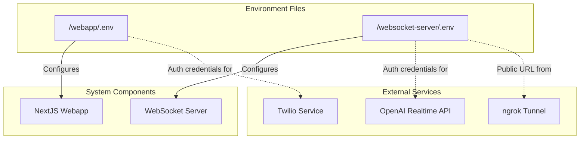
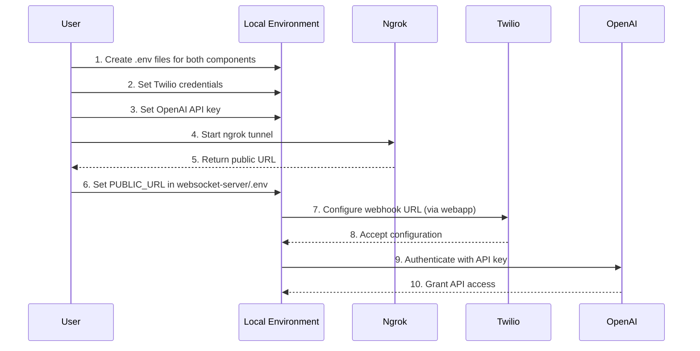
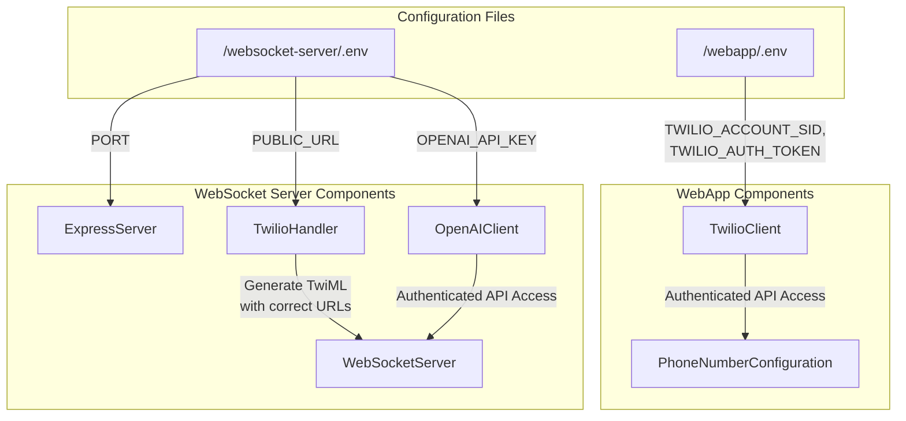
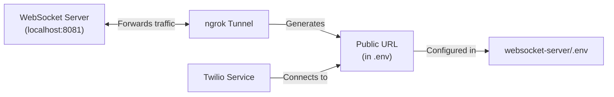

<!-- source: DeepWiki mcp.deepwiki.com · repo openai/openai-realtime-twilio-demo · page 4.1 Environment Configuration · fetched 2026-10-26 -->

# Environment Configuration

<details>
<summary>Relevant source files</summary>

The following files were used as context for generating this wiki page:

- [README.md](README.md)
- [webapp/.env.example](webapp/.env.example)
- [webapp/.gitignore](webapp/.gitignore)

</details>


This page details the necessary environment variables and configuration settings required to set up and run the OpenAI Realtime Twilio Demo. Proper configuration of both the webapp and websocket-server components is essential for the system to function correctly. For information about local development setup, see [Local Development](#4.2).

## Overview of Configuration Requirements

The OpenAI Realtime Twilio Demo requires configuration in two main components:

1. **NextJS Webapp** - Frontend interface for call configuration and transcript display
2. **WebSocket Server** - Backend that handles connections between Twilio and OpenAI

Each component has its own set of environment variables that must be configured before the system can operate properly.



Sources: [README.md:17-17](), [README.md:87-90]()

## Environment Variables by Component

The system relies on several environment variables split between the two main components:

| Component | Environment File | Purpose |
|-----------|------------------|---------|
| NextJS Webapp | `/webapp/.env` | Configure Twilio authentication for phone number management |
| WebSocket Server | `/websocket-server/.env` | Configure OpenAI authentication, Twilio connection, and public URL |

Sources: [README.md:87-90](), [webapp/.env.example:1-4]()

## Webapp Configuration

The webapp primarily needs Twilio credentials to manage and configure phone numbers. These credentials should be placed in the `/webapp/.env` file.

### Required Variables

```
TWILIO_ACCOUNT_SID="your_twilio_account_sid"
TWILIO_AUTH_TOKEN="your_twilio_auth_token"
```

### How to Obtain Credentials

1. Create or log in to your [Twilio account](https://www.twilio.com/)
2. Navigate to the Twilio Console dashboard
3. Locate your Account SID and Auth Token
4. Copy these values into your `/webapp/.env` file

Sources: [webapp/.env.example:1-4](), [README.md:87-90]()

## WebSocket Server Configuration

The WebSocket server requires more extensive configuration as it acts as the bridge between Twilio, OpenAI, and the frontend application.

### Required Variables

```
# OpenAI credentials
OPENAI_API_KEY="your_openai_api_key"

# Server configuration
PORT=8081  # Default port the server runs on
PUBLIC_URL="https://your-ngrok-url"  # URL from ngrok for public access

# Optional Twilio credentials (may be needed for some features)
TWILIO_ACCOUNT_SID="your_twilio_account_sid"
TWILIO_AUTH_TOKEN="your_twilio_auth_token"
```

The `PUBLIC_URL` is particularly important as it allows Twilio to reach your locally running WebSocket server through the ngrok tunnel.

Sources: [README.md:94-105]()

## Environment Configuration Workflow



Sources: [README.md:65-83]()

## Environment Variable Usage Flow

The following diagram illustrates how environment variables are used throughout the system:



Sources: [README.md:21-25](), [README.md:87-90](), [README.md:94-105]()

## Setting Up ngrok for Public URL

Since Twilio needs to reach your WebSocket server which is running locally, you need to expose it using a service like ngrok. The generated public URL must be configured in your environment variables.

### Steps to Configure ngrok URL

1. Install ngrok if not already installed
2. Start ngrok on the same port as your WebSocket server (default: 8081)
   ```
   ngrok http 8081
   ```
3. Note the "Forwarding" URL provided by ngrok (e.g., `https://54c5-35-170-32-42.ngrok-free.app`)
4. Set this URL as the `PUBLIC_URL` in `websocket-server/.env`



Sources: [README.md:94-105]()

## Verifying Configuration

Before running the application, verify that your environment files are properly configured:

1. Ensure both `webapp/.env` and `websocket-server/.env` exist and contain all required variables
2. Confirm that the ngrok tunnel is active and the URL matches the `PUBLIC_URL` in your websocket-server configuration
3. Check that your Twilio and OpenAI credentials are valid

### Common Configuration Issues

- **Missing .env files**: Make sure to rename `.env.example` to `.env` in both directories
- **Invalid ngrok URL**: If your ngrok session expires, you'll need to update the `PUBLIC_URL` with the new forwarding URL
- **Port conflicts**: If port 8081 is already in use, you can change the PORT in `websocket-server/.env` but remember to update your ngrok command accordingly

Sources: [README.md:17-17](), [README.md:87-90](), [README.md:94-105]()

## Security Considerations

As noted in the README, this demo repository isn't polished from a security perspective. When deploying to production, consider these security improvements:

- Use environment variable encryption for sensitive credentials
- Implement proper authentication for the WebSocket connections
- Ensure secure storage of API keys and tokens
- Consider using a more robust method than ngrok for production deployments

Sources: [README.md:107-109]()

---

