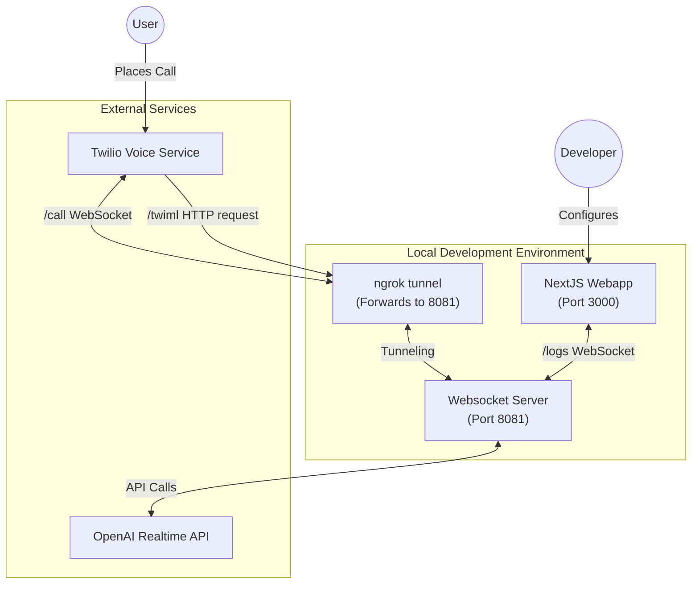
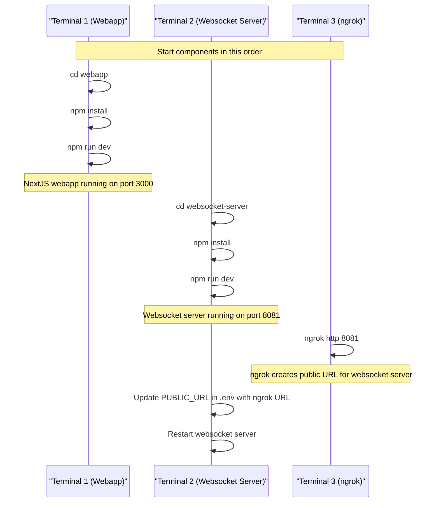
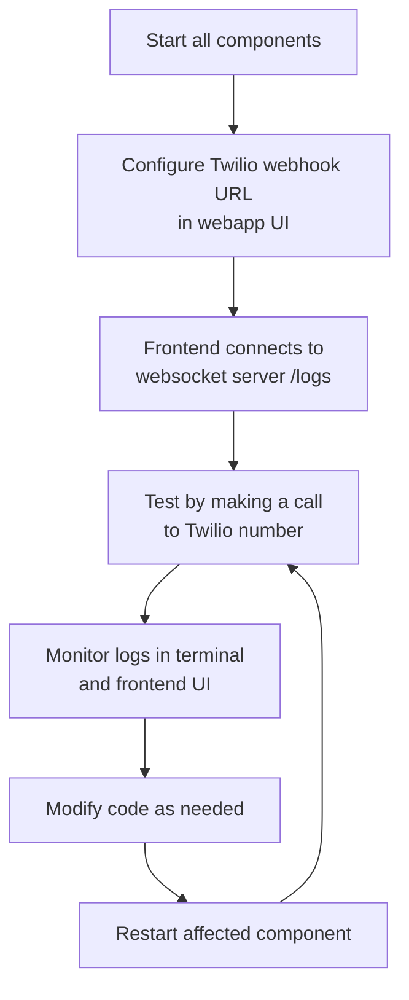
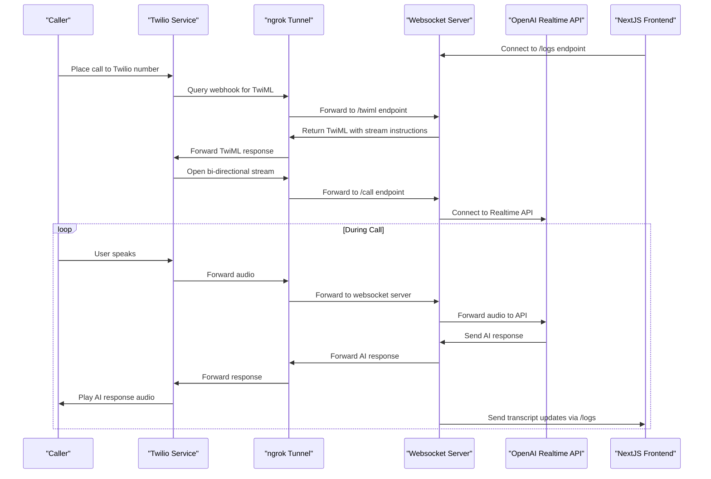
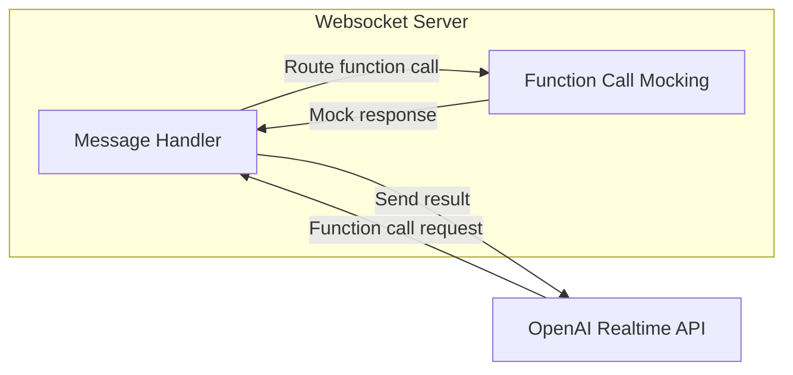

<!-- source: DeepWiki mcp.deepwiki.com · repo openai/openai-realtime-twilio-demo · page 4.2 Local Development · fetched 2026-10-26 -->

# Local Development

<details>
<summary>Relevant source files</summary>

The following files were used as context for generating this wiki page:

- [README.md](README.md)
- [webapp/.env.example](webapp/.env.example)

</details>


This document explains how to set up and run the OpenAI Realtime Twilio Demo in a local development environment. It covers the process of configuring and running all system components on your local machine and testing the functionality of the AI-powered calling assistant.

For information about environment variables and configuration requirements, see [Environment Configuration](#4.1). For detailed instructions on using ngrok to expose your local server to Twilio, see [Using ngrok](#4.3).

## System Overview for Local Development

The local development environment requires three separate components running simultaneously:



Sources: [README.md:11-16](), [README.md:21-25](), [README.md:42-51]()

## Prerequisites

Before starting local development, ensure you have the following:

| Requirement | Purpose | Notes |
|-------------|---------|-------|
| Node.js & npm | To run the webapp and websocket server | Latest LTS version recommended |
| OpenAI API key | To access the Realtime API | Requires appropriate access level |
| Twilio account | To handle phone calls | Need Account SID and Auth Token |
| ngrok account | To expose local server | Free tier works for testing |
| Git | To clone the repository | - |

Sources: [README.md:85-89](), [webapp/.env.example:1-4]()

## Setup Process

Setting up the local development environment involves a three-terminal approach to run all the necessary components simultaneously.

### 1. Clone and Configure the Repository

First, clone the repository and set up the environment variables for both components:

#### Webapp Environment Configuration

Create a `.env` file in the `webapp` directory based on the provided example:

```
TWILIO_ACCOUNT_SID="your_twilio_account_sid"
TWILIO_AUTH_TOKEN="your_twilio_auth_token"
```

#### Websocket Server Environment Configuration

Create a `.env` file in the `websocket-server` directory with:

```
OPENAI_API_KEY="your_openai_api_key"
PUBLIC_URL="your_ngrok_forwarding_url"
```

Note: The `PUBLIC_URL` will be set after starting ngrok in a later step.

Sources: [README.md:17](), [webapp/.env.example:1-4](), [README.md:85-89]()

### 2. Start the Components

You need three terminal windows to run all components of the system:



#### Terminal 1: Start the Webapp

```bash
cd webapp
npm install
npm run dev
```

This starts the NextJS frontend application on port 3000, accessible at http://localhost:3000.

#### Terminal 2: Start the Websocket Server

```bash
cd websocket-server
npm install
npm run dev
```

This starts the Express websocket server on port 8081.

#### Terminal 3: Start ngrok

```bash
ngrok http 8081
```

This creates a public URL (like `https://abc123.ngrok-free.app`) that forwards to your local websocket server.

Sources: [README.md:11-16](), [README.md:67-83](), [README.md:91-101]()

### 3. Configure the Public URL

After starting ngrok, copy the forwarding URL it displays. Update the `PUBLIC_URL` in your `websocket-server/.env` file with this URL, then restart the websocket server for the changes to take effect.

```
PUBLIC_URL="https://your-unique-subdomain.ngrok-free.app"
```

Sources: [README.md:103-105]()

## Development Workflow

The following diagram illustrates the typical development workflow once your environment is set up:



Sources: [README.md:46-60]()

## Call Flow in Development Environment

This diagram shows the flow of data during a call in the development environment:



Sources: [README.md:44-60]()

## Function Call Testing

The demo includes a mechanism for testing function calls without implementing actual functionality:



During development, the system mocks function calls instead of executing real functionality. This allows for rapid testing of the AI assistant's capabilities.

Sources: [README.md:61-64]()

## Troubleshooting

Here are common issues you might encounter during local development:

| Issue | Possible Cause | Solution |
|-------|---------------|----------|
| Websocket connection failing | ngrok URL not updated in `PUBLIC_URL` | Update `.env` file and restart the websocket server |
| Twilio not connecting to websocket | Incorrect webhook URL configuration | Verify the URL in Twilio configuration |
| OpenAI API errors | Invalid API key or insufficient permissions | Check your API key and OpenAI account access |
| Changes not taking effect | Server not restarted after config changes | Always restart the server after changing environment variables |

Remember that the ngrok URL changes each time you restart ngrok (unless you have a paid plan), so you'll need to update both the `PUBLIC_URL` in your environment variables and the Twilio webhook URL accordingly.

Sources: [README.md:107-109]()

## Security Considerations

As noted in the README, this demo implementation has limitations for security and is intended for reference and learning purposes. For production deployments, conduct proper security audits and engineering reviews.

Sources: [README.md:107-109]()

---

