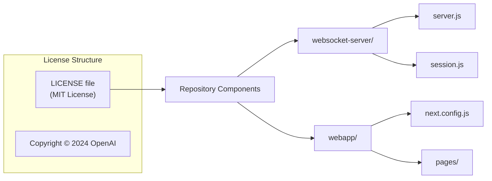
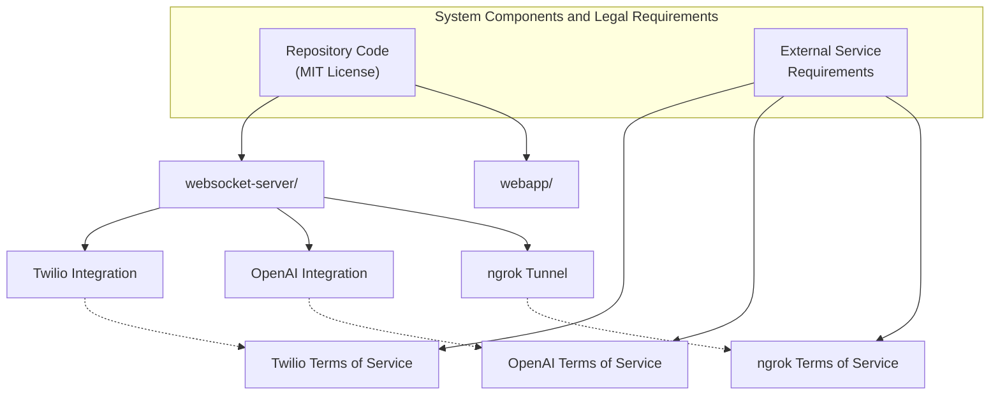

<!-- source: DeepWiki mcp.deepwiki.com · repo openai/openai-realtime-twilio-demo · page 5 Legal Information · fetched 2026-10-26 -->

# Legal Information

<details>
<summary>Relevant source files</summary>

The following files were used as context for generating this wiki page:

- [LICENSE](LICENSE)

</details>


This document outlines the legal framework governing the OpenAI Realtime Twilio Demo repository, including licensing terms, usage permissions, and important considerations for implementers. For technical details about the system architecture, please refer to [Overview](#1) and [Architecture](#1.1).

## License Overview

The OpenAI Realtime Twilio Demo is released under the MIT License, a permissive open-source license that allows for extensive freedom in using, modifying, and distributing the software, with minimal restrictions.



Sources: [LICENSE:1-4]()

## MIT License Terms

The MIT License grants the following permissions and comes with minimal requirements:

### Permissions

The license explicitly grants users permission to:

| Permission | Application to this Codebase |
|------------|------------------------------|
| Use | Deploy the Twilio-OpenAI integration as described |
| Copy | Duplicate the codebase for development or production |
| Modify | Customize the AI behavior, function calling capabilities, or UI |
| Merge | Incorporate into larger systems or applications |
| Publish | Release modified versions |
| Distribute | Share the system with others |
| Sublicense | Allow others to use your modified version |
| Sell | Commercialize the system or derivatives |

Sources: [LICENSE:5-10]()

### Requirements

To comply with the MIT License, users must:

1. Include the original copyright notice (Copyright (c) 2024 OpenAI)
2. Include the permission notice (the full license text)

This notice must be included in all copies or substantial portions of the software.

Sources: [LICENSE:12-13]()

## Warranty Disclaimer and Liability Limitation

The MIT License includes a clear disclaimer of warranty and limitation of liability:

```
THE SOFTWARE IS PROVIDED "AS IS", WITHOUT WARRANTY OF ANY KIND, EXPRESS OR
IMPLIED, INCLUDING BUT NOT LIMITED TO THE WARRANTIES OF MERCHANTABILITY,
FITNESS FOR A PARTICULAR PURPOSE AND NONINFRINGEMENT. IN NO EVENT SHALL THE
AUTHORS OR COPYRIGHT HOLDERS BE LIABLE FOR ANY CLAIM, DAMAGES OR OTHER
LIABILITY, WHETHER IN AN ACTION OF CONTRACT, TORT OR OTHERWISE, ARISING FROM,
OUT OF OR IN CONNECTION WITH THE SOFTWARE OR THE USE OR OTHER DEALINGS IN THE
SOFTWARE.
```

This means that:
- The software is provided without warranties of any kind
- The authors or copyright holders cannot be held liable for any claims or damages
- Users implement and deploy this system at their own risk

Sources: [LICENSE:15-21]()

## Additional Legal Considerations

### Third-Party Service Integration

While the codebase itself is MIT-licensed, implementing this system requires integration with third-party services that have their own terms of service:



Sources: [LICENSE:1-21]()

### Regulatory Considerations

Implementers should be aware of potential regulatory requirements:

1. **Telecommunications Regulations**: Systems handling voice calls may be subject to telecommunications regulations
2. **AI Disclosure**: Some jurisdictions require disclosure that callers are interacting with an AI system
3. **Call Recording**: Recording or transcribing calls may require consent in many jurisdictions
4. **Data Privacy**: Processing call audio and transcripts may involve data privacy requirements (GDPR, CCPA, etc.)

## Summary

The OpenAI Realtime Twilio Demo is provided under the permissive MIT License, allowing for extensive freedom in using, modifying, and distributing the software. When implementing this system, users must:

1. Retain the copyright and license notices
2. Understand there are no warranties or liabilities
3. Comply with third-party service terms (OpenAI, Twilio, ngrok)
4. Consider applicable regulations regarding telecommunications, AI systems, and data privacy

Sources: [LICENSE:1-21]()