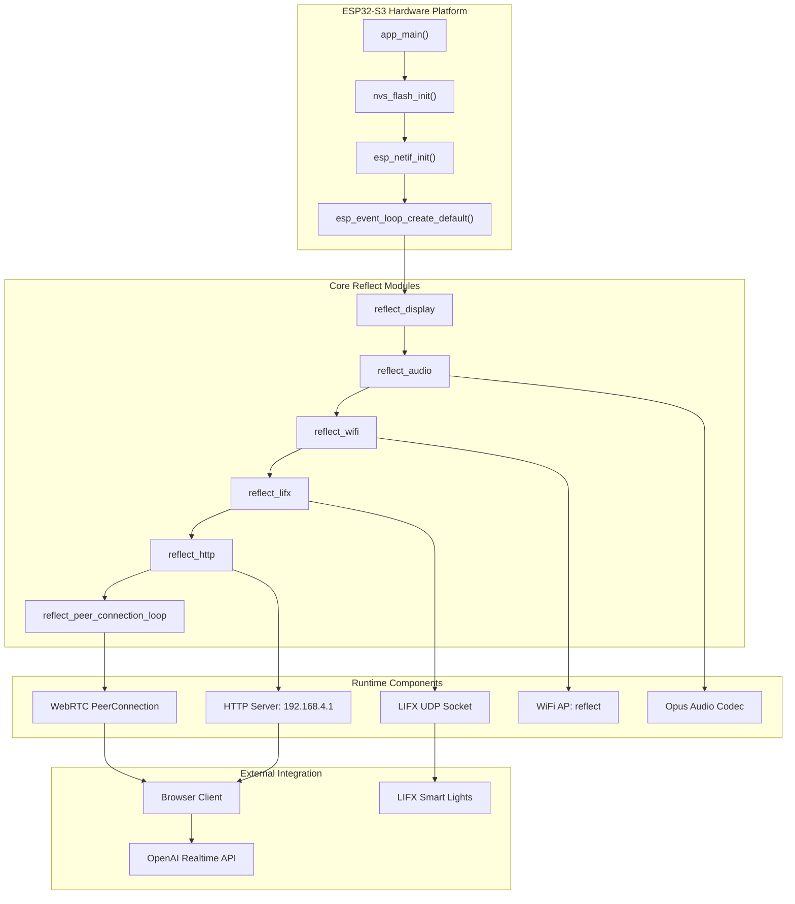
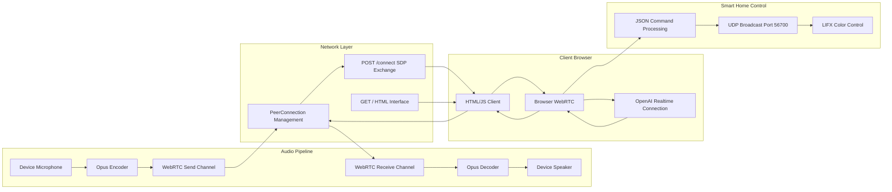

<!-- source: DeepWiki mcp.deepwiki.com · repo openai/openai-reflect · page 1 Overview · fetched 2026-10-26 -->

# Overview

Relevant source files

The following files were used as context for generating this wiki page:

- [README.md](README.md)

## Purpose and Scope

This document provides a high-level overview of the Reflect hardware AI assistant system, introducing its architecture, key components, and integration points. Reflect is a voice-controlled smart home device built on the ESP32-S3 platform that integrates with OpenAI's Realtime API to provide natural language interactions and smart home control capabilities.

For detailed information about specific subsystems, see: [Audio System](#2), [WebRTC Communication](#3), [Web Interface](#4), [System Architecture](#5), [Hardware Platform](#6), [Smart Home Integration](#7), and [Hardware Interfaces](#8).

## System Overview

Reflect is a stateless hardware AI assistant designed around the principle of natural communication through sound, light, and color while avoiding traditional screen-based interfaces. The device creates a local WiFi network that clients connect to, establishing peer-to-peer WebRTC connections for real-time audio streaming and command processing.

### Core Design Principles

| Principle | Implementation |
|-----------|----------------|
| **Communicate naturally** | Sound, light and color interfaces instead of screens |
| **Phone is your key** | Device has no persistent state; all information stored on client |
| **Stateless operation** | No local data storage; operates as a communication bridge |
| **Easy modification** | Modular design for adding new features and integrations |
| **Cost-effective** | Built on affordable ESP32-S3 hardware platform |

### System Architecture Overview

**System Initialization and Module Dependencies**

The system follows a strict initialization sequence where ESP-IDF foundation services must complete successfully before Reflect-specific modules initialize. Each module has clear dependencies and interfaces with specific hardware or network components.

Sources: [README.md:1-93]()

### Communication Flow Architecture

**Real-time Communication Pipeline**

The system establishes a complete audio processing pipeline from device microphone through Opus encoding, WebRTC transmission, OpenAI API processing, and response playback. Smart home control commands flow through the same WebRTC data channel as JSON messages.

Sources: [README.md:84-92]()

## Hardware Platform

Reflect targets the M5Stack CoreS3 ESP32S3 IoT Development Kit, chosen for its integrated camera, display, audio codec, and WiFi capabilities. The device operates as a WiFi access point, creating a network named `reflect` that clients connect to for interaction.

### Supported Hardware

| Component Type | Model | Purpose |
|---------------|-------|---------|
| **Microcontroller** | M5Stack CoreS3 ESP32S3 | Main processing unit with integrated peripherals |
| **Smart Lights** | LIFX Color A19 | Voice-controlled ambient lighting |

### Network Configuration

The device creates a WiFi access point with the following configuration:
- **SSID**: `reflect`
- **IP Address**: `192.168.4.1`
- **Web Interface**: HTTP server on port 80
- **Protocol**: WebRTC peer-to-peer connections

## Key Integration Points

### OpenAI Realtime API Integration
The browser client establishes a direct WebRTC connection to OpenAI's Realtime API, enabling low-latency voice conversations with function calling capabilities for smart home control.

### LIFX Smart Lighting Control
The device communicates with LIFX lights using UDP broadcasts on port 56700, supporting color changes, power control, and waveform effects based on AI-generated commands.

### Stateless Design Philosophy
All session state, user preferences, and conversation history are maintained in the browser client. The Reflect device operates as a stateless communication bridge, making it simple to deploy and maintain.

## Getting Started

To use Reflect:
1. Connect to the `reflect` WiFi network
2. Navigate to `http://192.168.4.1` in a web browser
3. Start a session to establish WebRTC connections
4. Begin voice interactions with the AI assistant

For installation and deployment procedures, see [Development and Deployment](#9).

Sources: [README.md:57-92]()

---

