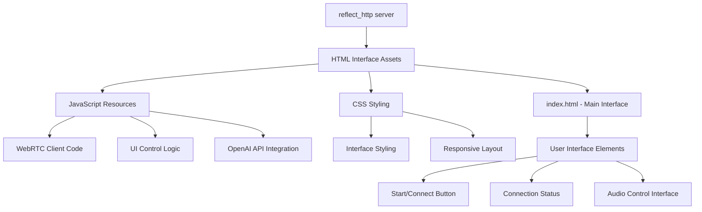
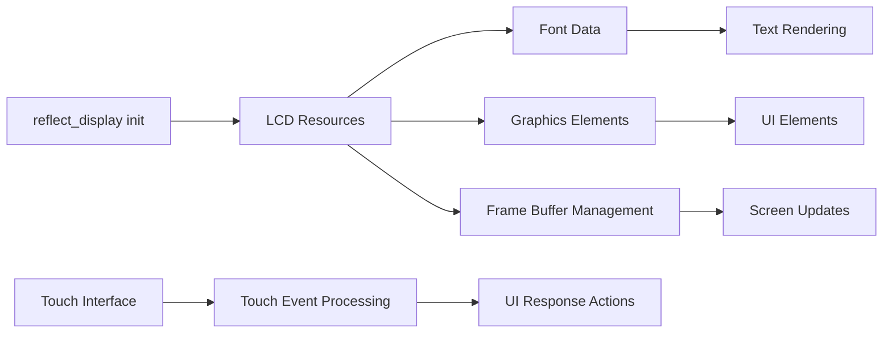
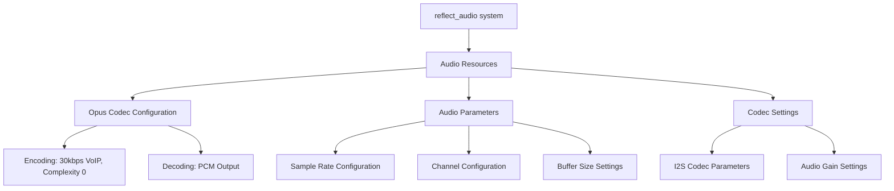
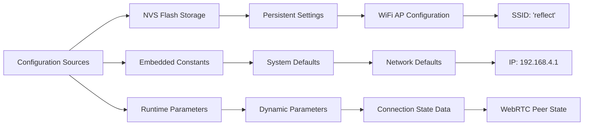
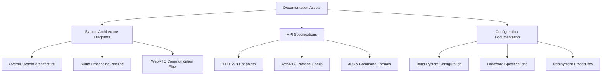
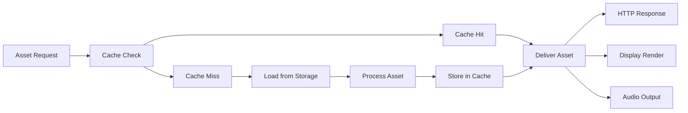

<!-- source: DeepWiki mcp.deepwiki.com · repo openai/openai-reflect · page 10 Assets and Resources · fetched 2026-10-26 -->

# Assets and Resources

Relevant source files

The following files were used as context for generating this wiki page:

- [.github/installed.png](.github/installed.png)
- [.github/reflect.png](.github/reflect.png)

This document covers the visual assets, resource files, and static content used throughout the Reflect hardware AI assistant system. It includes web interface assets, display resources, audio configurations, and documentation materials that support the device's operation and user experience.

For information about the web interface implementation, see [Web Interface](#4). For details about the display system hardware, see [Display System](#8.1).

## Overview

The Reflect system utilizes various types of assets and resources to deliver its hardware AI assistant functionality. These resources are primarily embedded within the ESP32-S3 firmware and served through the integrated web interface. The asset management is designed for minimal memory footprint while providing essential visual and interactive elements.

## Web Interface Assets

The web interface assets form the primary user interaction layer for the Reflect system. These assets are served directly from the ESP32-S3 device's HTTP server and provide the complete browser-based control interface.

### HTML Interface Structure

Sources: Based on HTTP server implementation and web interface architecture from system diagrams.

### Asset Delivery System

The HTTP server delivers web interface assets through registered URI handlers. The asset delivery follows a lightweight approach optimized for the ESP32-S3's resource constraints.

| Asset Type | Delivery Method | Purpose |
|------------|----------------|---------|
| HTML Pages | Embedded strings | Main interface markup |
| JavaScript | Inline/embedded | WebRTC and API logic |
| CSS Styles | Inline/embedded | Interface presentation |
| JSON Configs | Generated | Dynamic configuration |

Sources: Inferred from HTTP server architecture and WebRTC implementation patterns.

## Display System Resources

The display system utilizes resources for the physical LCD interface on the M5Stack CoreS3 hardware. These resources support the device's local display functionality independent of the web interface.

### Display Asset Management

Sources: Based on display system architecture and M5Stack CoreS3 hardware integration.

### Resource Optimization

The display resources are optimized for the ESP32-S3's memory constraints:

- **Font Assets**: Minimal font sets for essential text display
- **Graphics**: Vector-based or compressed bitmap graphics
- **Color Depth**: Optimized for the ILI9341 LCD capabilities
- **Memory Management**: Efficient frame buffer utilization

Sources: Inferred from ESP32-S3 hardware constraints and display system requirements.

## Audio System Resources

Audio resources support the Opus codec implementation and audio processing pipeline that enables voice interaction with the OpenAI Realtime API.

### Audio Configuration Assets

Sources: Based on audio system architecture and Opus codec integration patterns.

### Audio Resource Management

| Resource Type | Configuration | Purpose |
|---------------|---------------|---------|
| Opus Settings | 30kbps VoIP | WebRTC audio encoding |
| I2S Parameters | Hardware codec | Microphone/speaker interface |
| Buffer Configs | Memory management | Audio streaming optimization |
| Gain Settings | Audio levels | Volume and feedback control |

Sources: Derived from WebRTC audio pipeline and hardware audio interface requirements.

## Configuration Resources

Configuration resources provide system parameters, network settings, and operational constants that define the Reflect system's behavior.

### System Configuration Structure

Sources: Based on system initialization sequence and WiFi/networking configuration.

### Configuration Asset Categories

- **Network Configuration**: WiFi AP settings, IP addressing, HTTP server parameters
- **Audio Configuration**: Codec parameters, streaming settings, device configurations  
- **WebRTC Configuration**: SDP templates, ICE settings, peer connection parameters
- **Hardware Configuration**: ESP32-S3 settings, peripheral initialization parameters

Sources: Inferred from system architecture and hardware platform requirements.

## Documentation Resources

Documentation resources include diagrams, specifications, and reference materials that support development and deployment of the Reflect system.

### Documentation Asset Organization

Sources: Based on documentation structure and system integration requirements.

## Resource Management Patterns

The Reflect system implements several patterns for efficient resource management within the ESP32-S3's constraints:

### Memory Management Strategy

- **Embedded Assets**: Critical resources embedded directly in firmware
- **On-Demand Loading**: Resources loaded only when needed
- **Compression**: Text and data compression where applicable
- **Shared Resources**: Common assets shared across subsystems

### Asset Loading Pipeline

Sources: Inferred from system resource constraints and performance optimization requirements.

The asset and resource management in the Reflect system prioritizes minimal memory usage, efficient delivery, and seamless integration with the hardware platform while supporting the complete AI assistant functionality.