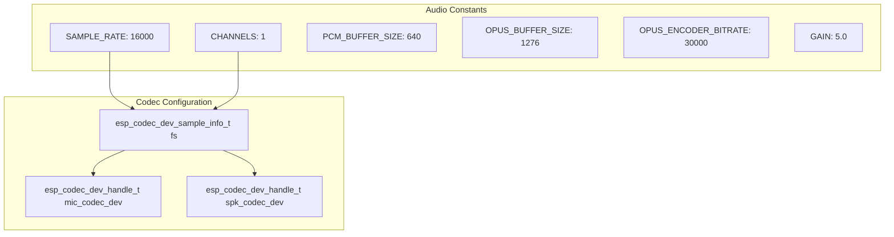
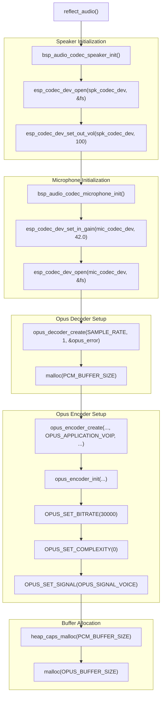
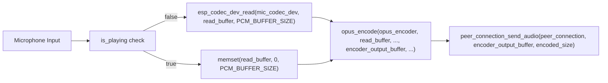
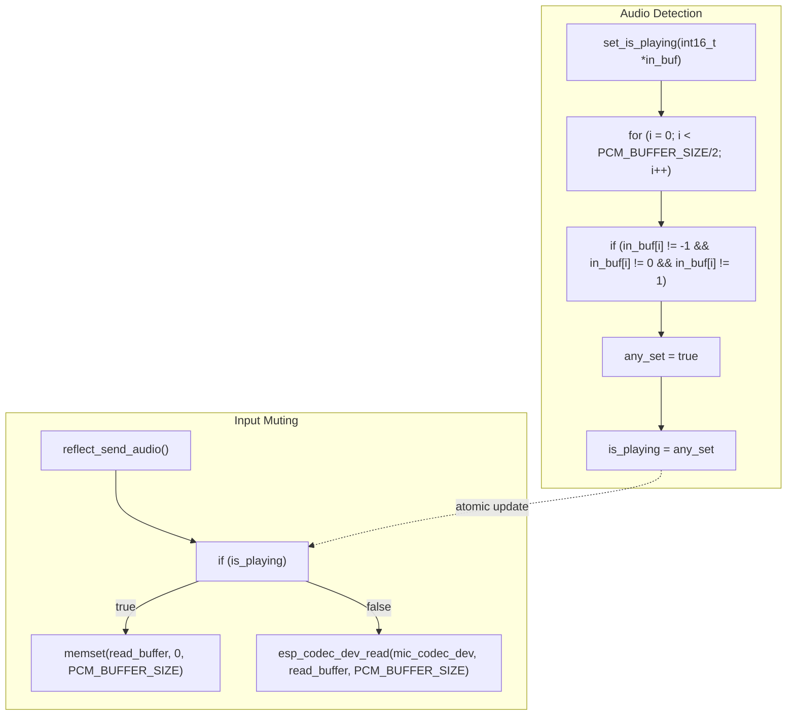
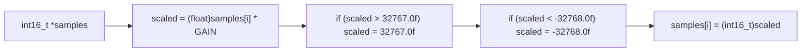
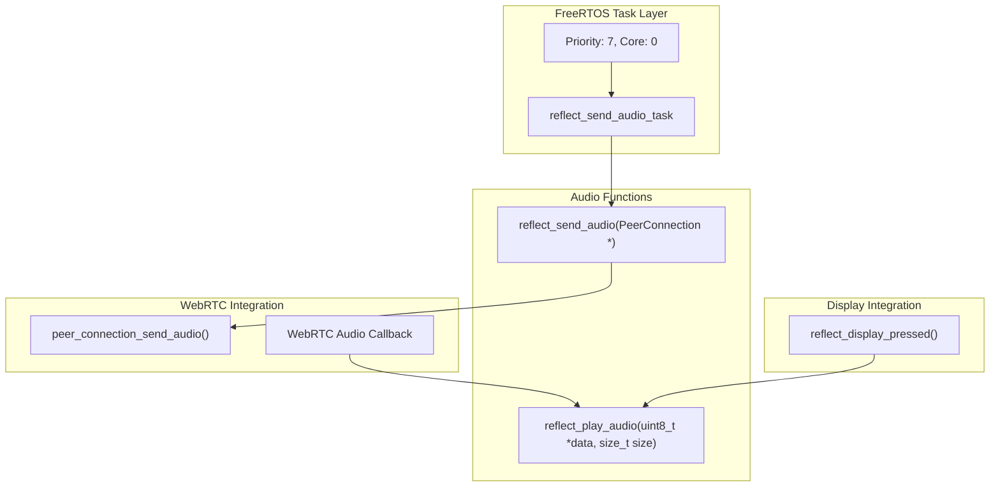

<!-- source: DeepWiki mcp.deepwiki.com · repo openai/openai-reflect · page 2 Audio System · fetched 2026-10-26 -->

# Audio System

Relevant source files

The following files were used as context for generating this wiki page:

- [main/audio.cpp](main/audio.cpp)

The Audio System implements real-time audio processing for the Reflect hardware AI assistant, providing Opus-encoded audio streaming between the ESP32-S3 device and WebRTC peer connections. This system handles microphone input capture, speaker output playback, codec initialization, and feedback prevention mechanisms.

For information about WebRTC communication that transports the audio data, see [WebRTC Communication](#3). For details about the hardware platform and codec devices, see [Hardware Platform](#6).

## Audio Configuration and Constants

The audio system operates with specific configuration parameters optimized for voice communication with the OpenAI Realtime API:

| Parameter | Value | Purpose |
|-----------|--------|---------|
| Sample Rate | 16kHz | Voice-optimized sampling frequency |
| Channels | Mono (1) | Single-channel voice communication |
| Bit Depth | 16-bit | Standard PCM audio depth |
| PCM Buffer Size | 640 bytes | 20ms audio frames at 16kHz |
| Opus Bitrate | 30kbps | Low-bandwidth voice encoding |
| Opus Complexity | 0 | Minimum CPU usage for real-time processing |

The system defines these constants in [main/audio.cpp:7-17]() and configures the ESP codec sample format in [main/audio.cpp:19-25]().

**Audio Configuration Diagram**

Sources: [main/audio.cpp:7-28]()

## Codec and Buffer Initialization

The `reflect_audio()` function initializes all audio components in a specific sequence to ensure proper codec setup and memory allocation.

**Codec Initialization Process**

The initialization process configures the microphone gain to 42.0 and speaker volume to 100%, while setting up Opus encoding optimized for voice applications with minimal CPU complexity.

Sources: [main/audio.cpp:48-84]()

## Audio Input Pipeline

The `reflect_send_audio()` function captures microphone input and encodes it for transmission via WebRTC peer connections.

**Audio Input Processing Flow**

The input pipeline implements feedback prevention by checking the `is_playing` atomic boolean. When audio is currently being played through the speaker, the microphone input is zeroed to prevent echo and feedback loops.

Sources: [main/audio.cpp:115-129]()

## Audio Output Pipeline

The `reflect_play_audio()` function receives Opus-encoded audio data, decodes it to PCM, and plays it through the device speaker with gain control.

**Audio Output Processing Flow**

```mermaid
graph LR
    opus_data["Opus Data Input"]
    opus_decode["opus_decode(opus_decoder, data, size, decoder_buffer, ...)"]
    display_check["reflect_display_pressed()"]
    memset_mute["memset(decoder_buffer, 0, PCM_BUFFER_SIZE)"]
    set_is_playing["set_is_playing(decoder_buffer)"]
    apply_gain["apply_gain((int16_t *)decoder_buffer)"]
    esp_codec_dev_write["esp_codec_dev_write(spk_codec_dev, decoder_buffer, PCM_BUFFER_SIZE)"]
    
    opus_data --> opus_decode
    opus_decode --> display_check
    display_check -->|"true"| memset_mute
    display_check -->|"false"| set_is_playing
    memset_mute --> set_is_playing
    set_is_playing --> apply_gain
    apply_gain --> esp_codec_dev_write
```

The output pipeline includes a manual mute function triggered by display touch input and automatic gain amplification of 5.0x to ensure adequate speaker volume.

Sources: [main/audio.cpp:100-113]()

## Feedback Prevention System

The system implements sophisticated feedback prevention using the `is_playing` atomic boolean and dynamic input muting.

**Feedback Prevention Logic**

The `set_is_playing()` function analyzes PCM samples to detect active audio playback by checking if samples exceed noise floor thresholds (-1, 0, 1). When audio is detected, the microphone input is automatically muted to prevent acoustic feedback.

Sources: [main/audio.cpp:37-46](), [main/audio.cpp:115-121]()

## Gain Control and Audio Processing

The `apply_gain()` function amplifies decoded audio samples while preventing clipping through proper range limiting.

The gain amplification uses a fixed multiplier of 5.0x defined by the `GAIN` constant, with proper saturation arithmetic to prevent 16-bit integer overflow and audio distortion.

Sources: [main/audio.cpp:86-98]()

## Integration with WebRTC and Task Management

The audio system integrates with the broader Reflect architecture through WebRTC peer connections and FreeRTOS task scheduling.

**Audio System Integration**

The audio system operates within a dedicated FreeRTOS task (`reflect_send_audio_task`) running at priority 7 on CPU core 0, ensuring real-time audio processing performance. Audio data flows bidirectionally through WebRTC peer connections to enable voice communication with the OpenAI Realtime API.

Sources: [main/audio.cpp:115-129](), [main/audio.cpp:100-113]()

---

