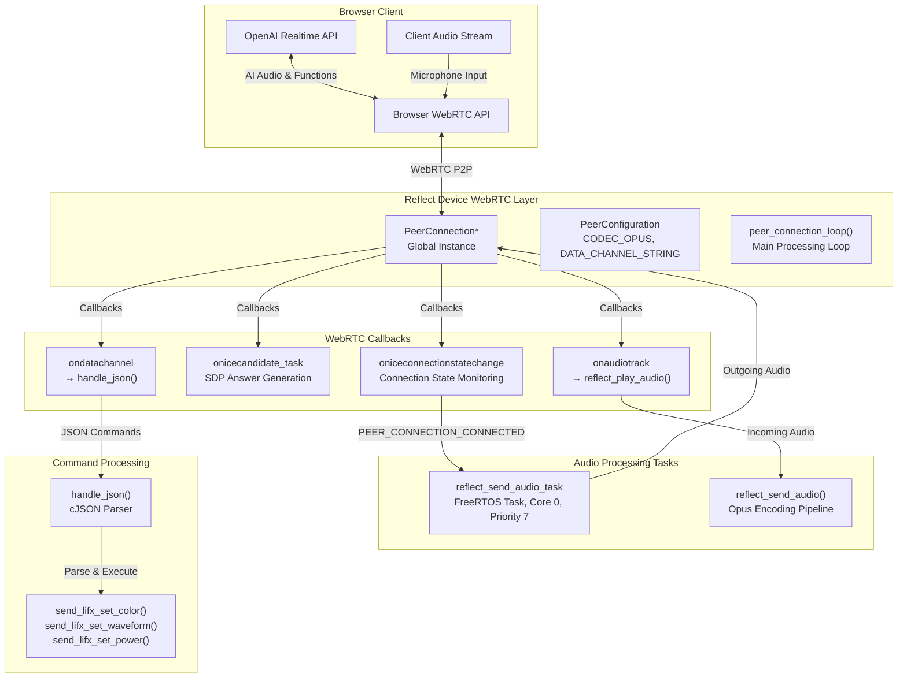
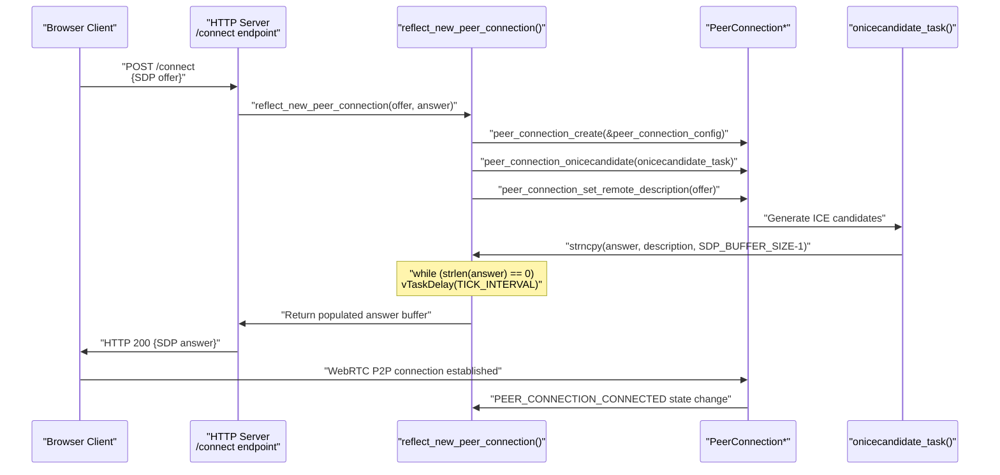
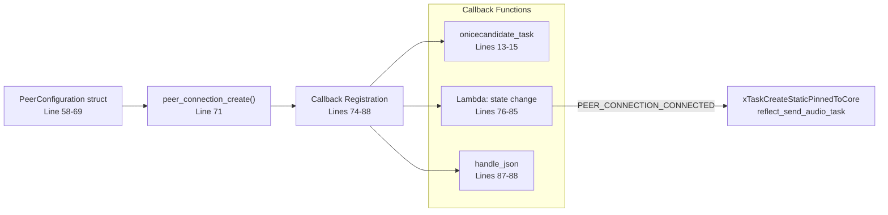
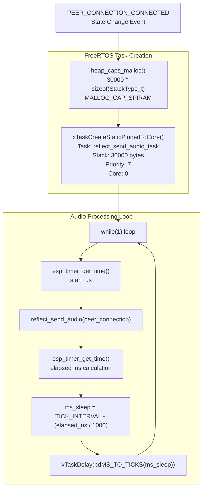
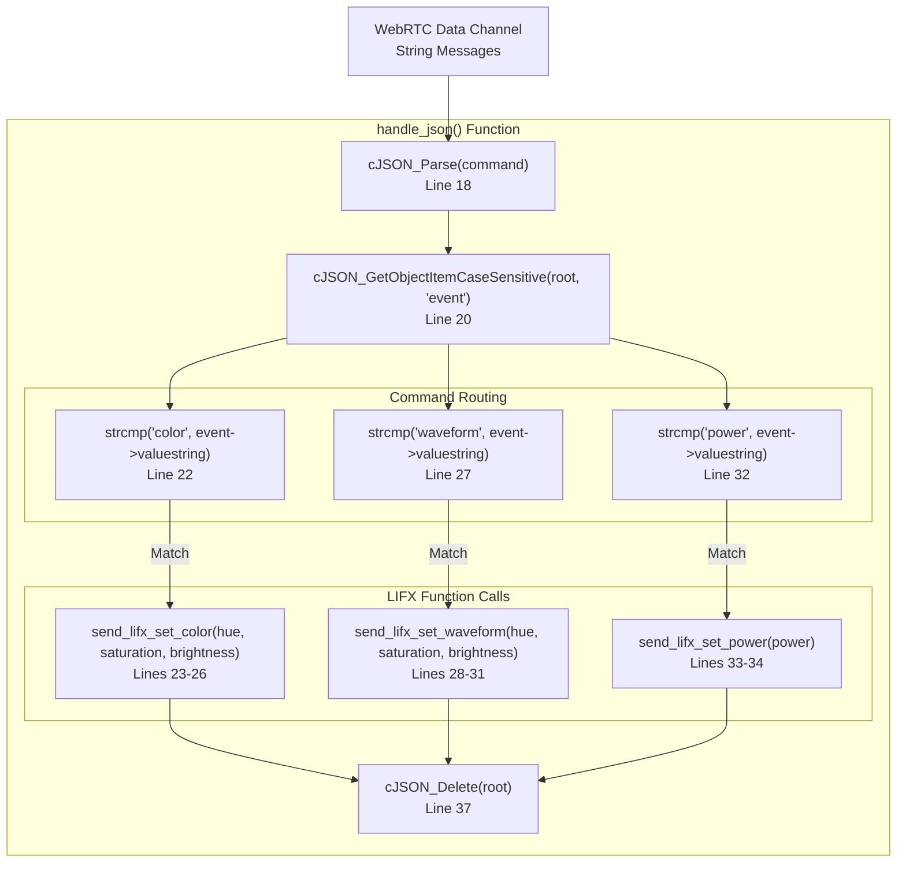
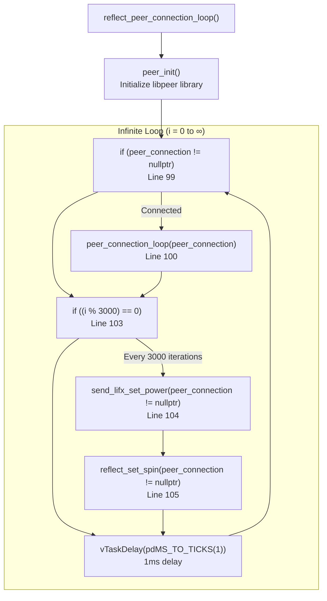

<!-- source: DeepWiki mcp.deepwiki.com · repo openai/openai-reflect · page 3 WebRTC Communication · fetched 2026-10-26 -->

# WebRTC Communication

<details>
<summary>Relevant source files</summary>

The following files were used as context for generating this wiki page:

- [main/webrtc.cpp](main/webrtc.cpp)

</details>


This document covers the WebRTC peer-to-peer communication system that enables real-time audio streaming and JSON command processing between the Reflect device and browser clients. The WebRTC implementation handles SDP exchange, ICE candidate negotiation, Opus audio codec streaming, and data channel communication for smart home control.

For information about the audio encoding/decoding system, see [Audio System](#2). For details about the HTTP server that facilitates the initial WebRTC handshake, see [HTTP Server](#4.1).

## WebRTC Architecture Overview

The WebRTC system establishes direct peer-to-peer connections between the Reflect device and browser clients. The device acts as a WebRTC peer that can receive audio streams and JSON commands while sending processed audio back to clients.

**WebRTC Component Architecture**


Sources: [main/webrtc.cpp:1-111]()

## Connection Establishment Process

The WebRTC connection establishment follows the standard offer/answer model with SDP exchange. The process begins when a browser client sends an SDP offer to the device's HTTP endpoint.

**SDP Exchange and ICE Negotiation Flow**


The `reflect_new_peer_connection()` function creates a new peer connection with specific configuration parameters optimized for audio streaming and data channel communication.

Sources: [main/webrtc.cpp:57-93]()

## Peer Connection Configuration

The WebRTC peer connection is configured specifically for audio communication with no video support and string-based data channels for JSON command processing.

| Configuration Parameter | Value | Purpose |
|------------------------|-------|---------|
| `ice_servers` | `{}` (empty) | Local network only, no STUN/TURN servers |
| `audio_codec` | `CODEC_OPUS` | High-quality audio compression for voice |
| `video_codec` | `CODEC_NONE` | No video streaming capability |
| `datachannel` | `DATA_CHANNEL_STRING` | Text-based command transmission |
| `onaudiotrack` | Lambda function | Routes audio to `reflect_play_audio()` |
| `user_data` | `answer` buffer | SDP answer storage location |

**Peer Connection Initialization Code Structure**


Sources: [main/webrtc.cpp:58-88]()

## Audio Streaming Task Management

When a WebRTC connection is established, the system creates a dedicated FreeRTOS task for audio transmission. This task runs on Core 0 with high priority to ensure real-time audio streaming performance.

**Audio Task Creation and Execution**


The audio task maintains precise timing with a `TICK_INTERVAL` of 15 milliseconds, measuring execution time to maintain consistent audio streaming intervals.

Sources: [main/webrtc.cpp:41-55](), [main/webrtc.cpp:76-84]()

## Data Channel JSON Command Processing

The WebRTC data channel processes JSON commands sent from browser clients to control smart home devices. Commands are parsed using the cJSON library and routed to appropriate LIFX control functions.

**JSON Command Processing Flow**


### Supported JSON Command Formats

The system supports three types of LIFX control commands:

**Color Command**
```json
{
  "event": "color",
  "hue": 120,
  "saturation": 100,
  "brightness": 75
}
```

**Waveform Command**
```json
{
  "event": "waveform", 
  "hue": 240,
  "saturation": 90,
  "brightness": 85
}
```

**Power Command**
```json
{
  "event": "power",
  "power": 1
}
```

Sources: [main/webrtc.cpp:17-39]()

## Connection Management Loop

The main WebRTC processing occurs in `reflect_peer_connection_loop()`, which initializes the peer library, manages connection state, and provides periodic status updates to connected devices.

**Main Processing Loop Structure**


The loop runs every millisecond and performs status updates every 3000 iterations (approximately every 3 seconds), signaling connection status to LIFX lights and the display system.

Sources: [main/webrtc.cpp:95-110]()

## Global State Management

The WebRTC system maintains minimal global state with a single peer connection instance and associated task management structures.

| Global Variable | Type | Purpose | Location |
|----------------|------|---------|----------|
| `peer_connection` | `PeerConnection*` | Active WebRTC connection instance | Line 11 |
| `send_audio_task_buffer` | `StaticTask_t` | FreeRTOS static task control block | Line 41 |
| `TICK_INTERVAL` | `#define 15` | Audio streaming timing constant | Line 10 |
| `SDP_BUFFER_SIZE` | Constant | SDP answer buffer size limit | Line 14 |

The system is designed to handle only one active peer connection at a time, with the global `peer_connection` pointer being set to `NULL` initially and updated when new connections are established.

Sources: [main/webrtc.cpp:10-11](), [main/webrtc.cpp:41]()

---

