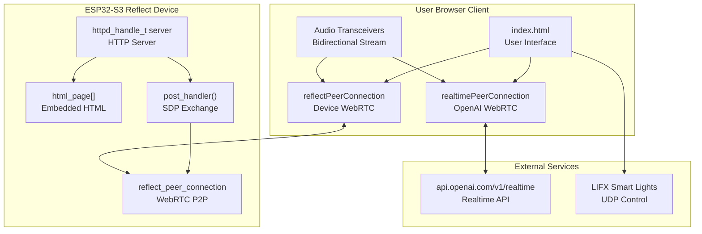
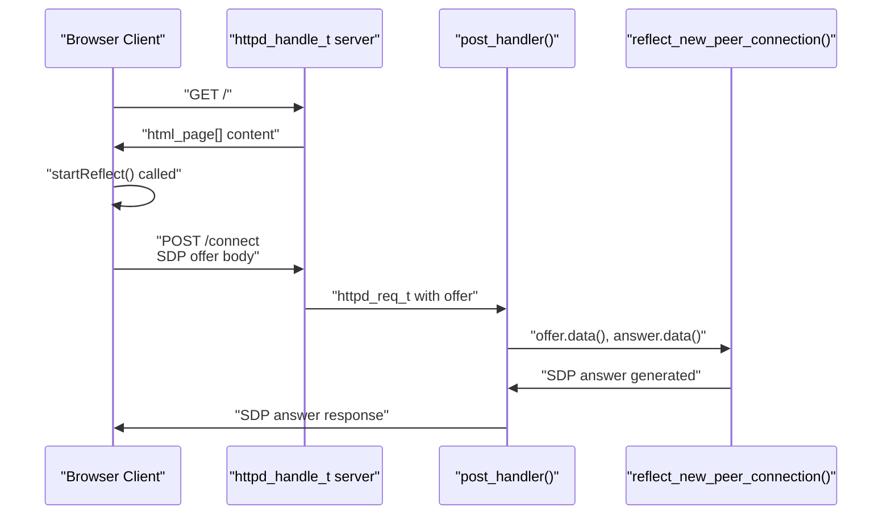
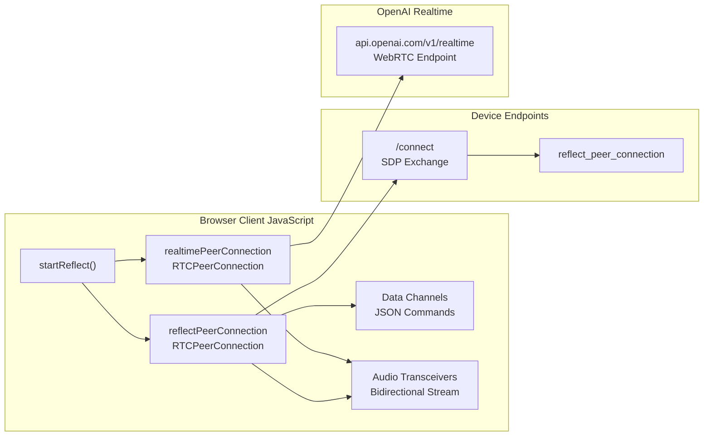
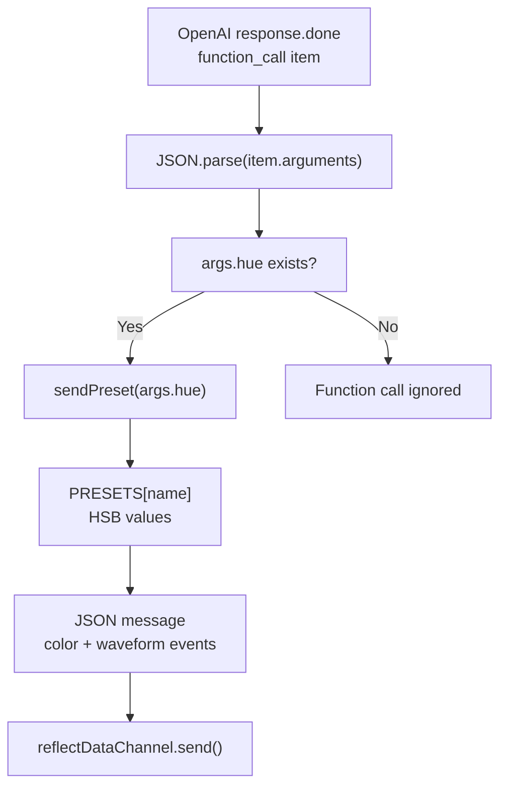
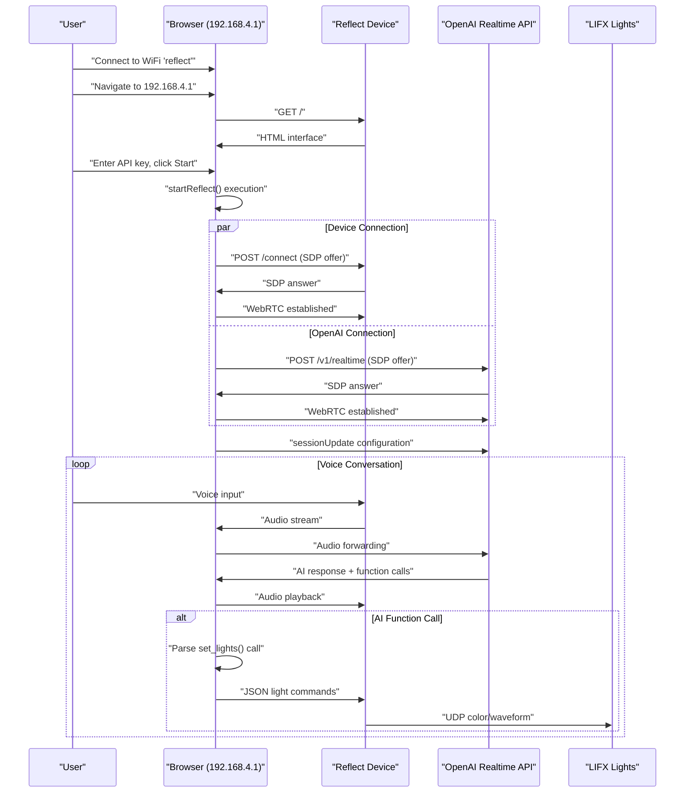

<!-- source: DeepWiki mcp.deepwiki.com · repo openai/openai-reflect · page 4 Web Interface · fetched 2026-10-26 -->

# Web Interface

Relevant source files

The following files were used as context for generating this wiki page:

- [main/http.cpp](main/http.cpp)
- [main/index.html](main/index.html)

## Purpose and Scope

The Web Interface provides a complete web-based control system for the Reflect hardware AI assistant. It consists of an embedded HTTP server that runs on the ESP32-S3 device and a browser-based client that enables users to interact with OpenAI's Realtime API while controlling the device's audio and lighting features.

This document covers the overall web interface architecture and user workflows. For detailed implementation of the HTTP server, see [HTTP Server](#4.1). For browser client functionality, see [Browser Client](#4.2).

## Architecture Overview

The web interface operates as a bridge between three distinct systems: the Reflect device hardware, the user's browser, and OpenAI's Realtime API. The device hosts a local HTTP server that serves a single-page application capable of establishing dual WebRTC connections.

**Web Interface Architecture**

Sources: [main/http.cpp:1-48](), [main/index.html:1-291]()

## HTTP Server Implementation

The device runs an ESP-IDF HTTP server that handles two primary endpoints. The server configuration uses default settings and registers URI handlers for static content delivery and WebRTC negotiation.

| Endpoint | Method | Handler Function | Purpose |
|----------|--------|------------------|---------|
| `/` | GET | `root_get_handler()` | Serves the main HTML interface |
| `/connect` | POST | `post_handler()` | Handles WebRTC SDP offer/answer exchange |

The server initialization occurs in `reflect_http()` which creates the server instance and registers both URI handlers. The HTML page is embedded as a binary asset using the `_binary_index_html_start` symbol.

**HTTP Server Request Flow**

Sources: [main/http.cpp:8-47]()

## Browser Client Functionality

The browser client implements a sophisticated WebRTC orchestration system that manages simultaneous connections to both the Reflect device and OpenAI's Realtime API. The client handles audio routing, AI function call processing, and LIFX light control commands.

### WebRTC Connection Management

The `startReflect()` function establishes two separate `RTCPeerConnection` instances:

- `reflectPeerConnection`: Connects to the device for audio streaming and light control
- `realtimePeerConnection`: Connects to OpenAI for AI conversation processing

**Browser WebRTC Connection Architecture**

Sources: [main/index.html:200-286]()

### AI Function Call Processing

The browser processes OpenAI function calls through the `realtimeDataChannel.onmessage` handler, specifically monitoring for `response.done` events containing `function_call` items. When the AI calls `set_lights()`, the browser translates the hue parameter through the `PRESETS` object and sends JSON commands to the device.

**AI Function Call Processing Flow**

The `PRESETS` object maps descriptive color names to HSB values that the LIFX lights understand:

| Hue Name | H | S | B | Use Case |
|----------|---|---|---|----------|
| `warm sunrise` | 30 | 80% | 95% | Morning wake-up |
| `calm blue` | 200 | 45% | 95% | Relaxation |
| `energetic white` | 40 | 10% | 100% | Focus/productivity |
| `mood red` | 345 | 50% | 90% | Evening ambiance |

Sources: [main/index.html:241-266](), [main/index.html:86-127]()

## User Interaction Workflow

The complete user workflow involves device connection, API configuration, and voice interaction with intelligent lighting control.

**Complete User Interaction Flow**

Sources: [main/index.html:200-286](), [main/http.cpp:14-28]()

## Technical Configuration

### Session Configuration

The browser automatically configures the OpenAI session with comprehensive instructions for the AI assistant personality and capabilities. The `sessionUpdate` object defines the AI as "Reflect" with specific behavioral guidelines for voice interaction and lighting control.

Key configuration elements:
- **Instructions**: Detailed AI personality and behavior guidelines
- **Tools**: Single `set_lights()` function definition with mode and hue parameters  
- **Tool Choice**: Automatic function calling enabled

### Audio Handling

The system implements sophisticated audio routing where device microphone input can be processed either locally through the device or directly through the browser's `getUserMedia()` API when local mode is enabled. Audio tracks are bidirectionally routed between the device and OpenAI connections.

Sources: [main/index.html:29-84](), [main/index.html:277-282]()

---

