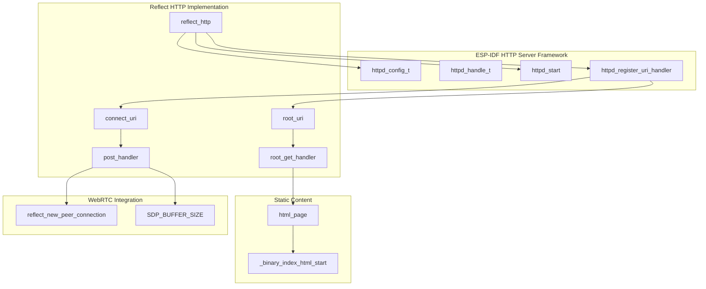
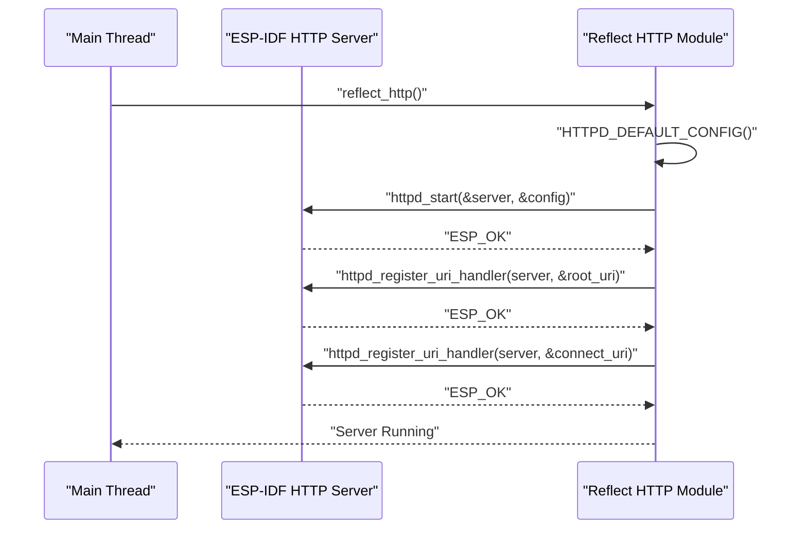
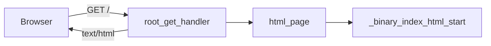
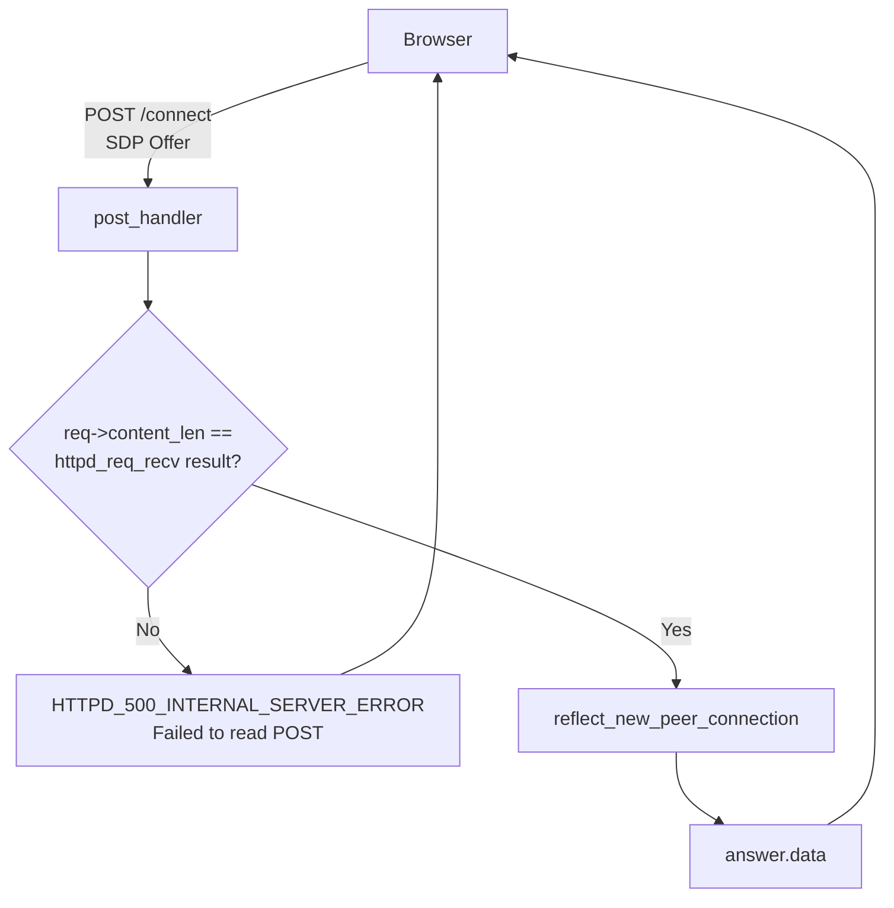
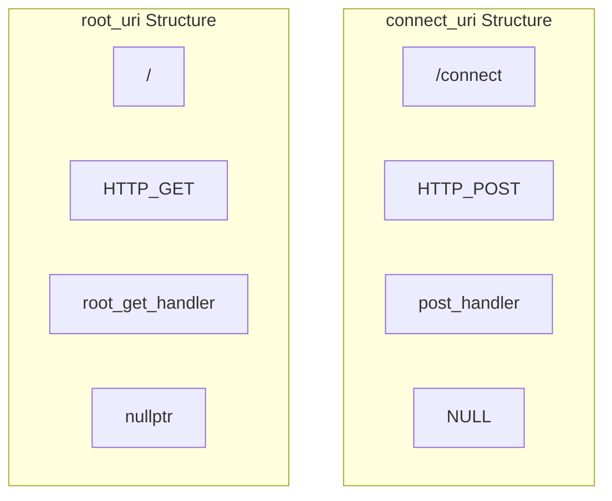
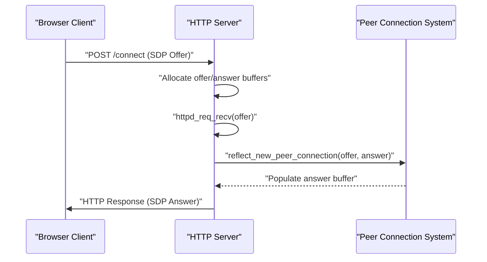
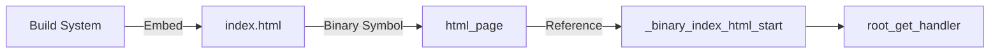

<!-- source: DeepWiki mcp.deepwiki.com · repo openai/openai-reflect · page 4.1 HTTP Server · fetched 2026-10-26 -->

# HTTP Server

Relevant source files

The following files were used as context for generating this wiki page:

- [main/http.cpp](main/http.cpp)

## Purpose and Scope

The HTTP server component provides the web interface for the Reflect system, serving static HTML content and handling WebRTC Session Description Protocol (SDP) exchange. It implements a lightweight HTTP server using ESP-IDF's built-in HTTP server framework to enable browser-based client connections.

For information about the browser client implementation that consumes these HTTP endpoints, see [Browser Client](#4.2). For details about the WebRTC communication system that uses the SDP exchange, see [WebRTC Communication](#3).

## Server Architecture

The HTTP server operates as a simple two-endpoint web server that facilitates WebRTC peer connection establishment between browsers and the Reflect device.

### HTTP Server Component Overview

Sources: [main/http.cpp:1-47]()

### Server Initialization Process

The HTTP server initialization follows a standard ESP-IDF pattern with URI handler registration:

Sources: [main/http.cpp:40-47]()

## URI Handlers and Routes

The HTTP server implements two primary endpoints to support the web interface and WebRTC connectivity.

### Route Configuration

| Route | Method | Handler Function | Purpose |
|-------|--------|------------------|---------|
| `/` | GET | `root_get_handler` | Serve HTML interface |
| `/connect` | POST | `post_handler` | Handle SDP exchange |

### Root Handler (`/`)

The root handler serves the embedded HTML page that contains the browser client interface:

The handler implementation:
- Sets content type to `text/html; charset=utf-8`
- Serves embedded HTML content using `HTTPD_RESP_USE_STRLEN`
- Returns `ESP_OK` on successful delivery

Sources: [main/http.cpp:8-12]()

### Connect Handler (`/connect`)

The connect handler manages WebRTC SDP offer/answer exchange for peer connection establishment:

The SDP exchange process:
1. Allocates `SDP_BUFFER_SIZE` vectors for offer and answer
2. Receives SDP offer data via `httpd_req_recv`
3. Validates content length matches received data
4. Calls `reflect_new_peer_connection` with offer/answer buffers
5. Returns SDP answer to browser client

Sources: [main/http.cpp:14-28]()

### URI Handler Definitions

The URI handlers are defined as static structures with specific configuration:

Sources: [main/http.cpp:30-38]()

## Buffer Management and Error Handling

### SDP Buffer Allocation

The connect handler uses stack-allocated vectors for SDP data handling:
- `std::vector<char> offer(SDP_BUFFER_SIZE)` - Incoming SDP offer
- `std::vector<char> answer(SDP_BUFFER_SIZE)` - Outgoing SDP answer

### Error Conditions

The HTTP server implements error handling for:
- **Content Length Mismatch**: Returns `HTTPD_500_INTERNAL_SERVER_ERROR` if received data doesn't match expected length
- **ESP-IDF Failures**: Uses `ESP_ERROR_CHECK` for critical server operations
- **Memory Allocation**: Relies on stack allocation and automatic vector management

Sources: [main/http.cpp:15-27](), [main/http.cpp:44-46]()

## Integration with WebRTC System

The HTTP server serves as the entry point for WebRTC peer connection establishment by bridging HTTP requests with the peer connection management system.

### SDP Exchange Integration

The `reflect_new_peer_connection` function processes the SDP offer and generates an appropriate SDP answer, enabling the browser to establish a direct WebRTC connection with the device.

Sources: [main/http.cpp:25-26]()

## Static Content Embedding

The HTML content is embedded as binary data in the firmware using ESP-IDF's component build system. The `html_page` symbol references the start of the embedded HTML file, allowing the server to serve static content without external file system dependencies.

Sources: [main/http.cpp:6](), [main/http.cpp:9-10]()

---

