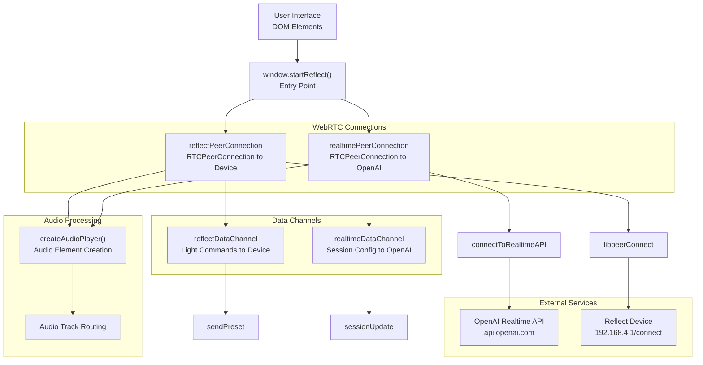
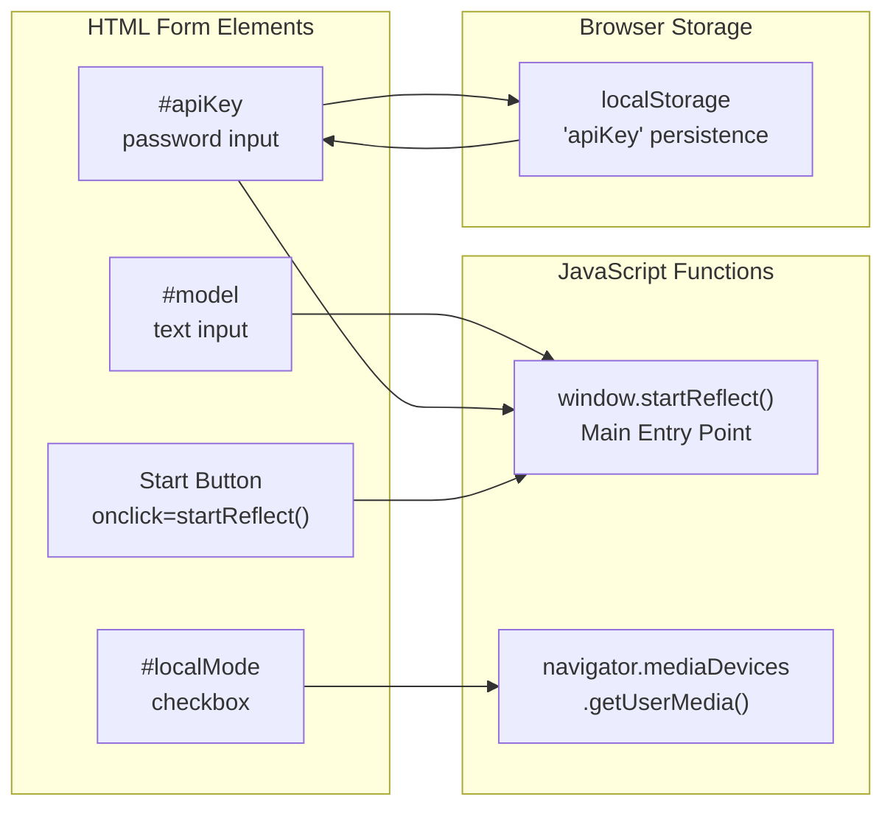
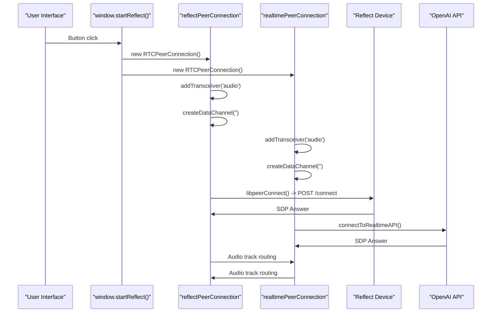
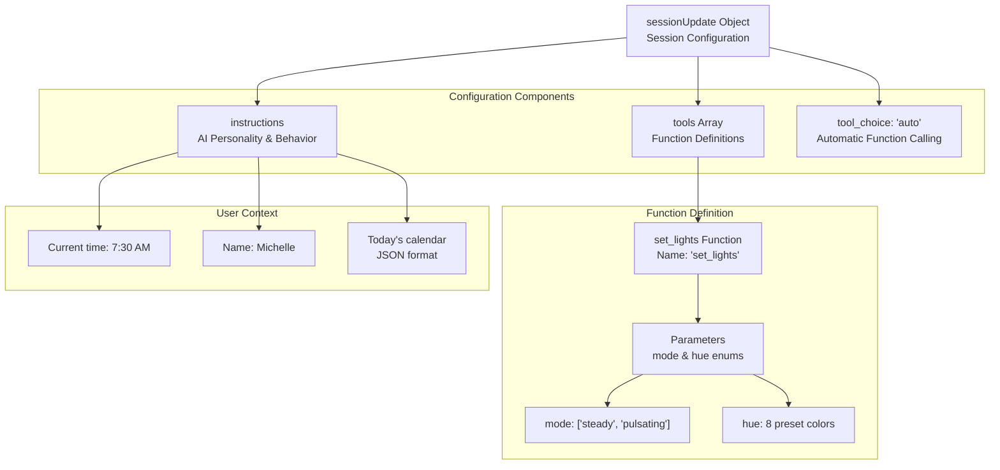
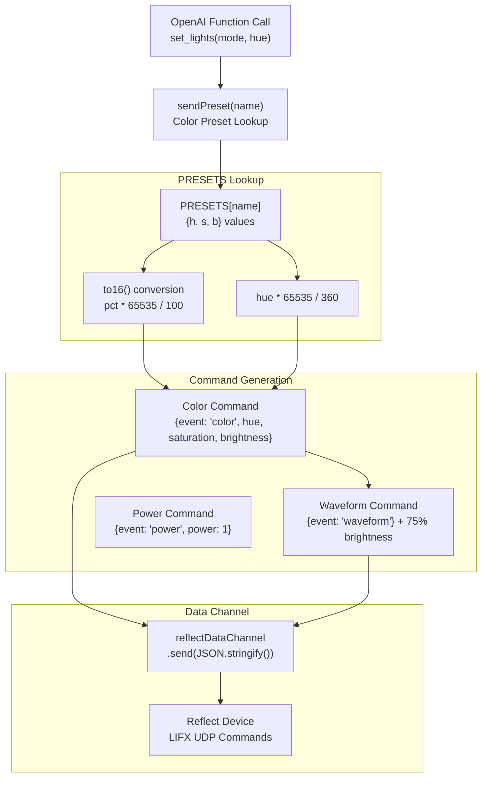
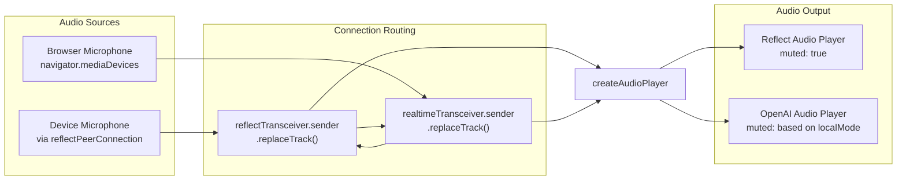

<!-- source: DeepWiki mcp.deepwiki.com · repo openai/openai-reflect · page 4.2 Browser Client · fetched 2026-10-26 -->

# Browser Client

Relevant source files

The following files were used as context for generating this wiki page:

- [main/index.html](main/index.html)

This document covers the browser client implementation that provides the web interface for the Reflect system. The browser client is an HTML/JavaScript application that establishes WebRTC connections to both the Reflect device and OpenAI's Realtime API, managing audio streams and smart lighting control through function calls.

For information about the HTTP server that serves this client, see [HTTP Server](#4.1).

## Architecture Overview

The browser client operates as a WebRTC bridge between the Reflect device and OpenAI's Realtime API, handling bidirectional audio streams and translating AI function calls into device commands.

### Client System Flow

**Sources:** [main/index.html:200-287]()

## User Interface Components

The browser client provides a minimal HTML interface for configuration and control.

### Form Elements

| Element | ID | Purpose | Storage |
|---------|----|---------| --------|
| API Key Input | `apiKey` | OpenAI API authentication | `localStorage.apiKey` |
| Model Input | `model` | OpenAI model selection | Default: `gpt-4o-realtime-preview-2025-06-03` |
| Local Mode Checkbox | `localMode` | Direct microphone vs device audio | Session only |
| Start Button | - | Initiates `window.startReflect()` | - |
| Audio Container | `audio` | Dynamic audio player elements | - |

**Sources:** [main/index.html:17-21](), [main/index.html:27-28]()

## WebRTC Connection Management

The client manages two separate WebRTC peer connections with different purposes and connection procedures.

### Dual Peer Connection Architecture

### Connection Functions

The client implements specialized connection logic for each peer:

- **`libpeerConnect()`**: Handles SDP exchange with Reflect device including ICE candidate filtering and MID workarounds [main/index.html:141-176]()
- **`connectToRealtimeAPI()`**: Establishes connection to OpenAI using Bearer authentication [main/index.html:178-198]()

**Sources:** [main/index.html:200-236](), [main/index.html:141-198]()

## OpenAI Integration

The browser client configures and manages the OpenAI Realtime API session with comprehensive instructions and function definitions.

### Session Configuration

The client sends a detailed `sessionUpdate` configuration defining the AI assistant's personality and capabilities:

### Function Call Processing

When OpenAI sends function calls, the client processes them through the data channel message handler:

```mermaid
graph LR
    realtimeDataChannel["realtimeDataChannel<br/>.onmessage"]
    parseMessage["JSON.parse()<br/>Event Data"]
    checkType["parsed.type === 'response.done'"]
    
    subgraph "Function Processing"
        functionCall["item.type === 'function_call'"]
        parseArgs["JSON.parse(item.arguments)"]
        sendPreset["sendPreset(args.hue)"]
    end
    
    subgraph "Response Generation"
        createEvent["conversation.item.create<br/>Function Call Output"]
        successResponse["success: true<br/>JSON Response"]
    end
    
    realtimeDataChannel --> parseMessage
    parseMessage --> checkType
    checkType --> functionCall
    functionCall --> parseArgs
    parseArgs --> sendPreset
    
    sendPreset --> createEvent
    createEvent --> successResponse
```

**Sources:** [main/index.html:29-84](), [main/index.html:241-266]()

## Smart Lighting Control

The browser client translates OpenAI function calls into LIFX light commands using predefined color presets.

### Color Preset System

The client defines 8 color presets mapping human-readable names to HSB values:

| Preset Name | Hue | Saturation | Brightness | Use Case |
|-------------|-----|------------|------------|----------|
| warm sunrise | 30 | 80% | 95% | Morning wake-up |
| calm blue | 200 | 45% | 95% | Stress relief |
| energetic white | 40 | 10% | 100% | Active focus |
| mood red | 345 | 50% | 90% | Evening ambiance |
| soft violet | 270 | 50% | 90% | Relaxation |
| forest green | 120 | 60% | 90% | Natural calm |
| ocean teal | 180 | 50% | 90% | Meditation |
| golden hour | 45 | 80% | 90% | Warm evening |

### Light Command Generation

The `sendPreset()` function sends two sequential commands:
1. **Color Command**: Sets the target HSB values
2. **Waveform Command**: Applies dimming effect (75% brightness) after 500ms delay

**Sources:** [main/index.html:86-127](), [main/index.html:205-224]()

## Audio Processing

The browser client manages bidirectional audio streams between the device, user, and OpenAI API with dynamic audio element creation.

### Audio Track Routing

The client implements two audio modes:

1. **Device Mode** (default): Routes device microphone through WebRTC
2. **Local Mode**: Uses browser `getUserMedia()` for direct microphone access

### Dynamic Audio Elements

The `createAudioPlayer()` function dynamically creates HTML audio elements for each track:

- **Autoplay**: Enabled for immediate playback
- **Controls**: Visible for user debugging
- **Muting**: Conditional based on audio source and local mode
- **Stream Assignment**: Direct `srcObject` assignment from WebRTC streams

**Sources:** [main/index.html:129-137](), [main/index.html:268-285]()

---

