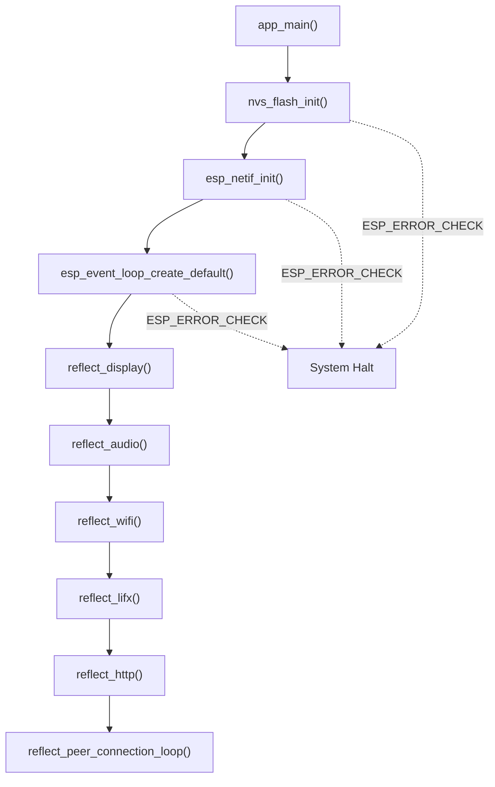
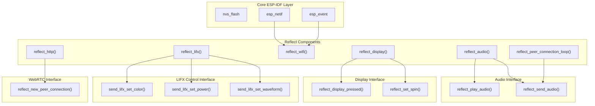
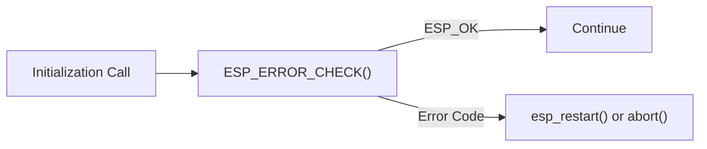
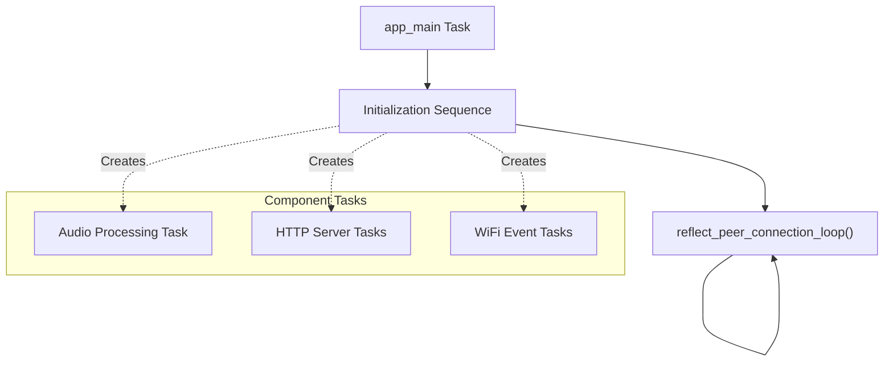

<!-- source: DeepWiki mcp.deepwiki.com · repo openai/openai-reflect · page 5 System Architecture · fetched 2026-10-26 -->

# System Architecture

<details>
<summary>Relevant source files</summary>

The following files were used as context for generating this wiki page:

- [main/reflect.cpp](main/reflect.cpp)
- [main/reflect.hpp](main/reflect.hpp)

</details>


This document describes the overall system architecture of the Reflect hardware AI assistant, focusing on system initialization, component coordination, and core interfaces. It covers the main entry point, component dependencies, and error handling patterns that tie together all subsystems.

For specific implementation details of individual subsystems, see [Audio System](#2), [WebRTC Communication](#3), [Web Interface](#4), and [Hardware Platform](#6).

## System Initialization Flow

The Reflect system follows a strict initialization sequence managed by the main entry point in `app_main()`. Each component must initialize successfully before the next component starts, ensuring proper dependency ordering.

### Main Initialization Sequence



The initialization process follows this critical path:

1. **NVS Flash Storage** - Initialize non-volatile storage for configuration persistence
2. **Network Interface** - Set up ESP-IDF networking stack
3. **Event Loop** - Create default event handling system
4. **Display System** - Initialize LCD and touch interface
5. **Audio System** - Set up Opus codec and audio I/O
6. **WiFi Access Point** - Create "reflect" network for client connections
7. **LIFX Integration** - Initialize UDP socket for smart home control
8. **HTTP Server** - Start web interface server
9. **Peer Connection Loop** - Enter main WebRTC management loop

Sources: [main/reflect.cpp:10-21]()

## Component Architecture

The system is organized as a collection of subsystems, each providing a specific interface through the main header file. Components communicate through well-defined APIs rather than direct coupling.

### Core Component Interfaces



Sources: [main/reflect.hpp:1-20]()

## Interface Definitions

The system defines clear interfaces between components through function declarations in the main header. These interfaces enable loose coupling while maintaining type safety.

### Key Interface Categories

| Interface Category | Functions | Purpose |
|-------------------|-----------|---------|
| **Audio Management** | `reflect_play_audio()`, `reflect_send_audio()` | Handle audio playback and WebRTC streaming |
| **Display Control** | `reflect_display_pressed()`, `reflect_set_spin()` | Manage touch input and UI feedback |
| **Smart Home Integration** | `send_lifx_set_color()`, `send_lifx_set_power()`, `send_lifx_set_waveform()` | Control LIFX lighting via UDP |
| **WebRTC Management** | `reflect_new_peer_connection()` | Handle SDP exchange and peer setup |

### Buffer and Configuration Constants

The system defines critical constants for memory management and protocol handling:

```c
#define SDP_BUFFER_SIZE 5000
```

This buffer size accommodates WebRTC Session Description Protocol messages during peer connection establishment.

Sources: [main/reflect.hpp:4-19]()

## Error Handling Strategy

The system employs ESP-IDF's standard error checking macros to ensure critical initialization steps complete successfully. Any failure in the core ESP-IDF components results in immediate system halt.

### Critical Error Checking



The `ESP_ERROR_CHECK` macro is applied to:
- `nvs_flash_init()` - Storage initialization failure
- `esp_netif_init()` - Network stack failure  
- `esp_event_loop_create_default()` - Event system failure

Reflect-specific components (`reflect_display()`, `reflect_audio()`, etc.) do not use `ESP_ERROR_CHECK`, allowing for more graceful degradation of non-critical features.

Sources: [main/reflect.cpp:11-13]()

## Threading and Task Model

The system operates primarily on the main task with specific components creating their own FreeRTOS tasks as needed. The main thread enters an infinite loop in `reflect_peer_connection_loop()` for WebRTC management.

### Task Architecture



The main application task becomes the WebRTC management loop, while individual components spawn their own tasks for:
- Audio encoding/decoding operations
- HTTP request handling
- WiFi event processing
- LIFX UDP communication

Sources: [main/reflect.cpp:20]()

---

