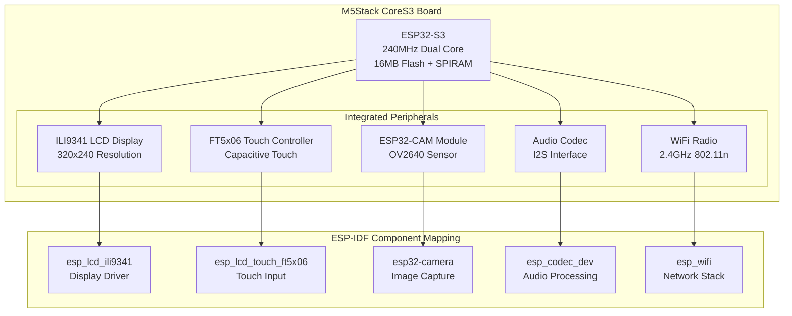
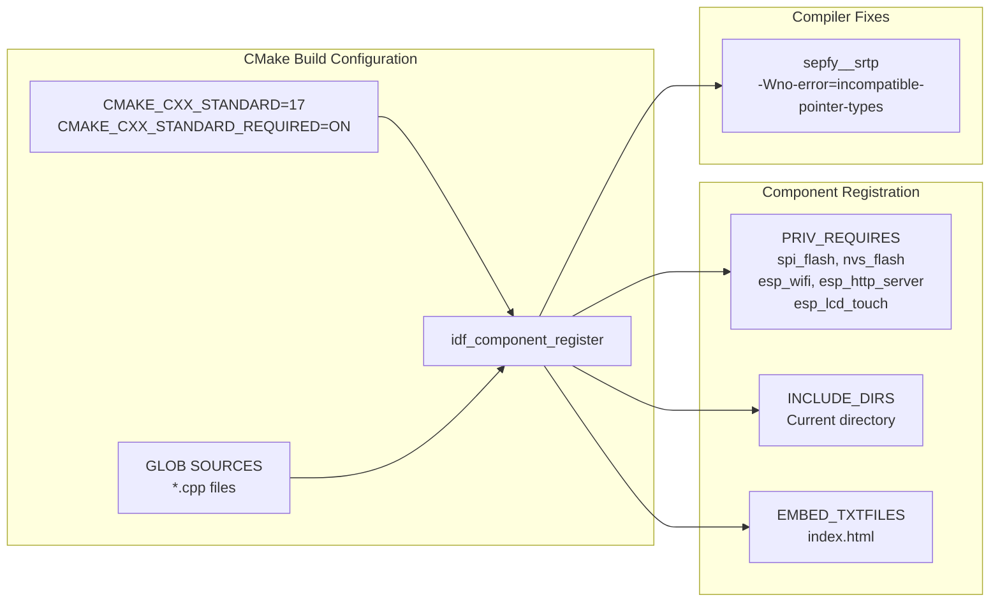
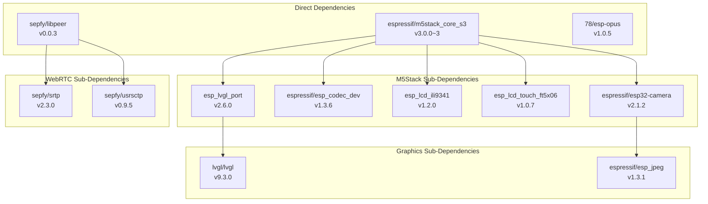
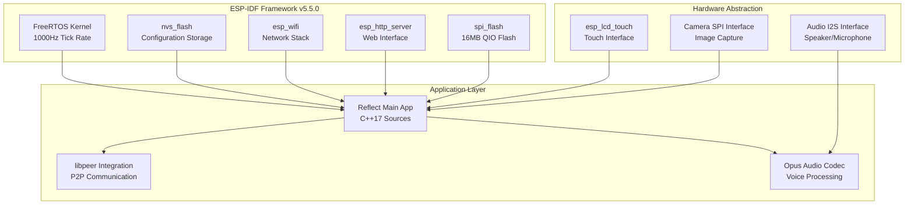

<!-- source: DeepWiki mcp.deepwiki.com · repo openai/openai-reflect · page 6 Hardware Platform · fetched 2026-10-26 -->

# Hardware Platform

Relevant source files

The following files were used as context for generating this wiki page:

- [dependencies.lock](dependencies.lock)
- [main/CMakeLists.txt](main/CMakeLists.txt)
- [main/idf_component.yml](main/idf_component.yml)
- [sdkconfig.defaults](sdkconfig.defaults)

This document covers the hardware platform configuration for the Reflect AI assistant system, including the ESP32-S3 microcontroller setup, build system configuration, and external component dependencies. The system runs on M5Stack CoreS3 hardware using the ESP-IDF framework.

For detailed ESP32-S3 configuration parameters, see [ESP32-S3 Configuration](#6.1). For build system specifics, see [Build System](#6.2). For external component details, see [Dependencies](#6.3).

## Hardware Foundation

The Reflect system is built on the ESP32-S3 microcontroller using the M5Stack CoreS3 development board. This provides a complete hardware platform with integrated peripherals for audio, display, camera, and wireless communication.

### ESP32-S3 Core Configuration

The system is configured for high-performance operation with the following key specifications:

| Parameter | Configuration | Source |
|-----------|---------------|--------|
| Target Chip | `esp32s3` | [sdkconfig.defaults:1]() |
| CPU Frequency | 240 MHz | [sdkconfig.defaults:8]() |
| Flash Size | 16MB QIO mode | [sdkconfig.defaults:3-4]() |
| SPIRAM | Enabled | [sdkconfig.defaults:6]() |
| FreeRTOS Tick | 1000 Hz | [sdkconfig.defaults:9]() |
| Optimization | Performance optimized | [sdkconfig.defaults:10]() |

The configuration prioritizes performance over power consumption, with assertions disabled and compiler optimization set to performance mode.

**Sources:** [sdkconfig.defaults:1-11]()

### M5Stack CoreS3 Integration

The M5Stack CoreS3 board provides integrated peripherals that the Reflect system utilizes:

**Sources:** [dependencies.lock:108-139]()

## Build System Architecture

The project uses ESP-IDF's CMake-based build system with component registration and dependency management.

### Main Component Structure

The main application component is defined with C++17 standard and specific ESP-IDF requirements:

The build system embeds the web interface HTML file directly into the firmware binary and applies compiler warning fixes for third-party libraries.

**Sources:** [main/CMakeLists.txt:1-12]()

## Component Dependencies

The system relies on several external components managed through ESP-IDF's component manager:

### Direct Dependencies

| Component | Version | Purpose |
|-----------|---------|---------|
| `espressif/m5stack_core_s3` | ^3.0.0~3 | M5Stack hardware support |
| `sepfy/libpeer` | ^0.0.3 | WebRTC peer connection library |
| `78/esp-opus` | ^1.0.5 | Opus audio codec implementation |

### Dependency Tree

The dependency tree shows how the core functionality is built on specialized libraries for graphics, audio processing, and network communication.

**Sources:** [main/idf_component.yml:1-4](), [dependencies.lock:1-186]()

## System Integration

The hardware platform integrates multiple subsystems through ESP-IDF's component architecture:

This architecture provides a layered approach where ESP-IDF handles hardware abstraction, while application-specific components like WebRTC and Opus codec provide specialized functionality.

**Sources:** [main/CMakeLists.txt:5-8](), [sdkconfig.defaults:1-18](), [dependencies.lock:140-143]()

---

