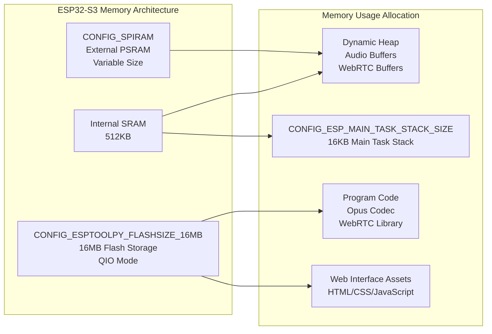
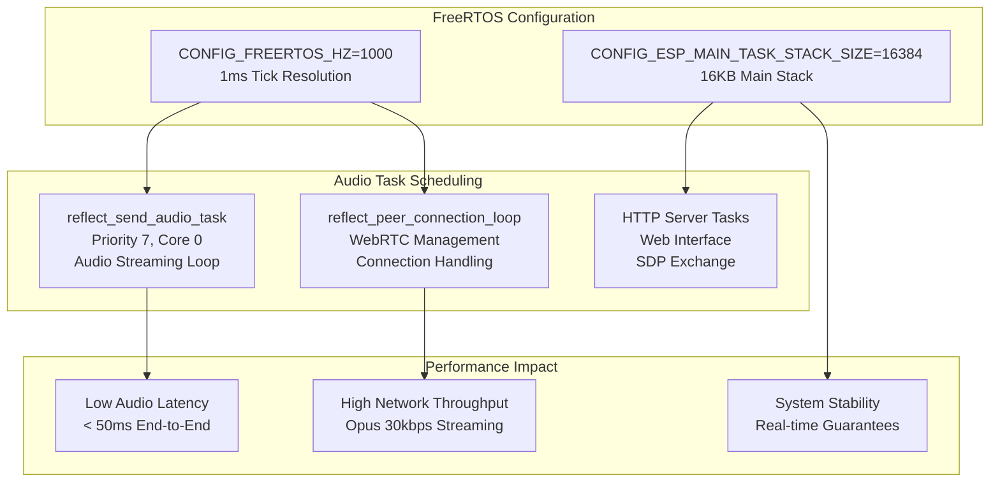
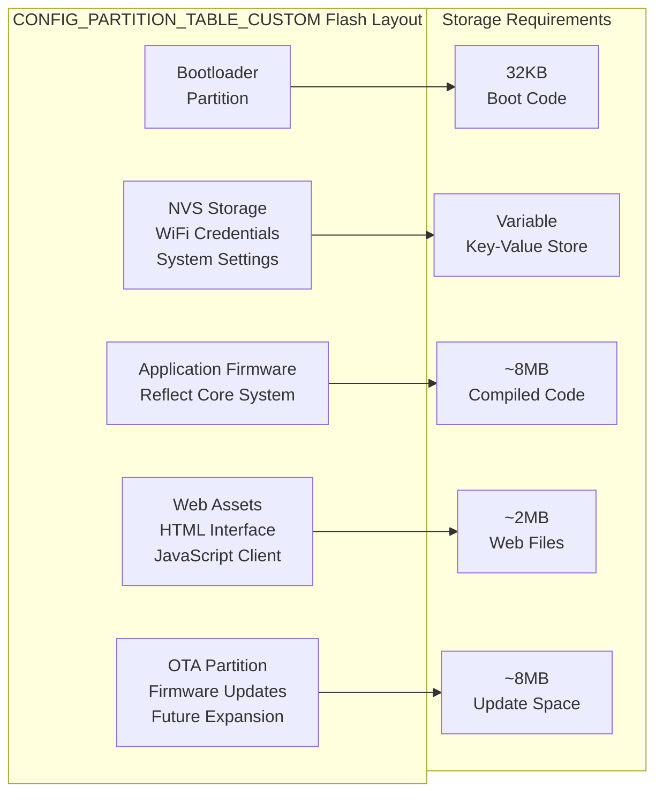

<!-- source: DeepWiki mcp.deepwiki.com · repo openai/openai-reflect · page 6.1 ESP32-S3 Configuration · fetched 2026-10-26 -->

# ESP32-S3 Configuration

Relevant source files

The following files were used as context for generating this wiki page:

- [sdkconfig.defaults](sdkconfig.defaults)

## Purpose and Scope

This document details the ESP-IDF configuration settings for the ESP32-S3 microcontroller used in the Reflect hardware AI assistant system. It covers the specific configuration parameters defined in the project's default SDK configuration that optimize the hardware platform for real-time audio processing, WebRTC communication, and smart home integration.

For information about the overall hardware platform architecture, see [Hardware Platform](#6). For build system configuration and component registration, see [Build System](#6.2).

## Configuration Overview

The Reflect system uses a customized ESP-IDF configuration optimized for high-performance real-time audio processing and network communication. The configuration is defined in the `sdkconfig.defaults` file, which establishes the baseline settings for all project builds.

### ESP32-S3 Configuration Hierarchy

```mermaid
graph TD
    sdkconfig["sdkconfig.defaults<br/>Project Configuration"]
    
    subgraph "Hardware Target Configuration"
        target["CONFIG_IDF_TARGET=esp32s3<br/>Target Platform"]
        flash_mode["CONFIG_ESPTOOLPY_FLASHMODE_QIO<br/>Flash Interface Mode"]
        flash_size["CONFIG_ESPTOOLPY_FLASHSIZE_16MB<br/>Flash Memory Size"]
        spiram["CONFIG_SPIRAM=y<br/>External SPIRAM Enable"]
    end
    
    subgraph "Performance Configuration"
        cpu_freq["CONFIG_ESP_DEFAULT_CPU_FREQ_MHZ_240<br/>CPU Clock Speed"]
        freertos_hz["CONFIG_FREERTOS_HZ=1000<br/>RTOS Tick Rate"]
        optimization["CONFIG_COMPILER_OPTIMIZATION_PERF<br/>Performance Optimization"]
        assertions["CONFIG_COMPILER_OPTIMIZATION_ASSERTIONS_DISABLE<br/>Debug Assertions"]
    end
    
    subgraph "System Configuration"
        partition["CONFIG_PARTITION_TABLE_CUSTOM<br/>Custom Partition Layout"]
        stack_size["CONFIG_ESP_MAIN_TASK_STACK_SIZE=16384<br/>Main Task Stack"]
        dtls["CONFIG_MBEDTLS_SSL_PROTO_DTLS<br/>DTLS Protocol Support"]
    end
    
    sdkconfig --> target
    sdkconfig --> flash_mode
    sdkconfig --> flash_size
    sdkconfig --> spiram
    sdkconfig --> cpu_freq
    sdkconfig --> freertos_hz
    sdkconfig --> optimization
    sdkconfig --> assertions
    sdkconfig --> partition
    sdkconfig --> stack_size
    sdkconfig --> dtls
```

Sources: [sdkconfig.defaults:1-18]()

## Hardware Platform Configuration

### Target Platform and Flash Configuration

The system targets the ESP32-S3 microcontroller with specific flash memory configuration optimized for the M5Stack CoreS3 hardware platform.

| Configuration Parameter | Value | Purpose |
|-------------------------|-------|---------|
| `CONFIG_IDF_TARGET` | `esp32s3` | Specifies ESP32-S3 as the target microcontroller |
| `CONFIG_ESPTOOLPY_FLASHMODE_QIO` | `y` | Enables Quad I/O flash mode for faster flash access |
| `CONFIG_ESPTOOLPY_FLASHSIZE_16MB` | `y` | Configures 16MB flash memory size |
| `CONFIG_SPIRAM` | `y` | Enables external SPIRAM for additional memory |

The QIO flash mode provides higher throughput for the web interface assets and firmware updates, while the 16MB flash size accommodates the complete system including web assets and future expansion.

Sources: [sdkconfig.defaults:1-6]()

### Memory Configuration

Sources: [sdkconfig.defaults:4-6,17]()

## Performance Optimization Configuration

### CPU and Real-Time Performance

The configuration prioritizes real-time performance for audio processing and WebRTC communication through aggressive optimization settings.

| Configuration Parameter | Value | Impact |
|-------------------------|-------|--------|
| `CONFIG_ESP_DEFAULT_CPU_FREQ_MHZ_240` | `y` | Maximum 240MHz CPU frequency for real-time audio |
| `CONFIG_FREERTOS_HZ` | `1000` | 1ms RTOS tick for precise timing control |
| `CONFIG_COMPILER_OPTIMIZATION_PERF` | `y` | Performance-optimized compilation (-O2) |
| `CONFIG_COMPILER_OPTIMIZATION_ASSERTIONS_DISABLE` | `y` | Removes debug assertions for production performance |

The 1000Hz FreeRTOS tick rate enables precise timing for the audio streaming tasks, while the performance compiler optimization ensures efficient Opus encoding/decoding operations.

Sources: [sdkconfig.defaults:8-11]()

### Real-Time Task Configuration

Sources: [sdkconfig.defaults:9,17]()

## System Integration Configuration

### Security and Protocol Support

The configuration enables DTLS protocol support required for WebRTC secure communications with the OpenAI Realtime API.

| Configuration Parameter | Value | Purpose |
|-------------------------|-------|---------|
| `CONFIG_MBEDTLS_SSL_PROTO_DTLS` | `y` | Enables DTLS 1.2 for WebRTC security |
| `CONFIG_PARTITION_TABLE_CUSTOM` | `y` | Custom partition layout for optimal storage |

The DTLS support is essential for establishing secure peer-to-peer connections in the WebRTC communication pipeline, ensuring encrypted audio streams and command data.

Sources: [sdkconfig.defaults:13,15]()

### Partition Table Configuration

Sources: [sdkconfig.defaults:13]()

## Configuration Dependencies

### ESP-IDF Framework Integration

The configuration settings work together to create an optimized environment for the Reflect system's core requirements:

1. **Audio Processing**: High CPU frequency and FreeRTOS tick rate support real-time Opus encoding
2. **Network Communication**: DTLS support enables secure WebRTC connections
3. **Memory Management**: SPIRAM and optimized stack size handle audio buffers and network data
4. **Storage Layout**: Custom partitions accommodate web assets and firmware updates

The configuration is automatically applied during the ESP-IDF build process, ensuring consistent hardware behavior across all development and production environments.

Sources: [sdkconfig.defaults:1-18]()

---

