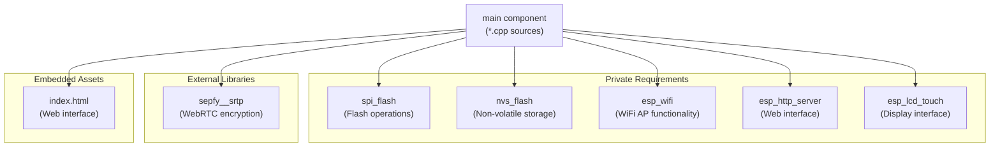
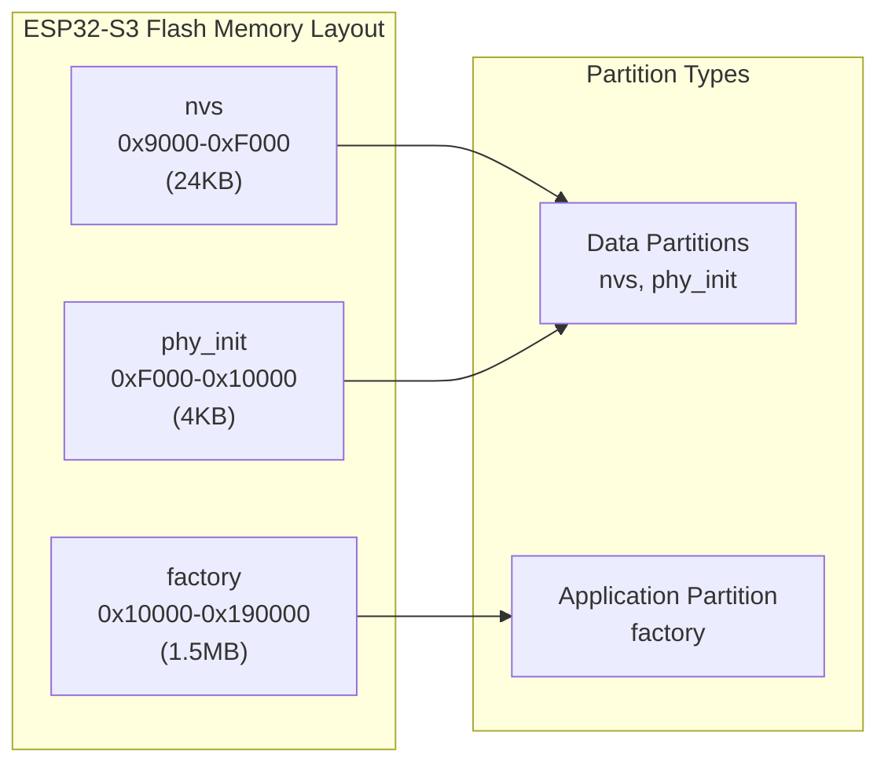
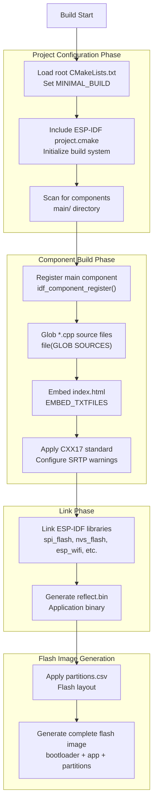

<!-- source: DeepWiki mcp.deepwiki.com · repo openai/openai-reflect · page 6.2 Build System · fetched 2026-10-26 -->

# Build System

<details>
<summary>Relevant source files</summary>

The following files were used as context for generating this wiki page:

- [CMakeLists.txt](CMakeLists.txt)
- [main/CMakeLists.txt](main/CMakeLists.txt)
- [partitions.csv](partitions.csv)

</details>


This document covers the CMake-based build system configuration for the Reflect hardware AI assistant project. The build system is based on ESP-IDF's component architecture and manages compilation, linking, and flash memory partitioning for the ESP32-S3 target platform.

For hardware platform configuration details, see [ESP32-S3 Configuration](#6.1). For information about external component dependencies, see [Dependencies](#6.3).

## Project Structure

The Reflect project follows ESP-IDF's standard CMake project structure with a root-level project configuration and component-specific build files.

### Root Project Configuration

The main project is configured in [CMakeLists.txt:1-7]() which establishes the ESP-IDF build environment:

```cmake
cmake_minimum_required(VERSION 3.16)
include($ENV{IDF_PATH}/tools/cmake/project.cmake)
idf_build_set_property(MINIMAL_BUILD ON)
project(reflect)
```

The `MINIMAL_BUILD` property is set to optimize build time by including only essential ESP-IDF components and their dependencies. This reduces the overall binary size and compilation time for the embedded target.

**Sources:** CMakeLists.txt

### Main Component Configuration

The primary application logic is organized as a component in [main/CMakeLists.txt:1-12]() with the following configuration:

| Build Parameter | Value | Purpose |
|-----------------|-------|---------|
| `CMAKE_CXX_STANDARD` | 17 | Enable C++17 features |
| `CMAKE_CXX_STANDARD_REQUIRED` | ON | Enforce C++17 compliance |
| `SOURCES` | `*.cpp` files | Auto-discover all C++ source files |
| `EMBED_TXTFILES` | `index.html` | Embed web interface into binary |

**Sources:** main/CMakeLists.txt

## Component Registration and Dependencies

The main component is registered using `idf_component_register()` with specific ESP-IDF framework requirements:



**Build Configuration for Component Registration**

The component registration in [main/CMakeLists.txt:5-8]() specifies:

- **SRCS**: All `.cpp` files in the main directory
- **PRIV_REQUIRES**: Private dependencies not exposed to other components
- **INCLUDE_DIRS**: Header file search paths (current directory)
- **EMBED_TXTFILES**: Web assets compiled into the binary

**Sources:** main/CMakeLists.txt

## Compilation Settings and Library Configuration

### C++ Standard Configuration

The build system enforces C++17 standard compliance through [main/CMakeLists.txt:1-2]():

```cmake
set(CMAKE_CXX_STANDARD 17)
set(CMAKE_CXX_STANDARD_REQUIRED ON)
```

This enables modern C++ features required by the WebRTC and audio processing components.

### External Library Compiler Flags

The SRTP library requires specific compiler flag adjustments in [main/CMakeLists.txt:10-11]():

```cmake
idf_component_get_property(lib sepfy__srtp COMPONENT_LIB)
target_compile_options(${lib} PRIVATE -Wno-error=incompatible-pointer-types)
```

This configuration suppresses pointer type warnings that occur in the external SRTP cryptography library.

**Sources:** main/CMakeLists.txt

## Flash Memory Partitioning

The ESP32-S3 flash memory layout is defined in [partitions.csv:1-6]() using ESP-IDF's partition table format:



**Partition Configuration Details**

| Partition | Type | SubType | Offset | Size | Purpose |
|-----------|------|---------|--------|------|---------|
| nvs | data | nvs | 0x9000 | 24KB | Non-volatile storage for WiFi config |
| phy_init | data | phy | 0xF000 | 4KB | RF calibration data |
| factory | app | factory | 0x10000 | 1.5MB | Main application binary |

The partition layout reserves sufficient space for the application binary while providing persistent storage for WiFi credentials and RF calibration data.

**Sources:** partitions.csv

## Build Process Flow

The complete build process follows ESP-IDF's component-based architecture:



The build system automatically handles dependency resolution, cross-compilation for the ESP32-S3 target, and generation of flashable binaries compatible with the hardware platform.

**Sources:** CMakeLists.txt, main/CMakeLists.txt, partitions.csv

---

