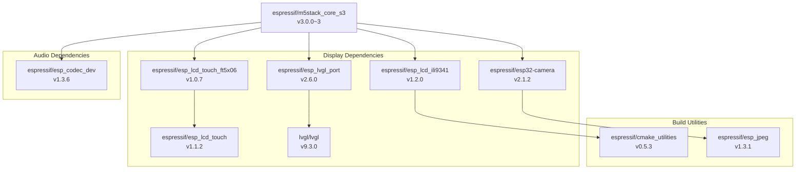
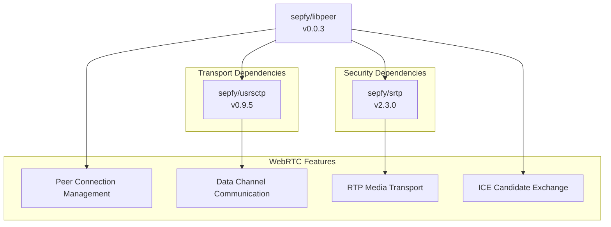
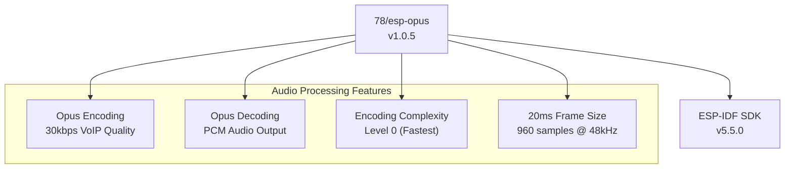
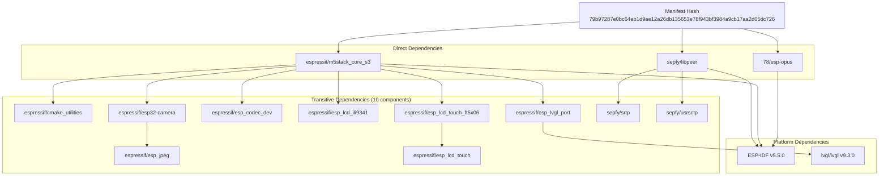

<!-- source: DeepWiki mcp.deepwiki.com · repo openai/openai-reflect · page 6.3 Dependencies · fetched 2026-10-26 -->

# Dependencies

Relevant source files

The following files were used as context for generating this wiki page:

- [dependencies.lock](dependencies.lock)
- [main/idf_component.yml](main/idf_component.yml)

This document describes the external component dependencies required by the Reflect hardware AI assistant system. It covers the three direct dependencies and their transitive dependency trees, explaining how each dependency supports different subsystems within the project.

For information about the build system configuration that manages these dependencies, see [Build System](#6.2). For details about the ESP32-S3 hardware configuration, see [ESP32-S3 Configuration](#6.1).

## Dependency Overview

The Reflect system relies on three primary external dependencies, each serving a distinct functional role:

| Dependency | Version | Purpose | Registry |
|------------|---------|---------|----------|
| `espressif/m5stack_core_s3` | ^3.0.0~3 | Hardware abstraction for M5Stack CoreS3 device | Espressif Components |
| `sepfy/libpeer` | ^0.0.3 | WebRTC peer-to-peer communication implementation | Espressif Components |
| `78/esp-opus` | ^1.0.5 | Opus audio codec for voice compression | Espressif Components |

These dependencies are declared in [main/idf_component.yml:1-4]() and resolved with exact versions and component hashes in [dependencies.lock:1-187]().

**Sources:** `main/idf_component.yml`, `dependencies.lock`

## Hardware Platform Dependencies

### M5Stack CoreS3 Component

The `espressif/m5stack_core_s3` component provides hardware abstraction for the ESP32-S3 M5Stack CoreS3 device, enabling access to integrated peripherals including camera, display, touch interface, and audio codec.

The M5Stack component requires ESP-IDF version >=5.4 and targets specifically the `esp32s3` platform as defined in [dependencies.lock:137-138](). Its transitive dependencies support:

- **Camera System**: `esp32-camera` component for image capture functionality
- **Display System**: `esp_lcd_ili9341` driver for the ILI9341 LCD controller
- **Touch Interface**: `esp_lcd_touch_ft5x06` driver for FT5x06 capacitive touch controller
- **Graphics Framework**: `esp_lvgl_port` and `lvgl` for user interface rendering
- **Audio Codec**: `esp_codec_dev` for I2S audio interface management

**Sources:** `dependencies.lock:108-139`

## Communication Dependencies

### LibPeer WebRTC Implementation

The `sepfy/libpeer` component implements WebRTC peer-to-peer communication, providing the core networking functionality for real-time audio streaming and data channel communication with browser clients.

The libpeer dependency tree includes two essential components:

- **sepfy/srtp v2.3.0**: Secure Real-time Transport Protocol implementation for encrypted media streaming
- **sepfy/usrsctp v0.9.5**: User-space SCTP implementation for WebRTC data channel transport

Both SRTP and USRSCTP components have no further dependencies as shown in [dependencies.lock:166-179](), providing self-contained implementations of their respective protocols.

**Sources:** `dependencies.lock:151-179`

## Audio Processing Dependencies

### Opus Codec Component

The `78/esp-opus` component provides Opus audio encoding and decoding capabilities for high-quality, low-latency voice communication with configurable compression settings.

The esp-opus component requires only ESP-IDF version >=5.0 as its dependency and provides optimized audio compression specifically tuned for voice communication applications. The component hash `8182b733f071d7bfe1e837f4c9f8649a63e4c937177f089e65772880c02f2e17` ensures reproducible builds.

**Sources:** `dependencies.lock:1-11`

## Complete Dependency Resolution

The ESP-IDF component manager resolves all dependencies into a deterministic dependency tree with exact versions and component hashes for reproducible builds:

### Version Constraints

The dependency resolution enforces specific version constraints:

| Component | Version Constraint | Target Platform |
|-----------|-------------------|----------------|
| `idf` | >=5.5.0 | esp32s3 |
| `m5stack_core_s3` | ^3.0.0~3 | esp32s3 only |
| `libpeer` | ^0.0.3 | All targets |
| `esp-opus` | ^1.0.5 | All targets |

The manifest hash `79b97287e0bc64eb1d9ae12a26db135653e78f943bf3984a9cb17aa2d05dc726` in [dependencies.lock:184]() ensures that the exact same dependency tree is resolved across different build environments.

**Sources:** `dependencies.lock:180-187`

## Component Registry Sources

All dependencies are sourced from the official Espressif Component Registry at `https://components.espressif.com/` with the exception of the core ESP-IDF framework which uses the `idf` source type for the locally installed SDK version.

The component manager downloads dependencies based on their component hashes, providing cryptographic verification of component integrity during the build process.

**Sources:** `dependencies.lock:8-10`, `dependencies.lock:141-143`

---

