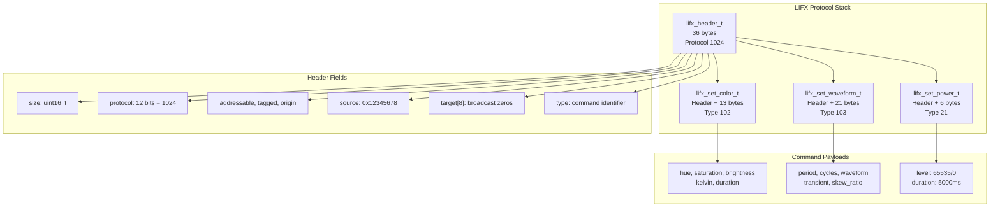
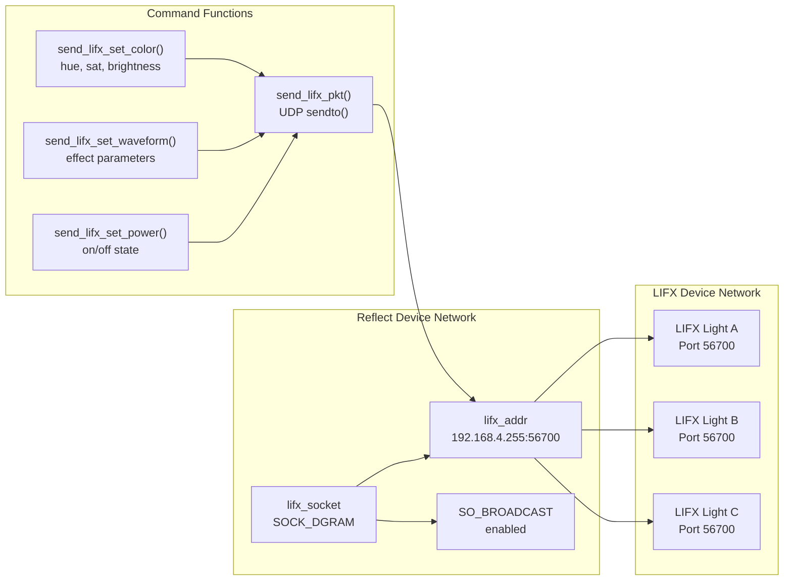
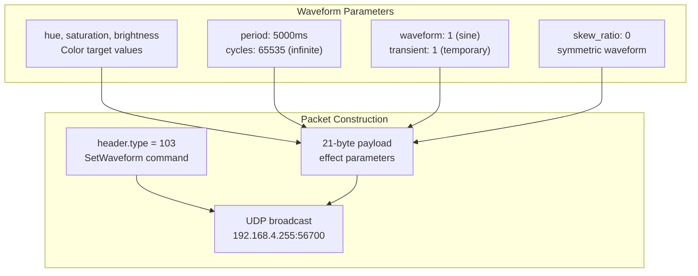
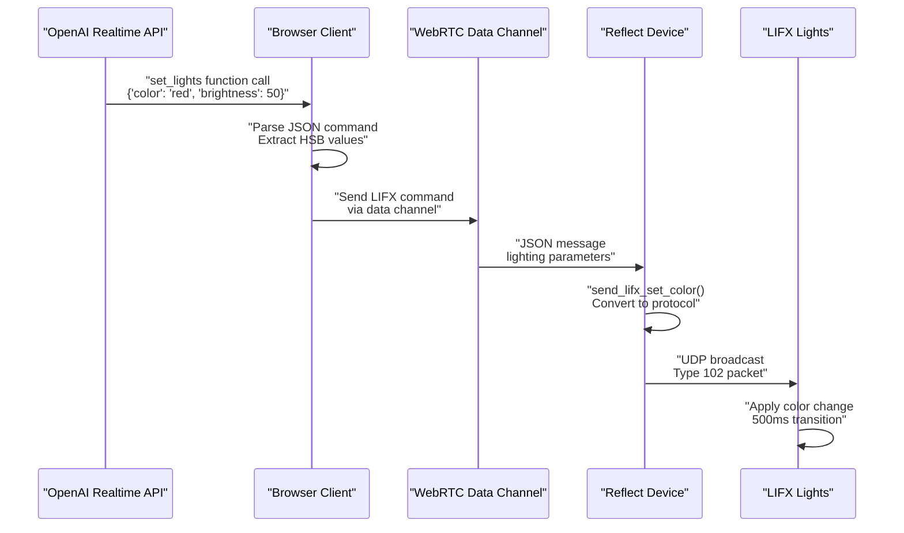

<!-- source: DeepWiki mcp.deepwiki.com · repo openai/openai-reflect · page 7 Smart Home Integration · fetched 2026-10-26 -->

# Smart Home Integration

Relevant source files

The following files were used as context for generating this wiki page:

- [main/lifx.cpp](main/lifx.cpp)

This document covers the LIFX smart lighting integration system that enables voice-controlled smart home functionality in the Reflect AI assistant. The system implements the LIFX LAN protocol to control smart lights through UDP broadcast messages, providing real-time lighting control in response to AI function calls.

For information about the WebRTC communication system that delivers AI function calls to the device, see [WebRTC Communication](#3). For details about the web interface that processes AI responses, see [Browser Client](#4.2).

## LIFX Protocol Implementation

The Reflect device implements a subset of the LIFX LAN protocol to control smart lights on the local network. The protocol uses structured UDP packets with specific headers and payloads for different lighting commands.

### Packet Structure Architecture

**Sources:** [main/lifx.cpp:11-62]()

## Network Communication Architecture

The LIFX integration uses UDP broadcast communication to reach all LIFX devices on the local network. The system establishes a socket with broadcast permissions and sends commands to the network broadcast address.

**Sources:** [main/lifx.cpp:64-70](), [main/lifx.cpp:151-166]()

## Command Processing Flow

The smart home integration receives JSON commands through the WebRTC data channel and translates them into LIFX protocol packets. Each command type has specific parameter handling and packet construction logic.

### Color Control Implementation

The `send_lifx_set_color` function constructs type 102 packets with HSB color values and transition parameters:

| Parameter | Type | Range | Default |
|-----------|------|-------|---------|
| `hue` | `uint16_t` | 0-65535 | Caller specified |
| `saturation` | `uint16_t` | 0-65535 | Caller specified |
| `brightness` | `uint16_t` | 0-65535 | Caller specified |
| `kelvin` | `uint16_t` | 2500-9000 | 3500 |
| `duration` | `uint32_t` | milliseconds | 500 |

**Sources:** [main/lifx.cpp:72-95]()

### Waveform Effect Processing

The `send_lifx_set_waveform` function implements type 103 packets for dynamic lighting effects:

**Sources:** [main/lifx.cpp:97-127]()

### Power State Management

The `send_lifx_set_power` function handles type 21 packets for device power control:

- **Power On**: `level = 65535`, `duration = 5000ms`
- **Power Off**: `level = 0`, `duration = 5000ms`

**Sources:** [main/lifx.cpp:129-149]()

## Integration with AI Command System

The LIFX integration connects to the broader Reflect AI system through JSON command processing. When the AI assistant receives voice commands about lighting, it generates function calls that are translated into LIFX protocol messages.

**Sources:** [main/lifx.cpp:67-70](), [main/lifx.cpp:72-95]()

## Network Configuration

The LIFX system operates within the Reflect device's WiFi access point network using the following configuration:

- **Network**: `192.168.4.0/24` 
- **Broadcast Address**: `192.168.4.255`
- **LIFX Port**: `56700` (standard LIFX LAN protocol port)
- **Protocol**: UDP with `SO_BROADCAST` socket option
- **Source ID**: `0x12345678` (fixed identifier for all packets)

The `reflect_lifx()` initialization function establishes the UDP socket and configures broadcast addressing for the local network subnet.

**Sources:** [main/lifx.cpp:8-9](), [main/lifx.cpp:151-166]()

---

