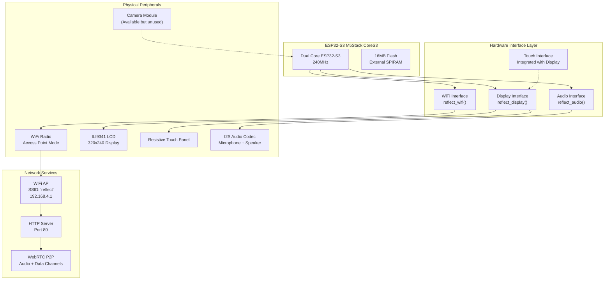
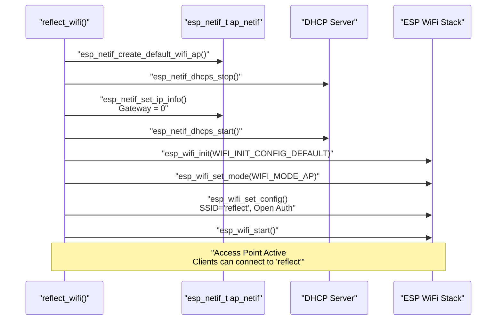

<!-- source: DeepWiki mcp.deepwiki.com · repo openai/openai-reflect · page 8 Hardware Interfaces · fetched 2026-10-26 -->

# Hardware Interfaces

Relevant source files

The following files were used as context for generating this wiki page:

- [main/display.cpp](main/display.cpp)
- [main/wifi.cpp](main/wifi.cpp)

This document covers the hardware interface implementations in the Reflect system, including the core peripheral interfaces for WiFi networking, display management, and audio processing. These interfaces provide the foundation for the device's interaction with both users and external systems.

For detailed ESP32-S3 hardware configuration, see [ESP32-S3 Configuration](#6.1). For the complete system initialization sequence, see [System Architecture](#5).

## Overview

The Reflect system implements several critical hardware interfaces on the ESP32-S3 M5Stack CoreS3 platform. These interfaces bridge the software components with physical hardware peripherals, enabling the device to function as a standalone AI assistant with network connectivity and multimedia capabilities.

## Hardware Interface Components

The system implements the following primary hardware interfaces:

**Hardware Interface Architecture**
This diagram shows how software interfaces connect ESP32-S3 cores to physical peripherals and enable higher-level network services.

Sources: System architecture analysis from provided diagrams

## WiFi Interface Implementation

The `reflect_wifi()` function establishes the core networking capability by configuring the ESP32-S3 as a WiFi access point. This creates the primary communication channel for client devices to connect to the Reflect system.

### Access Point Configuration

The WiFi interface implementation follows a specific initialization sequence:

**WiFi Interface Initialization Sequence**
This sequence shows the step-by-step WiFi access point configuration process.

The WiFi configuration uses these key parameters:
- **SSID**: `"reflect"` [main/wifi.cpp:23]()
- **Authentication**: `WIFI_AUTH_OPEN` (no password required) [main/wifi.cpp:24]()  
- **Max Connections**: `3` simultaneous client connections [main/wifi.cpp:25]()
- **IP Configuration**: Default network interface with gateway disabled [main/wifi.cpp:9-12]()

### Network Interface Management

The implementation manages the network interface through several critical steps:

| Step | Function Call | Purpose |
|------|---------------|---------|
| 1 | `esp_netif_create_default_wifi_ap()` | Create default AP network interface |
| 2 | `esp_netif_dhcps_stop()` | Stop DHCP server for reconfiguration |
| 3 | `esp_netif_set_ip_info()` | Configure IP settings (disable gateway) |
| 4 | `esp_netif_dhcps_start()` | Restart DHCP server with new settings |

Sources: [main/wifi.cpp:5-14]()

## Interface Integration Points

The hardware interfaces integrate with higher-level system components through these connection points:

- **WiFi → HTTP Server**: The WiFi access point enables the HTTP server to serve the web interface at `192.168.4.1`
- **WiFi → WebRTC**: Network connectivity supports WebRTC peer-to-peer connections for real-time audio streaming
- **Display → User Interaction**: Touch interface provides local control capabilities (implementation details in [Display System](#8.1))
- **Audio → Communication Pipeline**: I2S codec interfaces support bidirectional audio for voice conversations (see [Audio System](#2))

Each interface follows the ESP-IDF error checking pattern using `ESP_ERROR_CHECK()` macros to ensure reliable hardware initialization and operation.

Sources: [main/wifi.cpp:7-28](), system architecture analysis

For detailed information about specific interface implementations:
- WiFi network configuration: [WiFi Network](#8.2)  
- Display and touch interface: [Display System](#8.1)
- Audio codec interface: [Audio System](#2)

---

