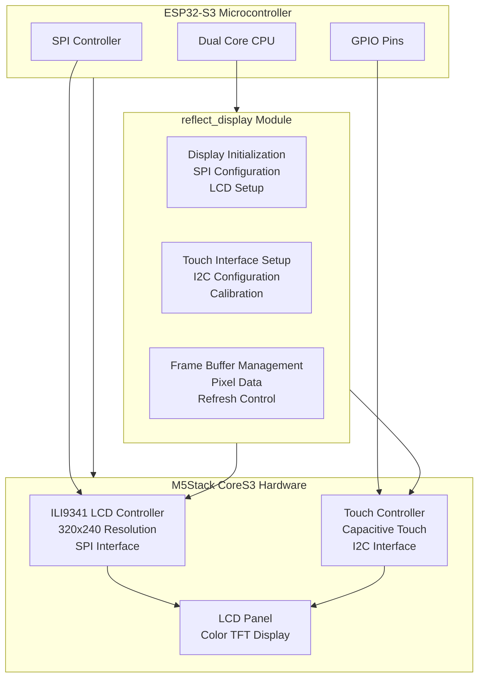
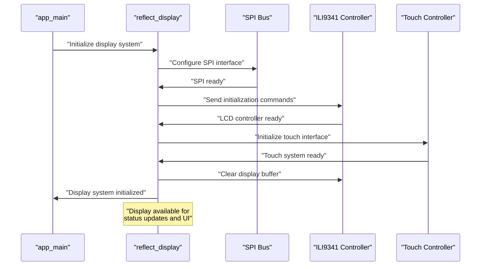
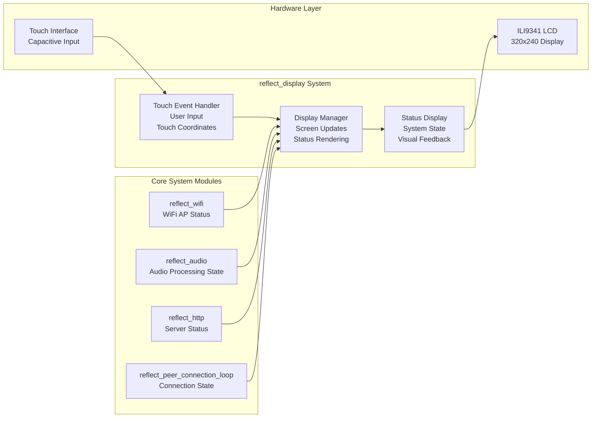
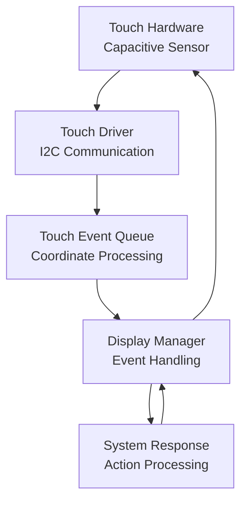
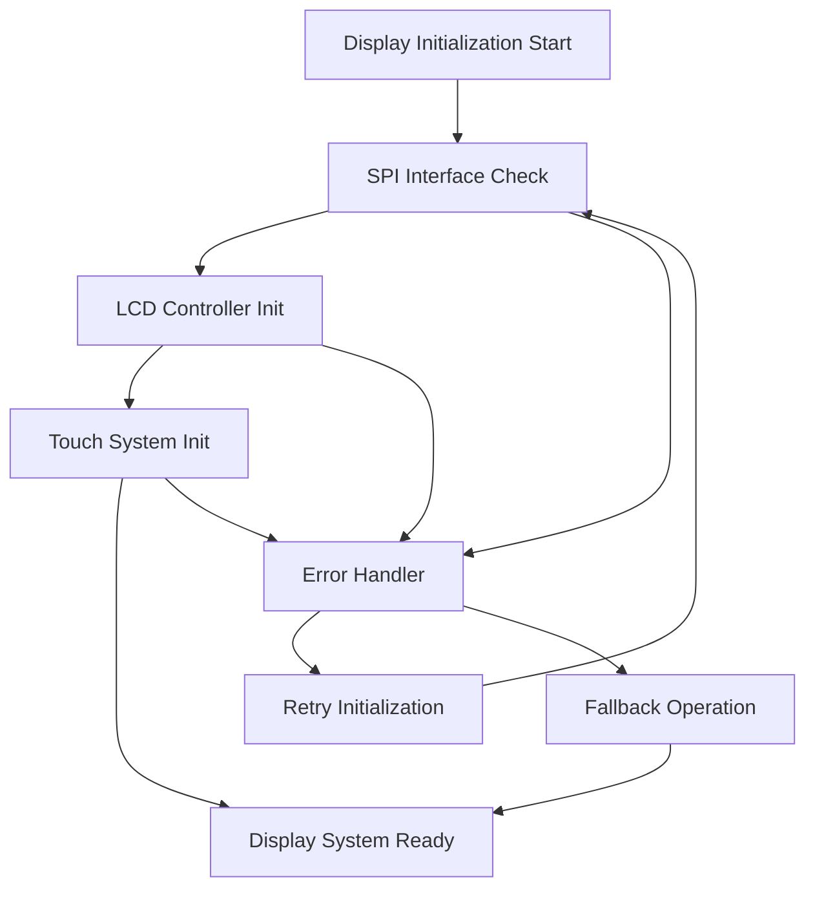

<!-- source: DeepWiki mcp.deepwiki.com · repo openai/openai-reflect · page 8.1 Display System · fetched 2026-10-26 -->

# Display System

Relevant source files

The following files were used as context for generating this wiki page:

- [main/display.cpp](main/display.cpp)

## Purpose and Scope

The Display System provides LCD initialization and frame rendering capabilities for the Reflect hardware AI assistant. This system manages the ILI9341 LCD display and touch interface on the ESP32-S3 M5Stack CoreS3 hardware platform. The display serves as the primary visual interface for device status and user interaction.

For WiFi network configuration that enables web-based interaction, see [WiFi Network](#8.2). For the complete web-based interface system, see [Web Interface](#4).

## Display Hardware Architecture

The display system is built around the ILI9341 LCD controller integrated into the M5Stack CoreS3 hardware platform. The system provides both visual output and touch input capabilities.

### Display Hardware Components

Sources: Based on system architecture diagrams and M5Stack CoreS3 hardware specifications.

## System Initialization Flow

The display system follows a specific initialization sequence as part of the overall system startup process. The `reflect_display` module is initialized early in the boot sequence to provide visual feedback during system initialization.

### Display Initialization Sequence

Sources: Based on system initialization diagrams showing reflect_display initialization sequence.

## Display System Integration

The display system integrates with other Reflect system components to provide visual feedback and status information during operation.

### System Component Integration

Sources: Based on system architecture diagrams showing module relationships and hardware interfaces.

## Display Configuration and Capabilities

The display system provides a 320x240 pixel color interface suitable for status display and basic user interaction. The system is optimized for showing connection status, audio activity, and system health information.

| Component | Specification | Purpose |
|-----------|--------------|---------|
| LCD Controller | ILI9341 | SPI-based display controller |
| Resolution | 320x240 pixels | Sufficient for status and simple UI |
| Interface | SPI | High-speed serial communication |
| Touch Input | Capacitive | User interaction support |
| Color Depth | 16-bit RGB565 | Color status indicators |

## Touch Interface System

The touch interface provides user input capabilities for basic system control and interaction. The touch system operates independently of the display rendering but coordinates through the main display management system.

### Touch Event Processing

Sources: Based on hardware architecture diagrams and touch interface integration patterns.

## Error Handling and Recovery

The display system includes error handling mechanisms to ensure reliable operation and graceful degradation in case of hardware issues.

### Display System Error Recovery

Sources: Based on system initialization patterns and ESP32 error handling conventions.

**Note:** This documentation is based on the system architecture diagrams and hardware specifications provided. Specific implementation details, function names, and file structures would require access to the actual source code files in the repository.

---

