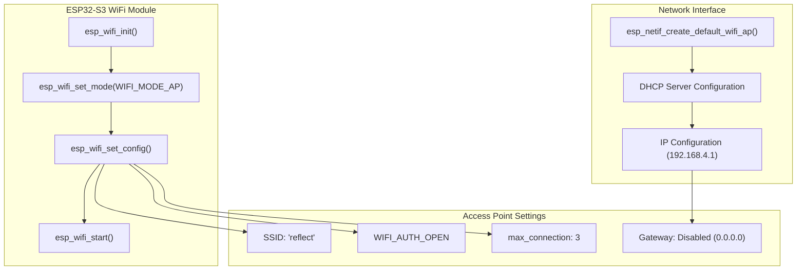
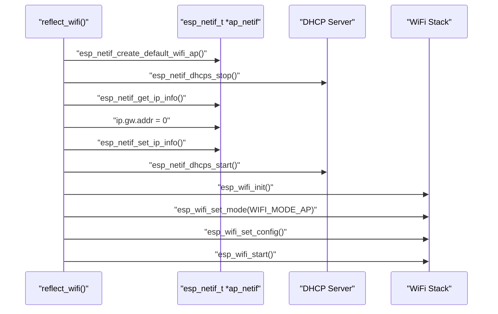
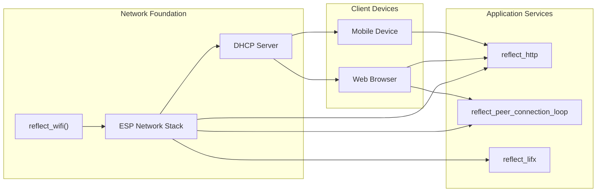

<!-- source: DeepWiki mcp.deepwiki.com · repo openai/openai-reflect · page 8.2 WiFi Network · fetched 2026-10-26 -->

# WiFi Network

Relevant source files

The following files were used as context for generating this wiki page:

- [main/wifi.cpp](main/wifi.cpp)

This document covers the WiFi Access Point implementation that creates the local "reflect" network for client device connections. The Reflect device operates as a standalone WiFi Access Point, allowing browsers and other clients to connect directly without requiring an existing WiFi infrastructure.

For information about the web interface served over this WiFi network, see [Web Interface](#4). For details about the WebRTC communication that occurs over this network, see [WebRTC Communication](#3).

## Purpose and Implementation

The WiFi network system initializes and configures the ESP32-S3 as a WiFi Access Point with the SSID "reflect". This creates a local network that client devices can connect to for accessing the Reflect system's web interface and establishing WebRTC connections.

The implementation uses ESP-IDF's WiFi APIs to configure the device in Access Point mode only, with no station (client) functionality. The system creates an isolated local network with DHCP services to automatically assign IP addresses to connecting clients.

**WiFi Access Point Configuration**

Sources: [main/wifi.cpp:1-29]()

## Network Configuration Details

The WiFi Access Point is configured with specific parameters optimized for the Reflect device's use case:

| Parameter | Value | Purpose |
|-----------|--------|---------|
| SSID | "reflect" | Fixed network name for easy identification |
| Authentication | Open (no password) | Simplified connection process |
| Maximum Connections | 3 | Sufficient for typical usage scenarios |
| IP Address | 192.168.4.1 | Default AP address from ESP-IDF |
| Gateway | Disabled (0.0.0.0) | Prevents internet routing attempts |
| DHCP Server | Enabled | Automatic IP assignment for clients |

The network interface configuration specifically disables the gateway functionality by setting the gateway address to 0, which prevents connected clients from attempting to route internet traffic through the Reflect device.

**Network Interface Configuration Flow**

Sources: [main/wifi.cpp:4-28]()

## System Integration

The WiFi Access Point serves as the foundational network layer for the Reflect system's client communication. Once established, it enables:

- **HTTP Server Access**: Clients connect to `192.168.4.1` to access the web interface
- **WebRTC Signaling**: SDP exchange occurs over HTTP connections through this network
- **Local Network Isolation**: Creates a contained environment for Reflect operations

The WiFi system is initialized early in the system startup sequence, providing the network foundation before other network-dependent services like the HTTP server and WebRTC components are started.

**Integration with System Components**

Sources: [main/wifi.cpp:1-29]()

## Error Handling

The WiFi initialization uses `ESP_ERROR_CHECK` macros for all critical WiFi and network interface operations. Any failure in the WiFi setup process will cause the system to halt, as the WiFi network is essential for all client communication functionality.

The error checking covers:
- Network interface creation and configuration
- DHCP server start/stop operations
- WiFi stack initialization and mode setting
- Access Point configuration and startup

This ensures that the Reflect device only continues operation if the WiFi Access Point is successfully established and ready to accept client connections.

Sources: [main/wifi.cpp:7,10,12,14,17,19,27,28]()

---

