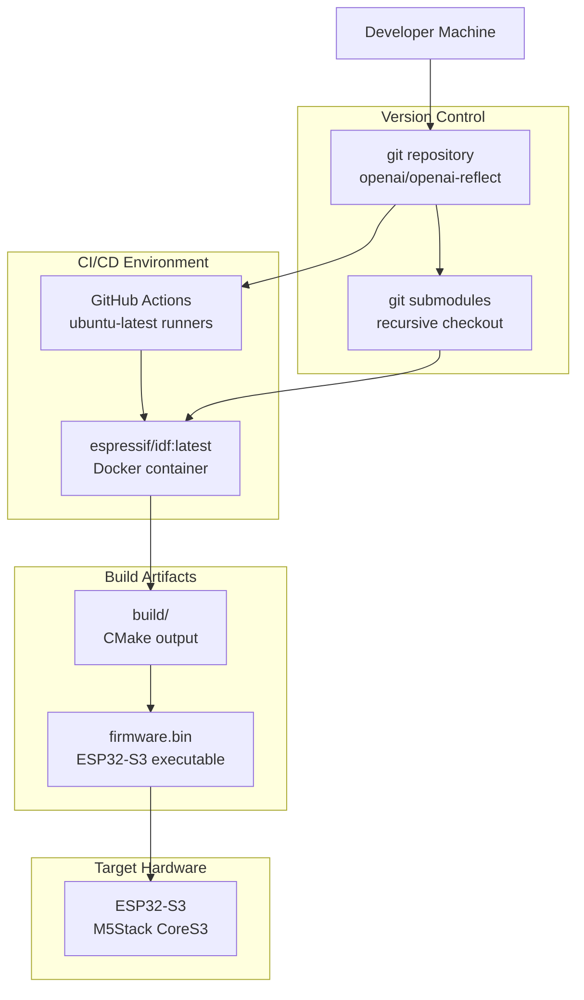
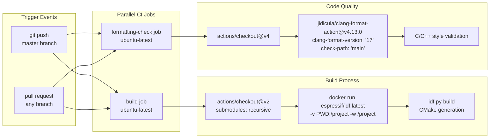
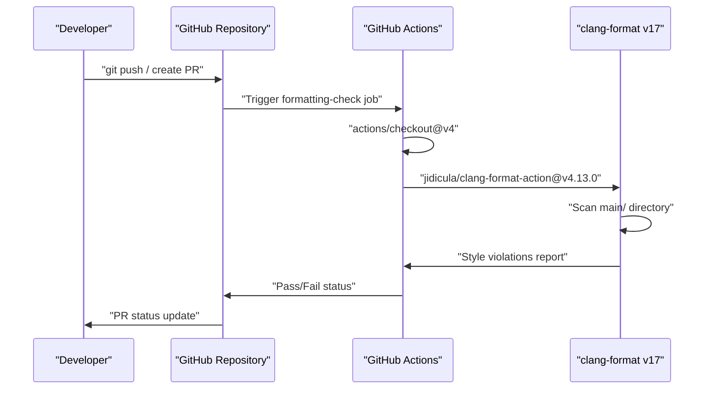
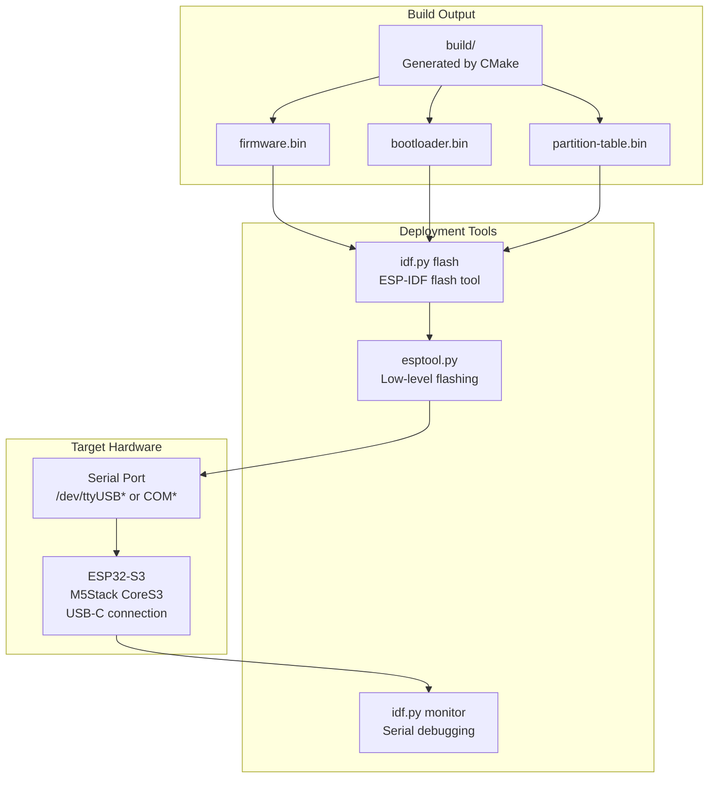

<!-- source: DeepWiki mcp.deepwiki.com · repo openai/openai-reflect · page 9 Development and Deployment · fetched 2026-10-26 -->

# Development and Deployment

Relevant source files

The following files were used as context for generating this wiki page:

- [.github/workflows/build.yaml](.github/workflows/build.yaml)
- [.github/workflows/clang-format-check.yml](.github/workflows/clang-format-check.yml)
- [.gitignore](.gitignore)
- [LICENSE](LICENSE)

This document covers the development workflow, continuous integration pipelines, and deployment procedures for the Reflect hardware AI assistant system. It focuses on the automated build processes, code quality checks, and the tools required for developing and deploying firmware to ESP32-S3 hardware.

For detailed information about specific CI/CD pipeline configurations, see [CI/CD Pipeline](#9.1). For project-level configuration details including Git ignore rules and licensing, see [Project Configuration](#9.2).

## Development Environment Requirements

The Reflect system is built on the ESP-IDF framework and requires a Docker-based development environment for consistent builds across different platforms. The development environment is containerized to ensure reproducible builds and eliminate platform-specific dependency issues.

### Build System Architecture

**Development and Build Flow Diagram**

Sources: [.github/workflows/build.yaml:1-21](), [.gitignore:1-4]()

## Continuous Integration Pipeline

The project implements automated CI/CD through GitHub Actions with two primary workflows that ensure code quality and build integrity on every push and pull request.

### CI/CD Workflow Overview

**CI/CD Pipeline Architecture**

The build workflow in [.github/workflows/build.yaml:1-21]() executes on pushes to `master` and all pull requests, ensuring every code change is validated before integration. The formatting workflow in [.github/workflows/clang-format-check.yml:1-14]() runs in parallel to maintain code style consistency.

Sources: [.github/workflows/build.yaml:1-21](), [.github/workflows/clang-format-check.yml:1-14]()

## Build Process and Docker Integration

The build system leverages the official Espressif Docker image to provide a consistent ESP-IDF environment. This approach eliminates the need for developers to manually install and configure the ESP-IDF toolchain locally.

### Docker-based Build Configuration

| Component | Configuration | Purpose |
|-----------|---------------|---------|
| Base Image | `espressif/idf:latest` | Official ESP-IDF development environment |
| Volume Mount | `-v $PWD:/project` | Maps source code into container |
| Working Directory | `-w /project` | Sets build context |
| User Context | `-u 0` | Root user for package installation |
| Home Override | `-e HOME=/tmp` | Temporary home for build isolation |

The build command in [.github/workflows/build.yaml:19-20]() executes the ESP-IDF build system within the containerized environment, ensuring consistent toolchain versions and dependencies across all build environments.

### Build Artifact Management

Build artifacts are managed through the `.gitignore` configuration, which excludes build outputs from version control:

- `build/` - CMake build directory containing compiled objects
- `managed_components/` - ESP-IDF component manager downloads  
- `sdkconfig` - ESP-IDF project configuration (generated)

Sources: [.github/workflows/build.yaml:19-21](), [.gitignore:1-4]()

## Code Quality and Formatting Standards

The project enforces consistent C/C++ code formatting using `clang-format` version 17 through automated CI checks. This ensures all contributions maintain uniform code style across the entire codebase.

### Formatting Workflow Details

**Code Quality Validation Sequence**

The formatting check specifically targets the `main/` directory where the core Reflect application code resides, ensuring that ESP-IDF framework code and third-party dependencies are not subject to the project's formatting rules.

Sources: [.github/workflows/clang-format-check.yml:1-14]()

## Deployment and Hardware Flashing

Deployment involves flashing the compiled firmware to ESP32-S3 hardware using standard ESP-IDF tools. The build process generates firmware binaries that can be deployed through multiple methods.

### Deployment Workflow

**Firmware Deployment Process**

The deployment process requires physical access to the ESP32-S3 hardware for initial flashing. Subsequent updates can be delivered through the same serial connection or potentially through over-the-air (OTA) updates if implemented.

Sources: [.github/workflows/build.yaml:1-21]()

## License and Legal Compliance

The project is distributed under the MIT License, providing broad permissions for use, modification, and distribution while maintaining copyright attribution requirements.

### License Requirements

- **Copyright Notice**: Must be included in all copies: "Copyright (c) 2025 OpenAI"
- **License Text**: Full MIT License text must accompany distributions
- **Attribution**: Original copyright and license notice required in derivative works
- **Warranty Disclaimer**: Software provided "AS IS" without warranties

The license allows commercial use, private use, modification, and distribution while limiting liability and providing no warranty guarantees.

Sources: [LICENSE:1-22]()

---

