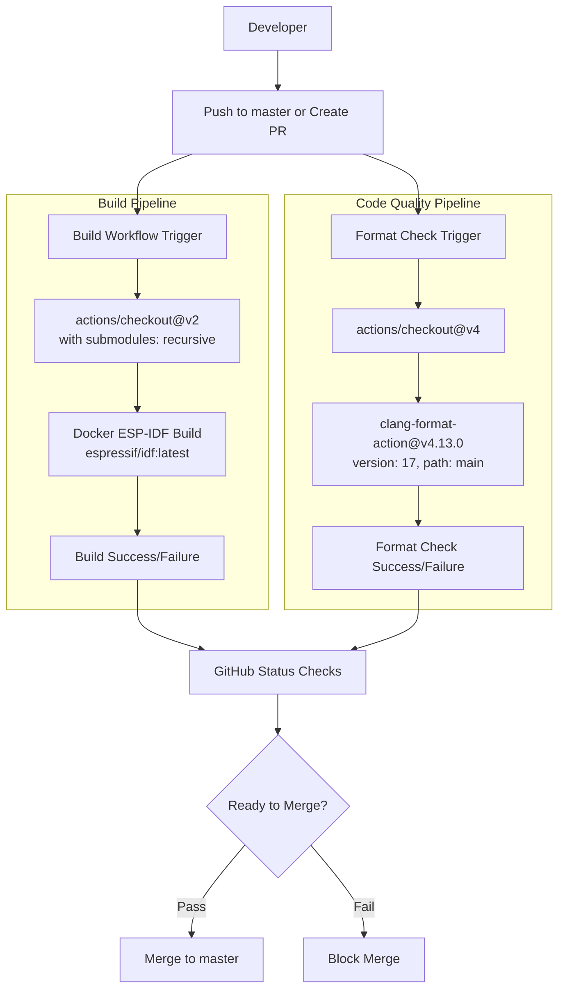
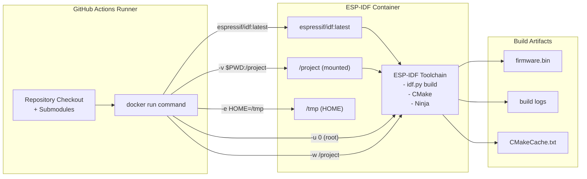

<!-- source: DeepWiki mcp.deepwiki.com · repo openai/openai-reflect · page 9.1 CI/CD Pipeline · fetched 2026-10-26 -->

# CI/CD Pipeline

<details>
<summary>Relevant source files</summary>

The following files were used as context for generating this wiki page:

- [.github/workflows/build.yaml](.github/workflows/build.yaml)
- [.github/workflows/clang-format-check.yml](.github/workflows/clang-format-check.yml)

</details>


This document covers the automated Continuous Integration and Continuous Deployment (CI/CD) pipeline for the Reflect hardware AI assistant project. The pipeline includes automated building and code quality checks that run on GitHub Actions for every code change.

For information about the overall project structure and build system configuration, see [Build System](#6.2). For details about development workflows beyond CI/CD, see [Development and Deployment](#9).

## Overview

The Reflect project uses GitHub Actions to implement a CI/CD pipeline with two primary workflows:

- **Build Pipeline**: Compiles the ESP-IDF project using Docker to ensure consistent builds across environments
- **Code Quality Pipeline**: Enforces consistent code formatting using `clang-format` for C/C++ source files

Both workflows are automatically triggered on pushes to the `master` branch and all pull requests, providing immediate feedback on code changes.

## Build Workflow

The main build pipeline is defined in [.github/workflows/build.yaml:1-21]() and handles compilation of the ESP32-S3 firmware using the ESP-IDF toolchain.

### Build Trigger Configuration

```yaml
on:
  push:
    branches:
      - master
  pull_request:
```

The workflow triggers on:
- Pushes to the `master` branch [.github/workflows/build.yaml:3-5]()
- All pull request events [.github/workflows/build.yaml:6]()

### Build Process

The build job runs on `ubuntu-latest` and uses a Docker-based approach for consistent ESP-IDF compilation:

| Step | Action | Configuration |
|------|--------|---------------|
| Checkout | `actions/checkout@v2` | Recursive submodules enabled |
| Build | Docker ESP-IDF | `espressif/idf:latest` image |

The Docker build command [.github/workflows/build.yaml:19]() mounts the project directory and runs the ESP-IDF build process:

```bash
docker run -v $PWD:/project -w /project -u 0 -e HOME=/tmp espressif/idf:latest
```

Key Docker parameters:
- `-v $PWD:/project`: Mounts current directory as `/project` in container
- `-w /project`: Sets working directory to the mounted project
- `-u 0`: Runs as root user for file system permissions
- `-e HOME=/tmp`: Sets temporary home directory for build artifacts

Sources: [.github/workflows/build.yaml:8-21]()

## Code Quality Workflow

The formatting enforcement pipeline is defined in [.github/workflows/clang-format-check.yml:1-14]() and ensures consistent code style across the C/C++ codebase.

### Formatting Check Configuration

The workflow uses `clang-format` version 17 and specifically targets the `main` directory:

```yaml
- name: Run clang-format style check for C/C++/Protobuf programs.
  uses: jidicula/clang-format-action@v4.13.0
  with:
    clang-format-version: '17'
    check-path: 'main'
```

### Scope and Triggers

- **Triggers**: All push and pull request events [.github/workflows/clang-format-check.yml:2]()
- **Target Path**: Only checks files in the `main` directory [.github/workflows/clang-format-check.yml:13]()
- **Languages**: C, C++, and Protocol Buffer files [.github/workflows/clang-format-check.yml:9]()

Sources: [.github/workflows/clang-format-check.yml:1-14]()

## CI/CD Pipeline Flow



This diagram shows the parallel execution of both build and formatting checks, with GitHub status checks preventing merges until both pipelines pass.

Sources: [.github/workflows/build.yaml:2-6](), [.github/workflows/clang-format-check.yml:2]()

## ESP-IDF Docker Integration



This diagram illustrates how the Docker-based build process integrates with ESP-IDF toolchain, showing the volume mounting and environment configuration used in [.github/workflows/build.yaml:19]().

Sources: [.github/workflows/build.yaml:19-20]()

## Workflow Dependencies and Status Checks

The CI/CD pipeline enforces code quality through required status checks that must pass before code can be merged:

| Workflow | Job Name | Required for Merge | Check Scope |
|----------|----------|-------------------|-------------|
| Build | `build` | Yes | Full ESP-IDF compilation |
| Clang Format Check | `formatting-check` | Yes | C/C++ files in `main/` |

Both workflows use different versions of the checkout action:
- Build workflow: `actions/checkout@v2` [.github/workflows/build.yaml:14]()
- Format workflow: `actions/checkout@v4` [.github/workflows/clang-format-check.yml:8]()

The format check specifically targets the `main` directory [.github/workflows/clang-format-check.yml:13](), which contains the core ESP-IDF application source code, excluding other directories that may contain third-party code or generated files.

Sources: [.github/workflows/build.yaml:8-21](), [.github/workflows/clang-format-check.yml:4-14]()

---

