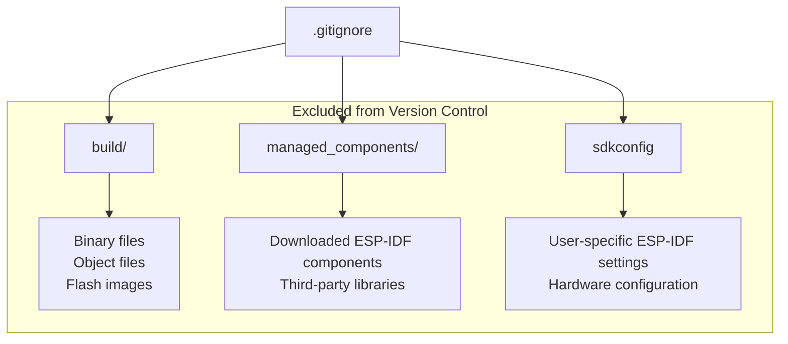
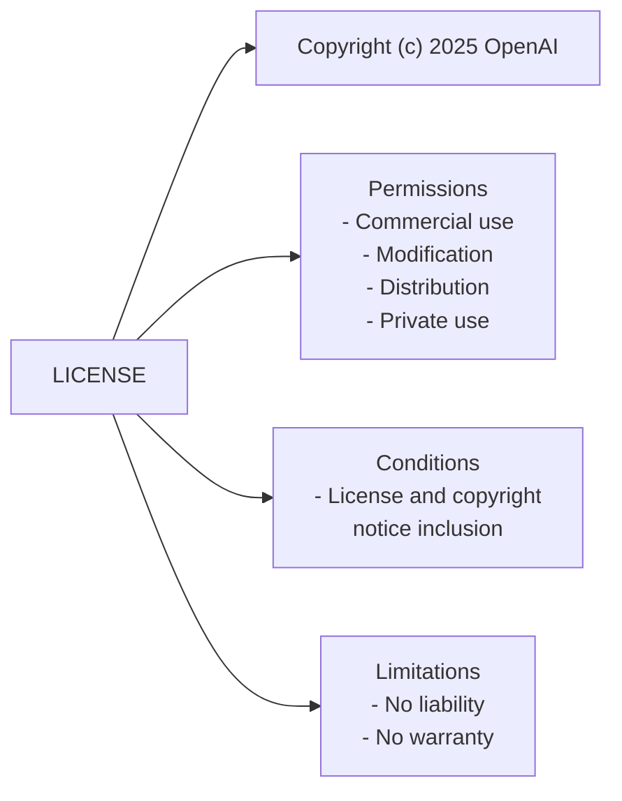
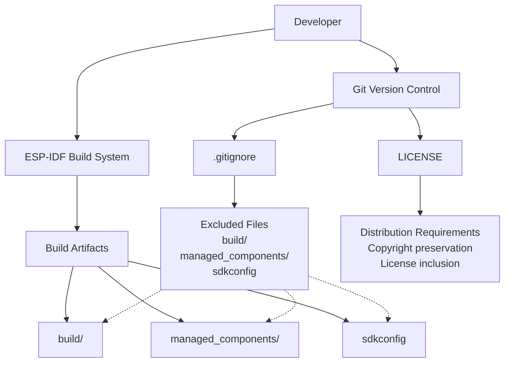

<!-- source: DeepWiki mcp.deepwiki.com · repo openai/openai-reflect · page 9.2 Project Configuration · fetched 2026-10-26 -->

# Project Configuration

Relevant source files

The following files were used as context for generating this wiki page:

- [.gitignore](.gitignore)
- [LICENSE](LICENSE)

This document covers the project-level configuration files that define fundamental settings for the Reflect hardware AI assistant system. These configurations control version control behavior, licensing terms, and development environment setup.

For information about ESP-IDF specific configuration, see [ESP32-S3 Configuration](#6.1). For build system configuration, see [Build System](#6.2).

## Git Configuration

The project uses Git version control with specific ignore rules defined to exclude generated files and build artifacts from source control.

### Ignore Rules

The `.gitignore` file defines four categories of excluded files:

| Category | Pattern | Purpose |
|----------|---------|---------|
| Build Artifacts | `build` | Compiled binaries and intermediate files |
| Managed Dependencies | `managed_components` | ESP-IDF managed component downloads |
| SDK Configuration | `sdkconfig` | ESP-IDF configuration state |

The `build` directory contains all compilation outputs from the ESP-IDF build system. The `managed_components` directory stores downloaded ESP-IDF components that are fetched automatically based on dependencies. The `sdkconfig` file contains user-specific ESP-IDF configuration choices that should not be committed to maintain environment consistency.

**Git Ignore Structure**

Sources: [.gitignore:1-4]()

## License Configuration

The project is released under the MIT License with OpenAI as the copyright holder for 2025.

### License Terms

The MIT License provides broad permissions for use, modification, and distribution with minimal restrictions:

| Permission | Scope |
|------------|-------|
| Commercial Use | Permitted without restriction |
| Modification | Permitted without restriction |
| Distribution | Permitted without restriction |
| Private Use | Permitted without restriction |

The license requires only that copyright notices be preserved in all copies or substantial portions of the software. No warranty is provided, and OpenAI disclaims liability for any damages arising from use of the software.

### Copyright Attribution

The copyright is held by OpenAI for the year 2025, as specified in the license header [LICENSE:3](). This attribution must be maintained in any derivative works or redistributions.

**License Configuration Structure**

Sources: [LICENSE:1-22]()

## Development Workflow Integration

These configuration files integrate with the broader development and deployment workflow to ensure consistent builds and legal compliance.

**Configuration Integration Flow**

The `.gitignore` rules prevent build artifacts and environment-specific files from being committed, ensuring the repository contains only source code and essential configuration. The LICENSE file ensures legal compliance for any distribution or modification of the codebase.

Sources: [.gitignore:1-4](), [LICENSE:1-22]()

---

