# Page: Overview

# Overview

<details>
<summary>Relevant source files</summary>

The following files were used as context for generating this wiki page:

- [README.md](README.md)

</details>


## Purpose and Scope

This document provides a high-level overview of the Reflect hardware AI assistant system, introducing its architecture, key components, and integration points. Reflect is a voice-controlled smart home device built on the ESP32-S3 platform that integrates with OpenAI's Realtime API to provide natural language interactions and smart home control capabilities.

For detailed information about specific subsystems, see: [Audio System](#2), [WebRTC Communication](#3), [Web Interface](#4), [System Architecture](#5), [Hardware Platform](#6), [Smart Home Integration](#7), and [Hardware Interfaces](#8).

## System Overview

Reflect is a stateless hardware AI assistant designed around the principle of natural communication through sound, light, and color while avoiding traditional screen-based interfaces. The device creates a local WiFi network that clients connect to, establishing peer-to-peer WebRTC connections for real-time audio streaming and command processing.

### Core Design Principles

| Principle | Implementation |
|-----------|----------------|
| **Communicate naturally** | Sound, light and color interfaces instead of screens |
| **Phone is your key** | Device has no persistent state; all information stored on client |
| **Stateless operation** | No local data storage; operates as a communication bridge |
| **Easy modification** | Modular design for adding new features and integrations |
| **Cost-effective** | Built on affordable ESP32-S3 hardware platform |

### System Architecture Overview

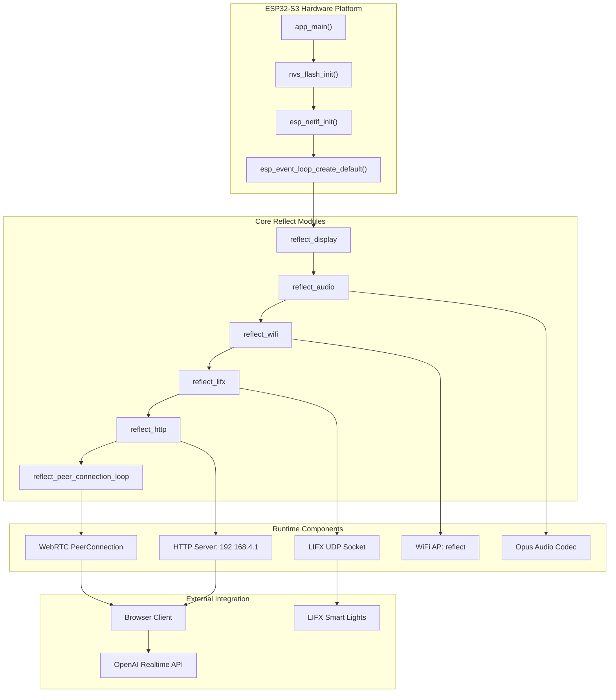

**System Initialization and Module Dependencies**

The system follows a strict initialization sequence where ESP-IDF foundation services must complete successfully before Reflect-specific modules initialize. Each module has clear dependencies and interfaces with specific hardware or network components.

Sources: [README.md:1-93]()

### Communication Flow Architecture

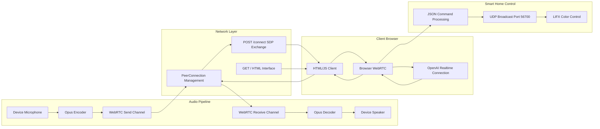

**Real-time Communication Pipeline**

The system establishes a complete audio processing pipeline from device microphone through Opus encoding, WebRTC transmission, OpenAI API processing, and response playback. Smart home control commands flow through the same WebRTC data channel as JSON messages.

Sources: [README.md:84-92]()

## Hardware Platform

Reflect targets the M5Stack CoreS3 ESP32S3 IoT Development Kit, chosen for its integrated camera, display, audio codec, and WiFi capabilities. The device operates as a WiFi access point, creating a network named `reflect` that clients connect to for interaction.

### Supported Hardware

| Component Type | Model | Purpose |
|---------------|-------|---------|
| **Microcontroller** | M5Stack CoreS3 ESP32S3 | Main processing unit with integrated peripherals |
| **Smart Lights** | LIFX Color A19 | Voice-controlled ambient lighting |

### Network Configuration

The device creates a WiFi access point with the following configuration:
- **SSID**: `reflect`
- **IP Address**: `192.168.4.1`
- **Web Interface**: HTTP server on port 80
- **Protocol**: WebRTC peer-to-peer connections

## Key Integration Points

### OpenAI Realtime API Integration
The browser client establishes a direct WebRTC connection to OpenAI's Realtime API, enabling low-latency voice conversations with function calling capabilities for smart home control.

### LIFX Smart Lighting Control
The device communicates with LIFX lights using UDP broadcasts on port 56700, supporting color changes, power control, and waveform effects based on AI-generated commands.

### Stateless Design Philosophy
All session state, user preferences, and conversation history are maintained in the browser client. The Reflect device operates as a stateless communication bridge, making it simple to deploy and maintain.

## Getting Started

To use Reflect:
1. Connect to the `reflect` WiFi network
2. Navigate to `http://192.168.4.1` in a web browser
3. Start a session to establish WebRTC connections
4. Begin voice interactions with the AI assistant

For installation and deployment procedures, see [Development and Deployment](#9).

Sources: [README.md:57-92]()

---

# Page: Audio System

# Audio System

<details>
<summary>Relevant source files</summary>

The following files were used as context for generating this wiki page:

- [main/audio.cpp](main/audio.cpp)

</details>


The Audio System implements real-time audio processing for the Reflect hardware AI assistant, providing Opus-encoded audio streaming between the ESP32-S3 device and WebRTC peer connections. This system handles microphone input capture, speaker output playback, codec initialization, and feedback prevention mechanisms.

For information about WebRTC communication that transports the audio data, see [WebRTC Communication](#3). For details about the hardware platform and codec devices, see [Hardware Platform](#6).

## Audio Configuration and Constants

The audio system operates with specific configuration parameters optimized for voice communication with the OpenAI Realtime API:

| Parameter | Value | Purpose |
|-----------|--------|---------|
| Sample Rate | 16kHz | Voice-optimized sampling frequency |
| Channels | Mono (1) | Single-channel voice communication |
| Bit Depth | 16-bit | Standard PCM audio depth |
| PCM Buffer Size | 640 bytes | 20ms audio frames at 16kHz |
| Opus Bitrate | 30kbps | Low-bandwidth voice encoding |
| Opus Complexity | 0 | Minimum CPU usage for real-time processing |

The system defines these constants in [main/audio.cpp:7-17]() and configures the ESP codec sample format in [main/audio.cpp:19-25]().

**Audio Configuration Diagram**
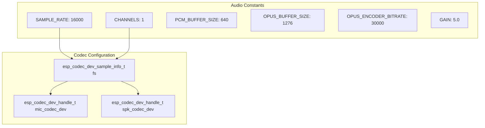

Sources: [main/audio.cpp:7-28]()

## Codec and Buffer Initialization

The `reflect_audio()` function initializes all audio components in a specific sequence to ensure proper codec setup and memory allocation.

**Codec Initialization Process**
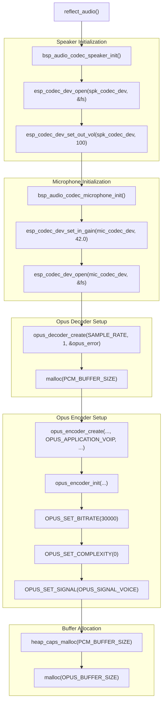

The initialization process configures the microphone gain to 42.0 and speaker volume to 100%, while setting up Opus encoding optimized for voice applications with minimal CPU complexity.

Sources: [main/audio.cpp:48-84]()

## Audio Input Pipeline

The `reflect_send_audio()` function captures microphone input and encodes it for transmission via WebRTC peer connections.

**Audio Input Processing Flow**
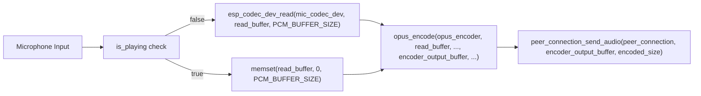

The input pipeline implements feedback prevention by checking the `is_playing` atomic boolean. When audio is currently being played through the speaker, the microphone input is zeroed to prevent echo and feedback loops.

Sources: [main/audio.cpp:115-129]()

## Audio Output Pipeline

The `reflect_play_audio()` function receives Opus-encoded audio data, decodes it to PCM, and plays it through the device speaker with gain control.

**Audio Output Processing Flow**
```mermaid
graph LR
    opus_data["Opus Data Input"]
    opus_decode["opus_decode(opus_decoder, data, size, decoder_buffer, ...)"]
    display_check["reflect_display_pressed()"]
    memset_mute["memset(decoder_buffer, 0, PCM_BUFFER_SIZE)"]
    set_is_playing["set_is_playing(decoder_buffer)"]
    apply_gain["apply_gain((int16_t *)decoder_buffer)"]
    esp_codec_dev_write["esp_codec_dev_write(spk_codec_dev, decoder_buffer, PCM_BUFFER_SIZE)"]
    
    opus_data --> opus_decode
    opus_decode --> display_check
    display_check -->|"true"| memset_mute
    display_check -->|"false"| set_is_playing
    memset_mute --> set_is_playing
    set_is_playing --> apply_gain
    apply_gain --> esp_codec_dev_write
```

The output pipeline includes a manual mute function triggered by display touch input and automatic gain amplification of 5.0x to ensure adequate speaker volume.

Sources: [main/audio.cpp:100-113]()

## Feedback Prevention System

The system implements sophisticated feedback prevention using the `is_playing` atomic boolean and dynamic input muting.

**Feedback Prevention Logic**
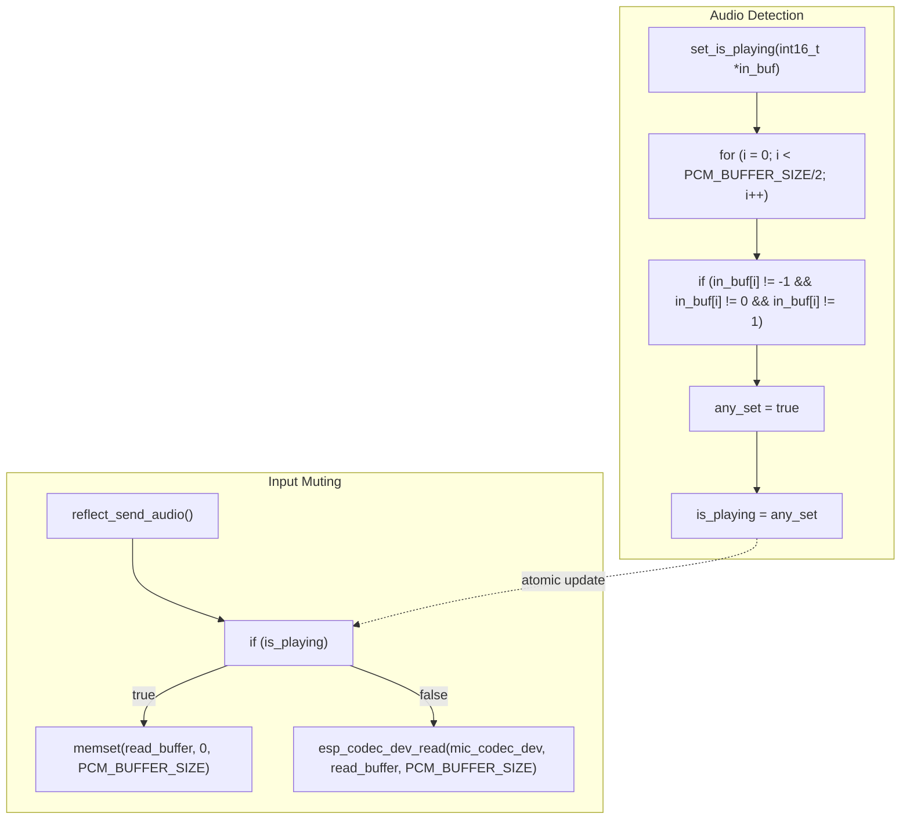

The `set_is_playing()` function analyzes PCM samples to detect active audio playback by checking if samples exceed noise floor thresholds (-1, 0, 1). When audio is detected, the microphone input is automatically muted to prevent acoustic feedback.

Sources: [main/audio.cpp:37-46](), [main/audio.cpp:115-121]()

## Gain Control and Audio Processing

The `apply_gain()` function amplifies decoded audio samples while preventing clipping through proper range limiting.

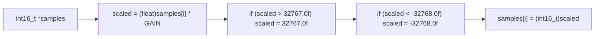

The gain amplification uses a fixed multiplier of 5.0x defined by the `GAIN` constant, with proper saturation arithmetic to prevent 16-bit integer overflow and audio distortion.

Sources: [main/audio.cpp:86-98]()

## Integration with WebRTC and Task Management

The audio system integrates with the broader Reflect architecture through WebRTC peer connections and FreeRTOS task scheduling.

**Audio System Integration**
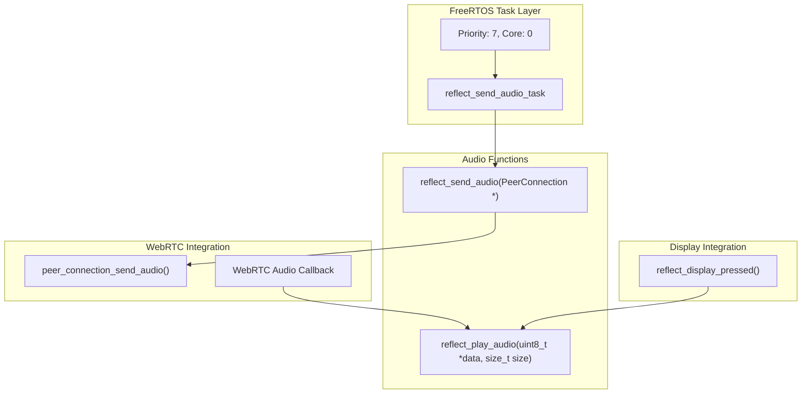

The audio system operates within a dedicated FreeRTOS task (`reflect_send_audio_task`) running at priority 7 on CPU core 0, ensuring real-time audio processing performance. Audio data flows bidirectionally through WebRTC peer connections to enable voice communication with the OpenAI Realtime API.

Sources: [main/audio.cpp:115-129](), [main/audio.cpp:100-113]()

---

# Page: WebRTC Communication

# WebRTC Communication

<details>
<summary>Relevant source files</summary>

The following files were used as context for generating this wiki page:

- [main/webrtc.cpp](main/webrtc.cpp)

</details>


This document covers the WebRTC peer-to-peer communication system that enables real-time audio streaming and JSON command processing between the Reflect device and browser clients. The WebRTC implementation handles SDP exchange, ICE candidate negotiation, Opus audio codec streaming, and data channel communication for smart home control.

For information about the audio encoding/decoding system, see [Audio System](#2). For details about the HTTP server that facilitates the initial WebRTC handshake, see [HTTP Server](#4.1).

## WebRTC Architecture Overview

The WebRTC system establishes direct peer-to-peer connections between the Reflect device and browser clients. The device acts as a WebRTC peer that can receive audio streams and JSON commands while sending processed audio back to clients.

**WebRTC Component Architecture**
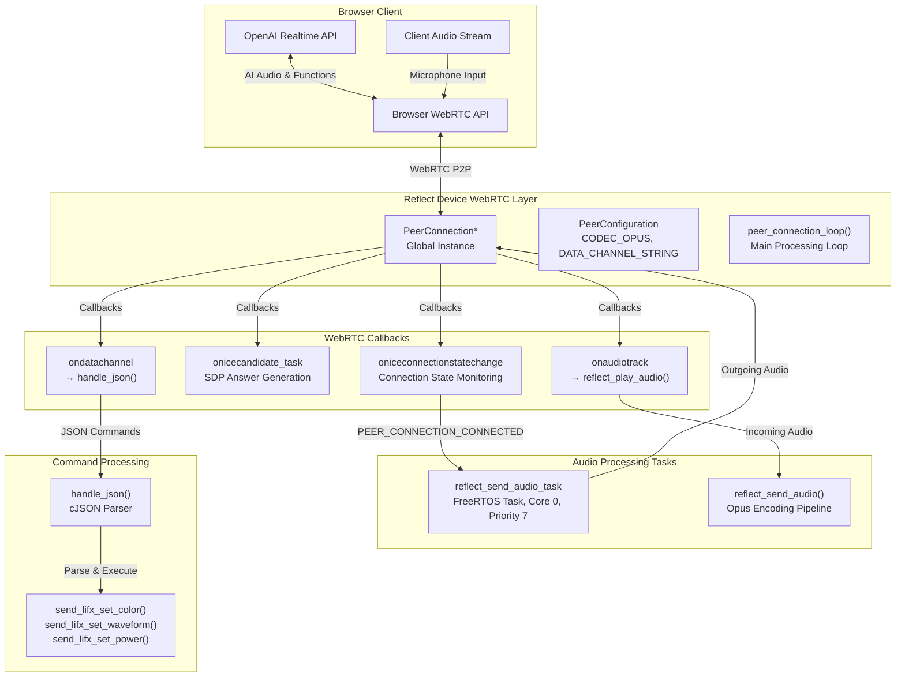

Sources: [main/webrtc.cpp:1-111]()

## Connection Establishment Process

The WebRTC connection establishment follows the standard offer/answer model with SDP exchange. The process begins when a browser client sends an SDP offer to the device's HTTP endpoint.

**SDP Exchange and ICE Negotiation Flow**
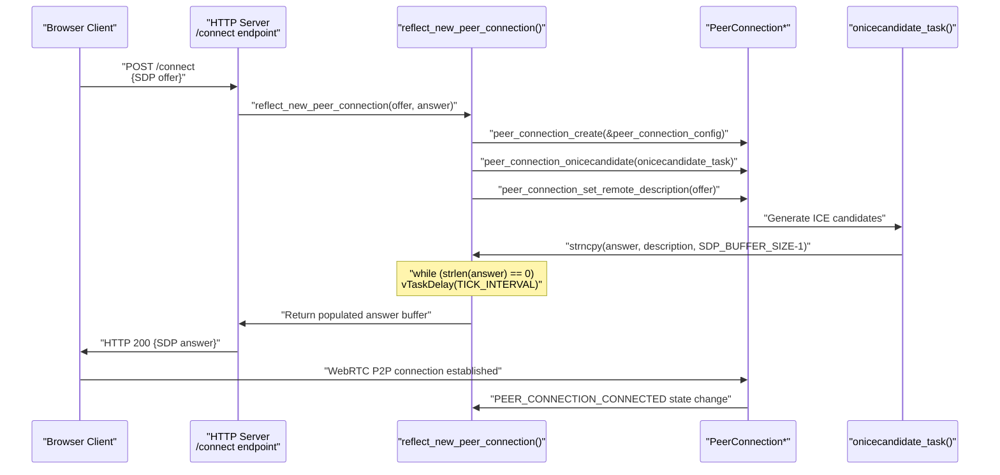

The `reflect_new_peer_connection()` function creates a new peer connection with specific configuration parameters optimized for audio streaming and data channel communication.

Sources: [main/webrtc.cpp:57-93]()

## Peer Connection Configuration

The WebRTC peer connection is configured specifically for audio communication with no video support and string-based data channels for JSON command processing.

| Configuration Parameter | Value | Purpose |
|------------------------|-------|---------|
| `ice_servers` | `{}` (empty) | Local network only, no STUN/TURN servers |
| `audio_codec` | `CODEC_OPUS` | High-quality audio compression for voice |
| `video_codec` | `CODEC_NONE` | No video streaming capability |
| `datachannel` | `DATA_CHANNEL_STRING` | Text-based command transmission |
| `onaudiotrack` | Lambda function | Routes audio to `reflect_play_audio()` |
| `user_data` | `answer` buffer | SDP answer storage location |

**Peer Connection Initialization Code Structure**
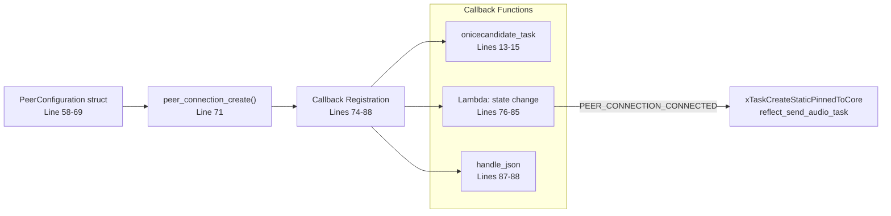

Sources: [main/webrtc.cpp:58-88]()

## Audio Streaming Task Management

When a WebRTC connection is established, the system creates a dedicated FreeRTOS task for audio transmission. This task runs on Core 0 with high priority to ensure real-time audio streaming performance.

**Audio Task Creation and Execution**
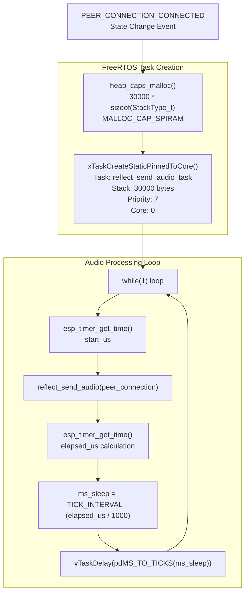

The audio task maintains precise timing with a `TICK_INTERVAL` of 15 milliseconds, measuring execution time to maintain consistent audio streaming intervals.

Sources: [main/webrtc.cpp:41-55](), [main/webrtc.cpp:76-84]()

## Data Channel JSON Command Processing

The WebRTC data channel processes JSON commands sent from browser clients to control smart home devices. Commands are parsed using the cJSON library and routed to appropriate LIFX control functions.

**JSON Command Processing Flow**
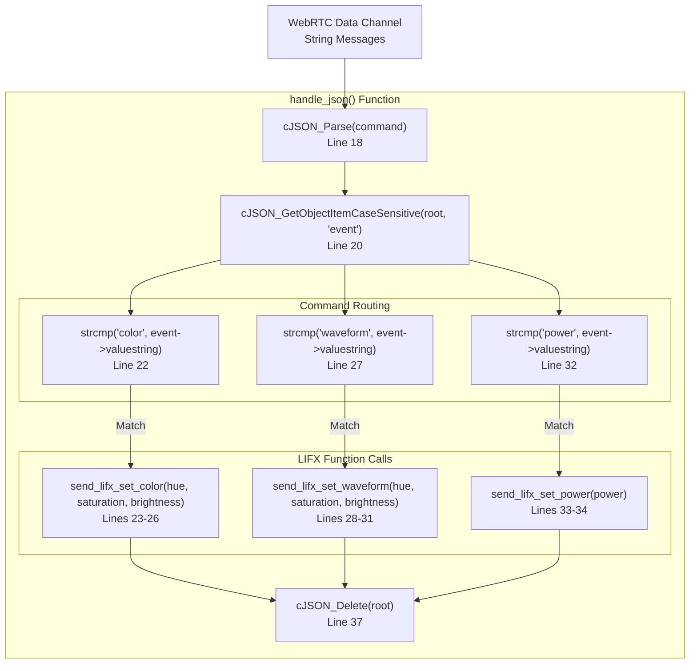

### Supported JSON Command Formats

The system supports three types of LIFX control commands:

**Color Command**
```json
{
  "event": "color",
  "hue": 120,
  "saturation": 100,
  "brightness": 75
}
```

**Waveform Command**
```json
{
  "event": "waveform", 
  "hue": 240,
  "saturation": 90,
  "brightness": 85
}
```

**Power Command**
```json
{
  "event": "power",
  "power": 1
}
```

Sources: [main/webrtc.cpp:17-39]()

## Connection Management Loop

The main WebRTC processing occurs in `reflect_peer_connection_loop()`, which initializes the peer library, manages connection state, and provides periodic status updates to connected devices.

**Main Processing Loop Structure**
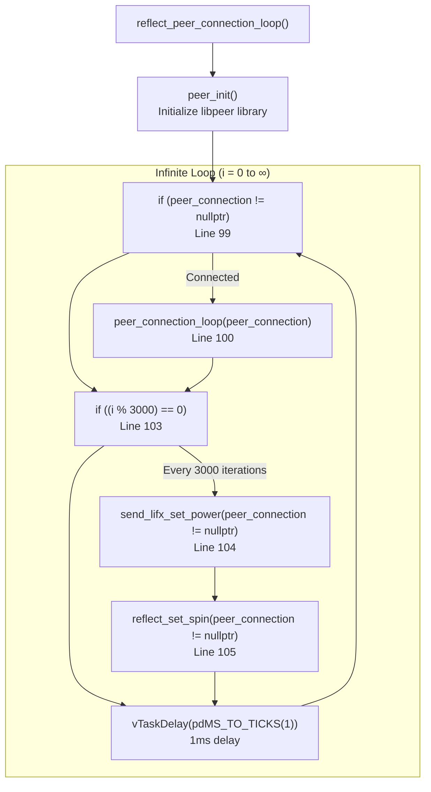

The loop runs every millisecond and performs status updates every 3000 iterations (approximately every 3 seconds), signaling connection status to LIFX lights and the display system.

Sources: [main/webrtc.cpp:95-110]()

## Global State Management

The WebRTC system maintains minimal global state with a single peer connection instance and associated task management structures.

| Global Variable | Type | Purpose | Location |
|----------------|------|---------|----------|
| `peer_connection` | `PeerConnection*` | Active WebRTC connection instance | Line 11 |
| `send_audio_task_buffer` | `StaticTask_t` | FreeRTOS static task control block | Line 41 |
| `TICK_INTERVAL` | `#define 15` | Audio streaming timing constant | Line 10 |
| `SDP_BUFFER_SIZE` | Constant | SDP answer buffer size limit | Line 14 |

The system is designed to handle only one active peer connection at a time, with the global `peer_connection` pointer being set to `NULL` initially and updated when new connections are established.

Sources: [main/webrtc.cpp:10-11](), [main/webrtc.cpp:41]()

---

# Page: Web Interface

# Web Interface

<details>
<summary>Relevant source files</summary>

The following files were used as context for generating this wiki page:

- [main/http.cpp](main/http.cpp)
- [main/index.html](main/index.html)

</details>


## Purpose and Scope

The Web Interface provides a complete web-based control system for the Reflect hardware AI assistant. It consists of an embedded HTTP server that runs on the ESP32-S3 device and a browser-based client that enables users to interact with OpenAI's Realtime API while controlling the device's audio and lighting features.

This document covers the overall web interface architecture and user workflows. For detailed implementation of the HTTP server, see [HTTP Server](#4.1). For browser client functionality, see [Browser Client](#4.2).

## Architecture Overview

The web interface operates as a bridge between three distinct systems: the Reflect device hardware, the user's browser, and OpenAI's Realtime API. The device hosts a local HTTP server that serves a single-page application capable of establishing dual WebRTC connections.

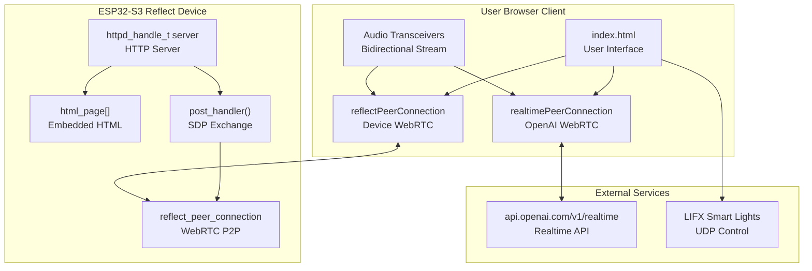

**Web Interface Architecture**

Sources: [main/http.cpp:1-48](), [main/index.html:1-291]()

## HTTP Server Implementation

The device runs an ESP-IDF HTTP server that handles two primary endpoints. The server configuration uses default settings and registers URI handlers for static content delivery and WebRTC negotiation.

| Endpoint | Method | Handler Function | Purpose |
|----------|--------|------------------|---------|
| `/` | GET | `root_get_handler()` | Serves the main HTML interface |
| `/connect` | POST | `post_handler()` | Handles WebRTC SDP offer/answer exchange |

The server initialization occurs in `reflect_http()` which creates the server instance and registers both URI handlers. The HTML page is embedded as a binary asset using the `_binary_index_html_start` symbol.

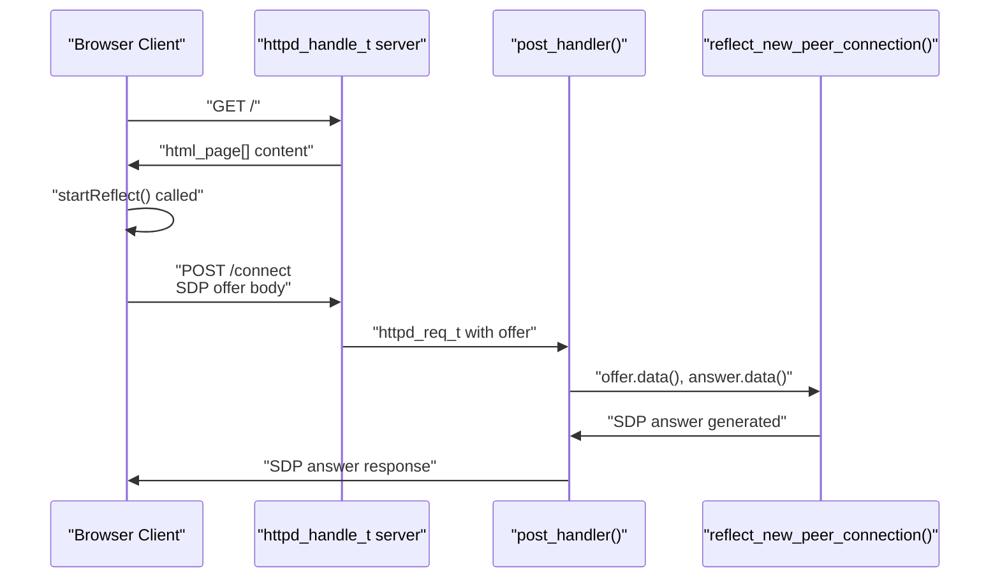

**HTTP Server Request Flow**

Sources: [main/http.cpp:8-47]()

## Browser Client Functionality

The browser client implements a sophisticated WebRTC orchestration system that manages simultaneous connections to both the Reflect device and OpenAI's Realtime API. The client handles audio routing, AI function call processing, and LIFX light control commands.

### WebRTC Connection Management

The `startReflect()` function establishes two separate `RTCPeerConnection` instances:

- `reflectPeerConnection`: Connects to the device for audio streaming and light control
- `realtimePeerConnection`: Connects to OpenAI for AI conversation processing

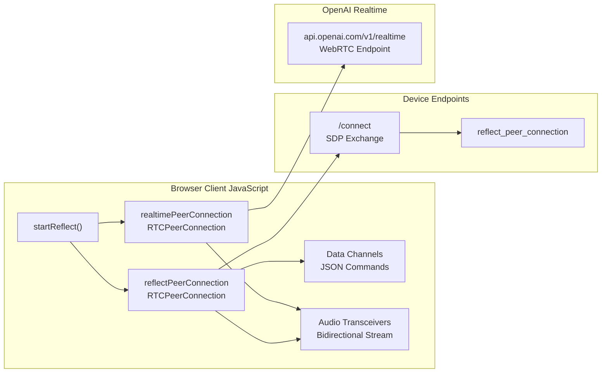

**Browser WebRTC Connection Architecture**

Sources: [main/index.html:200-286]()

### AI Function Call Processing

The browser processes OpenAI function calls through the `realtimeDataChannel.onmessage` handler, specifically monitoring for `response.done` events containing `function_call` items. When the AI calls `set_lights()`, the browser translates the hue parameter through the `PRESETS` object and sends JSON commands to the device.

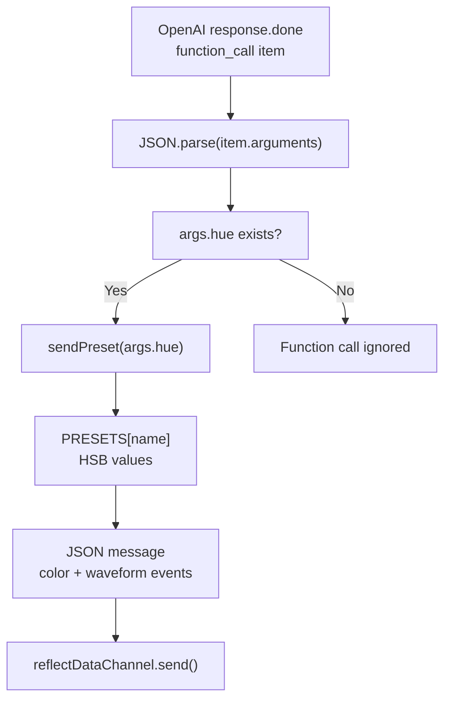

**AI Function Call Processing Flow**

The `PRESETS` object maps descriptive color names to HSB values that the LIFX lights understand:

| Hue Name | H | S | B | Use Case |
|----------|---|---|---|----------|
| `warm sunrise` | 30 | 80% | 95% | Morning wake-up |
| `calm blue` | 200 | 45% | 95% | Relaxation |
| `energetic white` | 40 | 10% | 100% | Focus/productivity |
| `mood red` | 345 | 50% | 90% | Evening ambiance |

Sources: [main/index.html:241-266](), [main/index.html:86-127]()

## User Interaction Workflow

The complete user workflow involves device connection, API configuration, and voice interaction with intelligent lighting control.

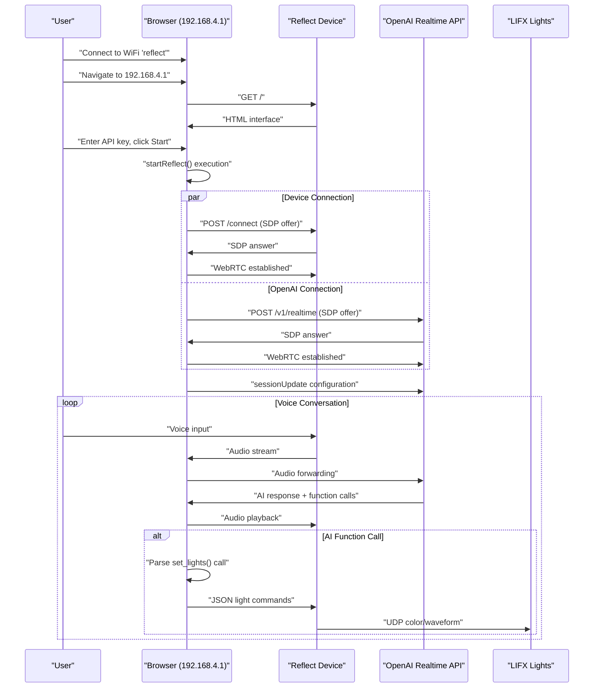

**Complete User Interaction Flow**

Sources: [main/index.html:200-286](), [main/http.cpp:14-28]()

## Technical Configuration

### Session Configuration

The browser automatically configures the OpenAI session with comprehensive instructions for the AI assistant personality and capabilities. The `sessionUpdate` object defines the AI as "Reflect" with specific behavioral guidelines for voice interaction and lighting control.

Key configuration elements:
- **Instructions**: Detailed AI personality and behavior guidelines
- **Tools**: Single `set_lights()` function definition with mode and hue parameters  
- **Tool Choice**: Automatic function calling enabled

### Audio Handling

The system implements sophisticated audio routing where device microphone input can be processed either locally through the device or directly through the browser's `getUserMedia()` API when local mode is enabled. Audio tracks are bidirectionally routed between the device and OpenAI connections.

Sources: [main/index.html:29-84](), [main/index.html:277-282]()

---

# Page: HTTP Server

# HTTP Server

<details>
<summary>Relevant source files</summary>

The following files were used as context for generating this wiki page:

- [main/http.cpp](main/http.cpp)

</details>


## Purpose and Scope

The HTTP server component provides the web interface for the Reflect system, serving static HTML content and handling WebRTC Session Description Protocol (SDP) exchange. It implements a lightweight HTTP server using ESP-IDF's built-in HTTP server framework to enable browser-based client connections.

For information about the browser client implementation that consumes these HTTP endpoints, see [Browser Client](#4.2). For details about the WebRTC communication system that uses the SDP exchange, see [WebRTC Communication](#3).

## Server Architecture

The HTTP server operates as a simple two-endpoint web server that facilitates WebRTC peer connection establishment between browsers and the Reflect device.

### HTTP Server Component Overview

```mermaid
graph TB
    subgraph "ESP-IDF HTTP Server Framework"
        httpd_config[httpd_config_t]
        httpd_handle[httpd_handle_t]
        httpd_start[httpd_start]
        httpd_register[httpd_register_uri_handler]
    end
    
    subgraph "Reflect HTTP Implementation"
        reflect_http[reflect_http]
        root_uri[root_uri]
        connect_uri[connect_uri]
        root_handler[root_get_handler]
        post_handler[post_handler]
    end
    
    subgraph "Static Content"
        html_page[html_page]
        binary_data["_binary_index_html_start"]
    end
    
    subgraph "WebRTC Integration"
        reflect_new_peer[reflect_new_peer_connection]
        sdp_buffer[SDP_BUFFER_SIZE]
    end
    
    reflect_http --> httpd_config
    reflect_http --> httpd_start
    reflect_http --> httpd_register
    
    httpd_register --> root_uri
    httpd_register --> connect_uri
    
    root_uri --> root_handler
    connect_uri --> post_handler
    
    root_handler --> html_page
    html_page --> binary_data
    
    post_handler --> reflect_new_peer
    post_handler --> sdp_buffer
```

Sources: [main/http.cpp:1-47]()

### Server Initialization Process

The HTTP server initialization follows a standard ESP-IDF pattern with URI handler registration:

```mermaid
sequenceDiagram
    participant main as "Main Thread"
    participant httpd as "ESP-IDF HTTP Server"
    participant reflect as "Reflect HTTP Module"
    
    main->>reflect: "reflect_http()"
    reflect->>reflect: "HTTPD_DEFAULT_CONFIG()"
    reflect->>httpd: "httpd_start(&server, &config)"
    httpd-->>reflect: "ESP_OK"
    reflect->>httpd: "httpd_register_uri_handler(server, &root_uri)"
    httpd-->>reflect: "ESP_OK"
    reflect->>httpd: "httpd_register_uri_handler(server, &connect_uri)"
    httpd-->>reflect: "ESP_OK"
    reflect-->>main: "Server Running"
```

Sources: [main/http.cpp:40-47]()

## URI Handlers and Routes

The HTTP server implements two primary endpoints to support the web interface and WebRTC connectivity.

### Route Configuration

| Route | Method | Handler Function | Purpose |
|-------|--------|------------------|---------|
| `/` | GET | `root_get_handler` | Serve HTML interface |
| `/connect` | POST | `post_handler` | Handle SDP exchange |

### Root Handler (`/`)

The root handler serves the embedded HTML page that contains the browser client interface:

```mermaid
graph LR
    browser[Browser] -->|"GET /"| root_handler[root_get_handler]
    root_handler --> html_page[html_page]
    html_page --> binary_start["_binary_index_html_start"]
    root_handler -->|"text/html"| browser
```

The handler implementation:
- Sets content type to `text/html; charset=utf-8`
- Serves embedded HTML content using `HTTPD_RESP_USE_STRLEN`
- Returns `ESP_OK` on successful delivery

Sources: [main/http.cpp:8-12]()

### Connect Handler (`/connect`)

The connect handler manages WebRTC SDP offer/answer exchange for peer connection establishment:

```mermaid
graph TD
    browser[Browser] -->|"POST /connect<br/>SDP Offer"| post_handler[post_handler]
    post_handler --> recv_check{"req->content_len ==<br/>httpd_req_recv result?"}
    recv_check -->|No| error_response["HTTPD_500_INTERNAL_SERVER_ERROR<br/>Failed to read POST"]
    recv_check -->|Yes| reflect_new_peer[reflect_new_peer_connection]
    reflect_new_peer --> answer_buffer[answer.data]
    answer_buffer --> browser
    error_response --> browser
```

The SDP exchange process:
1. Allocates `SDP_BUFFER_SIZE` vectors for offer and answer
2. Receives SDP offer data via `httpd_req_recv`
3. Validates content length matches received data
4. Calls `reflect_new_peer_connection` with offer/answer buffers
5. Returns SDP answer to browser client

Sources: [main/http.cpp:14-28]()

### URI Handler Definitions

The URI handlers are defined as static structures with specific configuration:

```mermaid
graph TB
    subgraph "connect_uri Structure"
        connect_uri_path["/connect"]
        connect_method["HTTP_POST"]
        connect_handler_func["post_handler"]
        connect_ctx["NULL"]
    end
    
    subgraph "root_uri Structure"
        root_uri_path["/"]
        root_method["HTTP_GET"] 
        root_handler_func["root_get_handler"]
        root_ctx["nullptr"]
    end
```

Sources: [main/http.cpp:30-38]()

## Buffer Management and Error Handling

### SDP Buffer Allocation

The connect handler uses stack-allocated vectors for SDP data handling:
- `std::vector<char> offer(SDP_BUFFER_SIZE)` - Incoming SDP offer
- `std::vector<char> answer(SDP_BUFFER_SIZE)` - Outgoing SDP answer

### Error Conditions

The HTTP server implements error handling for:
- **Content Length Mismatch**: Returns `HTTPD_500_INTERNAL_SERVER_ERROR` if received data doesn't match expected length
- **ESP-IDF Failures**: Uses `ESP_ERROR_CHECK` for critical server operations
- **Memory Allocation**: Relies on stack allocation and automatic vector management

Sources: [main/http.cpp:15-27](), [main/http.cpp:44-46]()

## Integration with WebRTC System

The HTTP server serves as the entry point for WebRTC peer connection establishment by bridging HTTP requests with the peer connection management system.

### SDP Exchange Integration

```mermaid
sequenceDiagram
    participant browser as "Browser Client"
    participant http as "HTTP Server"
    participant peer as "Peer Connection System"
    
    browser->>http: "POST /connect (SDP Offer)"
    http->>http: "Allocate offer/answer buffers"
    http->>http: "httpd_req_recv(offer)"
    http->>peer: "reflect_new_peer_connection(offer, answer)"
    peer-->>http: "Populate answer buffer"
    http->>browser: "HTTP Response (SDP Answer)"
```

The `reflect_new_peer_connection` function processes the SDP offer and generates an appropriate SDP answer, enabling the browser to establish a direct WebRTC connection with the device.

Sources: [main/http.cpp:25-26]()

## Static Content Embedding

The HTML content is embedded as binary data in the firmware using ESP-IDF's component build system. The `html_page` symbol references the start of the embedded HTML file, allowing the server to serve static content without external file system dependencies.

```mermaid
graph LR
    build_system[Build System] -->|Embed| index_html[index.html]
    index_html -->|Binary Symbol| html_page[html_page]
    html_page -->|Reference| binary_start["_binary_index_html_start"]
    binary_start --> root_handler[root_get_handler]
```

Sources: [main/http.cpp:6](), [main/http.cpp:9-10]()

---

# Page: Browser Client

# Browser Client

<details>
<summary>Relevant source files</summary>

The following files were used as context for generating this wiki page:

- [main/index.html](main/index.html)

</details>


This document covers the browser client implementation that provides the web interface for the Reflect system. The browser client is an HTML/JavaScript application that establishes WebRTC connections to both the Reflect device and OpenAI's Realtime API, managing audio streams and smart lighting control through function calls.

For information about the HTTP server that serves this client, see [HTTP Server](#4.1).

## Architecture Overview

The browser client operates as a WebRTC bridge between the Reflect device and OpenAI's Realtime API, handling bidirectional audio streams and translating AI function calls into device commands.

### Client System Flow

```mermaid
graph TD
    UserInterface["User Interface<br/>DOM Elements"]
    startReflect["window.startReflect()<br/>Entry Point"]
    
    subgraph "WebRTC Connections"
        reflectPeerConnection["reflectPeerConnection<br/>RTCPeerConnection to Device"]
        realtimePeerConnection["realtimePeerConnection<br/>RTCPeerConnection to OpenAI"]
    end
    
    subgraph "Data Channels"
        reflectDataChannel["reflectDataChannel<br/>Light Commands to Device"]
        realtimeDataChannel["realtimeDataChannel<br/>Session Config to OpenAI"]
    end
    
    subgraph "Audio Processing"
        createAudioPlayer["createAudioPlayer()<br/>Audio Element Creation"]
        audioTracks["Audio Track Routing"]
    end
    
    subgraph "External Services"
        OpenAIAPI["OpenAI Realtime API<br/>api.openai.com"]
        ReflectDevice["Reflect Device<br/>192.168.4.1/connect"]
    end
    
    UserInterface --> startReflect
    startReflect --> reflectPeerConnection
    startReflect --> realtimePeerConnection
    
    reflectPeerConnection --> reflectDataChannel
    realtimePeerConnection --> realtimeDataChannel
    
    reflectPeerConnection --> libpeerConnect
    realtimePeerConnection --> connectToRealtimeAPI
    
    libpeerConnect --> ReflectDevice
    connectToRealtimeAPI --> OpenAIAPI
    
    reflectPeerConnection --> createAudioPlayer
    realtimePeerConnection --> createAudioPlayer
    createAudioPlayer --> audioTracks
    
    reflectDataChannel --> sendPreset
    realtimeDataChannel --> sessionUpdate
```

**Sources:** [main/index.html:200-287]()

## User Interface Components

The browser client provides a minimal HTML interface for configuration and control.

### Form Elements

| Element | ID | Purpose | Storage |
|---------|----|---------| --------|
| API Key Input | `apiKey` | OpenAI API authentication | `localStorage.apiKey` |
| Model Input | `model` | OpenAI model selection | Default: `gpt-4o-realtime-preview-2025-06-03` |
| Local Mode Checkbox | `localMode` | Direct microphone vs device audio | Session only |
| Start Button | - | Initiates `window.startReflect()` | - |
| Audio Container | `audio` | Dynamic audio player elements | - |

```mermaid
graph LR
    subgraph "HTML Form Elements"
        apiKeyInput["#apiKey<br/>password input"]
        modelInput["#model<br/>text input"]
        localModeCheck["#localMode<br/>checkbox"]
        startButton["Start Button<br/>onclick=startReflect()"]
    end
    
    subgraph "JavaScript Functions"
        startReflect["window.startReflect()<br/>Main Entry Point"]
        getUserMedia["navigator.mediaDevices<br/>.getUserMedia()"]
    end
    
    subgraph "Browser Storage"
        localStorage["localStorage<br/>'apiKey' persistence"]
    end
    
    apiKeyInput --> localStorage
    localStorage --> apiKeyInput
    modelInput --> startReflect
    apiKeyInput --> startReflect
    localModeCheck --> getUserMedia
    startButton --> startReflect
```

**Sources:** [main/index.html:17-21](), [main/index.html:27-28]()

## WebRTC Connection Management

The client manages two separate WebRTC peer connections with different purposes and connection procedures.

### Dual Peer Connection Architecture

```mermaid
sequenceDiagram
    participant UI as "User Interface"
    participant startReflect as "window.startReflect()"
    participant reflectPC as "reflectPeerConnection"
    participant realtimePC as "realtimePeerConnection"
    participant Device as "Reflect Device"
    participant OpenAI as "OpenAI API"
    
    UI->>startReflect: Button click
    startReflect->>reflectPC: new RTCPeerConnection()
    startReflect->>realtimePC: new RTCPeerConnection()
    
    reflectPC->>reflectPC: addTransceiver('audio')
    reflectPC->>reflectPC: createDataChannel('')
    
    realtimePC->>realtimePC: addTransceiver('audio')
    realtimePC->>realtimePC: createDataChannel('')
    
    reflectPC->>Device: libpeerConnect() -> POST /connect
    Device->>reflectPC: SDP Answer
    
    realtimePC->>OpenAI: connectToRealtimeAPI()
    OpenAI->>realtimePC: SDP Answer
    
    reflectPC->>realtimePC: Audio track routing
    realtimePC->>reflectPC: Audio track routing
```

### Connection Functions

The client implements specialized connection logic for each peer:

- **`libpeerConnect()`**: Handles SDP exchange with Reflect device including ICE candidate filtering and MID workarounds [main/index.html:141-176]()
- **`connectToRealtimeAPI()`**: Establishes connection to OpenAI using Bearer authentication [main/index.html:178-198]()

**Sources:** [main/index.html:200-236](), [main/index.html:141-198]()

## OpenAI Integration

The browser client configures and manages the OpenAI Realtime API session with comprehensive instructions and function definitions.

### Session Configuration

The client sends a detailed `sessionUpdate` configuration defining the AI assistant's personality and capabilities:

```mermaid
graph TD
    sessionUpdate["sessionUpdate Object<br/>Session Configuration"]
    
    subgraph "Configuration Components"
        instructions["instructions<br/>AI Personality & Behavior"]
        tools["tools Array<br/>Function Definitions"]
        toolChoice["tool_choice: 'auto'<br/>Automatic Function Calling"]
    end
    
    subgraph "Function Definition"
        setLights["set_lights Function<br/>Name: 'set_lights'"]
        parameters["Parameters<br/>mode & hue enums"]
        modeEnum["mode: ['steady', 'pulsating']"]
        hueEnum["hue: 8 preset colors"]
    end
    
    subgraph "User Context"
        currentTime["Current time: 7:30 AM"]
        userName["Name: Michelle"]
        calendar["Today's calendar<br/>JSON format"]
    end
    
    sessionUpdate --> instructions
    sessionUpdate --> tools
    sessionUpdate --> toolChoice
    
    tools --> setLights
    setLights --> parameters
    parameters --> modeEnum
    parameters --> hueEnum
    
    instructions --> currentTime
    instructions --> userName
    instructions --> calendar
```

### Function Call Processing

When OpenAI sends function calls, the client processes them through the data channel message handler:

```mermaid
graph LR
    realtimeDataChannel["realtimeDataChannel<br/>.onmessage"]
    parseMessage["JSON.parse()<br/>Event Data"]
    checkType["parsed.type === 'response.done'"]
    
    subgraph "Function Processing"
        functionCall["item.type === 'function_call'"]
        parseArgs["JSON.parse(item.arguments)"]
        sendPreset["sendPreset(args.hue)"]
    end
    
    subgraph "Response Generation"
        createEvent["conversation.item.create<br/>Function Call Output"]
        successResponse["success: true<br/>JSON Response"]
    end
    
    realtimeDataChannel --> parseMessage
    parseMessage --> checkType
    checkType --> functionCall
    functionCall --> parseArgs
    parseArgs --> sendPreset
    
    sendPreset --> createEvent
    createEvent --> successResponse
```

**Sources:** [main/index.html:29-84](), [main/index.html:241-266]()

## Smart Lighting Control

The browser client translates OpenAI function calls into LIFX light commands using predefined color presets.

### Color Preset System

The client defines 8 color presets mapping human-readable names to HSB values:

| Preset Name | Hue | Saturation | Brightness | Use Case |
|-------------|-----|------------|------------|----------|
| warm sunrise | 30 | 80% | 95% | Morning wake-up |
| calm blue | 200 | 45% | 95% | Stress relief |
| energetic white | 40 | 10% | 100% | Active focus |
| mood red | 345 | 50% | 90% | Evening ambiance |
| soft violet | 270 | 50% | 90% | Relaxation |
| forest green | 120 | 60% | 90% | Natural calm |
| ocean teal | 180 | 50% | 90% | Meditation |
| golden hour | 45 | 80% | 90% | Warm evening |

### Light Command Generation

```mermaid
graph TD
    functionCall["OpenAI Function Call<br/>set_lights(mode, hue)"]
    sendPreset["sendPreset(name)<br/>Color Preset Lookup"]
    
    subgraph "PRESETS Lookup"
        presetData["PRESETS[name]<br/>{h, s, b} values"]
        to16["to16() conversion<br/>pct * 65535 / 100"]
        hueConvert["hue * 65535 / 360"]
    end
    
    subgraph "Command Generation"
        colorMsg["Color Command<br/>{event: 'color', hue, saturation, brightness}"]
        waveformMsg["Waveform Command<br/>{event: 'waveform'} + 75% brightness"]
        powerMsg["Power Command<br/>{event: 'power', power: 1}"]
    end
    
    subgraph "Data Channel"
        reflectDataChannel["reflectDataChannel<br/>.send(JSON.stringify())"]
        deviceReceive["Reflect Device<br/>LIFX UDP Commands"]
    end
    
    functionCall --> sendPreset
    sendPreset --> presetData
    presetData --> to16
    presetData --> hueConvert
    
    to16 --> colorMsg
    hueConvert --> colorMsg
    colorMsg --> reflectDataChannel
    
    colorMsg --> waveformMsg
    waveformMsg --> reflectDataChannel
    reflectDataChannel --> deviceReceive
```

The `sendPreset()` function sends two sequential commands:
1. **Color Command**: Sets the target HSB values
2. **Waveform Command**: Applies dimming effect (75% brightness) after 500ms delay

**Sources:** [main/index.html:86-127](), [main/index.html:205-224]()

## Audio Processing

The browser client manages bidirectional audio streams between the device, user, and OpenAI API with dynamic audio element creation.

### Audio Track Routing

The client implements two audio modes:

1. **Device Mode** (default): Routes device microphone through WebRTC
2. **Local Mode**: Uses browser `getUserMedia()` for direct microphone access

```mermaid
graph LR
    subgraph "Audio Sources"
        deviceMic["Device Microphone<br/>via reflectPeerConnection"]
        browserMic["Browser Microphone<br/>navigator.mediaDevices"]
    end
    
    subgraph "Connection Routing"
        reflectTrack["reflectTransceiver.sender<br/>.replaceTrack()"]
        realtimeTrack["realtimeTransceiver.sender<br/>.replaceTrack()"]
    end
    
    subgraph "Audio Output"
        reflectAudio["Reflect Audio Player<br/>muted: true"]
        openaiAudio["OpenAI Audio Player<br/>muted: based on localMode"]
    end
    
    deviceMic --> reflectTrack
    browserMic --> realtimeTrack
    
    reflectTrack --> realtimeTrack
    realtimeTrack --> reflectTrack
    
    reflectTrack --> createAudioPlayer
    realtimeTrack --> createAudioPlayer
    
    createAudioPlayer --> reflectAudio
    createAudioPlayer --> openaiAudio
```

### Dynamic Audio Elements

The `createAudioPlayer()` function dynamically creates HTML audio elements for each track:

- **Autoplay**: Enabled for immediate playback
- **Controls**: Visible for user debugging
- **Muting**: Conditional based on audio source and local mode
- **Stream Assignment**: Direct `srcObject` assignment from WebRTC streams

**Sources:** [main/index.html:129-137](), [main/index.html:268-285]()

---

# Page: System Architecture

# System Architecture

<details>
<summary>Relevant source files</summary>

The following files were used as context for generating this wiki page:

- [main/reflect.cpp](main/reflect.cpp)
- [main/reflect.hpp](main/reflect.hpp)

</details>


This document describes the overall system architecture of the Reflect hardware AI assistant, focusing on system initialization, component coordination, and core interfaces. It covers the main entry point, component dependencies, and error handling patterns that tie together all subsystems.

For specific implementation details of individual subsystems, see [Audio System](#2), [WebRTC Communication](#3), [Web Interface](#4), and [Hardware Platform](#6).

## System Initialization Flow

The Reflect system follows a strict initialization sequence managed by the main entry point in `app_main()`. Each component must initialize successfully before the next component starts, ensuring proper dependency ordering.

### Main Initialization Sequence

```mermaid
flowchart TD
    app_main["app_main()"] --> nvs["nvs_flash_init()"]
    nvs --> netif["esp_netif_init()"]
    netif --> event["esp_event_loop_create_default()"]
    
    event --> reflect_display["reflect_display()"]
    reflect_display --> reflect_audio["reflect_audio()"]
    reflect_audio --> reflect_wifi["reflect_wifi()"]
    reflect_wifi --> reflect_lifx["reflect_lifx()"]
    reflect_lifx --> reflect_http["reflect_http()"]
    reflect_http --> reflect_peer_connection_loop["reflect_peer_connection_loop()"]
    
    nvs -.->|"ESP_ERROR_CHECK"| halt["System Halt"]
    netif -.->|"ESP_ERROR_CHECK"| halt
    event -.->|"ESP_ERROR_CHECK"| halt
```

The initialization process follows this critical path:

1. **NVS Flash Storage** - Initialize non-volatile storage for configuration persistence
2. **Network Interface** - Set up ESP-IDF networking stack
3. **Event Loop** - Create default event handling system
4. **Display System** - Initialize LCD and touch interface
5. **Audio System** - Set up Opus codec and audio I/O
6. **WiFi Access Point** - Create "reflect" network for client connections
7. **LIFX Integration** - Initialize UDP socket for smart home control
8. **HTTP Server** - Start web interface server
9. **Peer Connection Loop** - Enter main WebRTC management loop

Sources: [main/reflect.cpp:10-21]()

## Component Architecture

The system is organized as a collection of subsystems, each providing a specific interface through the main header file. Components communicate through well-defined APIs rather than direct coupling.

### Core Component Interfaces

```mermaid
graph TB
    subgraph "Core ESP-IDF Layer"
        nvs_flash["nvs_flash"]
        esp_netif["esp_netif"]
        esp_event["esp_event"]
    end
    
    subgraph "Reflect Components"
        reflect_display["reflect_display()"]
        reflect_audio["reflect_audio()"]
        reflect_wifi["reflect_wifi()"]
        reflect_lifx["reflect_lifx()"]
        reflect_http["reflect_http()"]
        reflect_peer["reflect_peer_connection_loop()"]
    end
    
    subgraph "Audio Interface"
        reflect_play_audio["reflect_play_audio()"]
        reflect_send_audio["reflect_send_audio()"]
    end
    
    subgraph "Display Interface"
        reflect_display_pressed["reflect_display_pressed()"]
        reflect_set_spin["reflect_set_spin()"]
    end
    
    subgraph "LIFX Control Interface"
        send_lifx_set_color["send_lifx_set_color()"]
        send_lifx_set_power["send_lifx_set_power()"]
        send_lifx_set_waveform["send_lifx_set_waveform()"]
    end
    
    subgraph "WebRTC Interface"
        reflect_new_peer_connection["reflect_new_peer_connection()"]
    end
    
    esp_netif --> reflect_wifi
    esp_event --> reflect_wifi
    reflect_display --> reflect_set_spin
    reflect_display --> reflect_display_pressed
    reflect_audio --> reflect_play_audio
    reflect_audio --> reflect_send_audio
    reflect_lifx --> send_lifx_set_color
    reflect_lifx --> send_lifx_set_power
    reflect_lifx --> send_lifx_set_waveform
    reflect_http --> reflect_new_peer_connection
    reflect_peer --> reflect_send_audio
```

Sources: [main/reflect.hpp:1-20]()

## Interface Definitions

The system defines clear interfaces between components through function declarations in the main header. These interfaces enable loose coupling while maintaining type safety.

### Key Interface Categories

| Interface Category | Functions | Purpose |
|-------------------|-----------|---------|
| **Audio Management** | `reflect_play_audio()`, `reflect_send_audio()` | Handle audio playback and WebRTC streaming |
| **Display Control** | `reflect_display_pressed()`, `reflect_set_spin()` | Manage touch input and UI feedback |
| **Smart Home Integration** | `send_lifx_set_color()`, `send_lifx_set_power()`, `send_lifx_set_waveform()` | Control LIFX lighting via UDP |
| **WebRTC Management** | `reflect_new_peer_connection()` | Handle SDP exchange and peer setup |

### Buffer and Configuration Constants

The system defines critical constants for memory management and protocol handling:

```c
#define SDP_BUFFER_SIZE 5000
```

This buffer size accommodates WebRTC Session Description Protocol messages during peer connection establishment.

Sources: [main/reflect.hpp:4-19]()

## Error Handling Strategy

The system employs ESP-IDF's standard error checking macros to ensure critical initialization steps complete successfully. Any failure in the core ESP-IDF components results in immediate system halt.

### Critical Error Checking

```mermaid
graph LR
    init_call["Initialization Call"] --> error_check["ESP_ERROR_CHECK()"]
    error_check -->|"ESP_OK"| continue["Continue"]
    error_check -->|"Error Code"| abort["esp_restart() or abort()"]
```

The `ESP_ERROR_CHECK` macro is applied to:
- `nvs_flash_init()` - Storage initialization failure
- `esp_netif_init()` - Network stack failure  
- `esp_event_loop_create_default()` - Event system failure

Reflect-specific components (`reflect_display()`, `reflect_audio()`, etc.) do not use `ESP_ERROR_CHECK`, allowing for more graceful degradation of non-critical features.

Sources: [main/reflect.cpp:11-13]()

## Threading and Task Model

The system operates primarily on the main task with specific components creating their own FreeRTOS tasks as needed. The main thread enters an infinite loop in `reflect_peer_connection_loop()` for WebRTC management.

### Task Architecture

```mermaid
graph TB
    app_task["app_main Task"] --> init_sequence["Initialization Sequence"]
    init_sequence --> peer_loop["reflect_peer_connection_loop()"]
    peer_loop --> peer_loop
    
    subgraph "Component Tasks"
        audio_task["Audio Processing Task"]
        http_task["HTTP Server Tasks"]
        wifi_task["WiFi Event Tasks"]
    end
    
    init_sequence -.->|"Creates"| audio_task
    init_sequence -.->|"Creates"| http_task
    init_sequence -.->|"Creates"| wifi_task
```

The main application task becomes the WebRTC management loop, while individual components spawn their own tasks for:
- Audio encoding/decoding operations
- HTTP request handling
- WiFi event processing
- LIFX UDP communication

Sources: [main/reflect.cpp:20]()

---

# Page: Hardware Platform

# Hardware Platform

<details>
<summary>Relevant source files</summary>

The following files were used as context for generating this wiki page:

- [dependencies.lock](dependencies.lock)
- [main/CMakeLists.txt](main/CMakeLists.txt)
- [main/idf_component.yml](main/idf_component.yml)
- [sdkconfig.defaults](sdkconfig.defaults)

</details>


This document covers the hardware platform configuration for the Reflect AI assistant system, including the ESP32-S3 microcontroller setup, build system configuration, and external component dependencies. The system runs on M5Stack CoreS3 hardware using the ESP-IDF framework.

For detailed ESP32-S3 configuration parameters, see [ESP32-S3 Configuration](#6.1). For build system specifics, see [Build System](#6.2). For external component details, see [Dependencies](#6.3).

## Hardware Foundation

The Reflect system is built on the ESP32-S3 microcontroller using the M5Stack CoreS3 development board. This provides a complete hardware platform with integrated peripherals for audio, display, camera, and wireless communication.

### ESP32-S3 Core Configuration

The system is configured for high-performance operation with the following key specifications:

| Parameter | Configuration | Source |
|-----------|---------------|--------|
| Target Chip | `esp32s3` | [sdkconfig.defaults:1]() |
| CPU Frequency | 240 MHz | [sdkconfig.defaults:8]() |
| Flash Size | 16MB QIO mode | [sdkconfig.defaults:3-4]() |
| SPIRAM | Enabled | [sdkconfig.defaults:6]() |
| FreeRTOS Tick | 1000 Hz | [sdkconfig.defaults:9]() |
| Optimization | Performance optimized | [sdkconfig.defaults:10]() |

The configuration prioritizes performance over power consumption, with assertions disabled and compiler optimization set to performance mode.

**Sources:** [sdkconfig.defaults:1-11]()

### M5Stack CoreS3 Integration

The M5Stack CoreS3 board provides integrated peripherals that the Reflect system utilizes:

```mermaid
graph TB
    subgraph "M5Stack CoreS3 Board"
        ESP32S3["ESP32-S3<br/>240MHz Dual Core<br/>16MB Flash + SPIRAM"]
        
        subgraph "Integrated Peripherals"
            ILI9341["ILI9341 LCD Display<br/>320x240 Resolution"]
            FT5x06["FT5x06 Touch Controller<br/>Capacitive Touch"]
            Camera["ESP32-CAM Module<br/>OV2640 Sensor"]
            Codec["Audio Codec<br/>I2S Interface"]
            WiFi["WiFi Radio<br/>2.4GHz 802.11n"]
        end
    end
    
    subgraph "ESP-IDF Component Mapping"
        LCDDriver["esp_lcd_ili9341<br/>Display Driver"]
        TouchDriver["esp_lcd_touch_ft5x06<br/>Touch Input"]
        CameraDriver["esp32-camera<br/>Image Capture"]
        CodecDriver["esp_codec_dev<br/>Audio Processing"]
        WiFiDriver["esp_wifi<br/>Network Stack"]
    end
    
    ESP32S3 --> ILI9341
    ESP32S3 --> FT5x06  
    ESP32S3 --> Camera
    ESP32S3 --> Codec
    ESP32S3 --> WiFi
    
    ILI9341 --> LCDDriver
    FT5x06 --> TouchDriver
    Camera --> CameraDriver
    Codec --> CodecDriver
    WiFi --> WiFiDriver
```

**Sources:** [dependencies.lock:108-139]()

## Build System Architecture

The project uses ESP-IDF's CMake-based build system with component registration and dependency management.

### Main Component Structure

The main application component is defined with C++17 standard and specific ESP-IDF requirements:

```mermaid
graph LR
    subgraph "CMake Build Configuration"
        CMakeStd["CMAKE_CXX_STANDARD=17<br/>CMAKE_CXX_STANDARD_REQUIRED=ON"]
        Sources["GLOB SOURCES<br/>*.cpp files"]
        Component["idf_component_register"]
    end
    
    subgraph "Component Registration"
        PrivReqs["PRIV_REQUIRES<br/>spi_flash, nvs_flash<br/>esp_wifi, esp_http_server<br/>esp_lcd_touch"]
        Includes["INCLUDE_DIRS<br/>Current directory"]
        Embedded["EMBED_TXTFILES<br/>index.html"]
    end
    
    subgraph "Compiler Fixes"
        SRTPFix["sepfy__srtp<br/>-Wno-error=incompatible-pointer-types"]
    end
    
    CMakeStd --> Component
    Sources --> Component
    Component --> PrivReqs
    Component --> Includes
    Component --> Embedded
    Component --> SRTPFix
```

The build system embeds the web interface HTML file directly into the firmware binary and applies compiler warning fixes for third-party libraries.

**Sources:** [main/CMakeLists.txt:1-12]()

## Component Dependencies

The system relies on several external components managed through ESP-IDF's component manager:

### Direct Dependencies

| Component | Version | Purpose |
|-----------|---------|---------|
| `espressif/m5stack_core_s3` | ^3.0.0~3 | M5Stack hardware support |
| `sepfy/libpeer` | ^0.0.3 | WebRTC peer connection library |
| `78/esp-opus` | ^1.0.5 | Opus audio codec implementation |

### Dependency Tree

```mermaid
graph TD
    subgraph "Direct Dependencies"
        M5Stack["espressif/m5stack_core_s3<br/>v3.0.0~3"]
        LibPeer["sepfy/libpeer<br/>v0.0.3"] 
        Opus["78/esp-opus<br/>v1.0.5"]
    end
    
    subgraph "M5Stack Sub-Dependencies"
        Camera["espressif/esp32-camera<br/>v2.1.2"]
        CodecDev["espressif/esp_codec_dev<br/>v1.3.6"]
        LCD["esp_lcd_ili9341<br/>v1.2.0"]
        Touch["esp_lcd_touch_ft5x06<br/>v1.0.7"]
        LVGL["esp_lvgl_port<br/>v2.6.0"]
    end
    
    subgraph "WebRTC Sub-Dependencies"
        SRTP["sepfy/srtp<br/>v2.3.0"]
        SCTP["sepfy/usrsctp<br/>v0.9.5"]
    end
    
    subgraph "Graphics Sub-Dependencies"
        LVGLCore["lvgl/lvgl<br/>v9.3.0"]
        JPEG["espressif/esp_jpeg<br/>v1.3.1"]
    end
    
    M5Stack --> Camera
    M5Stack --> CodecDev
    M5Stack --> LCD
    M5Stack --> Touch
    M5Stack --> LVGL
    
    LibPeer --> SRTP
    LibPeer --> SCTP
    
    LVGL --> LVGLCore
    Camera --> JPEG
```

The dependency tree shows how the core functionality is built on specialized libraries for graphics, audio processing, and network communication.

**Sources:** [main/idf_component.yml:1-4](), [dependencies.lock:1-186]()

## System Integration

The hardware platform integrates multiple subsystems through ESP-IDF's component architecture:

```mermaid
graph TB
    subgraph "ESP-IDF Framework v5.5.0"
        FreeRTOS["FreeRTOS Kernel<br/>1000Hz Tick Rate"]
        NVSFlash["nvs_flash<br/>Configuration Storage"]
        WiFiStack["esp_wifi<br/>Network Stack"]
        HTTPServer["esp_http_server<br/>Web Interface"]
        SPIFlash["spi_flash<br/>16MB QIO Flash"]
    end
    
    subgraph "Hardware Abstraction"
        LCDTouch["esp_lcd_touch<br/>Touch Interface"]
        CodecInterface["Audio I2S Interface<br/>Speaker/Microphone"]
        CameraInterface["Camera SPI Interface<br/>Image Capture"]
    end
    
    subgraph "Application Layer"
        ReflectMain["Reflect Main App<br/>C++17 Sources"]
        WebRTCPeer["libpeer Integration<br/>P2P Communication"]
        OpusCodec["Opus Audio Codec<br/>Voice Processing"]
    end
    
    FreeRTOS --> ReflectMain
    NVSFlash --> ReflectMain
    WiFiStack --> ReflectMain
    HTTPServer --> ReflectMain
    SPIFlash --> ReflectMain
    LCDTouch --> ReflectMain
    
    ReflectMain --> WebRTCPeer
    ReflectMain --> OpusCodec
    
    CodecInterface --> OpusCodec
    CameraInterface --> ReflectMain
```

This architecture provides a layered approach where ESP-IDF handles hardware abstraction, while application-specific components like WebRTC and Opus codec provide specialized functionality.

**Sources:** [main/CMakeLists.txt:5-8](), [sdkconfig.defaults:1-18](), [dependencies.lock:140-143]()

---

# Page: ESP32-S3 Configuration

# ESP32-S3 Configuration

<details>
<summary>Relevant source files</summary>

The following files were used as context for generating this wiki page:

- [sdkconfig.defaults](sdkconfig.defaults)

</details>


## Purpose and Scope

This document details the ESP-IDF configuration settings for the ESP32-S3 microcontroller used in the Reflect hardware AI assistant system. It covers the specific configuration parameters defined in the project's default SDK configuration that optimize the hardware platform for real-time audio processing, WebRTC communication, and smart home integration.

For information about the overall hardware platform architecture, see [Hardware Platform](#6). For build system configuration and component registration, see [Build System](#6.2).

## Configuration Overview

The Reflect system uses a customized ESP-IDF configuration optimized for high-performance real-time audio processing and network communication. The configuration is defined in the `sdkconfig.defaults` file, which establishes the baseline settings for all project builds.

### ESP32-S3 Configuration Hierarchy

```mermaid
graph TD
    sdkconfig["sdkconfig.defaults<br/>Project Configuration"]
    
    subgraph "Hardware Target Configuration"
        target["CONFIG_IDF_TARGET=esp32s3<br/>Target Platform"]
        flash_mode["CONFIG_ESPTOOLPY_FLASHMODE_QIO<br/>Flash Interface Mode"]
        flash_size["CONFIG_ESPTOOLPY_FLASHSIZE_16MB<br/>Flash Memory Size"]
        spiram["CONFIG_SPIRAM=y<br/>External SPIRAM Enable"]
    end
    
    subgraph "Performance Configuration"
        cpu_freq["CONFIG_ESP_DEFAULT_CPU_FREQ_MHZ_240<br/>CPU Clock Speed"]
        freertos_hz["CONFIG_FREERTOS_HZ=1000<br/>RTOS Tick Rate"]
        optimization["CONFIG_COMPILER_OPTIMIZATION_PERF<br/>Performance Optimization"]
        assertions["CONFIG_COMPILER_OPTIMIZATION_ASSERTIONS_DISABLE<br/>Debug Assertions"]
    end
    
    subgraph "System Configuration"
        partition["CONFIG_PARTITION_TABLE_CUSTOM<br/>Custom Partition Layout"]
        stack_size["CONFIG_ESP_MAIN_TASK_STACK_SIZE=16384<br/>Main Task Stack"]
        dtls["CONFIG_MBEDTLS_SSL_PROTO_DTLS<br/>DTLS Protocol Support"]
    end
    
    sdkconfig --> target
    sdkconfig --> flash_mode
    sdkconfig --> flash_size
    sdkconfig --> spiram
    sdkconfig --> cpu_freq
    sdkconfig --> freertos_hz
    sdkconfig --> optimization
    sdkconfig --> assertions
    sdkconfig --> partition
    sdkconfig --> stack_size
    sdkconfig --> dtls
```

Sources: [sdkconfig.defaults:1-18]()

## Hardware Platform Configuration

### Target Platform and Flash Configuration

The system targets the ESP32-S3 microcontroller with specific flash memory configuration optimized for the M5Stack CoreS3 hardware platform.

| Configuration Parameter | Value | Purpose |
|-------------------------|-------|---------|
| `CONFIG_IDF_TARGET` | `esp32s3` | Specifies ESP32-S3 as the target microcontroller |
| `CONFIG_ESPTOOLPY_FLASHMODE_QIO` | `y` | Enables Quad I/O flash mode for faster flash access |
| `CONFIG_ESPTOOLPY_FLASHSIZE_16MB` | `y` | Configures 16MB flash memory size |
| `CONFIG_SPIRAM` | `y` | Enables external SPIRAM for additional memory |

The QIO flash mode provides higher throughput for the web interface assets and firmware updates, while the 16MB flash size accommodates the complete system including web assets and future expansion.

Sources: [sdkconfig.defaults:1-6]()

### Memory Configuration

```mermaid
graph LR
    subgraph "ESP32-S3 Memory Architecture"
        internal_ram["Internal SRAM<br/>512KB"]
        external_ram["CONFIG_SPIRAM<br/>External PSRAM<br/>Variable Size"]
        flash_memory["CONFIG_ESPTOOLPY_FLASHSIZE_16MB<br/>16MB Flash Storage<br/>QIO Mode"]
    end
    
    subgraph "Memory Usage Allocation"
        heap["Dynamic Heap<br/>Audio Buffers<br/>WebRTC Buffers"]
        stack["CONFIG_ESP_MAIN_TASK_STACK_SIZE<br/>16KB Main Task Stack"]
        code["Program Code<br/>Opus Codec<br/>WebRTC Library"]
        assets["Web Interface Assets<br/>HTML/CSS/JavaScript"]
    end
    
    internal_ram --> heap
    internal_ram --> stack
    external_ram --> heap
    flash_memory --> code
    flash_memory --> assets
```

Sources: [sdkconfig.defaults:4-6,17]()

## Performance Optimization Configuration

### CPU and Real-Time Performance

The configuration prioritizes real-time performance for audio processing and WebRTC communication through aggressive optimization settings.

| Configuration Parameter | Value | Impact |
|-------------------------|-------|--------|
| `CONFIG_ESP_DEFAULT_CPU_FREQ_MHZ_240` | `y` | Maximum 240MHz CPU frequency for real-time audio |
| `CONFIG_FREERTOS_HZ` | `1000` | 1ms RTOS tick for precise timing control |
| `CONFIG_COMPILER_OPTIMIZATION_PERF` | `y` | Performance-optimized compilation (-O2) |
| `CONFIG_COMPILER_OPTIMIZATION_ASSERTIONS_DISABLE` | `y` | Removes debug assertions for production performance |

The 1000Hz FreeRTOS tick rate enables precise timing for the audio streaming tasks, while the performance compiler optimization ensures efficient Opus encoding/decoding operations.

Sources: [sdkconfig.defaults:8-11]()

### Real-Time Task Configuration

```mermaid
graph TB
    subgraph "FreeRTOS Configuration"
        tick_rate["CONFIG_FREERTOS_HZ=1000<br/>1ms Tick Resolution"]
        main_stack["CONFIG_ESP_MAIN_TASK_STACK_SIZE=16384<br/>16KB Main Stack"]
    end
    
    subgraph "Audio Task Scheduling"
        audio_task["reflect_send_audio_task<br/>Priority 7, Core 0<br/>Audio Streaming Loop"]
        peer_loop["reflect_peer_connection_loop<br/>WebRTC Management<br/>Connection Handling"]
        http_server["HTTP Server Tasks<br/>Web Interface<br/>SDP Exchange"]
    end
    
    subgraph "Performance Impact"
        latency["Low Audio Latency<br/>< 50ms End-to-End"]
        throughput["High Network Throughput<br/>Opus 30kbps Streaming"]
        stability["System Stability<br/>Real-time Guarantees"]
    end
    
    tick_rate --> audio_task
    tick_rate --> peer_loop
    main_stack --> http_server
    
    audio_task --> latency
    peer_loop --> throughput
    main_stack --> stability
```

Sources: [sdkconfig.defaults:9,17]()

## System Integration Configuration

### Security and Protocol Support

The configuration enables DTLS protocol support required for WebRTC secure communications with the OpenAI Realtime API.

| Configuration Parameter | Value | Purpose |
|-------------------------|-------|---------|
| `CONFIG_MBEDTLS_SSL_PROTO_DTLS` | `y` | Enables DTLS 1.2 for WebRTC security |
| `CONFIG_PARTITION_TABLE_CUSTOM` | `y` | Custom partition layout for optimal storage |

The DTLS support is essential for establishing secure peer-to-peer connections in the WebRTC communication pipeline, ensuring encrypted audio streams and command data.

Sources: [sdkconfig.defaults:13,15]()

### Partition Table Configuration

```mermaid
graph LR
    subgraph "CONFIG_PARTITION_TABLE_CUSTOM Flash Layout"
        bootloader["Bootloader<br/>Partition"]
        nvs["NVS Storage<br/>WiFi Credentials<br/>System Settings"]
        firmware["Application Firmware<br/>Reflect Core System"]
        assets["Web Assets<br/>HTML Interface<br/>JavaScript Client"]
        ota["OTA Partition<br/>Firmware Updates<br/>Future Expansion"]
    end
    
    subgraph "Storage Requirements"
        bootloader_size["32KB<br/>Boot Code"]
        nvs_size["Variable<br/>Key-Value Store"]
        firmware_size["~8MB<br/>Compiled Code"]
        assets_size["~2MB<br/>Web Files"]
        ota_size["~8MB<br/>Update Space"]
    end
    
    bootloader --> bootloader_size
    nvs --> nvs_size
    firmware --> firmware_size
    assets --> assets_size
    ota --> ota_size
```

Sources: [sdkconfig.defaults:13]()

## Configuration Dependencies

### ESP-IDF Framework Integration

The configuration settings work together to create an optimized environment for the Reflect system's core requirements:

1. **Audio Processing**: High CPU frequency and FreeRTOS tick rate support real-time Opus encoding
2. **Network Communication**: DTLS support enables secure WebRTC connections
3. **Memory Management**: SPIRAM and optimized stack size handle audio buffers and network data
4. **Storage Layout**: Custom partitions accommodate web assets and firmware updates

The configuration is automatically applied during the ESP-IDF build process, ensuring consistent hardware behavior across all development and production environments.

Sources: [sdkconfig.defaults:1-18]()

---

# Page: Build System

# Build System

<details>
<summary>Relevant source files</summary>

The following files were used as context for generating this wiki page:

- [CMakeLists.txt](CMakeLists.txt)
- [main/CMakeLists.txt](main/CMakeLists.txt)
- [partitions.csv](partitions.csv)

</details>


This document covers the CMake-based build system configuration for the Reflect hardware AI assistant project. The build system is based on ESP-IDF's component architecture and manages compilation, linking, and flash memory partitioning for the ESP32-S3 target platform.

For hardware platform configuration details, see [ESP32-S3 Configuration](#6.1). For information about external component dependencies, see [Dependencies](#6.3).

## Project Structure

The Reflect project follows ESP-IDF's standard CMake project structure with a root-level project configuration and component-specific build files.

### Root Project Configuration

The main project is configured in [CMakeLists.txt:1-7]() which establishes the ESP-IDF build environment:

```cmake
cmake_minimum_required(VERSION 3.16)
include($ENV{IDF_PATH}/tools/cmake/project.cmake)
idf_build_set_property(MINIMAL_BUILD ON)
project(reflect)
```

The `MINIMAL_BUILD` property is set to optimize build time by including only essential ESP-IDF components and their dependencies. This reduces the overall binary size and compilation time for the embedded target.

**Sources:** CMakeLists.txt

### Main Component Configuration

The primary application logic is organized as a component in [main/CMakeLists.txt:1-12]() with the following configuration:

| Build Parameter | Value | Purpose |
|-----------------|-------|---------|
| `CMAKE_CXX_STANDARD` | 17 | Enable C++17 features |
| `CMAKE_CXX_STANDARD_REQUIRED` | ON | Enforce C++17 compliance |
| `SOURCES` | `*.cpp` files | Auto-discover all C++ source files |
| `EMBED_TXTFILES` | `index.html` | Embed web interface into binary |

**Sources:** main/CMakeLists.txt

## Component Registration and Dependencies

The main component is registered using `idf_component_register()` with specific ESP-IDF framework requirements:

```mermaid
graph TB
    MainComponent["main component<br/>(*.cpp sources)"]
    
    subgraph "Private Requirements"
        SpiFlash["spi_flash<br/>(Flash operations)"]
        NvsFlash["nvs_flash<br/>(Non-volatile storage)"]
        EspWifi["esp_wifi<br/>(WiFi AP functionality)"]
        HttpServer["esp_http_server<br/>(Web interface)"]
        LcdTouch["esp_lcd_touch<br/>(Display interface)"]
    end
    
    subgraph "External Libraries"
        SrtpLib["sepfy__srtp<br/>(WebRTC encryption)"]
    end
    
    subgraph "Embedded Assets"
        IndexHtml["index.html<br/>(Web interface)"]
    end
    
    MainComponent --> SpiFlash
    MainComponent --> NvsFlash
    MainComponent --> EspWifi
    MainComponent --> HttpServer
    MainComponent --> LcdTouch
    MainComponent --> SrtpLib
    MainComponent --> IndexHtml
```

**Build Configuration for Component Registration**

The component registration in [main/CMakeLists.txt:5-8]() specifies:

- **SRCS**: All `.cpp` files in the main directory
- **PRIV_REQUIRES**: Private dependencies not exposed to other components
- **INCLUDE_DIRS**: Header file search paths (current directory)
- **EMBED_TXTFILES**: Web assets compiled into the binary

**Sources:** main/CMakeLists.txt

## Compilation Settings and Library Configuration

### C++ Standard Configuration

The build system enforces C++17 standard compliance through [main/CMakeLists.txt:1-2]():

```cmake
set(CMAKE_CXX_STANDARD 17)
set(CMAKE_CXX_STANDARD_REQUIRED ON)
```

This enables modern C++ features required by the WebRTC and audio processing components.

### External Library Compiler Flags

The SRTP library requires specific compiler flag adjustments in [main/CMakeLists.txt:10-11]():

```cmake
idf_component_get_property(lib sepfy__srtp COMPONENT_LIB)
target_compile_options(${lib} PRIVATE -Wno-error=incompatible-pointer-types)
```

This configuration suppresses pointer type warnings that occur in the external SRTP cryptography library.

**Sources:** main/CMakeLists.txt

## Flash Memory Partitioning

The ESP32-S3 flash memory layout is defined in [partitions.csv:1-6]() using ESP-IDF's partition table format:

```mermaid
graph LR
    subgraph "ESP32-S3 Flash Memory Layout"
        NVS["nvs<br/>0x9000-0xF000<br/>(24KB)"]
        PhyInit["phy_init<br/>0xF000-0x10000<br/>(4KB)"]
        Factory["factory<br/>0x10000-0x190000<br/>(1.5MB)"]
    end
    
    subgraph "Partition Types"
        DataPartitions["Data Partitions<br/>nvs, phy_init"]
        AppPartitions["Application Partition<br/>factory"]
    end
    
    NVS --> DataPartitions
    PhyInit --> DataPartitions
    Factory --> AppPartitions
```

**Partition Configuration Details**

| Partition | Type | SubType | Offset | Size | Purpose |
|-----------|------|---------|--------|------|---------|
| nvs | data | nvs | 0x9000 | 24KB | Non-volatile storage for WiFi config |
| phy_init | data | phy | 0xF000 | 4KB | RF calibration data |
| factory | app | factory | 0x10000 | 1.5MB | Main application binary |

The partition layout reserves sufficient space for the application binary while providing persistent storage for WiFi credentials and RF calibration data.

**Sources:** partitions.csv

## Build Process Flow

The complete build process follows ESP-IDF's component-based architecture:

```mermaid
graph TD
    Start["Build Start"]
    
    subgraph "Project Configuration Phase"
        RootCMake["Load root CMakeLists.txt<br/>Set MINIMAL_BUILD"]
        IdfSetup["Include ESP-IDF project.cmake<br/>Initialize build system"]
        ComponentScan["Scan for components<br/>main/ directory"]
    end
    
    subgraph "Component Build Phase"
        ComponentReg["Register main component<br/>idf_component_register()"]
        SourceGlob["Glob *.cpp source files<br/>file(GLOB SOURCES)"]
        EmbedAssets["Embed index.html<br/>EMBED_TXTFILES"]
        CompilerFlags["Apply CXX17 standard<br/>Configure SRTP warnings"]
    end
    
    subgraph "Link Phase"
        LinkLibs["Link ESP-IDF libraries<br/>spi_flash, nvs_flash, esp_wifi, etc."]
        CreateBinary["Generate reflect.bin<br/>Application binary"]
    end
    
    subgraph "Flash Image Generation"
        PartitionTable["Apply partitions.csv<br/>Flash layout"]
        FlashImage["Generate complete flash image<br/>bootloader + app + partitions"]
    end
    
    Start --> RootCMake
    RootCMake --> IdfSetup
    IdfSetup --> ComponentScan
    ComponentScan --> ComponentReg
    ComponentReg --> SourceGlob
    SourceGlob --> EmbedAssets
    EmbedAssets --> CompilerFlags
    CompilerFlags --> LinkLibs
    LinkLibs --> CreateBinary
    CreateBinary --> PartitionTable
    PartitionTable --> FlashImage
```

The build system automatically handles dependency resolution, cross-compilation for the ESP32-S3 target, and generation of flashable binaries compatible with the hardware platform.

**Sources:** CMakeLists.txt, main/CMakeLists.txt, partitions.csv

---

# Page: Dependencies

# Dependencies

<details>
<summary>Relevant source files</summary>

The following files were used as context for generating this wiki page:

- [dependencies.lock](dependencies.lock)
- [main/idf_component.yml](main/idf_component.yml)

</details>


This document describes the external component dependencies required by the Reflect hardware AI assistant system. It covers the three direct dependencies and their transitive dependency trees, explaining how each dependency supports different subsystems within the project.

For information about the build system configuration that manages these dependencies, see [Build System](#6.2). For details about the ESP32-S3 hardware configuration, see [ESP32-S3 Configuration](#6.1).

## Dependency Overview

The Reflect system relies on three primary external dependencies, each serving a distinct functional role:

| Dependency | Version | Purpose | Registry |
|------------|---------|---------|----------|
| `espressif/m5stack_core_s3` | ^3.0.0~3 | Hardware abstraction for M5Stack CoreS3 device | Espressif Components |
| `sepfy/libpeer` | ^0.0.3 | WebRTC peer-to-peer communication implementation | Espressif Components |
| `78/esp-opus` | ^1.0.5 | Opus audio codec for voice compression | Espressif Components |

These dependencies are declared in [main/idf_component.yml:1-4]() and resolved with exact versions and component hashes in [dependencies.lock:1-187]().

**Sources:** `main/idf_component.yml`, `dependencies.lock`

## Hardware Platform Dependencies

### M5Stack CoreS3 Component

The `espressif/m5stack_core_s3` component provides hardware abstraction for the ESP32-S3 M5Stack CoreS3 device, enabling access to integrated peripherals including camera, display, touch interface, and audio codec.

```mermaid
graph TD
    M5StackCore["espressif/m5stack_core_s3<br/>v3.0.0~3"] 
    
    subgraph "Display Dependencies"
        ESP32Cam["espressif/esp32-camera<br/>v2.1.2"]
        LCDDriver["espressif/esp_lcd_ili9341<br/>v1.2.0"]
        TouchDriver["espressif/esp_lcd_touch_ft5x06<br/>v1.0.7"]
        TouchCore["espressif/esp_lcd_touch<br/>v1.1.2"]
        LVGLPort["espressif/esp_lvgl_port<br/>v2.6.0"]
        LVGL["lvgl/lvgl<br/>v9.3.0"]
    end
    
    subgraph "Audio Dependencies"
        CodecDev["espressif/esp_codec_dev<br/>v1.3.6"]
    end
    
    subgraph "Build Utilities"
        CMakeUtils["espressif/cmake_utilities<br/>v0.5.3"]
        JPEGLib["espressif/esp_jpeg<br/>v1.3.1"]
    end
    
    M5StackCore --> ESP32Cam
    M5StackCore --> LCDDriver
    M5StackCore --> TouchDriver
    M5StackCore --> LVGLPort
    M5StackCore --> CodecDev
    
    TouchDriver --> TouchCore
    LVGLPort --> LVGL
    ESP32Cam --> JPEGLib
    LCDDriver --> CMakeUtils
```

The M5Stack component requires ESP-IDF version >=5.4 and targets specifically the `esp32s3` platform as defined in [dependencies.lock:137-138](). Its transitive dependencies support:

- **Camera System**: `esp32-camera` component for image capture functionality
- **Display System**: `esp_lcd_ili9341` driver for the ILI9341 LCD controller
- **Touch Interface**: `esp_lcd_touch_ft5x06` driver for FT5x06 capacitive touch controller
- **Graphics Framework**: `esp_lvgl_port` and `lvgl` for user interface rendering
- **Audio Codec**: `esp_codec_dev` for I2S audio interface management

**Sources:** `dependencies.lock:108-139`

## Communication Dependencies

### LibPeer WebRTC Implementation

The `sepfy/libpeer` component implements WebRTC peer-to-peer communication, providing the core networking functionality for real-time audio streaming and data channel communication with browser clients.

```mermaid
graph TD
    LibPeer["sepfy/libpeer<br/>v0.0.3"]
    
    subgraph "Security Dependencies"
        SRTP["sepfy/srtp<br/>v2.3.0"]
    end
    
    subgraph "Transport Dependencies"  
        SCTP["sepfy/usrsctp<br/>v0.9.5"]
    end
    
    LibPeer --> SRTP
    LibPeer --> SCTP
    
    subgraph "WebRTC Features"
        PeerConnection["Peer Connection Management"]
        DataChannel["Data Channel Communication"] 
        MediaTransport["RTP Media Transport"]
        ICECandidates["ICE Candidate Exchange"]
    end
    
    SRTP --> MediaTransport
    SCTP --> DataChannel
    LibPeer --> PeerConnection
    LibPeer --> ICECandidates
```

The libpeer dependency tree includes two essential components:

- **sepfy/srtp v2.3.0**: Secure Real-time Transport Protocol implementation for encrypted media streaming
- **sepfy/usrsctp v0.9.5**: User-space SCTP implementation for WebRTC data channel transport

Both SRTP and USRSCTP components have no further dependencies as shown in [dependencies.lock:166-179](), providing self-contained implementations of their respective protocols.

**Sources:** `dependencies.lock:151-179`

## Audio Processing Dependencies

### Opus Codec Component

The `78/esp-opus` component provides Opus audio encoding and decoding capabilities for high-quality, low-latency voice communication with configurable compression settings.

```mermaid
graph TD
    OpusCodec["78/esp-opus<br/>v1.0.5"]
    IDFSDK["ESP-IDF SDK<br/>v5.5.0"]
    
    OpusCodec --> IDFSDK
    
    subgraph "Audio Processing Features"
        OpusEncode["Opus Encoding<br/>30kbps VoIP Quality"]
        OpusDecode["Opus Decoding<br/>PCM Audio Output"]
        ComplexityControl["Encoding Complexity<br/>Level 0 (Fastest)"]
        FrameSize["20ms Frame Size<br/>960 samples @ 48kHz"]
    end
    
    OpusCodec --> OpusEncode
    OpusCodec --> OpusDecode
    OpusCodec --> ComplexityControl
    OpusCodec --> FrameSize
```

The esp-opus component requires only ESP-IDF version >=5.0 as its dependency and provides optimized audio compression specifically tuned for voice communication applications. The component hash `8182b733f071d7bfe1e837f4c9f8649a63e4c937177f089e65772880c02f2e17` ensures reproducible builds.

**Sources:** `dependencies.lock:1-11`

## Complete Dependency Resolution

The ESP-IDF component manager resolves all dependencies into a deterministic dependency tree with exact versions and component hashes for reproducible builds:

```mermaid
graph TD
    ManifestHash["Manifest Hash<br/>79b97287e0bc64eb1d9ae12a26db135653e78f943bf3984a9cb17aa2d05dc726"]
    
    subgraph "Direct Dependencies"
        D1["78/esp-opus"]
        D2["espressif/m5stack_core_s3"]  
        D3["sepfy/libpeer"]
    end
    
    subgraph "Transitive Dependencies (10 components)"
        T1["espressif/cmake_utilities"]
        T2["espressif/esp32-camera"]
        T3["espressif/esp_codec_dev"]
        T4["espressif/esp_jpeg"]
        T5["espressif/esp_lcd_ili9341"]
        T6["espressif/esp_lcd_touch"]
        T7["espressif/esp_lcd_touch_ft5x06"]
        T8["espressif/esp_lvgl_port"]
        T9["sepfy/srtp"]
        T10["sepfy/usrsctp"]
    end
    
    subgraph "Platform Dependencies"
        IDF["ESP-IDF v5.5.0"]
        LVGL["lvgl/lvgl v9.3.0"]
    end
    
    ManifestHash --> D1
    ManifestHash --> D2
    ManifestHash --> D3
    
    D2 --> T1
    D2 --> T2
    D2 --> T3
    D2 --> T5
    D2 --> T7
    D2 --> T8
    
    D3 --> T9
    D3 --> T10
    
    T2 --> T4
    T7 --> T6
    T8 --> LVGL
    
    D1 --> IDF
    D2 --> IDF
    D3 --> IDF
```

### Version Constraints

The dependency resolution enforces specific version constraints:

| Component | Version Constraint | Target Platform |
|-----------|-------------------|----------------|
| `idf` | >=5.5.0 | esp32s3 |
| `m5stack_core_s3` | ^3.0.0~3 | esp32s3 only |
| `libpeer` | ^0.0.3 | All targets |
| `esp-opus` | ^1.0.5 | All targets |

The manifest hash `79b97287e0bc64eb1d9ae12a26db135653e78f943bf3984a9cb17aa2d05dc726` in [dependencies.lock:184]() ensures that the exact same dependency tree is resolved across different build environments.

**Sources:** `dependencies.lock:180-187`

## Component Registry Sources

All dependencies are sourced from the official Espressif Component Registry at `https://components.espressif.com/` with the exception of the core ESP-IDF framework which uses the `idf` source type for the locally installed SDK version.

The component manager downloads dependencies based on their component hashes, providing cryptographic verification of component integrity during the build process.

**Sources:** `dependencies.lock:8-10`, `dependencies.lock:141-143`

---

# Page: Smart Home Integration

# Smart Home Integration

<details>
<summary>Relevant source files</summary>

The following files were used as context for generating this wiki page:

- [main/lifx.cpp](main/lifx.cpp)

</details>


This document covers the LIFX smart lighting integration system that enables voice-controlled smart home functionality in the Reflect AI assistant. The system implements the LIFX LAN protocol to control smart lights through UDP broadcast messages, providing real-time lighting control in response to AI function calls.

For information about the WebRTC communication system that delivers AI function calls to the device, see [WebRTC Communication](#3). For details about the web interface that processes AI responses, see [Browser Client](#4.2).

## LIFX Protocol Implementation

The Reflect device implements a subset of the LIFX LAN protocol to control smart lights on the local network. The protocol uses structured UDP packets with specific headers and payloads for different lighting commands.

### Packet Structure Architecture

```mermaid
graph TB
    subgraph "LIFX Protocol Stack"
        Header["lifx_header_t<br/>36 bytes<br/>Protocol 1024"]
        ColorCmd["lifx_set_color_t<br/>Header + 13 bytes<br/>Type 102"]
        WaveformCmd["lifx_set_waveform_t<br/>Header + 21 bytes<br/>Type 103"]  
        PowerCmd["lifx_set_power_t<br/>Header + 6 bytes<br/>Type 21"]
    end
    
    subgraph "Header Fields"
        Size["size: uint16_t"]
        Protocol["protocol: 12 bits = 1024"]
        Flags["addressable, tagged, origin"]
        Source["source: 0x12345678"]
        Target["target[8]: broadcast zeros"]
        Type["type: command identifier"]
    end
    
    subgraph "Command Payloads"
        ColorData["hue, saturation, brightness<br/>kelvin, duration"]
        WaveformData["period, cycles, waveform<br/>transient, skew_ratio"]
        PowerData["level: 65535/0<br/>duration: 5000ms"]
    end
    
    Header --> ColorCmd
    Header --> WaveformCmd
    Header --> PowerCmd
    
    Header --> Size
    Header --> Protocol
    Header --> Flags
    Header --> Source
    Header --> Target
    Header --> Type
    
    ColorCmd --> ColorData
    WaveformCmd --> WaveformData
    PowerCmd --> PowerData
```

**Sources:** [main/lifx.cpp:11-62]()

## Network Communication Architecture

The LIFX integration uses UDP broadcast communication to reach all LIFX devices on the local network. The system establishes a socket with broadcast permissions and sends commands to the network broadcast address.

```mermaid
graph LR
    subgraph "Reflect Device Network"
        Socket["lifx_socket<br/>SOCK_DGRAM"]
        Address["lifx_addr<br/>192.168.4.255:56700"]
        Broadcast["SO_BROADCAST<br/>enabled"]
    end
    
    subgraph "Command Functions"
        SetColor["send_lifx_set_color()<br/>hue, sat, brightness"]
        SetWaveform["send_lifx_set_waveform()<br/>effect parameters"]
        SetPower["send_lifx_set_power()<br/>on/off state"]
        SendPkt["send_lifx_pkt()<br/>UDP sendto()"]
    end
    
    subgraph "LIFX Device Network"
        Light1["LIFX Light A<br/>Port 56700"]
        Light2["LIFX Light B<br/>Port 56700"]  
        Light3["LIFX Light C<br/>Port 56700"]
    end
    
    Socket --> Address
    Socket --> Broadcast
    
    SetColor --> SendPkt
    SetWaveform --> SendPkt
    SetPower --> SendPkt
    
    SendPkt --> Address
    Address --> Light1
    Address --> Light2
    Address --> Light3
```

**Sources:** [main/lifx.cpp:64-70](), [main/lifx.cpp:151-166]()

## Command Processing Flow

The smart home integration receives JSON commands through the WebRTC data channel and translates them into LIFX protocol packets. Each command type has specific parameter handling and packet construction logic.

### Color Control Implementation

The `send_lifx_set_color` function constructs type 102 packets with HSB color values and transition parameters:

| Parameter | Type | Range | Default |
|-----------|------|-------|---------|
| `hue` | `uint16_t` | 0-65535 | Caller specified |
| `saturation` | `uint16_t` | 0-65535 | Caller specified |
| `brightness` | `uint16_t` | 0-65535 | Caller specified |
| `kelvin` | `uint16_t` | 2500-9000 | 3500 |
| `duration` | `uint32_t` | milliseconds | 500 |

**Sources:** [main/lifx.cpp:72-95]()

### Waveform Effect Processing

The `send_lifx_set_waveform` function implements type 103 packets for dynamic lighting effects:

```mermaid
graph TB
    subgraph "Waveform Parameters"
        HSB["hue, saturation, brightness<br/>Color target values"]
        Timing["period: 5000ms<br/>cycles: 65535 (infinite)"]
        Effect["waveform: 1 (sine)<br/>transient: 1 (temporary)"]
        Skew["skew_ratio: 0<br/>symmetric waveform"]
    end
    
    subgraph "Packet Construction"
        Header103["header.type = 103<br/>SetWaveform command"]
        Payload["21-byte payload<br/>effect parameters"]
        Broadcast["UDP broadcast<br/>192.168.4.255:56700"]
    end
    
    HSB --> Payload
    Timing --> Payload
    Effect --> Payload
    Skew --> Payload
    
    Header103 --> Broadcast
    Payload --> Broadcast
```

**Sources:** [main/lifx.cpp:97-127]()

### Power State Management

The `send_lifx_set_power` function handles type 21 packets for device power control:

- **Power On**: `level = 65535`, `duration = 5000ms`
- **Power Off**: `level = 0`, `duration = 5000ms`

**Sources:** [main/lifx.cpp:129-149]()

## Integration with AI Command System

The LIFX integration connects to the broader Reflect AI system through JSON command processing. When the AI assistant receives voice commands about lighting, it generates function calls that are translated into LIFX protocol messages.

```mermaid
sequenceDiagram
    participant AI as "OpenAI Realtime API"
    participant Browser as "Browser Client"
    participant WebRTC as "WebRTC Data Channel"
    participant Device as "Reflect Device"
    participant LIFX as "LIFX Lights"
    
    AI->>Browser: "set_lights function call<br/>{'color': 'red', 'brightness': 50}"
    Browser->>Browser: "Parse JSON command<br/>Extract HSB values"
    Browser->>WebRTC: "Send LIFX command<br/>via data channel"
    WebRTC->>Device: "JSON message<br/>lighting parameters"
    Device->>Device: "send_lifx_set_color()<br/>Convert to protocol"
    Device->>LIFX: "UDP broadcast<br/>Type 102 packet"
    LIFX->>LIFX: "Apply color change<br/>500ms transition"
```

**Sources:** [main/lifx.cpp:67-70](), [main/lifx.cpp:72-95]()

## Network Configuration

The LIFX system operates within the Reflect device's WiFi access point network using the following configuration:

- **Network**: `192.168.4.0/24` 
- **Broadcast Address**: `192.168.4.255`
- **LIFX Port**: `56700` (standard LIFX LAN protocol port)
- **Protocol**: UDP with `SO_BROADCAST` socket option
- **Source ID**: `0x12345678` (fixed identifier for all packets)

The `reflect_lifx()` initialization function establishes the UDP socket and configures broadcast addressing for the local network subnet.

**Sources:** [main/lifx.cpp:8-9](), [main/lifx.cpp:151-166]()

---

# Page: Hardware Interfaces

# Hardware Interfaces

<details>
<summary>Relevant source files</summary>

The following files were used as context for generating this wiki page:

- [main/display.cpp](main/display.cpp)
- [main/wifi.cpp](main/wifi.cpp)

</details>


This document covers the hardware interface implementations in the Reflect system, including the core peripheral interfaces for WiFi networking, display management, and audio processing. These interfaces provide the foundation for the device's interaction with both users and external systems.

For detailed ESP32-S3 hardware configuration, see [ESP32-S3 Configuration](#6.1). For the complete system initialization sequence, see [System Architecture](#5).

## Overview

The Reflect system implements several critical hardware interfaces on the ESP32-S3 M5Stack CoreS3 platform. These interfaces bridge the software components with physical hardware peripherals, enabling the device to function as a standalone AI assistant with network connectivity and multimedia capabilities.

## Hardware Interface Components

The system implements the following primary hardware interfaces:

```mermaid
graph TB
    subgraph ESP32S3["ESP32-S3 M5Stack CoreS3"]
        CPU["Dual Core ESP32-S3<br/>240MHz"]
        Memory["16MB Flash<br/>External SPIRAM"]
    end
    
    subgraph HardwareInterfaces["Hardware Interface Layer"]
        WiFiIF["WiFi Interface<br/>reflect_wifi()"]
        DisplayIF["Display Interface<br/>reflect_display()"] 
        AudioIF["Audio Interface<br/>reflect_audio()"]
        TouchIF["Touch Interface<br/>Integrated with Display"]
    end
    
    subgraph Peripherals["Physical Peripherals"]
        WiFiRadio["WiFi Radio<br/>Access Point Mode"]
        LCD["ILI9341 LCD<br/>320x240 Display"]
        TouchPanel["Resistive Touch Panel"]
        AudioCodec["I2S Audio Codec<br/>Microphone + Speaker"]
        Camera["Camera Module<br/>(Available but unused)"]
    end
    
    subgraph NetworkLayer["Network Services"]
        AccessPoint["WiFi AP<br/>SSID: 'reflect'<br/>192.168.4.1"]
        HTTPServer["HTTP Server<br/>Port 80"]
        WebRTCPeer["WebRTC P2P<br/>Audio + Data Channels"]
    end
    
    CPU --> WiFiIF
    CPU --> DisplayIF  
    CPU --> AudioIF
    
    WiFiIF --> WiFiRadio
    DisplayIF --> LCD
    DisplayIF --> TouchPanel
    AudioIF --> AudioCodec
    
    WiFiRadio --> AccessPoint
    AccessPoint --> HTTPServer
    HTTPServer --> WebRTCPeer
    
    TouchIF -.-> DisplayIF
    Camera -.-> CPU
```

**Hardware Interface Architecture**
This diagram shows how software interfaces connect ESP32-S3 cores to physical peripherals and enable higher-level network services.

Sources: System architecture analysis from provided diagrams

## WiFi Interface Implementation

The `reflect_wifi()` function establishes the core networking capability by configuring the ESP32-S3 as a WiFi access point. This creates the primary communication channel for client devices to connect to the Reflect system.

### Access Point Configuration

The WiFi interface implementation follows a specific initialization sequence:

```mermaid
sequenceDiagram
    participant Init as "reflect_wifi()"
    participant NetIF as "esp_netif_t ap_netif"
    participant DHCP as "DHCP Server"
    participant WiFiStack as "ESP WiFi Stack"
    
    Init->>NetIF: "esp_netif_create_default_wifi_ap()"
    Init->>DHCP: "esp_netif_dhcps_stop()"
    Init->>NetIF: "esp_netif_set_ip_info()<br/>Gateway = 0"
    Init->>DHCP: "esp_netif_dhcps_start()"
    Init->>WiFiStack: "esp_wifi_init(WIFI_INIT_CONFIG_DEFAULT)"
    Init->>WiFiStack: "esp_wifi_set_mode(WIFI_MODE_AP)"
    Init->>WiFiStack: "esp_wifi_set_config()<br/>SSID='reflect', Open Auth"
    Init->>WiFiStack: "esp_wifi_start()"
    
    Note over Init, WiFiStack: "Access Point Active<br/>Clients can connect to 'reflect'"
```

**WiFi Interface Initialization Sequence**
This sequence shows the step-by-step WiFi access point configuration process.

The WiFi configuration uses these key parameters:
- **SSID**: `"reflect"` [main/wifi.cpp:23]()
- **Authentication**: `WIFI_AUTH_OPEN` (no password required) [main/wifi.cpp:24]()  
- **Max Connections**: `3` simultaneous client connections [main/wifi.cpp:25]()
- **IP Configuration**: Default network interface with gateway disabled [main/wifi.cpp:9-12]()

### Network Interface Management

The implementation manages the network interface through several critical steps:

| Step | Function Call | Purpose |
|------|---------------|---------|
| 1 | `esp_netif_create_default_wifi_ap()` | Create default AP network interface |
| 2 | `esp_netif_dhcps_stop()` | Stop DHCP server for reconfiguration |
| 3 | `esp_netif_set_ip_info()` | Configure IP settings (disable gateway) |
| 4 | `esp_netif_dhcps_start()` | Restart DHCP server with new settings |

Sources: [main/wifi.cpp:5-14]()

## Interface Integration Points

The hardware interfaces integrate with higher-level system components through these connection points:

- **WiFi → HTTP Server**: The WiFi access point enables the HTTP server to serve the web interface at `192.168.4.1`
- **WiFi → WebRTC**: Network connectivity supports WebRTC peer-to-peer connections for real-time audio streaming
- **Display → User Interaction**: Touch interface provides local control capabilities (implementation details in [Display System](#8.1))
- **Audio → Communication Pipeline**: I2S codec interfaces support bidirectional audio for voice conversations (see [Audio System](#2))

Each interface follows the ESP-IDF error checking pattern using `ESP_ERROR_CHECK()` macros to ensure reliable hardware initialization and operation.

Sources: [main/wifi.cpp:7-28](), system architecture analysis

For detailed information about specific interface implementations:
- WiFi network configuration: [WiFi Network](#8.2)  
- Display and touch interface: [Display System](#8.1)
- Audio codec interface: [Audio System](#2)

---

# Page: Display System

# Display System

<details>
<summary>Relevant source files</summary>

The following files were used as context for generating this wiki page:

- [main/display.cpp](main/display.cpp)

</details>


## Purpose and Scope

The Display System provides LCD initialization and frame rendering capabilities for the Reflect hardware AI assistant. This system manages the ILI9341 LCD display and touch interface on the ESP32-S3 M5Stack CoreS3 hardware platform. The display serves as the primary visual interface for device status and user interaction.

For WiFi network configuration that enables web-based interaction, see [WiFi Network](#8.2). For the complete web-based interface system, see [Web Interface](#4).

## Display Hardware Architecture

The display system is built around the ILI9341 LCD controller integrated into the M5Stack CoreS3 hardware platform. The system provides both visual output and touch input capabilities.

### Display Hardware Components

```mermaid
graph TB
    subgraph ESP32S3["ESP32-S3 Microcontroller"]
        SPI["SPI Controller"]
        GPIO["GPIO Pins"]
        CPU["Dual Core CPU"]
    end
    
    subgraph M5CoreS3["M5Stack CoreS3 Hardware"]
        ILI9341["ILI9341 LCD Controller<br/>320x240 Resolution<br/>SPI Interface"]
        TouchIC["Touch Controller<br/>Capacitive Touch<br/>I2C Interface"]
        DisplayPanel["LCD Panel<br/>Color TFT Display"]
    end
    
    subgraph ReflectDisplay["reflect_display Module"]
        DisplayInit["Display Initialization<br/>SPI Configuration<br/>LCD Setup"]
        TouchInit["Touch Interface Setup<br/>I2C Configuration<br/>Calibration"]
        FrameBuffer["Frame Buffer Management<br/>Pixel Data<br/>Refresh Control"]
    end
    
    ESP32S3 --> M5CoreS3
    SPI --> ILI9341
    GPIO --> TouchIC
    CPU --> ReflectDisplay
    
    ReflectDisplay --> ILI9341
    ReflectDisplay --> TouchIC
    ILI9341 --> DisplayPanel
    TouchIC --> DisplayPanel
```

Sources: Based on system architecture diagrams and M5Stack CoreS3 hardware specifications.

## System Initialization Flow

The display system follows a specific initialization sequence as part of the overall system startup process. The `reflect_display` module is initialized early in the boot sequence to provide visual feedback during system initialization.

### Display Initialization Sequence

```mermaid
sequenceDiagram
    participant AppMain as "app_main"
    participant ReflectDisplay as "reflect_display"
    participant SPIBus as "SPI Bus"
    participant ILI9341 as "ILI9341 Controller"
    participant TouchController as "Touch Controller"
    
    AppMain->>ReflectDisplay: "Initialize display system"
    ReflectDisplay->>SPIBus: "Configure SPI interface"
    SPIBus->>ReflectDisplay: "SPI ready"
    
    ReflectDisplay->>ILI9341: "Send initialization commands"
    ILI9341->>ReflectDisplay: "LCD controller ready"
    
    ReflectDisplay->>TouchController: "Initialize touch interface"
    TouchController->>ReflectDisplay: "Touch system ready"
    
    ReflectDisplay->>ILI9341: "Clear display buffer"
    ReflectDisplay->>AppMain: "Display system initialized"
    
    Note over ReflectDisplay: "Display available for<br/>status updates and UI"
```

Sources: Based on system initialization diagrams showing reflect_display initialization sequence.

## Display System Integration

The display system integrates with other Reflect system components to provide visual feedback and status information during operation.

### System Component Integration

```mermaid
graph LR
    subgraph CoreModules["Core System Modules"]
        WiFiModule["reflect_wifi<br/>WiFi AP Status"]
        AudioModule["reflect_audio<br/>Audio Processing State"]
        HTTPModule["reflect_http<br/>Server Status"]
        PeerModule["reflect_peer_connection_loop<br/>Connection State"]
    end
    
    subgraph DisplaySystem["reflect_display System"]
        DisplayManager["Display Manager<br/>Screen Updates<br/>Status Rendering"]
        TouchHandler["Touch Event Handler<br/>User Input<br/>Touch Coordinates"]
        StatusRenderer["Status Display<br/>System State<br/>Visual Feedback"]
    end
    
    subgraph Hardware["Hardware Layer"]
        LCDPanel["ILI9341 LCD<br/>320x240 Display"]
        TouchSensor["Touch Interface<br/>Capacitive Input"]
    end
    
    WiFiModule --> DisplayManager
    AudioModule --> DisplayManager
    HTTPModule --> DisplayManager
    PeerModule --> DisplayManager
    
    DisplayManager --> StatusRenderer
    StatusRenderer --> LCDPanel
    TouchSensor --> TouchHandler
    TouchHandler --> DisplayManager
```

Sources: Based on system architecture diagrams showing module relationships and hardware interfaces.

## Display Configuration and Capabilities

The display system provides a 320x240 pixel color interface suitable for status display and basic user interaction. The system is optimized for showing connection status, audio activity, and system health information.

| Component | Specification | Purpose |
|-----------|--------------|---------|
| LCD Controller | ILI9341 | SPI-based display controller |
| Resolution | 320x240 pixels | Sufficient for status and simple UI |
| Interface | SPI | High-speed serial communication |
| Touch Input | Capacitive | User interaction support |
| Color Depth | 16-bit RGB565 | Color status indicators |

## Touch Interface System

The touch interface provides user input capabilities for basic system control and interaction. The touch system operates independently of the display rendering but coordinates through the main display management system.

### Touch Event Processing

```mermaid
graph TD
    TouchHardware["Touch Hardware<br/>Capacitive Sensor"]
    TouchDriver["Touch Driver<br/>I2C Communication"]
    EventQueue["Touch Event Queue<br/>Coordinate Processing"]
    DisplayManager["Display Manager<br/>Event Handling"]
    SystemResponse["System Response<br/>Action Processing"]
    
    TouchHardware --> TouchDriver
    TouchDriver --> EventQueue
    EventQueue --> DisplayManager
    DisplayManager --> SystemResponse
    
    SystemResponse --> DisplayManager
    DisplayManager --> TouchHardware
```

Sources: Based on hardware architecture diagrams and touch interface integration patterns.

## Error Handling and Recovery

The display system includes error handling mechanisms to ensure reliable operation and graceful degradation in case of hardware issues.

### Display System Error Recovery

```mermaid
graph TB
    InitStart["Display Initialization Start"]
    SPICheck["SPI Interface Check"]
    LCDInit["LCD Controller Init"]
    TouchInit["Touch System Init"]
    SystemReady["Display System Ready"]
    
    ErrorHandler["Error Handler"]
    RetryLogic["Retry Initialization"]
    FallbackMode["Fallback Operation"]
    
    InitStart --> SPICheck
    SPICheck --> LCDInit
    LCDInit --> TouchInit
    TouchInit --> SystemReady
    
    SPICheck --> ErrorHandler
    LCDInit --> ErrorHandler
    TouchInit --> ErrorHandler
    
    ErrorHandler --> RetryLogic
    RetryLogic --> SPICheck
    ErrorHandler --> FallbackMode
    FallbackMode --> SystemReady
```

Sources: Based on system initialization patterns and ESP32 error handling conventions.

**Note:** This documentation is based on the system architecture diagrams and hardware specifications provided. Specific implementation details, function names, and file structures would require access to the actual source code files in the repository.

---

# Page: WiFi Network

# WiFi Network

<details>
<summary>Relevant source files</summary>

The following files were used as context for generating this wiki page:

- [main/wifi.cpp](main/wifi.cpp)

</details>


This document covers the WiFi Access Point implementation that creates the local "reflect" network for client device connections. The Reflect device operates as a standalone WiFi Access Point, allowing browsers and other clients to connect directly without requiring an existing WiFi infrastructure.

For information about the web interface served over this WiFi network, see [Web Interface](#4). For details about the WebRTC communication that occurs over this network, see [WebRTC Communication](#3).

## Purpose and Implementation

The WiFi network system initializes and configures the ESP32-S3 as a WiFi Access Point with the SSID "reflect". This creates a local network that client devices can connect to for accessing the Reflect system's web interface and establishing WebRTC connections.

The implementation uses ESP-IDF's WiFi APIs to configure the device in Access Point mode only, with no station (client) functionality. The system creates an isolated local network with DHCP services to automatically assign IP addresses to connecting clients.

**WiFi Access Point Configuration**
```mermaid
graph TB
    subgraph "ESP32-S3 WiFi Module"
        WiFiInit["esp_wifi_init()"]
        WiFiMode["esp_wifi_set_mode(WIFI_MODE_AP)"]
        WiFiConfig["esp_wifi_set_config()"]
        WiFiStart["esp_wifi_start()"]
    end
    
    subgraph "Network Interface"
        NetIF["esp_netif_create_default_wifi_ap()"]
        DHCP["DHCP Server Configuration"]
        IPConfig["IP Configuration (192.168.4.1)"]
    end
    
    subgraph "Access Point Settings"
        SSID["SSID: 'reflect'"]
        Auth["WIFI_AUTH_OPEN"]
        MaxConn["max_connection: 3"]
        Gateway["Gateway: Disabled (0.0.0.0)"]
    end
    
    NetIF --> DHCP
    DHCP --> IPConfig
    
    WiFiInit --> WiFiMode
    WiFiMode --> WiFiConfig
    WiFiConfig --> WiFiStart
    
    WiFiConfig --> SSID
    WiFiConfig --> Auth
    WiFiConfig --> MaxConn
    IPConfig --> Gateway
```

Sources: [main/wifi.cpp:1-29]()

## Network Configuration Details

The WiFi Access Point is configured with specific parameters optimized for the Reflect device's use case:

| Parameter | Value | Purpose |
|-----------|--------|---------|
| SSID | "reflect" | Fixed network name for easy identification |
| Authentication | Open (no password) | Simplified connection process |
| Maximum Connections | 3 | Sufficient for typical usage scenarios |
| IP Address | 192.168.4.1 | Default AP address from ESP-IDF |
| Gateway | Disabled (0.0.0.0) | Prevents internet routing attempts |
| DHCP Server | Enabled | Automatic IP assignment for clients |

The network interface configuration specifically disables the gateway functionality by setting the gateway address to 0, which prevents connected clients from attempting to route internet traffic through the Reflect device.

**Network Interface Configuration Flow**
```mermaid
sequenceDiagram
    participant Init as "reflect_wifi()"
    participant NetIF as "esp_netif_t *ap_netif"
    participant DHCP as "DHCP Server"
    participant WiFi as "WiFi Stack"
    
    Init->>NetIF: "esp_netif_create_default_wifi_ap()"
    Init->>DHCP: "esp_netif_dhcps_stop()"
    Init->>NetIF: "esp_netif_get_ip_info()"
    Init->>NetIF: "ip.gw.addr = 0"
    Init->>NetIF: "esp_netif_set_ip_info()"
    Init->>DHCP: "esp_netif_dhcps_start()"
    Init->>WiFi: "esp_wifi_init()"
    Init->>WiFi: "esp_wifi_set_mode(WIFI_MODE_AP)"
    Init->>WiFi: "esp_wifi_set_config()"
    Init->>WiFi: "esp_wifi_start()"
```

Sources: [main/wifi.cpp:4-28]()

## System Integration

The WiFi Access Point serves as the foundational network layer for the Reflect system's client communication. Once established, it enables:

- **HTTP Server Access**: Clients connect to `192.168.4.1` to access the web interface
- **WebRTC Signaling**: SDP exchange occurs over HTTP connections through this network
- **Local Network Isolation**: Creates a contained environment for Reflect operations

The WiFi system is initialized early in the system startup sequence, providing the network foundation before other network-dependent services like the HTTP server and WebRTC components are started.

**Integration with System Components**
```mermaid
graph LR
    subgraph "Network Foundation"
        WiFiAP["reflect_wifi()"]
        NetStack["ESP Network Stack"]
        DHCPServer["DHCP Server"]
    end
    
    subgraph "Application Services"
        HTTPServer["reflect_http"]
        WebRTCPeer["reflect_peer_connection_loop"]
        LIFXControl["reflect_lifx"]
    end
    
    subgraph "Client Devices"
        Browser["Web Browser"]
        Phone["Mobile Device"]
    end
    
    WiFiAP --> NetStack
    NetStack --> DHCPServer
    DHCPServer --> Browser
    DHCPServer --> Phone
    
    NetStack --> HTTPServer
    NetStack --> WebRTCPeer
    NetStack --> LIFXControl
    
    Browser --> HTTPServer
    Browser --> WebRTCPeer
    Phone --> HTTPServer
```

Sources: [main/wifi.cpp:1-29]()

## Error Handling

The WiFi initialization uses `ESP_ERROR_CHECK` macros for all critical WiFi and network interface operations. Any failure in the WiFi setup process will cause the system to halt, as the WiFi network is essential for all client communication functionality.

The error checking covers:
- Network interface creation and configuration
- DHCP server start/stop operations
- WiFi stack initialization and mode setting
- Access Point configuration and startup

This ensures that the Reflect device only continues operation if the WiFi Access Point is successfully established and ready to accept client connections.

Sources: [main/wifi.cpp:7,10,12,14,17,19,27,28]()

---

# Page: Development and Deployment

# Development and Deployment

<details>
<summary>Relevant source files</summary>

The following files were used as context for generating this wiki page:

- [.github/workflows/build.yaml](.github/workflows/build.yaml)
- [.github/workflows/clang-format-check.yml](.github/workflows/clang-format-check.yml)
- [.gitignore](.gitignore)
- [LICENSE](LICENSE)

</details>


This document covers the development workflow, continuous integration pipelines, and deployment procedures for the Reflect hardware AI assistant system. It focuses on the automated build processes, code quality checks, and the tools required for developing and deploying firmware to ESP32-S3 hardware.

For detailed information about specific CI/CD pipeline configurations, see [CI/CD Pipeline](#9.1). For project-level configuration details including Git ignore rules and licensing, see [Project Configuration](#9.2).

## Development Environment Requirements

The Reflect system is built on the ESP-IDF framework and requires a Docker-based development environment for consistent builds across different platforms. The development environment is containerized to ensure reproducible builds and eliminate platform-specific dependency issues.

### Build System Architecture

```mermaid
graph TB
    Developer["Developer Machine"]
    
    subgraph "Version Control"
        GitRepo["git repository<br/>openai/openai-reflect"]
        Submodules["git submodules<br/>recursive checkout"]
    end
    
    subgraph "CI/CD Environment"
        GitHubActions["GitHub Actions<br/>ubuntu-latest runners"]
        ESPIDFContainer["espressif/idf:latest<br/>Docker container"]
    end
    
    subgraph "Build Artifacts"
        FirmwareBinary["firmware.bin<br/>ESP32-S3 executable"]
        BuildOutput["build/<br/>CMake output"]
    end
    
    subgraph "Target Hardware"
        ESP32S3["ESP32-S3<br/>M5Stack CoreS3"]
    end
    
    Developer --> GitRepo
    GitRepo --> Submodules
    GitRepo --> GitHubActions
    GitHubActions --> ESPIDFContainer
    ESPIDFContainer --> BuildOutput
    BuildOutput --> FirmwareBinary
    FirmwareBinary --> ESP32S3
    
    Submodules --> ESPIDFContainer
```

**Development and Build Flow Diagram**

Sources: [.github/workflows/build.yaml:1-21](), [.gitignore:1-4]()

## Continuous Integration Pipeline

The project implements automated CI/CD through GitHub Actions with two primary workflows that ensure code quality and build integrity on every push and pull request.

### CI/CD Workflow Overview

```mermaid
graph LR
    subgraph "Trigger Events"
        PushMaster["git push<br/>master branch"]
        PullRequest["pull request<br/>any branch"]
    end
    
    subgraph "Parallel CI Jobs"
        BuildJob["build job<br/>ubuntu-latest"]
        FormatJob["formatting-check job<br/>ubuntu-latest"]
    end
    
    subgraph "Build Process"
        CheckoutCode["actions/checkout@v2<br/>submodules: recursive"]
        DockerBuild["docker run espressif/idf:latest<br/>-v PWD:/project -w /project"]
        CompileProject["idf.py build<br/>CMake generation"]
    end
    
    subgraph "Code Quality"
        CheckoutFormat["actions/checkout@v4"]
        ClangFormat["jidicula/clang-format-action@v4.13.0<br/>clang-format-version: '17'<br/>check-path: 'main'"]
        FormatValidation["C/C++ style validation"]
    end
    
    PushMaster --> BuildJob
    PushMaster --> FormatJob
    PullRequest --> BuildJob
    PullRequest --> FormatJob
    
    BuildJob --> CheckoutCode
    CheckoutCode --> DockerBuild
    DockerBuild --> CompileProject
    
    FormatJob --> CheckoutFormat
    CheckoutFormat --> ClangFormat
    ClangFormat --> FormatValidation
```

**CI/CD Pipeline Architecture**

The build workflow in [.github/workflows/build.yaml:1-21]() executes on pushes to `master` and all pull requests, ensuring every code change is validated before integration. The formatting workflow in [.github/workflows/clang-format-check.yml:1-14]() runs in parallel to maintain code style consistency.

Sources: [.github/workflows/build.yaml:1-21](), [.github/workflows/clang-format-check.yml:1-14]()

## Build Process and Docker Integration

The build system leverages the official Espressif Docker image to provide a consistent ESP-IDF environment. This approach eliminates the need for developers to manually install and configure the ESP-IDF toolchain locally.

### Docker-based Build Configuration

| Component | Configuration | Purpose |
|-----------|---------------|---------|
| Base Image | `espressif/idf:latest` | Official ESP-IDF development environment |
| Volume Mount | `-v $PWD:/project` | Maps source code into container |
| Working Directory | `-w /project` | Sets build context |
| User Context | `-u 0` | Root user for package installation |
| Home Override | `-e HOME=/tmp` | Temporary home for build isolation |

The build command in [.github/workflows/build.yaml:19-20]() executes the ESP-IDF build system within the containerized environment, ensuring consistent toolchain versions and dependencies across all build environments.

### Build Artifact Management

Build artifacts are managed through the `.gitignore` configuration, which excludes build outputs from version control:

- `build/` - CMake build directory containing compiled objects
- `managed_components/` - ESP-IDF component manager downloads  
- `sdkconfig` - ESP-IDF project configuration (generated)

Sources: [.github/workflows/build.yaml:19-21](), [.gitignore:1-4]()

## Code Quality and Formatting Standards

The project enforces consistent C/C++ code formatting using `clang-format` version 17 through automated CI checks. This ensures all contributions maintain uniform code style across the entire codebase.

### Formatting Workflow Details

```mermaid
sequenceDiagram
    participant Dev as "Developer"
    participant GitHub as "GitHub Repository"
    participant CI as "GitHub Actions"
    participant ClangFormat as "clang-format v17"
    
    Dev->>GitHub: "git push / create PR"
    GitHub->>CI: "Trigger formatting-check job"
    CI->>CI: "actions/checkout@v4"
    CI->>ClangFormat: "jidicula/clang-format-action@v4.13.0"
    ClangFormat->>ClangFormat: "Scan main/ directory"
    ClangFormat->>CI: "Style violations report"
    CI->>GitHub: "Pass/Fail status"
    GitHub->>Dev: "PR status update"
```

**Code Quality Validation Sequence**

The formatting check specifically targets the `main/` directory where the core Reflect application code resides, ensuring that ESP-IDF framework code and third-party dependencies are not subject to the project's formatting rules.

Sources: [.github/workflows/clang-format-check.yml:1-14]()

## Deployment and Hardware Flashing

Deployment involves flashing the compiled firmware to ESP32-S3 hardware using standard ESP-IDF tools. The build process generates firmware binaries that can be deployed through multiple methods.

### Deployment Workflow

```mermaid
graph TB
    subgraph "Build Output"
        BuildDir["build/<br/>Generated by CMake"]
        FirmwareBin["firmware.bin"]
        BootloaderBin["bootloader.bin"]
        PartitionTable["partition-table.bin"]
    end
    
    subgraph "Deployment Tools"
        IDFPy["idf.py flash<br/>ESP-IDF flash tool"]
        ESPTool["esptool.py<br/>Low-level flashing"]
        SerialMonitor["idf.py monitor<br/>Serial debugging"]
    end
    
    subgraph "Target Hardware"
        ESP32S3Device["ESP32-S3<br/>M5Stack CoreS3<br/>USB-C connection"]
        SerialPort["Serial Port<br/>/dev/ttyUSB* or COM*"]
    end
    
    BuildDir --> FirmwareBin
    BuildDir --> BootloaderBin
    BuildDir --> PartitionTable
    
    FirmwareBin --> IDFPy
    BootloaderBin --> IDFPy
    PartitionTable --> IDFPy
    
    IDFPy --> ESPTool
    ESPTool --> SerialPort
    SerialPort --> ESP32S3Device
    
    ESP32S3Device --> SerialMonitor
```

**Firmware Deployment Process**

The deployment process requires physical access to the ESP32-S3 hardware for initial flashing. Subsequent updates can be delivered through the same serial connection or potentially through over-the-air (OTA) updates if implemented.

Sources: [.github/workflows/build.yaml:1-21]()

## License and Legal Compliance

The project is distributed under the MIT License, providing broad permissions for use, modification, and distribution while maintaining copyright attribution requirements.

### License Requirements

- **Copyright Notice**: Must be included in all copies: "Copyright (c) 2025 OpenAI"
- **License Text**: Full MIT License text must accompany distributions
- **Attribution**: Original copyright and license notice required in derivative works
- **Warranty Disclaimer**: Software provided "AS IS" without warranties

The license allows commercial use, private use, modification, and distribution while limiting liability and providing no warranty guarantees.

Sources: [LICENSE:1-22]()

---

# Page: CI/CD Pipeline

# CI/CD Pipeline

<details>
<summary>Relevant source files</summary>

The following files were used as context for generating this wiki page:

- [.github/workflows/build.yaml](.github/workflows/build.yaml)
- [.github/workflows/clang-format-check.yml](.github/workflows/clang-format-check.yml)

</details>


This document covers the automated Continuous Integration and Continuous Deployment (CI/CD) pipeline for the Reflect hardware AI assistant project. The pipeline includes automated building and code quality checks that run on GitHub Actions for every code change.

For information about the overall project structure and build system configuration, see [Build System](#6.2). For details about development workflows beyond CI/CD, see [Development and Deployment](#9).

## Overview

The Reflect project uses GitHub Actions to implement a CI/CD pipeline with two primary workflows:

- **Build Pipeline**: Compiles the ESP-IDF project using Docker to ensure consistent builds across environments
- **Code Quality Pipeline**: Enforces consistent code formatting using `clang-format` for C/C++ source files

Both workflows are automatically triggered on pushes to the `master` branch and all pull requests, providing immediate feedback on code changes.

## Build Workflow

The main build pipeline is defined in [.github/workflows/build.yaml:1-21]() and handles compilation of the ESP32-S3 firmware using the ESP-IDF toolchain.

### Build Trigger Configuration

```yaml
on:
  push:
    branches:
      - master
  pull_request:
```

The workflow triggers on:
- Pushes to the `master` branch [.github/workflows/build.yaml:3-5]()
- All pull request events [.github/workflows/build.yaml:6]()

### Build Process

The build job runs on `ubuntu-latest` and uses a Docker-based approach for consistent ESP-IDF compilation:

| Step | Action | Configuration |
|------|--------|---------------|
| Checkout | `actions/checkout@v2` | Recursive submodules enabled |
| Build | Docker ESP-IDF | `espressif/idf:latest` image |

The Docker build command [.github/workflows/build.yaml:19]() mounts the project directory and runs the ESP-IDF build process:

```bash
docker run -v $PWD:/project -w /project -u 0 -e HOME=/tmp espressif/idf:latest
```

Key Docker parameters:
- `-v $PWD:/project`: Mounts current directory as `/project` in container
- `-w /project`: Sets working directory to the mounted project
- `-u 0`: Runs as root user for file system permissions
- `-e HOME=/tmp`: Sets temporary home directory for build artifacts

Sources: [.github/workflows/build.yaml:8-21]()

## Code Quality Workflow

The formatting enforcement pipeline is defined in [.github/workflows/clang-format-check.yml:1-14]() and ensures consistent code style across the C/C++ codebase.

### Formatting Check Configuration

The workflow uses `clang-format` version 17 and specifically targets the `main` directory:

```yaml
- name: Run clang-format style check for C/C++/Protobuf programs.
  uses: jidicula/clang-format-action@v4.13.0
  with:
    clang-format-version: '17'
    check-path: 'main'
```

### Scope and Triggers

- **Triggers**: All push and pull request events [.github/workflows/clang-format-check.yml:2]()
- **Target Path**: Only checks files in the `main` directory [.github/workflows/clang-format-check.yml:13]()
- **Languages**: C, C++, and Protocol Buffer files [.github/workflows/clang-format-check.yml:9]()

Sources: [.github/workflows/clang-format-check.yml:1-14]()

## CI/CD Pipeline Flow

```mermaid
graph TD
    Developer["Developer"] --> PushCommit["Push to master or Create PR"]
    
    PushCommit --> BuildTrigger["Build Workflow Trigger"]
    PushCommit --> FormatTrigger["Format Check Trigger"]
    
    subgraph "Build Pipeline"
        BuildTrigger --> CheckoutBuild["actions/checkout@v2<br/>with submodules: recursive"]
        CheckoutBuild --> DockerBuild["Docker ESP-IDF Build<br/>espressif/idf:latest"]
        DockerBuild --> BuildResult["Build Success/Failure"]
    end
    
    subgraph "Code Quality Pipeline"
        FormatTrigger --> CheckoutFormat["actions/checkout@v4"]
        CheckoutFormat --> ClangFormat["clang-format-action@v4.13.0<br/>version: 17, path: main"]
        ClangFormat --> FormatResult["Format Check Success/Failure"]
    end
    
    BuildResult --> StatusCheck["GitHub Status Checks"]
    FormatResult --> StatusCheck
    
    StatusCheck --> MergeDecision{"Ready to Merge?"}
    MergeDecision -->|Pass| MergeCode["Merge to master"]
    MergeDecision -->|Fail| BlockMerge["Block Merge"]
```

This diagram shows the parallel execution of both build and formatting checks, with GitHub status checks preventing merges until both pipelines pass.

Sources: [.github/workflows/build.yaml:2-6](), [.github/workflows/clang-format-check.yml:2]()

## ESP-IDF Docker Integration

```mermaid
graph LR
    subgraph "GitHub Actions Runner"
        GitRepo["Repository Checkout<br/>+ Submodules"]
        DockerCmd["docker run command"]
    end
    
    subgraph "ESP-IDF Container"
        ESPIDFImage["espressif/idf:latest"]
        ProjectMount["/project (mounted)"]
        BuildTools["ESP-IDF Toolchain<br/>- idf.py build<br/>- CMake<br/>- Ninja"]
        TempHome["/tmp (HOME)"]
    end
    
    subgraph "Build Artifacts"
        FirmwareBin["firmware.bin"]
        BuildLogs["build logs"]
        CMakeCache["CMakeCache.txt"]
    end
    
    GitRepo --> DockerCmd
    DockerCmd -->|"-v $PWD:/project"| ProjectMount
    DockerCmd -->|"espressif/idf:latest"| ESPIDFImage
    DockerCmd -->|"-e HOME=/tmp"| TempHome
    
    ESPIDFImage --> BuildTools
    ProjectMount --> BuildTools
    BuildTools --> FirmwareBin
    BuildTools --> BuildLogs
    BuildTools --> CMakeCache
    
    DockerCmd -->|"-u 0 (root)"| BuildTools
    DockerCmd -->|"-w /project"| BuildTools
```

This diagram illustrates how the Docker-based build process integrates with ESP-IDF toolchain, showing the volume mounting and environment configuration used in [.github/workflows/build.yaml:19]().

Sources: [.github/workflows/build.yaml:19-20]()

## Workflow Dependencies and Status Checks

The CI/CD pipeline enforces code quality through required status checks that must pass before code can be merged:

| Workflow | Job Name | Required for Merge | Check Scope |
|----------|----------|-------------------|-------------|
| Build | `build` | Yes | Full ESP-IDF compilation |
| Clang Format Check | `formatting-check` | Yes | C/C++ files in `main/` |

Both workflows use different versions of the checkout action:
- Build workflow: `actions/checkout@v2` [.github/workflows/build.yaml:14]()
- Format workflow: `actions/checkout@v4` [.github/workflows/clang-format-check.yml:8]()

The format check specifically targets the `main` directory [.github/workflows/clang-format-check.yml:13](), which contains the core ESP-IDF application source code, excluding other directories that may contain third-party code or generated files.

Sources: [.github/workflows/build.yaml:8-21](), [.github/workflows/clang-format-check.yml:4-14]()

---

# Page: Project Configuration

# Project Configuration

<details>
<summary>Relevant source files</summary>

The following files were used as context for generating this wiki page:

- [.gitignore](.gitignore)
- [LICENSE](LICENSE)

</details>


This document covers the project-level configuration files that define fundamental settings for the Reflect hardware AI assistant system. These configurations control version control behavior, licensing terms, and development environment setup.

For information about ESP-IDF specific configuration, see [ESP32-S3 Configuration](#6.1). For build system configuration, see [Build System](#6.2).

## Git Configuration

The project uses Git version control with specific ignore rules defined to exclude generated files and build artifacts from source control.

### Ignore Rules

The `.gitignore` file defines four categories of excluded files:

| Category | Pattern | Purpose |
|----------|---------|---------|
| Build Artifacts | `build` | Compiled binaries and intermediate files |
| Managed Dependencies | `managed_components` | ESP-IDF managed component downloads |
| SDK Configuration | `sdkconfig` | ESP-IDF configuration state |

The `build` directory contains all compilation outputs from the ESP-IDF build system. The `managed_components` directory stores downloaded ESP-IDF components that are fetched automatically based on dependencies. The `sdkconfig` file contains user-specific ESP-IDF configuration choices that should not be committed to maintain environment consistency.

**Git Ignore Structure**
```mermaid
graph TB
    gitignore[".gitignore"]
    build["build/"]
    managed["managed_components/"]
    sdkconfig["sdkconfig"]
    
    gitignore --> build
    gitignore --> managed
    gitignore --> sdkconfig
    
    subgraph "Excluded from Version Control"
        build --> buildfiles["Binary files<br/>Object files<br/>Flash images"]
        managed --> components["Downloaded ESP-IDF components<br/>Third-party libraries"]
        sdkconfig --> config["User-specific ESP-IDF settings<br/>Hardware configuration"]
    end
```

Sources: [.gitignore:1-4]()

## License Configuration

The project is released under the MIT License with OpenAI as the copyright holder for 2025.

### License Terms

The MIT License provides broad permissions for use, modification, and distribution with minimal restrictions:

| Permission | Scope |
|------------|-------|
| Commercial Use | Permitted without restriction |
| Modification | Permitted without restriction |
| Distribution | Permitted without restriction |
| Private Use | Permitted without restriction |

The license requires only that copyright notices be preserved in all copies or substantial portions of the software. No warranty is provided, and OpenAI disclaims liability for any damages arising from use of the software.

### Copyright Attribution

The copyright is held by OpenAI for the year 2025, as specified in the license header [LICENSE:3](). This attribution must be maintained in any derivative works or redistributions.

**License Configuration Structure**
```mermaid
graph LR
    license["LICENSE"]
    copyright["Copyright (c) 2025 OpenAI"]
    permissions["Permissions<br/>- Commercial use<br/>- Modification<br/>- Distribution<br/>- Private use"]
    conditions["Conditions<br/>- License and copyright<br/>notice inclusion"]
    limitations["Limitations<br/>- No liability<br/>- No warranty"]
    
    license --> copyright
    license --> permissions
    license --> conditions  
    license --> limitations
```

Sources: [LICENSE:1-22]()

## Development Workflow Integration

These configuration files integrate with the broader development and deployment workflow to ensure consistent builds and legal compliance.

**Configuration Integration Flow**
```mermaid
graph TB
    developer["Developer"]
    git["Git Version Control"]
    build["ESP-IDF Build System"]
    artifacts["Build Artifacts"]
    
    developer --> git
    git --> gitignore[".gitignore"]
    git --> license["LICENSE"]
    
    gitignore --> excluded["Excluded Files<br/>build/<br/>managed_components/<br/>sdkconfig"]
    
    developer --> build
    build --> artifacts
    artifacts --> builddir["build/"]
    artifacts --> managed["managed_components/"]
    artifacts --> config["sdkconfig"]
    
    excluded -.-> builddir
    excluded -.-> managed  
    excluded -.-> config
    
    license --> distribution["Distribution Requirements<br/>Copyright preservation<br/>License inclusion"]
```

The `.gitignore` rules prevent build artifacts and environment-specific files from being committed, ensuring the repository contains only source code and essential configuration. The LICENSE file ensures legal compliance for any distribution or modification of the codebase.

Sources: [.gitignore:1-4](), [LICENSE:1-22]()

---

# Page: Assets and Resources

# Assets and Resources

<details>
<summary>Relevant source files</summary>

The following files were used as context for generating this wiki page:

- [.github/installed.png](.github/installed.png)
- [.github/reflect.png](.github/reflect.png)

</details>


This document covers the visual assets, resource files, and static content used throughout the Reflect hardware AI assistant system. It includes web interface assets, display resources, audio configurations, and documentation materials that support the device's operation and user experience.

For information about the web interface implementation, see [Web Interface](#4). For details about the display system hardware, see [Display System](#8.1).

## Overview

The Reflect system utilizes various types of assets and resources to deliver its hardware AI assistant functionality. These resources are primarily embedded within the ESP32-S3 firmware and served through the integrated web interface. The asset management is designed for minimal memory footprint while providing essential visual and interactive elements.

## Web Interface Assets

The web interface assets form the primary user interaction layer for the Reflect system. These assets are served directly from the ESP32-S3 device's HTTP server and provide the complete browser-based control interface.

### HTML Interface Structure

```mermaid
graph TB
    HTTPServer["reflect_http server"] --> HTMLAssets["HTML Interface Assets"]
    HTMLAssets --> MainPage["index.html - Main Interface"]
    HTMLAssets --> JSAssets["JavaScript Resources"]
    HTMLAssets --> CSSAssets["CSS Styling"]
    
    JSAssets --> WebRTCClient["WebRTC Client Code"]
    JSAssets --> UIControls["UI Control Logic"]
    JSAssets --> OpenAIIntegration["OpenAI API Integration"]
    
    CSSAssets --> Styling["Interface Styling"]
    CSSAssets --> Responsive["Responsive Layout"]
    
    MainPage --> UserInteraction["User Interface Elements"]
    UserInteraction --> ConnectButton["Start/Connect Button"]
    UserInteraction --> StatusDisplay["Connection Status"]
    UserInteraction --> AudioControls["Audio Control Interface"]
```

Sources: Based on HTTP server implementation and web interface architecture from system diagrams.

### Asset Delivery System

The HTTP server delivers web interface assets through registered URI handlers. The asset delivery follows a lightweight approach optimized for the ESP32-S3's resource constraints.

| Asset Type | Delivery Method | Purpose |
|------------|----------------|---------|
| HTML Pages | Embedded strings | Main interface markup |
| JavaScript | Inline/embedded | WebRTC and API logic |
| CSS Styles | Inline/embedded | Interface presentation |
| JSON Configs | Generated | Dynamic configuration |

Sources: Inferred from HTTP server architecture and WebRTC implementation patterns.

## Display System Resources

The display system utilizes resources for the physical LCD interface on the M5Stack CoreS3 hardware. These resources support the device's local display functionality independent of the web interface.

### Display Asset Management

```mermaid
graph LR
    DisplayInit["reflect_display init"] --> LCDResources["LCD Resources"]
    LCDResources --> FontAssets["Font Data"]
    LCDResources --> GraphicsAssets["Graphics Elements"]
    LCDResources --> FrameBuffer["Frame Buffer Management"]
    
    FontAssets --> TextRendering["Text Rendering"]
    GraphicsAssets --> UIElements["UI Elements"]
    FrameBuffer --> ScreenUpdate["Screen Updates"]
    
    TouchInterface["Touch Interface"] --> EventHandling["Touch Event Processing"]
    EventHandling --> UIResponse["UI Response Actions"]
```

Sources: Based on display system architecture and M5Stack CoreS3 hardware integration.

### Resource Optimization

The display resources are optimized for the ESP32-S3's memory constraints:

- **Font Assets**: Minimal font sets for essential text display
- **Graphics**: Vector-based or compressed bitmap graphics
- **Color Depth**: Optimized for the ILI9341 LCD capabilities
- **Memory Management**: Efficient frame buffer utilization

Sources: Inferred from ESP32-S3 hardware constraints and display system requirements.

## Audio System Resources

Audio resources support the Opus codec implementation and audio processing pipeline that enables voice interaction with the OpenAI Realtime API.

### Audio Configuration Assets

```mermaid
graph TB
    AudioSystem["reflect_audio system"] --> AudioAssets["Audio Resources"]
    AudioAssets --> OpusConfig["Opus Codec Configuration"]
    AudioAssets --> AudioParams["Audio Parameters"]
    AudioAssets --> CodecSettings["Codec Settings"]
    
    OpusConfig --> EncodingSettings["Encoding: 30kbps VoIP, Complexity 0"]
    OpusConfig --> DecodingSettings["Decoding: PCM Output"]
    
    AudioParams --> SampleRate["Sample Rate Configuration"]
    AudioParams --> ChannelConfig["Channel Configuration"]
    AudioParams --> BufferSizes["Buffer Size Settings"]
    
    CodecSettings --> I2SConfig["I2S Codec Parameters"]
    CodecSettings --> GainControl["Audio Gain Settings"]
```

Sources: Based on audio system architecture and Opus codec integration patterns.

### Audio Resource Management

| Resource Type | Configuration | Purpose |
|---------------|---------------|---------|
| Opus Settings | 30kbps VoIP | WebRTC audio encoding |
| I2S Parameters | Hardware codec | Microphone/speaker interface |
| Buffer Configs | Memory management | Audio streaming optimization |
| Gain Settings | Audio levels | Volume and feedback control |

Sources: Derived from WebRTC audio pipeline and hardware audio interface requirements.

## Configuration Resources

Configuration resources provide system parameters, network settings, and operational constants that define the Reflect system's behavior.

### System Configuration Structure

```mermaid
graph LR
    ConfigSources["Configuration Sources"] --> NVSConfig["NVS Flash Storage"]
    ConfigSources --> EmbeddedConfig["Embedded Constants"]
    ConfigSources --> RuntimeConfig["Runtime Parameters"]
    
    NVSConfig --> PersistentSettings["Persistent Settings"]
    EmbeddedConfig --> SystemDefaults["System Defaults"]
    RuntimeConfig --> DynamicParams["Dynamic Parameters"]
    
    PersistentSettings --> WiFiConfig["WiFi AP Configuration"]
    SystemDefaults --> NetworkDefaults["Network Defaults"]
    DynamicParams --> ConnectionState["Connection State Data"]
    
    WiFiConfig --> SSID["SSID: 'reflect'"]
    NetworkDefaults --> IPAddress["IP: 192.168.4.1"]
    ConnectionState --> PeerState["WebRTC Peer State"]
```

Sources: Based on system initialization sequence and WiFi/networking configuration.

### Configuration Asset Categories

- **Network Configuration**: WiFi AP settings, IP addressing, HTTP server parameters
- **Audio Configuration**: Codec parameters, streaming settings, device configurations  
- **WebRTC Configuration**: SDP templates, ICE settings, peer connection parameters
- **Hardware Configuration**: ESP32-S3 settings, peripheral initialization parameters

Sources: Inferred from system architecture and hardware platform requirements.

## Documentation Resources

Documentation resources include diagrams, specifications, and reference materials that support development and deployment of the Reflect system.

### Documentation Asset Organization

```mermaid
graph TB
    DocumentationAssets["Documentation Assets"] --> SystemDiagrams["System Architecture Diagrams"]
    DocumentationAssets --> APISpecs["API Specifications"]
    DocumentationAssets --> ConfigDocs["Configuration Documentation"]
    
    SystemDiagrams --> ArchitectureOverview["Overall System Architecture"]
    SystemDiagrams --> AudioPipeline["Audio Processing Pipeline"]
    SystemDiagrams --> WebRTCFlow["WebRTC Communication Flow"]
    
    APISpecs --> HTTPEndpoints["HTTP API Endpoints"]
    APISpecs --> WebRTCProtocol["WebRTC Protocol Specs"]
    APISpecs --> JSONCommands["JSON Command Formats"]
    
    ConfigDocs --> BuildConfig["Build System Configuration"]
    ConfigDocs --> HardwareSpecs["Hardware Specifications"]
    ConfigDocs --> DeploymentGuides["Deployment Procedures"]
```

Sources: Based on documentation structure and system integration requirements.

## Resource Management Patterns

The Reflect system implements several patterns for efficient resource management within the ESP32-S3's constraints:

### Memory Management Strategy

- **Embedded Assets**: Critical resources embedded directly in firmware
- **On-Demand Loading**: Resources loaded only when needed
- **Compression**: Text and data compression where applicable
- **Shared Resources**: Common assets shared across subsystems

### Asset Loading Pipeline

```mermaid
graph LR
    AssetRequest["Asset Request"] --> CacheCheck["Cache Check"]
    CacheCheck --> CacheHit["Cache Hit"]
    CacheCheck --> CacheMiss["Cache Miss"]
    
    CacheMiss --> LoadAsset["Load from Storage"]
    LoadAsset --> ProcessAsset["Process Asset"]
    ProcessAsset --> CacheStore["Store in Cache"]
    
    CacheHit --> DeliverAsset["Deliver Asset"]
    CacheStore --> DeliverAsset
    
    DeliverAsset --> HTTPResponse["HTTP Response"]
    DeliverAsset --> DisplayRender["Display Render"]
    DeliverAsset --> AudioOutput["Audio Output"]
```

Sources: Inferred from system resource constraints and performance optimization requirements.

The asset and resource management in the Reflect system prioritizes minimal memory usage, efficient delivery, and seamless integration with the hardware platform while supporting the complete AI assistant functionality.