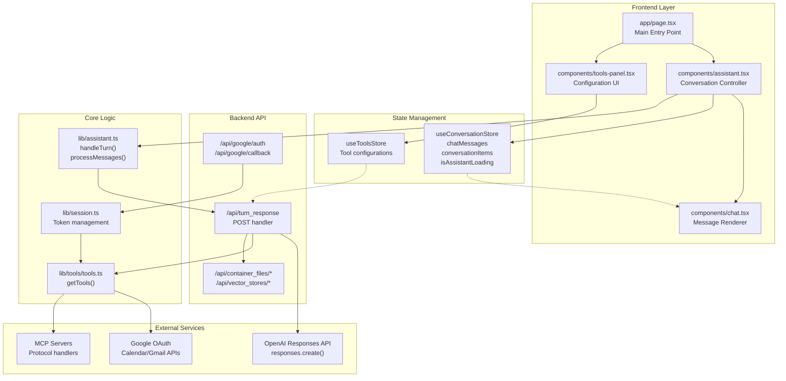
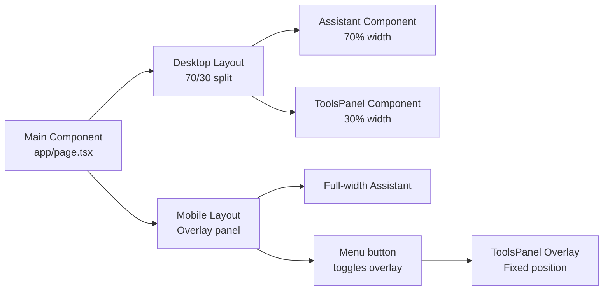
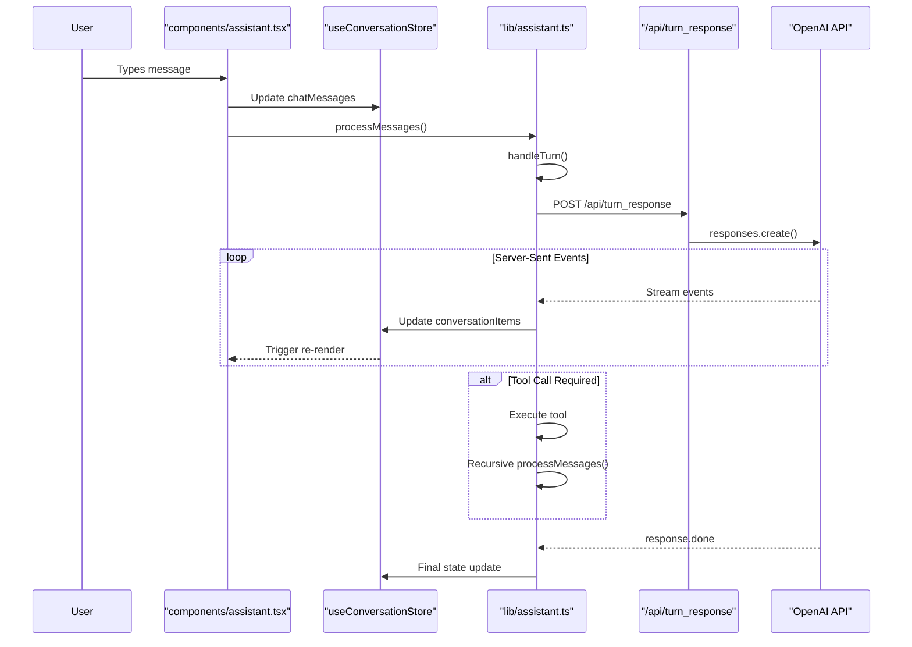
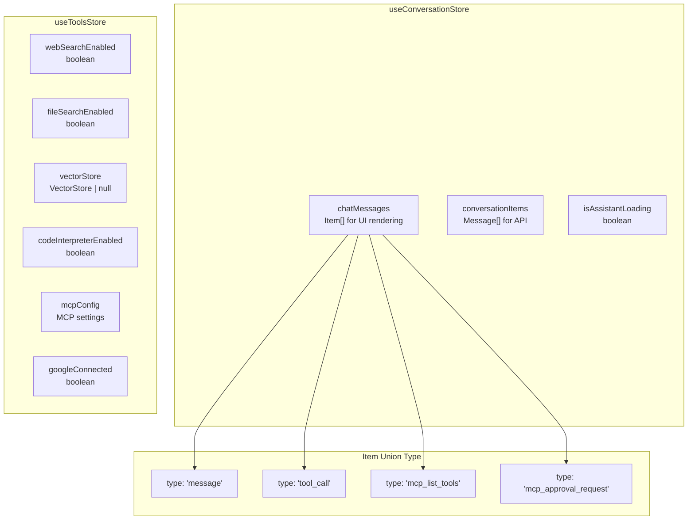
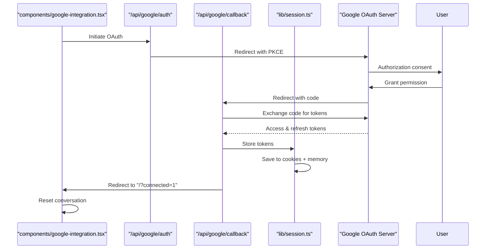

<!-- source: DeepWiki mcp.deepwiki.com · repo openai/openai-responses-starter-app · page 1 Overview · fetched 2026-10-26 -->

# Overview

<details>
<summary>Relevant source files</summary>

The following files were used as context for generating this wiki page:

- [README.md](README.md)
- [app/layout.tsx](app/layout.tsx)
- [app/page.tsx](app/page.tsx)
- [package.json](package.json)

</details>


This document provides an overview of the OpenAI Responses Starter App, a Next.js application that demonstrates integration with the OpenAI Responses API. The application showcases multi-turn conversation handling, real-time streaming, tool execution, and various integrations including web search, file search, MCP servers, and Google services.

For detailed information about specific subsystems, see:
- Installation and configuration: [Getting Started](#2)
- Conversation processing mechanics: [Core Components](#4)
- Tool configuration and execution: [Tool System](#5)
- Backend API routes: [API Endpoints](#6)

**Sources:** [README.md:1-156](), [package.json:1-53]()

## Application Purpose

The OpenAI Responses Starter App serves as a reference implementation for building conversational assistants using the OpenAI Responses API. It provides working examples of:

| Feature | Implementation |
|---------|----------------|
| Multi-turn conversations | Message history tracking with streaming responses |
| Built-in tools | Web search, file search, code interpreter |
| Custom functions | Example `get_weather` and `get_joke` functions |
| MCP integration | Model Context Protocol server configuration |
| Google connectors | OAuth-based Calendar and Gmail integration |
| UI rendering | Markdown messages, tool call visualization, annotations |

**Sources:** [README.md:7-21]()

## Technology Stack

The application is built with the following core technologies:

| Component | Technology | Version |
|-----------|-----------|---------|
| Framework | Next.js | 15.2.3 |
| UI Library | React | 18 |
| API Client | OpenAI SDK | 4.87.3 |
| State Management | Zustand | 5.0.2 |
| UI Components | Radix UI | Various |
| Markdown Rendering | react-markdown | 9.0.1 |
| Charting | recharts | 2.12.7 |
| OAuth | openid-client | 6.6.4 |

**Sources:** [package.json:11-40]()

## High-Level Architecture

The application follows a three-tier architecture with clear separation between presentation, state management, and API interaction layers.

### System Architecture Diagram



**Sources:** [app/page.tsx:1-52](), [README.md:1-156]()

## Application Entry Point

The main application is rendered through `Main` in [app/page.tsx:9-52](), which implements a responsive two-column layout:



The layout automatically adapts based on screen size, with the `ToolsPanel` becoming an overlay on mobile devices accessed via a hamburger menu. Additionally, it handles post-OAuth cleanup by checking the `connected` URL parameter and calling `resetConversation()` from `useConversationStore` [app/page.tsx:16-23]().

**Sources:** [app/page.tsx:7-52]()

## Core Data Flow

### Conversation Processing Pipeline

The application processes user messages through the following sequence:



The conversation flow uses Server-Sent Events (SSE) for real-time streaming, allowing progressive UI updates as the AI generates responses. When tools are invoked, the system executes them locally and recursively continues the conversation.

**Sources:** [README.md:12-13](), [app/page.tsx:28]()

## State Management Architecture

The application maintains two primary Zustand stores that persist across component re-renders:

### Store Structure



The `useConversationStore` maintains two parallel message collections: `chatMessages` optimized for UI rendering with rich item types, and `conversationItems` formatted for OpenAI API consumption. This separation enables the UI to display tool calls and MCP-specific content while sending clean message history to the API.

**Sources:** [app/page.tsx:7-12](), [README.md:12-18]()

## Tool System Overview

The application aggregates tools from multiple sources:

| Tool Type | Examples | Configuration |
|-----------|----------|---------------|
| Built-in OpenAI | `web_search`, `file_search`, `code_interpreter` | Enabled via `useToolsStore` |
| Custom Functions | `get_weather`, `get_joke` | Defined in `config/functions.ts` |
| MCP Servers | User-configured endpoints | MCP protocol configuration |
| Google Connectors | `goog_calendar`, `goog_gmail` | OAuth tokens via session |

The `getTools()` function aggregates these configurations into a tools array passed to the OpenAI Responses API. For details on tool configuration UI and execution, see [Tool System](#5).

**Sources:** [README.md:63-93]()

## Key Workflows

### OAuth Integration Flow

For services requiring authentication (e.g., Google Calendar and Gmail), the application implements a complete OAuth 2.0 PKCE flow:



Tokens are stored both in HTTP-only cookies (for persistence) and in-memory session storage (for server-side access). The refresh token enables automatic token renewal without user re-authentication.

**Sources:** [README.md:88-123](), [app/page.tsx:14-23]()

### Streaming Response Handling

The application uses the OpenAI Responses API's streaming capability to provide real-time updates. The `lib/assistant.ts` module processes Server-Sent Events and updates the conversation store progressively as chunks arrive.

**Sources:** [README.md:13]()

## File Organization

The codebase follows Next.js conventions with the App Router:

| Directory | Purpose |
|-----------|---------|
| `app/` | Next.js app router pages and API routes |
| `components/` | React UI components |
| `lib/` | Core business logic and utility functions |
| `stores/` | Zustand state management stores |
| `config/` | Application configuration and constants |
| `types/` | TypeScript type definitions |

**Sources:** [app/page.tsx:1-52](), [package.json:1-53]()

## Development and Deployment

The application requires Node.js and the following environment variables:

| Variable | Purpose | Required |
|----------|---------|----------|
| `OPENAI_API_KEY` | OpenAI API authentication | Yes |
| `GOOGLE_CLIENT_ID` | Google OAuth client ID | Optional |
| `GOOGLE_CLIENT_SECRET` | Google OAuth secret | Optional |
| `GOOGLE_REDIRECT_URI` | OAuth callback URL | Optional |

Available npm scripts from [package.json:5-9]():

```bash
npm run dev    # Start development server on localhost:3000
npm run build  # Create production build
npm run start  # Start production server
npm run lint   # Run ESLint
```

For detailed setup instructions, see [Getting Started](#2). For deployment considerations, see [Development and Deployment](#9).

**Sources:** [README.md:23-61](), [README.md:95-122](), [package.json:5-9]()

---

