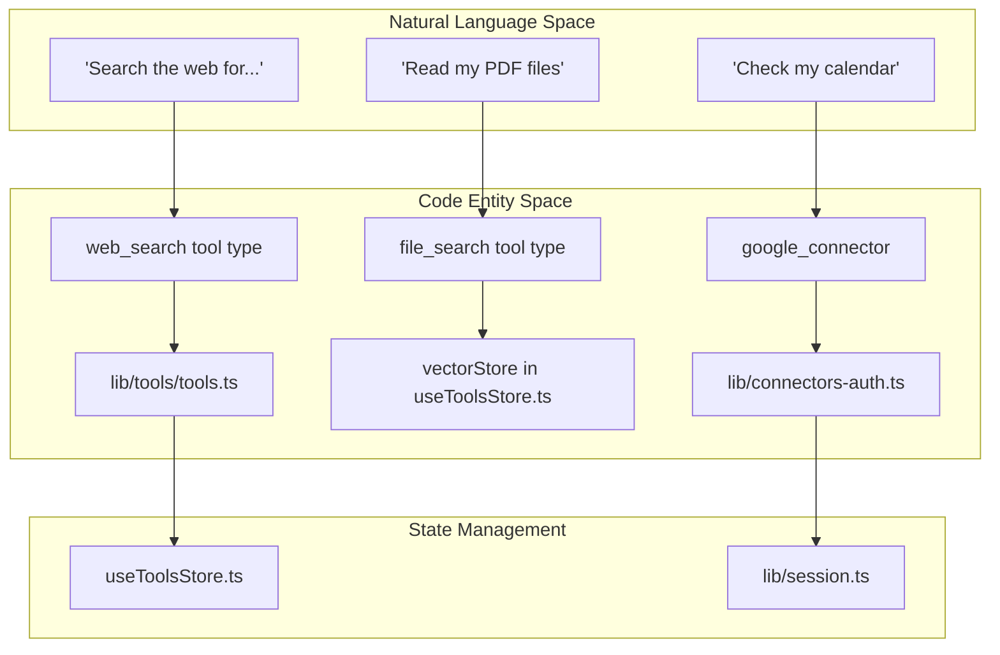
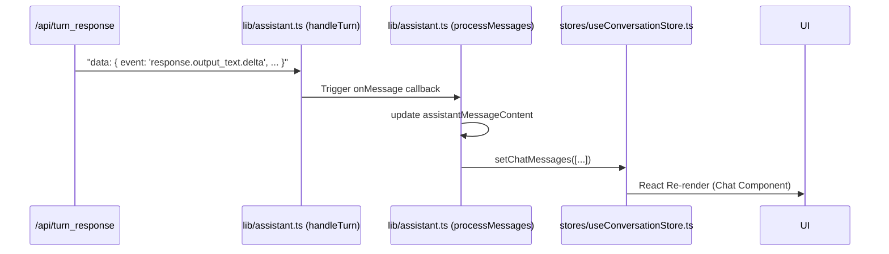

<!-- source: DeepWiki mcp.deepwiki.com · repo openai/openai-responses-starter-app · page 10 Glossary · fetched 2026-10-26 -->

# Glossary

Relevant source files

The following files were used as context for generating this wiki page:

- [README.md](README.md)
- [components/mcp-approval.tsx](components/mcp-approval.tsx)
- [components/mcp-tools-list.tsx](components/mcp-tools-list.tsx)
- [config/constants.ts](config/constants.ts)
- [lib/assistant.ts](lib/assistant.ts)
- [lib/session.ts](lib/session.ts)
- [lib/tools/tools.ts](lib/tools/tools.ts)
- [stores/useToolsStore.ts](stores/useToolsStore.ts)

This page defines codebase-specific terms, jargon, and domain concepts used within the OpenAI Responses Starter App. It provides technical definitions and maps these concepts to specific implementation details in the code.

## Core Concepts

### Responses API
The primary OpenAI API interface this application demonstrates. Unlike the standard Chat Completions API, the Responses API supports built-in tools like Web Search and File Search natively, along with persistent state management for complex turns.
*   **Implementation**: Utilized in the backend route `app/api/turn_response/route.ts` to generate assistant responses.
*   **Sources**: [README.md:7-9](), [app/api/turn_response/route.ts:1-10]()

### Item
The fundamental unit of data in the conversation stream. Items represent different types of content that can appear in the chat interface, including messages, tool calls, and UI-specific requests.
*   **Key Types**: `MessageItem`, `ToolCallItem`, `McpListToolsItem`, `McpApprovalRequestItem`.
*   **Definition**: [lib/assistant.ts:68-72]()
*   **Sources**: [lib/assistant.ts:21-72]()

### ContentItem
A sub-component of a `MessageItem`. It contains the actual payload of a message, such as text or audio, along with any associated annotations.
*   **Definition**: [lib/assistant.ts:14-18]()
*   **Sources**: [lib/assistant.ts:14-18]()

---

## Tooling & Integrations

### MCP (Model Context Protocol)
A protocol that allows the assistant to interact with external servers to list tools and execute functions. The application supports configuring a public MCP server URL and label.
*   **Config Structure**: Defined as `McpConfig` containing `server_url`, `server_label`, and `allowed_tools`.
*   **Logic**: Handled in `getTools` to append an `mcp` type tool to the OpenAI request.
*   **Sources**: [stores/useToolsStore.ts:26-31](), [lib/tools/tools.ts:72-88]()

### 1P Connectors (First-Party Connectors)
Managed integrations provided by OpenAI to connect to services like Google Calendar and Gmail.
*   **Implementation**: Enabled via `googleIntegrationEnabled` in the `ToolsState`.
*   **Authentication**: Uses OAuth 2.0 with tokens stored in a session-based `sessionStore`.
*   **Sources**: [lib/tools/tools.ts:90-94](), [lib/session.ts:8-18](), [README.md:87-94]()

### Vector Store
A storage mechanism for files used by the `file_search` tool. It allows the model to perform RAG (Retrieval-Augmented Generation) over uploaded documents.
*   **Implementation**: Managed in `useToolsStore` and passed to the API via `vector_store_ids`.
*   **Sources**: [stores/useToolsStore.ts:11-15](), [lib/tools/tools.ts:41-47]()

---

## State & Data Flow

### Conversation Store
A Zustand store that manages the lifecycle of the chat, including the list of items displayed to the user and the raw items sent to the API.
*   **File**: `stores/useConversationStore.ts`
*   **Key State**: `chatMessages` (UI representation) and `conversationItems` (API representation).
*   **Sources**: [lib/assistant.ts:138-145](), [stores/useConversationStore.ts:1-20]()

### Tools Store
A persisted Zustand store that holds the configuration for all enabled tools (Web Search, File Search, MCP, etc.).
*   **File**: `stores/useToolsStore.ts`
*   **Sources**: [stores/useToolsStore.ts:33-43]()

### Turn Response
The process of sending the current conversation state to the backend and streaming the resulting assistant items back to the frontend.
*   **Function**: `handleTurn` in `lib/assistant.ts`.
*   **Endpoint**: `/api/turn_response`.
*   **Sources**: [lib/assistant.ts:74-90]()

---

## Technical Diagrams

### Concept Mapping: Natural Language to Code Entities
This diagram bridges user-facing features to the specific classes and files that implement them.

**Sources**: [lib/tools/tools.ts:10-97](), [stores/useToolsStore.ts:33-43](), [lib/session.ts:1-18]()

### Streaming Data Flow
How raw data chunks from the OpenAI Responses API are transformed into UI components.

**Sources**: [lib/assistant.ts:97-123](), [lib/assistant.ts:156-205](), [stores/useConversationStore.ts:1-20]()

---

## Terminology Table

| Term | Definition | Code Pointer |
| :--- | :--- | :--- |
| **Developer Prompt** | The system instructions that guide the assistant's behavior and personality. | [config/constants.ts:4-25]() |
| **Annotation** | A citation or reference within a text response, often linking to a file or web source. | [lib/assistant.ts:8-12]() |
| **Tool Call** | A request from the model to execute a specific function or built-in tool. | [lib/assistant.ts:29-51]() |
| **Partial JSON** | A utility used to parse JSON arguments while they are still streaming from the model. | [lib/assistant.ts:1]() |
| **Session ID** | A unique hex string stored in a `httpOnly` cookie to track OAuth tokens for a specific user. | [lib/session.ts:4-33]() |
| **Functions Map** | A registry of client-side Javascript functions that the assistant can invoke. | [config/functions.ts:1-10]() |

**Sources**: [config/constants.ts:4-25](), [lib/assistant.ts:1-51](), [lib/session.ts:4-33]()