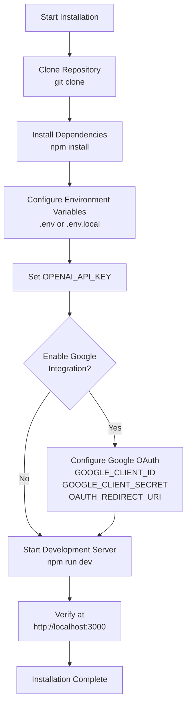
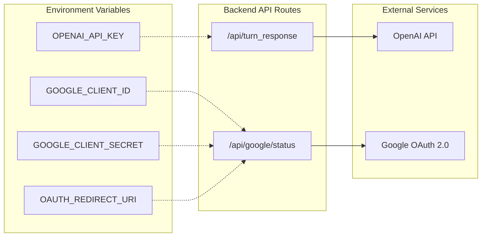
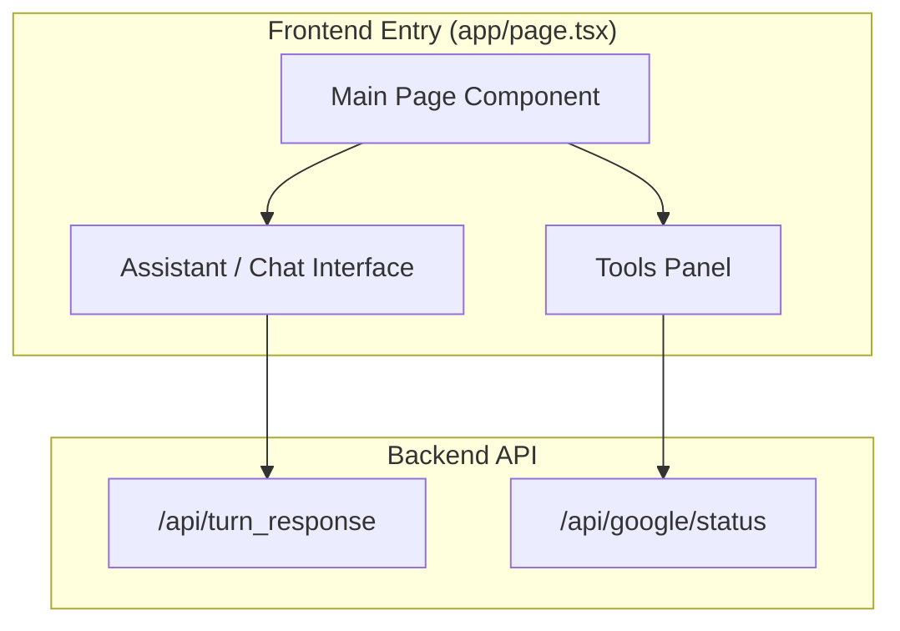

<!-- source: DeepWiki mcp.deepwiki.com · repo openai/openai-responses-starter-app · page 2 Getting Started · fetched 2026-10-26 -->

# Getting Started

<details>
<summary>Relevant source files</summary>

The following files were used as context for generating this wiki page:

- [.env.example](.env.example)
- [.gitignore](.gitignore)
- [README.md](README.md)
- [app/api/google/status/route.ts](app/api/google/status/route.ts)
- [next.config.mjs](next.config.mjs)
- [package.json](package.json)

</details>


This document provides step-by-step instructions for installing and configuring the OpenAI Responses Starter App. It covers prerequisites, installation, environment setup (API keys and OAuth), and running the development server for the first time.

---

## Prerequisites

Before installing the application, ensure your system meets the following requirements:

| Requirement | Version | Purpose |
|------------|---------|---------|
| Node.js | ≥18.17.0 | Runtime environment for Next.js [package.json:42-52]() |
| npm | ≥9.0.0 | Package manager (included with Node.js) [package.json:5-9]() |
| OpenAI API Account | - | Required for Responses API access [README.md:25-28]() |
| Google Cloud Project | - | Optional, for Google Calendar/Gmail integration [README.md:95-98]() |

**Sources:** [package.json:1-53](), [README.md:25-28](), [README.md:95-98]()

---

## Installation Process

### Installation Flow Diagram



**Sources:** [README.md:23-61]()

---

### Step 1: Clone the Repository

```bash
git clone https://github.com/openai/openai-responses-starter-app.git
cd openai-responses-starter-app
```

This creates a local copy of the application in a new directory named `openai-responses-starter-app`.

**Sources:** [README.md:41-45]()

---

### Step 2: Install Dependencies

Execute the following command in the project root directory:

```bash
npm install
```

This installs all required packages defined in `package.json`, including:

| Package | Purpose |
|---------|---------|
| `next` (^15.2.3) | Next.js framework for React applications [package.json:26]() |
| `openai` (^4.87.3) | Official OpenAI API client library [package.json:27]() |
| `zustand` (^5.0.2) | State management for tool and conversation state [package.json:40]() |
| `react-markdown` (^9.0.1) | Markdown rendering for AI responses [package.json:33]() |
| `openid-client` (^6.6.4) | OAuth 2.0 client for Google integration [package.json:28]() |

**Sources:** [package.json:1-53](), [README.md:47-53]()

---

## Environment Configuration

The application requires environment variables for API authentication and optional integrations. Configuration can be provided via project-level `.env` or `.env.local` files at the project root.

### Environment Variables Mapping

This diagram maps environment variables to the backend routes and external services that consume them.



**Sources:** [.env.example:1-5](), [app/api/google/status/route.ts:10-14](), [README.md:30-40]()

---

### Required: OpenAI API Key

The `OPENAI_API_KEY` is required for all Responses API functionality.

#### Obtaining an OpenAI API Key

1. If you don't have an OpenAI account, [sign up](https://platform.openai.com/signup) [README.md:27]().
2. Follow the [OpenAI Quickstart guide](https://platform.openai.com/docs/quickstart) to retrieve your API key [README.md:28]().

#### Configuration Options

**Option 1: Project-level `.env` file**

Create a `.env` file at the project root:

```bash
OPENAI_API_KEY=sk-proj-your-actual-key-here
```

The `.env.example` file provides a template for this configuration [README.md:35-39]().

**Sources:** [README.md:25-39](), [.env.example:1]()

---

### Optional: Google OAuth Configuration

Google OAuth enables integration with Google Calendar and Gmail via OpenAI's first-party connectors [README.md:88-91]().

#### Google Cloud Console Setup

1. **Create OAuth 2.0 Client**: Go to Google Cloud Console → APIs & Services → Credentials. Create a **Web application** client [README.md:99]().
2. **Authorized Redirect URI**: Add `http://localhost:3000/api/google/callback` [README.md:100]().
3. **Enable APIs**: Enable "Google Calendar API" and "Gmail API" [README.md:103-106]().
4. **Configure Scopes**: Ensure your app requests `openid`, `email`, `profile`, `calendar.events`, and `gmail.modify` [README.md:108-115]().

#### Configuration in `.env.local`

Create a `.env.local` file at the project root:

```bash
GOOGLE_CLIENT_ID="your-client-id"
GOOGLE_CLIENT_SECRET="your-client-secret"
OAUTH_REDIRECT_URI="http://localhost:3000/api/google/callback"
```

The `GET` handler in `app/api/google/status/route.ts` checks for these variables to determine if the system is `oauthConfigured` [app/api/google/status/route.ts:10-18]().

**Sources:** [README.md:95-122](), [.env.example:2-4](), [app/api/google/status/route.ts:10-14]()

---

## Running the Development Server

Start the application using the following command:

```bash
npm run dev
```

This executes `next dev` as defined in `package.json:6` [package.json:6](). The application will be available at `http://localhost:3000` [README.md:61]().

### Visual Verification

The application layout consists of a chat interface and a tools configuration panel.



**Sources:** [README.md:55-61](), [package.json:6](), [app/api/google/status/route.ts:5-19]()

---

## Available npm Scripts

| Command | Script Definition | Purpose |
|---------|------------------|---------|
| `npm run dev` | `next dev` | Start development server [package.json:6]() |
| `npm run build` | `next build` | Build production application [package.json:7]() |
| `npm start` | `next start` | Start production server [package.json:8]() |
| `npm run lint` | `next lint` | Run ESLint checks [package.json:9]() |

**Sources:** [package.json:5-10]()

---

