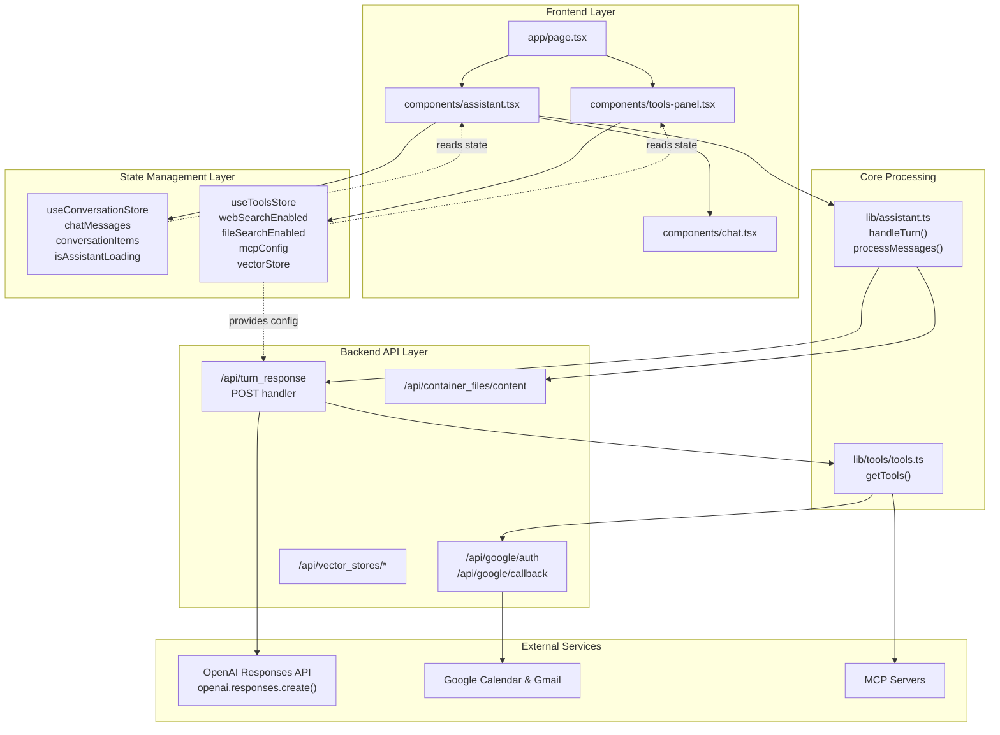
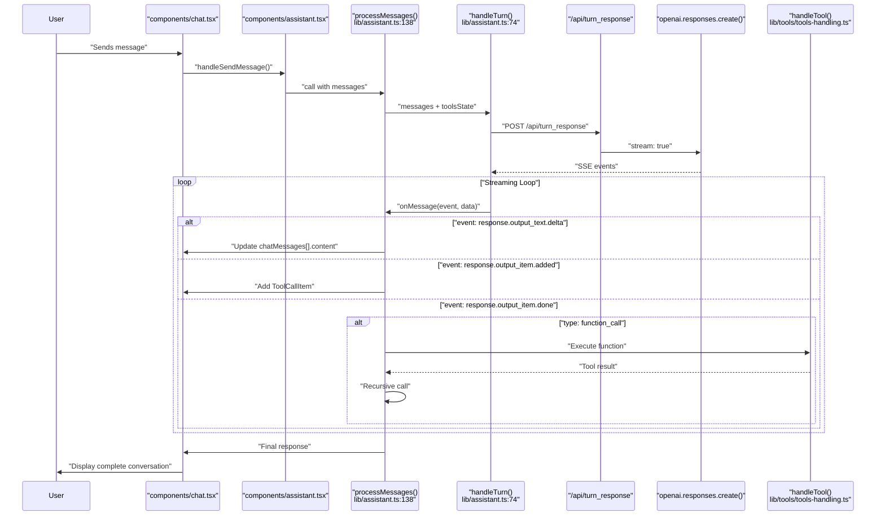
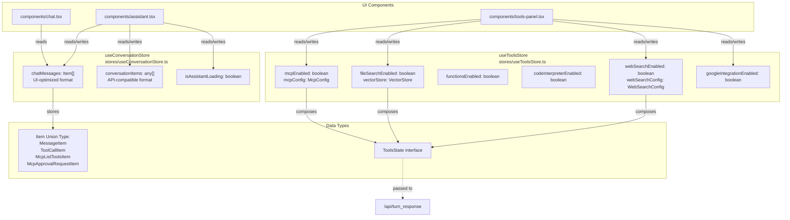

<!-- source: DeepWiki mcp.deepwiki.com · repo openai/openai-responses-starter-app · page 3 Architecture Overview · fetched 2026-10-26 -->

# Architecture Overview

<details>
<summary>Relevant source files</summary>

The following files were used as context for generating this wiki page:

- [README.md](README.md)
- [app/page.tsx](app/page.tsx)
- [components/assistant.tsx](components/assistant.tsx)
- [lib/assistant.ts](lib/assistant.ts)

</details>


## Purpose and Scope

This document provides a high-level overview of the system architecture for the OpenAI Responses Starter App, a Next.js-based conversational AI assistant. It covers the core architectural patterns, data flow, and key system interactions that enable streaming AI conversations with advanced tool integration capabilities.

For detailed information about individual components, see [Core Components](#4). For tool-specific architecture, see [Tool System](#5). For API endpoint implementation details, see [6. API Endpoints]().

## System Architecture Overview

The application implements a three-tier architecture with clear separation between the presentation layer (Next.js components), the state management layer (Zustand stores), and the backend API layer. The core orchestrator is `lib/assistant.ts`, which bridges frontend interactions with the OpenAI Responses API.

### Three-Tier Architecture Diagram



**Sources:** [lib/assistant.ts:74-136](), [lib/assistant.ts:138-159](), [app/api/turn_response/route.ts:5-63](), [stores/useConversationStore.ts:1-56](), [stores/useToolsStore.ts:1-122](), [lib/tools/tools.ts:10-97]()

## Conversation Flow and Message Processing

The core message processing flow follows an event-driven pattern where user messages trigger a streaming AI response. The system uses Server-Sent Events (SSE) for real-time updates and implements recursive processing for multi-turn tool interactions.

### Conversation Processing Sequence



**Sources:** [lib/assistant.ts:138-159](), [lib/assistant.ts:74-136](), [components/assistant.tsx:11-32](), [lib/assistant.ts:328-346]()

### Event Processing Pipeline

The `processMessages()` function implements a comprehensive event handler that processes various event types from the OpenAI Responses API. Each event type triggers specific state mutations in the Zustand stores.

| Event Type | Code Reference | Purpose | State Update |
|------------|----------------|---------|--------------|
| `response.output_text.delta` | [lib/assistant.ts:161-206]() | Stream text deltas | Updates `chatMessages[].content[].text` |
| `response.output_item.added` | [lib/assistant.ts:208-310]() | New tool call initiated | Adds `ToolCallItem` to `chatMessages` |
| `response.output_item.done` | [lib/assistant.ts:312-357]() | Tool call completed | Executes `handleTool()` for functions |
| `response.function_call_arguments.delta` | [lib/assistant.ts:359-380]() | Stream function args | Updates `ToolCallItem.arguments` |
| `response.function_call_arguments.done` | [lib/assistant.ts:382-397]() | Final function args | Sets `ToolCallItem.status = 'completed'` |
| `response.web_search_call.completed` | [lib/assistant.ts:434-443]() | Web search finished | Sets `ToolCallItem.output` |
| `response.file_search_call.completed` | [lib/assistant.ts:445-454]() | File search finished | Sets `ToolCallItem.output` |
| `response.code_interpreter_call_code.delta` | [lib/assistant.ts:456-473]() | Stream code execution | Updates `ToolCallItem.code` |
| `response.completed` | [lib/assistant.ts:508-546]() | Turn completed | Adds MCP items to `chatMessages` |

**Sources:** [lib/assistant.ts:156-552]()

## Data Flow and State Management

The application maintains conversation state through two primary Zustand stores that serve different purposes. The `useConversationStore` maintains parallel message collections for UI rendering and API communication, while `useToolsStore` centralizes tool configuration with local storage persistence.

### Dual-Store Architecture



**Sources:** [stores/useConversationStore.ts:1-56](), [stores/useToolsStore.ts:1-122](), [lib/assistant.ts:14-72]()

### State Store Details

**`useConversationStore` (stores/useConversationStore.ts)**

Maintains two parallel message arrays that serve different purposes:

| State Variable | Type | Purpose |
|----------------|------|---------|
| `chatMessages` | `Item[]` | UI-optimized format with union types for rendering |
| `conversationItems` | `any[]` | API-compatible format matching OpenAI schema |
| `isAssistantLoading` | `boolean` | Loading state indicator for UI |

The dual-array architecture allows the UI to display rich content (tool calls, MCP approval requests, loading states) while maintaining a clean conversation history for API calls.

**`useToolsStore` (stores/useToolsStore.ts)**

Centralizes all tool configuration with Zustand persist middleware for local storage:

| Configuration | Type | Default |
|---------------|------|---------|
| `webSearchEnabled` | `boolean` | `false` |
| `webSearchConfig` | `WebSearchConfig` | Location settings |
| `fileSearchEnabled` | `boolean` | `false` |
| `vectorStore` | `VectorStore \| null` | From `defaultVectorStore` |
| `functionsEnabled` | `boolean` | `true` |
| `codeInterpreterEnabled` | `boolean` | `false` |
| `mcpEnabled` | `boolean` | `false` |
| `mcpConfig` | `McpConfig` | Server connection details |
| `googleIntegrationEnabled` | `boolean` | `false` |

**Sources:** [stores/useConversationStore.ts:6-54](), [stores/useToolsStore.ts:33-120](), [lib/assistant.ts:139-148]()

### Data Flow Pattern

1. **User Input** → `Assistant` component calls `processMessages()` from `lib/assistant.ts` [components/assistant.tsx:28]()
2. **State Retrieval** → `processMessages()` reads both stores via `getState()` [lib/assistant.ts:139-148]()
3. **API Request** → `handleTurn()` sends `conversationItems` + `ToolsState` to `/api/turn_response` [lib/assistant.ts:82-90]()
4. **Streaming Response** → SSE events parsed in `handleTurn()` [lib/assistant.ts:98-136]()
5. **State Updates** → Event handlers update `chatMessages` via `setChatMessages()` [lib/assistant.ts:203]()
6. **Conversation Items** → Tool outputs appended to `conversationItems` via `setConversationItems()` [lib/assistant.ts:352]()
7. **Recursive Processing** → Function tool completion triggers recursive `processMessages()` call [lib/assistant.ts:345]()
8. **UI Rendering** → React components re-render based on Zustand state changes.

**Sources:** [lib/assistant.ts:138-552](), [lib/assistant.ts:74-136](), [components/assistant.tsx:11-32]()

## Key Architectural Patterns

### Event-Driven Processing
The core `processMessages()` function implements an event-driven architecture that processes streaming AI responses. Each event type triggers specific state updates and potential tool executions.

```typescript
// Main event processing switch in processMessages()
switch (event) {
  case "response.output_text.delta": // Text streaming
  case "response.output_item.added": // Tool calls initiated  
  case "response.output_item.done": // Tool execution trigger
  case "response.function_call_arguments.delta": // Argument streaming
  // ... other event types
}
```

**Sources:** [lib/assistant.ts:157-543]()

### Tool Integration Architecture
The system supports multiple tool types through a unified interface:

| Tool Type | Processing Pattern | Status Tracking |
|-----------|-------------------|-----------------|
| `function_call` | Local JavaScript execution via `handleTool()` | `in_progress` → `completed` |
| `web_search_call` | Built-in OpenAI tool | Status updates via events |
| `file_search_call` | Vector store queries | Status updates via events |
| `code_interpreter_call` | Python code execution | Code streaming + file output |
| `mcp_call` | External MCP server tools | Argument streaming + approval flow |

**Sources:** [lib/assistant.ts:243-305](), [lib/assistant.ts:324-343]()

### Streaming Response Handling

The `handleTurn()` function implements Server-Sent Events (SSE) processing for real-time AI response streaming. It reads the response body as a stream, processes SSE-formatted data, and invokes a callback for each parsed event.

**SSE Processing Implementation** ([lib/assistant.ts:98-136]()):

1. **Stream Reader Setup** - Creates a `ReadableStream` reader and `TextDecoder` at [lib/assistant.ts:98-100]()
2. **Buffer Management** - Accumulates chunks and splits on `\n\n` delimiters at [lib/assistant.ts:106-110]()
3. **Event Parsing** - Extracts lines starting with `data: ` and parses JSON at [lib/assistant.ts:112-122]()
4. **Callback Invocation** - Calls `onMessage({ event, data })` for each parsed event at [lib/assistant.ts:120]()
5. **Stream Termination** - Handles `[DONE]` marker and remaining buffer at [lib/assistant.ts:115-132]()

**Sources:** [lib/assistant.ts:74-136]()

## Integration Points

### OpenAI Responses API
The primary AI processing occurs through the OpenAI Responses API, typically targeting `gpt-4.1` or similar models. The API request includes the conversation history and the active tool configurations derived from `useToolsStore`.

**Sources:** [lib/assistant.ts:82-90](), [README.md:7-8]()

### Google Services Integration
Google Calendar and Gmail integration is handled through:
- OAuth flow for token management.
- Google Connectors that wrap API calls.
- MCP-style tool definitions for AI interaction.
- Fresh token retrieval with automatic refresh.

**Sources:** [lib/assistant.ts:80-89](), [README.md:87-94]()

### MCP (Model Context Protocol) Integration
The system supports external MCP servers for extended tool capabilities:
- Dynamic tool discovery and listing.
- User approval workflow for tool execution.
- Streaming argument processing.
- Tool result display and conversation integration.

**Sources:** [lib/assistant.ts:278-292](), [lib/assistant.ts:522-536](), [README.md:79-82]()

---

